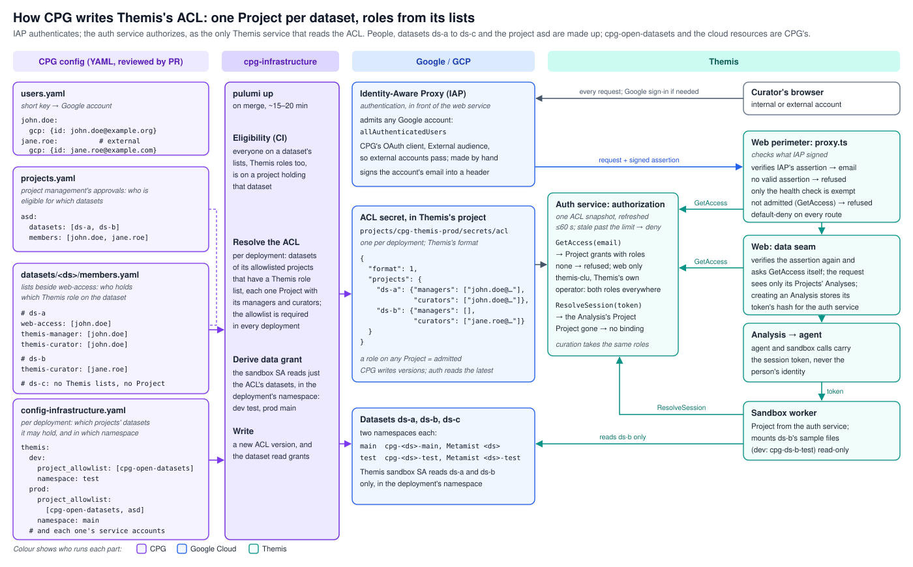
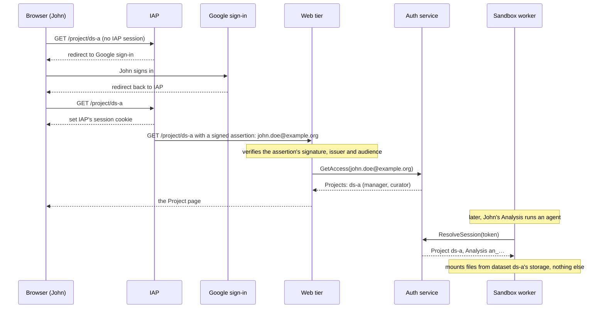
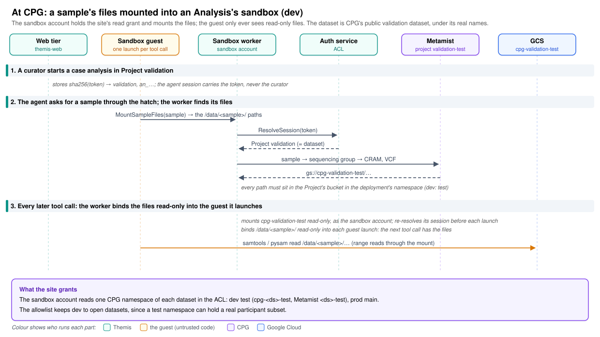

# Design: access control

**Related:** [`workspace-model.md`](workspace-model.md) (Projects, and the rule that a non-member gets "not found");
[`security.md`](security.md) (the single default-on chokepoint every critical check follows);
[`rpc-authorization.md`](rpc-authorization.md) (service callers, and the session token an agent's calls carry);
[`frontend-framework.md`](frontend-framework.md) (the web tier these checks run in);
[`spike-infrastructure.md`](spike-infrastructure.md) (the cloud setup around it).

## Overview

Themis holds data that only some people may see. A Project is one dataset together with the people who work on it, and a
person outside a Project must not even learn that it exists ([`workspace-model.md`](workspace-model.md)). Each person on
a Project holds one or both of two roles, manager and curator, which today decide what they may do on the Project's
curation surface. This doc decides how Themis learns who those people are and which roles they hold, how a request is
tied to one of them, and where the access decision is made.

Who may see which data is decided outside Themis, by whatever process governs data access at the site that deploys it.
At CPG, the one site that deploys Themis today, that process is project management, which records each approval as an
entry in `projects.yaml`: a set of datasets and the people approved to see them. CPG calls such an entry a project. It
is not a Themis Project: one CPG project can cover several datasets, and each of them can be a Project of its own.
Themis takes the outcome as one JSON document of access control lists, which this doc calls the ACL. It holds two lists
for each Project, its managers and its curators, and a person who holds a role on at least one Project is admitted to
the deployment. The ACL is the only thing Themis needs from the site, so a site can deploy Themis by producing that
document with whatever tooling it already has. Themis provides the place it goes: a secret in the deployment's own cloud
project, whose versions the site's writer may manage and read, and nothing else in the project. Each change at the site
becomes a new version of that secret, and which of Themis's components may read it stays Themis's decision.

Checking who someone is and deciding what they may reach are separate jobs, and the design gives them to separate
components. Google's Identity-Aware Proxy (IAP) authenticates. It stands in front of the web tier, admits any signed-in
Google account, and adds to every request it forwards a statement it has signed that names the account's email address;
the web tier verifies that signature before it believes the address. The auth service authorizes. It is the only Themis
service that reads the ACL, and it answers two questions: which Projects a person may reach (none means they are not
admitted), and which Project an agent's session token is bound to. Both answers come from the same copy of the ACL, so a
change to it reaches people and agents at the same moment.

The agent reads a Project's data as files. The sandbox worker, the trusted process that runs the agent's code in an
isolated guest, mounts the Project's dataset storage read-only and binds the files of a sample the agent asks for into
that guest. That flow is why a Project is one dataset, and why the site grants read on each Project's storage to the
account the worker runs as.

IAP checks very little: anyone can create a Google account, so it keeps out nobody who sets out to get in. What it does
is keep anonymous traffic, about 40% of the requests on the development deployment, from reaching any Themis code, so a
flaw in the web framework that can be exploited before login is not open to the whole internet. That protection costs
about 280 ms on every request and ties authentication to Google's proxy, and the design accepts both.

The web tier asks the auth service at both of its checkpoints on every request and keeps no answer beyond the request.
That costs internal calls, but it leaves exactly one cache, in one service, with one rule for what happens when the ACL
cannot be read: the service serves its last good copy for a bounded time and then refuses everyone.

The figure shows the whole design as CPG runs it. CPG's tooling is cpg-infrastructure, the repository whose merges
provision CPG's cloud. On every merge it turns CPG's records (the users, the `projects.yaml` approvals, each dataset's
Themis role lists and each deployment's settings) into that deployment's ACL, which it adds as a new version of the
deployment's secret, and into read grants on each listed dataset's storage. On the right are the Themis components that
read what it writes. Names and datasets in the figure are made up, apart from CPG's file names and its naming of cloud
projects and buckets.



## Background

### People, Projects and datasets

A dataset is a consented collection of samples and their metadata ([`../../GLOSSARY.md`](../../GLOSSARY.md)). A Project
is one dataset together with the people who work on it, and its id is the dataset's name.

Each person on a Project holds one or both of two roles. A manager runs the Project's curation: they register the
variants to be classified, assign curators to them and read the curators' compared answers. A curator works the
worksheets assigned to them ([`curation-surface.md`](curation-surface.md)). Either role makes a person a member of the
Project, and the members of a Project see its Analyses; nobody else does. Outside curation the two roles do not differ
yet.

Admission to the deployment follows from the roles: a person is admitted when they hold a role on at least one Project.
Admission is what the surfaces that belong to no Project need, such as the shared literature corpus. The deployment's
operator account is the one exception to the rule, described under §Programmatic callers. Take a small deployment:

| Person                 | Manager of | Curator of | Admitted |
| ---------------------- | ---------- | ---------- | -------- |
| `john.doe@example.org` | `ds-a`     | `ds-a`     | yes      |
| `jane.roe@example.com` | none       | `ds-b`     | yes      |
| anyone else            | none       | none       | no       |

John runs the curation of Project `ds-a`, which is the dataset `ds-a` and the people who work on it, and curates in it
too. Jane is an external curator on Project `ds-b`. Every other account is refused at the door.

### Authentication and authorization

Authentication establishes who is calling. Authorization decides what that caller may reach. The two fail in different
ways: a broken authentication lets someone act as another person, while a broken authorization lets a real person reach
something they should not.

People authenticate with a Google account, through IAP. A browser without an IAP session is sent to Google sign-in and
comes back with a cookie that IAP set for itself. To every request it then forwards, IAP adds a header carrying a JSON
Web Token it has signed, the assertion, which names the account's email address and its Google account id and says which
service the request was meant for. Curators often sign in with accounts from outside the deploying organisation, a
personal address or a partner institution's, so IAP admits any Google account, and admission alone decides who gets
further. A Google account does not need a Gmail address: a curator whose institution does not use Google creates one for
their institutional address.

### Two paths into the data

Data is reached on two paths. On the browser path, a person's request reaches the web tier, whose `AuthorizedBackend`
lets it touch only the Projects that person belongs to ([`workspace-model.md`](workspace-model.md) §Authorization).

On the agent path, the agent working in an Analysis calls backend services, and reads the files of its Project's samples
once the sandbox worker has mounted them. Its calls carry a session token that the web tier creates when it creates the
Analysis. The web tier stores only a hash of the token, together with the Analysis's Project, and the auth service
resolves the token back to that Project and Analysis when a service asks
([`rpc-authorization.md`](rpc-authorization.md)). The agent acts for the Analysis, never for the person who started it,
so two curators opening the same Analysis see the same evidence.

Both paths need the same facts: which Projects exist and who holds which role on them. This doc gives both paths one
source for those facts.

### Constraints

- A critical check is one implementation, enforced by default, applied at the perimeter and again where the data is
  read, and it fails closed when it cannot run ([`security.md`](security.md) §One default-on chokepoint).
- An ACL is personal data. This repository is mirrored publicly, so no ACL, and no identifier of a real person, is ever
  committed here.
- IAP's default sign-in admits only accounts of the organisation that owns the cloud project. Where external curators
  sign in, the site registers an OAuth client with an external audience and sets it on IAP. At CPG that client is
  created by hand in the Google Cloud console, because Google offers no API for creating one.

## Non-goals

- **Deciding who belongs on a Project, and in which role.** That is the site's governance, such as ethics approvals and
  data access agreements. Themis enforces the outcome and keeps no opinion on how it was reached.
- **A view of the data that depends on who is looking.** What an agent's call may see follows from the Analysis, never
  from the person driving it ([`rpc-authorization.md`](rpc-authorization.md) §What a call may see).

## Design

### A request, traced

Follow John from a fresh browser to an agent's data read.



The sign-in steps run once per IAP session. Every later request carries IAP's cookie, so IAP forwards it at once with a
fresh assertion. If John is removed from both of Project `ds-a`'s lists while he is signed in, and holds no role on any
other Project, the next `GetAccess` after the auth service picks up the change answers with no Projects, which means
"not admitted". The web tier then refuses him, although IAP still lets his requests through. His Analyses keep running,
because each acts for its Analysis rather than for John. If Project `ds-a` is removed instead, `ResolveSession` stops
resolving its tokens, and every agent working in it is refused at its next call.

### The ACL is the only input

The question is what Themis reads to learn who may see what. The obvious answer is the site's own directory: most sites
already keep groups of people, and Themis could ask whether a person is in a Project's group. That needs no new artefact
and is always current.

It fails on portability and on speed. A directory query ties Themis to one directory product and to the administrative
read access that product requires, which a site may not want to grant to an application. Membership in nested groups is
also slow to resolve. Asking a hosted directory whether one account is in one group took about half a second, whatever
the nesting depth (Appendix), and a page that lists a person's Projects needs one answer per Project.

So Themis reads a JSON document whose format it owns. Every site can produce one, and reading it is fast:

```json
{
  "format": 1,
  "projects": {
    "ds-a": {
      "managers": ["john.doe@example.org"],
      "curators": ["john.doe@example.org"]
    },
    "ds-b": {
      "managers": [],
      "curators": ["jane.roe@example.com"]
    }
  }
}
```

The ACL carries rules that the auth service checks before it uses a new version. A version that breaks any of them is
rejected whole, because a half-applied ACL is a wrong one.

- Each Project holds exactly two keys, `managers` and `curators`, and each is a list of email addresses. Either list may
  be empty, but not both.
- Every email address is lowercase, and no list names the same address twice.
- A Project's key is its id, which is the name of the Project's dataset. Analyses are stored under that id, so the
  writer keeps it stable for as long as the Project lives. Datasets have no display names, so a Project has none either,
  and the id is what Themis shows for it.
- The id is a lowercase slug of letters, digits and hyphens, such as `ds-a` or `epi-2024`. It ends up in URLs, in the
  database and, through the data path, in storage locations. A shape that all of them accept as it is keeps a name like
  `..` or `cohort/2024` from meaning something else in any of them.
- No Project key appears twice. A JSON parser would otherwise keep the last occurrence and drop the earlier one without
  a word, so the roles on a Project would depend on the order in which the writer emitted them.
- An unknown `format`, or a key the format does not define, at the top level or inside a Project, is rejected, so a
  writer that moves ahead of the reader fails loudly instead of being half understood.

The ACL becomes the registry of Projects as well as of people and their roles, so the tables that hold Projects,
memberships and curation roles in Themis's database retire. An Analysis keeps its Project id. When a Project leaves the
ACL, its Analyses stay stored but become unreachable, which is the fail-closed reading of "this Project no longer
exists".

The cost is that the ACL is a copy. A change at the site reaches Themis only when the site's tooling writes a new
version, so the delay between "approved" and "can get in" is the writer's delay plus the auth service's refresh.

### Two roles on a Project

The question is whether the ACL says only who is on a Project, or also what each person may do there. The obvious answer
is membership alone. On the workbench, every member of a Project sees the same Analyses and may start new ones, and no
decision there consults a role ([`workspace-model.md`](workspace-model.md) §Authorization).

The curation surface breaks that answer. Its blind pairs rest on a split between a manager, who registers a variant,
assigns two curators to it and reads their answers side by side, and the curators, who each answer alone and never see
the other's work ([`curation-surface.md`](curation-surface.md) §Blind pairs). That split needs a record of who holds
which role. A table of the curation surface's own would be a second record of who may do what, kept by different people
from the ACL, with nothing to keep the two in step. So the ACL lists each Project's managers and curators, and curation
is bound to Projects: every variant under curation belongs to one Project, and the people who may curate it are that
Project's. A person may hold both roles, as John does on `ds-a`.

The roles carry only the curation split for now. What else a manager may do on a Project that a curator may not is
decided once case reports exist, with the abilities they need. Until then, either role gives the same access to a
Project's Analyses.

No role reaches beyond a Project. Running the deployment, the work an instance administrator would do, goes through the
operator account (§Programmatic callers). Who may act as that account is a group that Themis's stack names in its config
and the site manages apart from the ACL: at CPG, the `themis-clu` group in `cpg-infrastructure-private`. If a surface
comes to need a person who acts across Projects without the operator account, the ACL gains a top-level list beside
`projects` under a new format version, which the site's writer and the auth service adopt together.

The cost is that the site's tooling keeps two lists per Project instead of one (at CPG, `themis-manager` and
`themis-curator` beside `web-access` in the dataset's `members.yaml`), and that changing who curates a Project goes
through the site's writer rather than a click on the curation surface.

### Authentication in front of the web tier

The question is where a login is checked. The obvious answer is the cloud's identity-aware proxy in front of the web
tier, which authenticates every request before any Themis code runs, and the design takes it. The rival worth weighing
is a login that the web tier runs itself, with OpenID Connect and a session cookie. That rival saves the about 280 ms
the proxy adds to every request (Appendix), and it works on any cloud.

It loses on what an unauthenticated request can reach. With the login in the web tier, every request meets Themis code
first: the framework's request parsing and routing, the perimeter in `proxy.ts`, and the login's own handlers. A flaw
anywhere in that code is open to anyone on the internet, and such flaws in web frameworks are found often and are
severe. Two have struck the framework Themis runs on: CVE-2025-29927 let a single request header skip the Next.js
middleware that `proxy.ts` is, and CVE-2025-55182 let an unauthenticated request run code through React Server
Components. Anonymous traffic is not hypothetical either. On the development deployment it was about 40% of all
requests, mostly probes for files such as `/.env` (Appendix). Behind IAP, none of those requests reaches the container,
and a caller who wants to exploit a flaw in the web tier first has to sign in with a Google account. That is no barrier
to a determined attacker, since anyone can create such an account, but it keeps out the automated scanning that finds
and exploits a newly published flaw within hours, and the code doing the keeping out is Google's.

IAP admits any Google account: `allAuthenticatedUsers` holds the right to pass it. Restricting it to a group would split
the record of who may reach Themis between the group and the ACL, with nothing to keep the two in step (§Alternatives
considered). Any Google account includes every service account in every cloud project, and the ACL refuses those like
any other address it does not list.

The web tier believes only the signed assertion. IAP also passes the email address in a plain header, but anything that
reaches the container could set that header, so the web tier ignores it. It verifies the assertion's signature against
Google's published keys, and checks that IAP issued it, that it has not expired, and that its audience is this web
service, so an assertion minted for another IAP-protected service is refused. The email address it then uses comes from
the verified claims. Cloud Run accepts requests to the web service only from the load balancer, and only IAP's own
service account may invoke it, so a request that reaches the container came through IAP. The assertion check holds even
if that configuration is wrong.

The web tier checks twice, as [`security.md`](security.md) requires. The perimeter in `proxy.ts` runs on every path and
denies by default. One path is exempt, the health check, because the platform's probe reaches the container directly and
carries no assertion. Every other path needs a valid assertion with an admitted caller behind it, or the request is
refused. The data seam, `userContext`, verifies the assertion again and asks `GetAccess` again where data is read. The
two checks do not share an answer, because the data seam's check exists to hold when the perimeter has been bypassed,
and so it cannot rely on what the perimeter learned. A request therefore costs up to two `GetAccess` calls.

Themis keeps no session of its own. IAP's cookie is IAP's, and the web tier learns the caller afresh from each request's
assertion. The auth service decides on every request what that person may reach, so revoking access is an edit to the
ACL: removing a person ends their access about a minute after the auth service reads the new version, however long their
IAP session still runs.

An alternative is to have the auth service verify the assertion too, so that a compromised web tier could not invent
identities. That buys nothing. The web tier is already trusted with more than identity: it calls backend services as
itself and derives the session tokens agents carry. An attacker who controls the web tier has those regardless.

The cost is the 280 ms on every request, and authentication that depends on Google's proxy. The assertion check is the
one piece of the web tier that knows about IAP; a site on another cloud would need an equivalent proxy in front, and a
verifier for that proxy's assertion. The framework also still has to stay current, because every Google account reaches
it.

### Programmatic callers

Some callers have no browser. An operator driving a deployment by hand, or the review loop that replays Analyses
([`run-review-loop.md`](run-review-loop.md)), acts as the deployment's operator service account, `themis-clu`, rather
than as a person. Such a caller cannot sign in through a browser, so it presents a short-lived token that the service
account signs through the cloud's IAM, whose audience is the web app's address. IAP accepts that token as it accepts a
person's sign-in, and forwards the request with the same kind of assertion, naming the account's email address. The web
tier therefore has one way to authenticate a caller, whoever it is.

From there the caller is treated like a person, with one difference in what `GetAccess` answers. For a person, the
answer comes from the ACL alone. The operator account is admitted to the deployment and holds both roles on every
Project in the ACL, whether or not the ACL lists it. The auth service recognises the account by its id, `themis-clu`,
which it completes into an email address with the cloud project it runs in, the same way the data plane completes every
first-party account ([`rpc-authorization.md`](rpc-authorization.md)).

The obvious design would list the operator account in the ACL like a person, so that the ACL stays the only source of
admission. Two facts break it. The first is that the ACL is the site's record of which people it has approved for which
data, while the operator account belongs to Themis. The site would have to learn the account's address in every
deployment and add it to every Project, although none of the site's approvals covers it. The second is that listing the
account would restrict nothing. On the data plane the same account is already admitted on every rpc, as the `CALLER_CLU`
principal ([`rpc-authorization.md`](rpc-authorization.md)), so a Project that the ACL left it off would be closed on the
web path and still open on the data plane. Where the account may act is therefore decided where its data-plane reach is
decided, by who may impersonate it. Themis's stack grants that right to one group, which it names in its config, and the
site manages the group's members apart from the ACL. At CPG it is the `themis-clu` group in
`cpg-infrastructure-private`, and it serves every deployment. The site never lists the account in the ACL.

The cost is that admission has a second source beside the ACL, fixed in the auth service rather than written by the
site. In production, whoever is granted the right to impersonate the operator account reaches every Project through the
web tier for as long as the grant lasts. That is the same reach `CALLER_CLU` already gives them on every data-plane rpc.

### Authorization in the auth service

The question is who reads the ACL. The obvious answer is the web tier for people and the auth service for sessions,
since the web tier already decides Project membership today. That gives two readers, one in TypeScript and one in
Python, each with its own parser, its own cache and its own idea of when the ACL last changed. For up to a cache
lifetime they can disagree: the web tier can admit someone to a Project whose agents the auth service already refuses.
Two implementations of one critical check is what [`security.md`](security.md) rules out.

So the auth service ([`themis/services/auth`](../../themis/services/auth)) is the only service that reads it, and it
answers through two rpcs that share one evaluator and one grant type, a Project as the ACL states it:

- **`GetAccess`** takes an email address and returns a grant for each Project on which the person holds a role, with the
  roles they hold there. The answer carries no separate admission flag: an empty list means the person is not admitted.
  The operator account gets both roles on every Project. Only the web tier may call it.
- **`ResolveSession`** takes a session token and returns the Analysis and the grant for its Project, with no roles,
  because an agent acts for its Analysis rather than for a person. It refuses a token whose Project is no longer in the
  ACL.

One rpc taking "an email or a token" would merge two different callers. Who may call an rpc is declared per method in
the proto ([`rpc-authorization.md`](rpc-authorization.md)). `GetAccess` must admit only the web tier, because it trusts
the email it is given. `ResolveSession` admits every data-plane service and declares no caller restriction, because it
is the rpc that admission itself is derived through. Two thin methods over one evaluator keep that declaration where the
existing design puts it.

`GetAccess` looks at first like it breaks a rule in [`rpc-authorization.md`](rpc-authorization.md): a person is resolved
from a token, never asserted in plain form. That rule protects the agent path, where calls are relayed by the sandbox
worker, a process next to model-driven code that could fabricate a plaintext claim. The web tier relays nobody's claim.
It verified IAP's assertion itself, the auth service verifies the web tier's own service identity on each call, and the
sandbox worker cannot call `GetAccess` at all.

The cost is availability and latency. When the auth service is down nobody gets in, a dependency agent calls already
have. Each checkpoint adds an internal call; whether that needs a short cache in the web tier is an open question that a
measurement settles.

### The agent reads its Project's dataset as files

The permissions in this doc exist for one flow: an agent reading a participant's files. The figure follows it on CPG's
development deployment, where a curator starts a case analysis in Project `validation`. The web tier stores the hash of
the Analysis's session token with the Project and the Analysis, and the agent's session carries the token, never the
curator. The agent's code runs in the guest, a sandboxed process with no credential and no network, launched afresh for
every tool call. Its one way out is the hatch, through which the sandbox worker forwards an allowlisted set of calls
([`sandbox-worker.md`](sandbox-worker.md)).



Through the hatch, the agent calls `MountSampleFiles` for a sample, which returns the `/data/<sample>/` paths its files
will have, and the worker does the rest. It resolves its session's Project through `ResolveSession`, so the answer comes
from the ACL as it stands at that moment: Project `validation`, which is the dataset `validation`. It asks the site's
sample registry where the sample's files are. At CPG the registry is Metamist, which maps the sample to its sequencing
group and that to its CRAM and VCF files.

The worker then checks that every file sits in the Project's dataset storage, in the storage tier this deployment reads,
and refuses the whole request if any file lies anywhere else. Each deployment reads one tier of every dataset. At CPG a
tier is a dataset's namespace: `main` or `test`, each with a bucket and a Metamist project of its own
(`cpg-<dataset>-main` and `<dataset>`, or `cpg-<dataset>-test` and `<dataset>-test`). The development deployment reads
`test`, so it asks Metamist's `validation-test` project, and every path it gets back must lie under
`gs://cpg-validation-test/`. <!-- screen-ignore: public, non-sensitive CPG names, kept as the worked example -->

Once the check passes, the worker mounts the dataset's storage read-only, as the sandbox account, and binds the sample's
files into the guest at `/data/<sample>/`. A guest launch reads its binds when it starts, so the files appear from the
agent's next tool call, and the agent reads them with ordinary tools such as `samtools`, whose range reads go through
the mount. Throughout, only Themis's own services and the trusted worker read storage. The guest never holds a
credential for it.

The permissions follow from this flow:

- **A Project is one dataset** because a dataset's storage is what the worker mounts. The check that every file sits in
  the Project's storage needs the Project to name exactly one storage location. A Project over several datasets would
  need a mount and a check for each.
- **The site grants read on each Project's dataset storage, in the deployment's tier, to Themis's sandbox account**, the
  account the worker runs as, because the worker is what mounts. A separate account for data would add a credential
  without narrowing who reads, since the worker would still be the process holding the mount. At CPG, the merge that
  writes a deployment's ACL also grants the sandbox account read on exactly that ACL's datasets, in the deployment's
  namespace.
- **A deployment reads one tier of each dataset**, such as the test tier for development and the main tier for
  production. A test tier can still hold a real subset of participants, so the tier alone cannot keep participant data
  out of a deployment that must not hold it. The site's allowlist of datasets does that: a dataset left out of the
  development deployment's ACL is not a Project there, and nothing in development mounts it. At CPG the allowlist is
  each deployment's `project_allowlist` of `projects.yaml` projects, and development's names only `cpg-open-datasets`,
  the project of CPG's open datasets.

The mount acts for the Analysis, as the rest of the agent path does, and ignores who holds which role. Before each guest
launch that binds a sample's files, the worker resolves its session again, so removing Project `validation` from the ACL
stops the mounts from the agent's next call: the token no longer resolves. Removing the curator who started the Analysis
does not, because its agent never acted for them.

### One copy of the ACL, failing closed

The auth service loads the ACL when it starts and refuses to start without a valid one. It then checks for a new version
about once a minute, validates it, and swaps it in whole. Both rpcs answer from whichever copy is current, so within one
instance of the service there is never a moment where one rpc sees the new ACL and the other the old. Instances refresh
independently, so two of them can disagree for up to a minute.

The obvious rule for a failed read is to deny at once, which is safe but brittle: a hiccup of a few seconds in Secret
Manager would lock everyone out. Trusting the last good copy forever is the opposite failure, because a removed person
would stay in for as long as the reads keep failing. The service does both in turn. It keeps answering from the last
good copy, and once that copy is older than a staleness limit, it refuses every request until a valid version loads. A
new version that fails validation is treated the same way as an unreadable one, and raises an alert, because the writer
has published something wrong.

Take two cases. Secret Manager is unreachable for two minutes: requests keep working on the copy from before the outage.
The writer adds a version in which one member's address has capital letters: the version is rejected, the previous copy
stays in force, and the alert names the rule it broke.

The last good copy lives in the memory of a running instance. An instance that starts while the latest version is
invalid has nothing to fall back on and refuses to start, so if no instance is running when a bad version is added (the
service scales to zero when idle), the next request finds the service down until the writer adds a valid one. An
instance that refuses to start logs the same rejection that the alert matches on a running instance, so a refused cold
start raises the alert too. Keeping an instance running at all times would close the gap, and so would a fallback at
start to an earlier version, which the writer would then have to keep. Neither is worth its cost while the alert reaches
the writer and a fix is one corrected version.

The cost is that a removal takes up to a minute to apply in normal operation, and cannot apply at all during an outage
until the limit is reached; and that a bad version can stop the service outright when no instance holds a good copy.

### The site writes the ACL into a secret Themis owns

Themis never writes the ACL. The site's own provisioning writes it, for every deployment, because that tooling already
knows who holds which approvals and can derive the ACL from its own records. The place the ACL goes is Themis's to
provide. Each deployment's stack creates a Secret Manager secret named `acl` in the deployment's own cloud project, and
writes no version of it. The stack grants read access on that one secret to the auth service's account. It grants the
management and reading of the secret's versions to one account that the site names in the deployment's config, the
site's writer. On every change, the writer adds the ACL as a new version of the secret, and the auth service reads the
latest version through Secret Manager's API.

Themis owns the secret because who may read the ACL is a decision about Themis. The ACL names every person admitted to
the deployment and the data each of them may see, and the auth service is meant to be the only Themis service that reads
it (§Authorization in the auth service). The one other Themis account that can read it is the deploy account, which
administers every secret in the stack as it administers the rest of the deployment. With the secret in Themis's project,
who reads it is decided by grants in Themis's own infrastructure, where a reviewer of Themis sees them, and a test of
the stack fails when any other account gains a role that reads secrets. The site's grant is narrow, and it is declared
on Themis's side. The writer may add, read, disable and destroy the versions of this one secret, and nothing else in the
project, so it reads only what it writes. The account that holds the grant is named in Themis's stack config, so a
change of writer is a reviewed change to Themis's config. The writer needs to destroy versions as well as add them,
because a writer that replaces the ACL on every run, as CPG's does, removes the version it replaced.

A secret version holds at most 64 KiB, and that bounds the ACL. In compact JSON, one role entry is an email address with
its quotes and a comma: an institutional address such as `firstname.lastname@populationgenomics.org.au` takes 47 bytes
that way. At about 48 bytes per entry, a version holds roughly 1,300 entries, where a person counts once for each role
on each Project. Secret Manager refuses a larger version when the writer adds it, so an ACL that has outgrown the secret
fails at the site, where it can be fixed, and the auth service needs no size limit of its own. CPG's writer checks the
size before it deploys, so the failure comes even earlier there.

The cost is an ordering on a fresh deployment. The auth service refuses to start without a valid ACL, and the secret
exists only once Themis's stack has created it. The first deploy therefore runs in three steps: a deploy of Themis's
stack limited to the secret, the auth service's account and the grants on the secret, then the site's writer adding the
first version, and then the rest of Themis's stack. Storage that the site owns would need no such ordering
(§Alternatives considered). The stack also protects the secret against deletion, because a re-created secret starts
empty and Themis admits nobody until the site's writer adds a version again.

At CPG, cpg-infrastructure is the writer, and the figure at the top of the doc follows it. A CI check requires everyone
on a dataset's Themis role lists to be on a `projects.yaml` project that holds the dataset, so nobody gets a role on
data that project management has not approved them for. On merge, cpg-infrastructure resolves each deployment's ACL from
the datasets of the projects that deployment may hold, and makes every dataset with a non-empty role list a Project. It
adds the ACL, as compact JSON, as a new version of the secret that its config names for the deployment
(`projects/cpg-themis-prod/secrets/acl` for production). It runs as CPG's deploy account, which each Themis stack names
as its writer. The deploy reads back each version it adds and bills that read to Themis's project, so Themis's stack
also grants CPG's deploy account the right to bill API calls there (`serviceUsageConsumer`), a role that lets it see the
project's enabled APIs, quotas and list of monitoring time series, but read no data. CPG grants the auth service
nothing.

Each deployment has its own secret, and so its own ACL. Enabling a Project in development is therefore a separate
decision from enabling it in production. That matters because development is the looser environment: an operator there
may act as any session, so a Project over consented data belongs in production only, while one over public data can be
enabled in both. Making that call is the site's, at the point where it decides which deployments a Project appears in.

The obvious alternative is for development to write its own ACL, with a small tool for the maintainers to add versions
to its secret. Development changes would then take effect without the site's review and deploy cycle. That speed is
worth little, because Projects and their members change rarely, and it would cost a second writer with its own
validation. With one writer, development also exercises the same path production relies on. A site with no provisioning
tooling can add versions however it likes, by hand with the cloud's command-line tool if need be; the auth service's
validation is the check either way.

Local runs use the fixture backend. There is no IAP locally: a configured development user stands in for the caller, and
the fixture's ACL is seeded the way the rest of the fixture is.

## Alternatives considered

- **A separate list of admitted people beside the Projects' role lists.** It could admit a person who is on no Project,
  such as a curator who only uses the curation surface. It lost because at a site it only repeated the union of the
  Project members, so each person had two places to be kept in step, and an ACL in which they disagreed had to be
  rejected. The cost is that a person who only curates has to be a curator on some Project. At a site, that is a Project
  over public data.
- **A Project that draws on several datasets, with a dataset free to feed several Projects.** One Project could then
  hold work that spans cohorts, such as an ASD review over cases from two of them, without a dataset assembled for it
  first. It lost because a site approves access per dataset. Every member of a Project over several datasets has to hold
  an approval for each of them, so the writer of the ACL would have to check each member list against several datasets'
  approvals, again whenever a member or a dataset changes. With one dataset per Project, the site's list of who may
  reach a dataset becomes the Project's member list unchanged, and the grant carries no list of datasets that could
  drift from it. Work across datasets then needs a dataset assembled for it, or separate Projects under the
  cross-Project rules of [`workspace-model.md`](workspace-model.md).
- **The web tier running the login itself, with nothing in front of it.** It would use OpenID Connect through a
  certified client library, keep a session cookie signed by a key the cloud's key management service holds, and accept
  cloud-issued ID tokens from service accounts. It saves the 280 ms on every request and depends on no cloud's proxy. It
  lost because every request, anonymous ones included, would meet Themis code before anyone was authenticated, so a flaw
  in the framework would be open to the whole internet until it was patched (§Authentication in front of the web tier).
- **IAP restricted to a group in the cloud's directory.** It would keep accounts that hold no role away from even the
  web tier's admission check. It lost because the group would be a second record of who may reach Themis, kept by
  different people from the ACL, with nothing to keep the two in step; and every external curator would have to be added
  to it by hand as well as to the ACL.
- **An authenticating proxy container beside the web tier, such as oauth2-proxy.** It would keep anonymous traffic away
  from Themis code without a cloud product, by admitting any account and leaving the rest to the ACL. It lost because
  the proxy would be a container we deploy and patch ourselves, so a flaw in it would be ours to find in time, and its
  recent critical advisories cluster in the matching of paths that skip authentication.
- **Signed access tokens minted by the auth service and verified by the web tier.** The web tier would need no call per
  request. It lost because token verification, refresh and key rotation would move into the web tier, and a removal
  would wait for the token to expire.
- **The ACL in storage the site owns.** The site would write the ACL to a bucket or a secret in its own cloud project,
  grant the deployment's auth service read access, and Themis's config would name the location. Themis's stack would
  create nothing for the ACL, and a fresh deployment would need no ordering: the site writes first, and Themis's first
  deploy finds the ACL in place. It lost because who may read the ACL would then be decided in the site's IAM policy,
  out of sight of anyone reviewing Themis. A read grant that the site added to a second Themis account, say the web
  tier's while debugging, would break the rule that the auth service is the only Themis service that reads it, and
  nothing in Themis would show it (§The site writes the ACL into a secret Themis owns).
- **A bucket in the deployment's project instead of a secret.** Themis's stack would create the bucket and grant the
  site's writer write access to it. The ACL would then have no 64 KiB ceiling. It lost on the preference of CPG, the
  first site. CPG's provisioning already hands configuration to its services as JSON secrets, so a secret is what its
  tooling and its reviewers expect. CPG's software team also considers write access to a bucket easier to widen by
  accident than access to one secret.
- **Cloud Run handing the secret to the auth service.** Cloud Run can expose a secret's latest version to a container as
  an environment variable or a mounted file, so the service would need no Secret Manager client of its own. It lost
  because the read would then happen in the platform, outside the code that bounds a read's time, keeps the last good
  copy when a read fails, and logs the line the alert matches (§One copy of the ACL, failing closed).

## Open questions

- **The cost of the web-tier call.** The latency of a `GetAccess` call from the web tier has not been measured. If two
  calls per request prove too slow, a cache of a few seconds in the web tier bounds both the cost and the delay it adds
  to a removal.
- **Pinning the Google account id.** An email address can outlive its holder's tie to an institution. Recording the
  account id that the assertion carries at a person's first request, and refusing a later request with the same email
  and a different id, would close that gap.
- **How the worker makes the mount.** The dataset's storage can be a volume declared on the sandbox job, or a mount the
  worker makes itself when a sample is asked for. The first leaves the mounting to the platform, while the second mounts
  only what a session uses.
- **A sample file outside its Project's storage.** The worker refuses a request whose files the registry places anywhere
  else. If such samples turn out to be common, the alternative is to widen the grant to cover where they lie, which
  widens what the sandbox account can read.
- **The staleness limit.** It should be long enough to ride out a Secret Manager outage and short enough that a stale
  ACL is not trusted for long. A value in the tens of minutes is the starting point.

## Appendix: measurements

All from the development deployment on 2026-10-19.

| What                                                                                    | Result                             |
| --------------------------------------------------------------------------------------- | ---------------------------------- |
| Proxy overhead per request: load balancer latency minus container latency, 580 requests | p50 280 ms, p90 294 ms, p99 322 ms |
| A request the proxy rejected before it reached the container                            | p50 180 ms                         |
| Anonymous requests among 1,000 load-balancer log entries over five hours                | 403, mostly probes for `/.env`     |
| Hosted-directory check "is this account in this group", including nested groups         | 420–520 ms warm p50                |

The directory measurement ran from a laptop in Australia. A request that only received an authentication error also took
about 590 ms, so the time is spent inside the provider rather than on the network, and running closer would help little.
