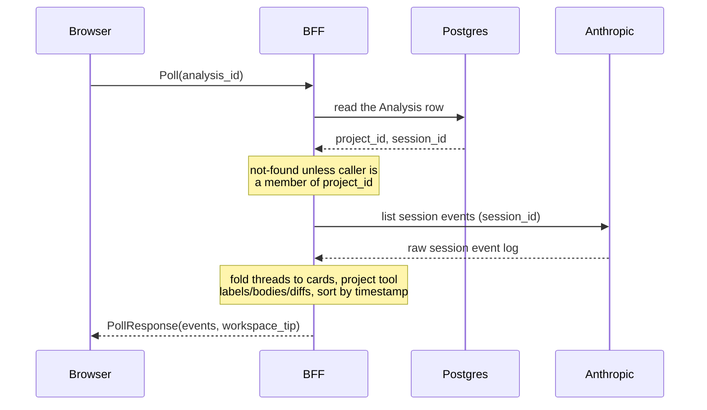
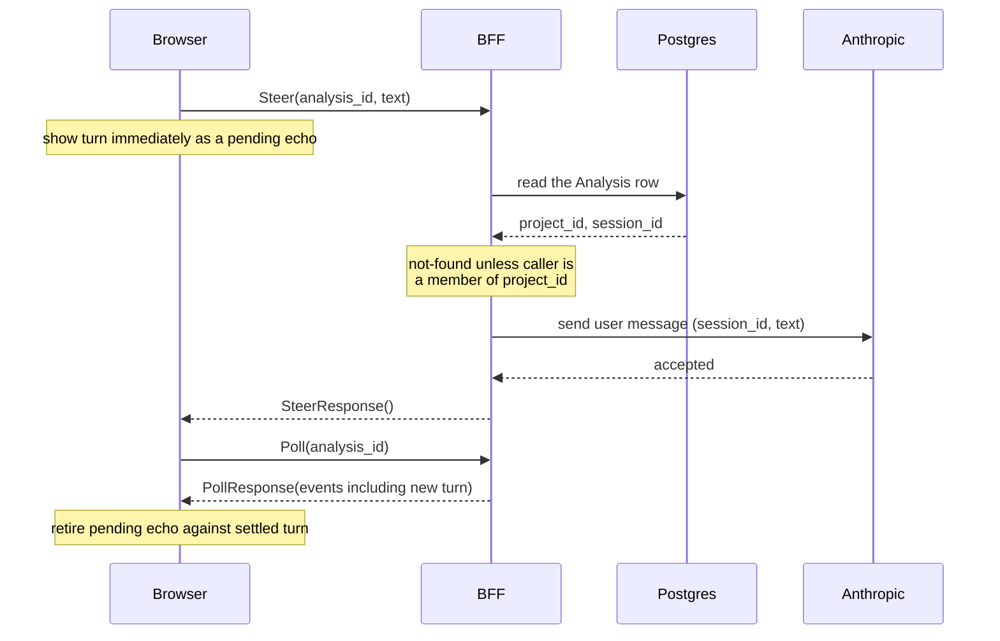

# Design: the conversation view

**Related:** [`document-pane.md`](document-pane.md) (conversation region layout and dock edges);
[`frontend-framework.md`](frontend-framework.md) (session polling, Connect RPC seam, and query caching);
[`workbench-navigation.md`](workbench-navigation.md) (the Analysis page that hosts this view);
[`workspace-model.md`](workspace-model.md) (turn model and Project-scoped authorization);
[`agent-runtime.md`](agent-runtime.md) (coordinator and sub-agent thread topology);
[`managed-agents.md`](managed-agents.md) (Anthropic session lifecycle); [`analysis-scenarios.md`](analysis-scenarios.md)
(how the kickoff prompt is rendered); [`agent-output-rendering.md`](agent-output-rendering.md) (tool rows, diffs, syntax
highlighting, and forward compatibility); [`proto.md`](proto.md) (wire format and compatibility gate).

## Overview

The conversation region on the Analysis page is where a curator watches the agent work and steers the run. Because
Anthropic Managed Agents already records every event in the session, storing a second copy of the conversation in our
own database would create two transcripts that can drift apart whenever projection rules change or a write fails midway.

Instead, the web tier's backend-for-frontend (BFF) stores no turns, tool calls, or tool results. On every poll, the BFF
reads the session's event log from Anthropic and projects it into the display stream that the browser renders. Each
sub-agent thread that the coordinator spawns folds into a single collapsible card in the coordinator's stream, and the
BFF fetches that thread's own event log (`GetThread`) only when the curator expands the card. A curator acts on the
session through two mutations: sending a plain-text steering turn (`Steer`) and halting the current step (`Interrupt`).
Both mutations return an empty response, leaving the poll as the single authority on what the conversation contains.

How individual agent outputs are drawn (tool call labels, file replacements, syntax-highlighted source blocks, and
unknown enum values from newer server builds) is covered by [`agent-output-rendering.md`](agent-output-rendering.md).
This document covers what the conversation stream contains, how the BFF projects it from the session log, and how a
curator steers or interrupts the run.

## Background

Anthropic runs the agent loop and holds the durable record of every run ([`managed-agents.md`](managed-agents.md)). One
Analysis corresponds to one Anthropic **session**. Inside a session, the **coordinator** runs on a root thread and
delegates subtasks to **sub-agent threads**, each with its own conversation history and tool calls
([`agent-runtime.md`](agent-runtime.md)). Every **turn** (one contribution to the conversation from the curator or the
agent; [`workspace-model.md`](workspace-model.md)), tool call, tool result, and thread status change is appended to the
session's **event log**. When a sub-agent works, Anthropic **cross-posts** its tool calls and thread status events onto
the coordinator's stream with a marker naming the sub-agent's thread ID, while keeping the sub-agent's prose narration
on the sub-agent's own thread. That cross-posting lets a reader of the coordinator's stream see that a delegation
happened and where it stands without reading the sub-agent's thread (see the
[Appendix](#appendix-what-the-event-stream-actually-delivers) for the exact upstream event shapes).

The web tier holds no open connection to Anthropic for the duration of a run
([`frontend-framework.md`](frontend-framework.md) §Session observation). While an Analysis page is open, the browser
polls the **BFF** (the Next.js server layer that holds the Anthropic credential and authorizes every browser request) on
a fixed interval. On each **tick** (one poll call and the full stream it returns), the BFF pages the upstream event log
and computes a **projection** ([`apps/web/src/server/adapters/live/`](../../apps/web/src/server/adapters/live/)): the
ordered list of display events that the browser renders. Computing that projection involves **folding** several raw log
events into a single stream item, such as pairing a tool call with its later result or collapsing all events for a
spawned sub-agent thread into one **card**. The BFF returns the entire projected stream on every tick, and the browser
replaces its cached list by event ID rather than appending incremental deltas. Any change to how the BFF projects the
log therefore appears on screen on the next tick without client-side merge state.

## Non-goals

- **Direct document editing in the conversation view.** A curator contributes by sending turns; the working document has
  one writer, the agent ([`workspace-model.md`](workspace-model.md)).
- **Client-settled turns.** The browser never commits a sent turn into the conversation stream on its own. A turn
  becomes part of the stream only when a poll tick carries it back from the session log.
- **Structured steering payloads.** A steering turn carries plain prose (§[`Steer`](#steer)); the agent extracts any
  clinical or classification decisions from that prose and records them in the working document.
- **Steering or interrupting a sub-agent directly.** As in Claude Desktop, the curator talks only to the coordinator.
  Sub-agents are delegations managed by the coordinator; if a curator wants a sub-agent redirected, they ask the
  coordinator, which can message the sub-agent thread.

## Design

### The surface

The conversation region ([`apps/web/src/components/workbench/`](../../apps/web/src/components/workbench/)) renders a
vertical event stream above a pinned message composer, docked to one of the main window's four edges beside the tab area
([`document-pane.md`](document-pane.md)). Every item in the projected stream is one of five kinds:

```
┌─ conversation region ───────────────────────────────────────────┐
│  I'll start from the ClinVar record, then the frequencies.      │ ← narration: agent prose, markdown
│                       ┌───────────────────────────────────────┐ │
│                       │ Ignore the two one-star submissions.  │ │ ← curator turn: right-aligned bubble
│                       └───────────────────────────────────────┘ │
│  ▸  read the ClinVar submissions for NM_001382309.1:c.332del    │ ← tool row, collapsed: the label only
│                                                                 │
│  ▾  classify the frameshift against SVCv4                       │ ← tool row, expanded
│     ┌──────────────────────────────────────────────────────┐    │
│     │ from themis import svcv4                             │    │ ← the body: the call's own text, highlighted
│     │ svcv4.evaluate(transcript, hgvs_c)                   │    │
│     └──────────────────────────────────────────────────────┘    │
│     ┌──────────────────────────────────────────────────────┐    │
│     │ PVS1 met (LOF, NMD-predicted)                        │    │ ← the result: never highlighted
│     └──────────────────────────────────────────────────────┘    │
│                                                                 │
│  ▾  revise the PVS1 paragraph of the working document           │ ← tool row whose body is a replacement
│     ┌──────────────────────────────────────────────────────┐    │
│     │   PVS1 applies at Very Strong.                       │    │ ← a diff, drawn from kinded lines:
│     │ - The transcript is MANE Select.                     │    │   no signs on the wire, never highlighted
│     │ + The transcript is MANE Select (NM_001382309.1).    │    │
│     └──────────────────────────────────────────────────────┘    │
│                                                                 │
│  ▸  SUB-AGENT  draft the frequency paragraph     (  idle   )    │ ← sub-agent card, collapsed: badge,
│                                                                 │   what it was asked, where it stands
│  ▾  SUB-AGENT  check gene–disease validity       (  done   )    │ ← sub-agent card, expanded
│     │  Read ClinGen's validity classification for this gene.    │ ← the thread's own stream, fetched
│     │  ▸  fetch the ClinGen gene–disease record                 │   on expand: its instruction, its
│     │  Definitive, last evaluated 2023-06.                      │   narration, its tool rows
│                                                                 │
│  ┌───────────────────────────────────────────────────────────┐  │
│  │ REFUSED  cyber                                            │  │ ← refusal: where a turn stopped,
│  │ This request triggered restrictions on violative cyber …  │  │   the policy category and upstream's
│  └───────────────────────────────────────────────────────────┘  │   explanation
│                                                                 │
│                       ┌───────────────────────────────────────┐ │
│                       ┊ Also check the splice predictions.    ┊ │ ← a sent turn, echoed until the
│                       └───────────────────────────────────────┘ │   poll carries it back
├─────────────────────────────────────────────────────────────────┤
│  [ Write a message…                             ]  [ ■ ]  [ ↑ ] │ ← composer, inside the region
└─────────────────────────────────────────────────────────────────┘
```

Alignment and styling distinguish the two speakers without avatars or per-turn speaker labels: agent narration renders
left-aligned without a frame, and curator turns render in right-aligned cream bubbles. The kickoff prompt that starts a
run ([`analysis-scenarios.md`](analysis-scenarios.md)) is sent to the session as an ordinary user message event, so it
appears at the top of the stream as the first curator bubble.

How tool rows and file replacements are projected and drawn (their intent labels, expandable bodies, syntax
highlighting, and diff line markers) is specified in [`agent-output-rendering.md`](agent-output-rendering.md).

### What is stored where

| Store                         | What this surface keeps there                                                                                                                                                                                                                                                                                                                                  |
| ----------------------------- | -------------------------------------------------------------------------------------------------------------------------------------------------------------------------------------------------------------------------------------------------------------------------------------------------------------------------------------------------------------- |
| Anthropic's session event log | The conversation itself: every curator turn, agent narration, tool call, tool result, and sub-agent thread. That log is the transcript; the BFF relays and projects it on demand without keeping a copy.                                                                                                                                                       |
| Postgres (`analysis` row)     | The session ID, the Project ID that gates access, and the scenario inputs. Written once when the Analysis is created. Every RPC here reads the row to check Project membership and resolve the `session_id`, but none of these methods reads the scenario inputs: those are read at create (to render the kickoff) and by the surfaces that name the Analysis. |
| GCS                           | Nothing for the conversation stream. The working document lives in the Analysis repository in sheaf's bucket, and each poll response carries that repository's branch tip, which the document pane uses to sync its local copy.                                                                                                                                |

Keeping the transcript solely in Anthropic's event log has two consequences. First, if the platform needs an archive of
conversations in our own storage, that archive belongs to a separate session-mirroring job rather than a side write in
the conversation UI ([`analysis-scenarios.md`](analysis-scenarios.md) §"The kickoff text is rendered, not stored").
Second, because the BFF stores no projected events of its own, our database can never disagree with the session log:
changing how the projection folds or labels events immediately updates every past and current Analysis on the next poll.

### The four methods

Four RPC methods on the `Workbench` service
([`workbench.proto`](../../schema/proto/themis/workbench/rpc/workbench.proto)) drive this surface. Every method is an
HTTP `POST` carrying its protobuf request message as proto3-JSON ([`proto.md`](proto.md), bucket 2), and every method
passes through the point-access authorization check in [`workspace-model.md`](workspace-model.md) §Authorization.

#### `Poll`

While the Analysis page is open and visible, the browser calls `Poll` on a fixed interval.

In response, the BFF loads the `Analysis` row from Postgres, verifies that the caller belongs to the Analysis's Project,
and runs two reads in parallel: it pages the session's event log from Anthropic (projecting the raw events into
`ConversationEvent` items) and reads the workspace repository's ref document from sheaf to report `workspace_tip`.
Neither store is written.



Authorization uses the point-access check in [`workspace-model.md`](workspace-model.md) §Authorization: if the Analysis
does not exist or the caller is not a member of its Project, the BFF returns not-found so a non-member cannot tell
whether the Analysis exists. The `session_id` is read from the authorized database row, never passed by the client.

When the response arrives, the browser replaces its event list by `id`. Because Anthropic's event log offers no
incremental `since` cursor and tool call bodies are not truncated
([`agent-output-rendering.md`](agent-output-rendering.md) §"The projection decides how a tool call looks"), the `Poll`
response grows linearly with the length of the run. Switching to incremental fetching is tracked in
[`frontend-framework.md`](frontend-framework.md) §Open questions.

#### `GetThread`

When a curator expands a sub-agent card, the browser calls `GetThread` with `analysis_id` and the card's `thread_id`.

In response, the BFF authorizes access to `analysis_id` through the same point-access check, then reads Anthropic's
thread event listing scoped to the resolved row's `session_id` and the requested `thread_id`. Passing the row's
`session_id` scopes the lookup to the caller's own session: if a caller supplies a guessed `thread_id` from another
session, Anthropic looks for it inside the authorized session and reports that the thread does not exist, which the BFF
maps to not-found. The BFF projects the thread's events using the same projection pipeline as the coordinator's stream,
so tool rows render identically and the coordinator's opening instruction projects to a `user` turn at the top of the
thread body.

While the expanded card's status is `RUNNING`, the browser refetches `GetThread` on the poll interval; once the card
transitions to `IDLE`, `REFUSED`, or `DONE`, refetching stops. Because `GetThread` reuses the `ConversationEvent`
message type, the wire schema permits a `sub_agent` variant inside a thread response, even though the runtime forbids
sub-agents from spawning further sub-agents ([`agent-runtime.md`](agent-runtime.md)). If a thread body ever contains a
`sub_agent` event, the client throws an error rather than rendering a nested card and triggering recursive fetches.

#### `Steer`

When a curator types a message in the composer and submits it, the browser calls `Steer` with `analysis_id` and `text`.

In response, the BFF authorizes `analysis_id`, verifies that `text` is non-blank, and sends a user message event to the
Analysis's existing Anthropic session (the same event type used to seed the session with its kickoff prompt). The BFF
writes nothing to Postgres or GCS and returns an empty `SteerResponse`.



The empty response is deliberate: if `Steer` returned the newly created event, the client would have a second path for
inserting turns into the stream beside `Poll`. Returning nothing forces the browser to show the turn as a temporary
pending echo and wait for the next `Poll` tick (triggered immediately on mutation success) to settle it
(§[A sent turn is echoed until the poll carries it](#a-sent-turn-is-echoed-until-the-poll-carries-it)).

A steering request carries plain prose rather than structured fields such as a pathogenicity tier or ACMG evidence code.
If `SteerRequest` carried structured fields alongside the text, those fields would create a second home for decisions
that belong in the working document, and the working document would stop being the one artifact. Keeping `Steer`
prose-only means the agent must read the curator's instruction and commit the resulting change to the workspace
repository itself.

#### `Interrupt`

When a curator clicks the stop button in the composer, the browser calls `Interrupt` with `analysis_id`.

In response, the BFF authorizes `analysis_id` and sends an interrupt event to the session. Anthropic closes any
in-flight tool call with an error result and transitions the session to idle. If the session is already idle, Anthropic
treats the interrupt as a no-op, so the stop button requires no client-side busy gating and can safely race a step that
is just finishing.

On success, the browser immediately invalidates the `Poll` query so the halted tool call and idle state appear without
waiting out the full poll interval. The client tracks `Interrupt` errors separately from `Steer` errors so a failed stop
never masquerades as a failure to send the curator's draft turn. Unlike `Steer`, `Interrupt` has no typed refusal of its
own: every failure from the halt propagates and is masked as an internal error
(§[What a failure means](#what-a-failure-means)).

### What a failure means

The four RPCs touch the upstream session in two ways: `Poll` and `GetThread` are the **read leg**, while `Steer` and
`Interrupt` are the **send leg** ([`apps/web/src/server/adapters/live/`](../../apps/web/src/server/adapters/live/)). The
same upstream error carries different meanings on the two legs.

When Anthropic reports that a session or thread does not exist on the read leg, the BFF maps it to not-found. A browser
tab polling a session that was deleted upstream, or requesting a `thread_id` that does not exist in the session, has
asked for a missing resource. On the send leg, however, the BFF has already loaded the `Analysis` row from Postgres and
verified the caller's Project membership, and the adapter methods (`steerAnalysis` and `interruptAnalysis`) take that
resolved `Analysis` row rather than an ID so the authorization gate and the send cannot be reordered or separated. If
Anthropic rejects `Steer` or `Interrupt` as missing, our database row names a session that Anthropic does not know
about, which is an internal data inconsistency. Because our RPC error interceptor does not log not-found responses,
mapping a send-leg missing-session error to not-found would silently discard the curator's turn without leaving a server
log entry. The send leg therefore lets that error propagate as an unhandled fault, which the interceptor logs and masks
as an internal error.

One send-leg rejection is an expected operational state rather than a fault: when a session has a tool call in flight,
Anthropic rejects user message events because a mid-step session accepts only tool results or an interrupt. The BFF
catches that specific rejection and returns failed-precondition with a fixed human-readable message rather than exposing
upstream's internal event IDs. The composer displays an alert telling the curator to wait for the current step to finish
or stop it first. Because that alert describes a live condition, the client clears it automatically as soon as a newer
`Poll` snapshot arrives with no tool call awaiting a result, or when the curator clicks stop.

### The stream carries five kinds of line, ordered by their stamps

Each `ConversationEvent` ([`workbench.proto`](../../schema/proto/themis/workbench/models/workbench.proto)) wraps a
`kind` oneof over five variants (`assistant`, `user`, `tool`, `sub_agent`, and `refusal`) so the payload type is tied to
its variant in the schema. Agent narration, sub-agent card summaries, and curator turns all render through the shared
markdown component, which strips raw HTML and keeps external links inert
([`agent-output-rendering.md`](agent-output-rendering.md) §"Agent text never becomes markup or a request").

The BFF orders the projected stream before returning it. If the server left ordering to the client, every consumer would
have to invent a fallback position for events that Anthropic returns without a timestamp, and two consumers of the same
`PollResponse` could order the stream differently. In practice, only user message events sent by the BFF can arrive
without a timestamp. During projection, an unstamped event inherits the timestamp of the event immediately preceding it;
if a run of unstamped events appears at the very beginning of the log before any stamped event, those leading events
inherit the first timestamp that follows them. For example, if the kickoff turn arrives unstamped ahead of an agent
message stamped `2024-01-01T00:00:05Z`, the kickoff inherits `2024-01-01T00:00:05Z` rather than defaulting to the Unix
epoch. The BFF writes that inherited timestamp into `occurred_at` on the wire and sorts the stream by timestamp while
preserving the upstream listing's relative order among events that share a timestamp, so any consumer sorting the
serialized stream by `occurred_at` reproduces the server's order. The ordering promise is that and no more—sorted by
timestamp, with the listing's relative order preserved between equal timestamps. It is the strongest claim available,
with the tiebreak leaning on the listing arriving near-ascending (see the
[Appendix](#appendix-what-the-event-stream-actually-delivers)).

### A spawned thread folds to one card

When the coordinator spawns a sub-agent thread, the coordinator's stream could either show every cross-posted event from
that thread individually or collapse the thread into a single summary item. Showing individual events and grouping them
on the client breaks down for two reasons: sub-agent narration is not cross-posted to the session-scope log at all (only
tool uses and status events are), and a thread's status changes and summary reply arrive long after the thread is
created, which would force the browser to re-fold the event list on every tick.

Instead, the BFF folds each spawned thread into a single `SubAgent` card. Before projecting the stream, the BFF scans
the raw log to identify every spawned thread (any thread ID named by a thread-creation or thread-message-sent event) and
collects three values for each thread:

1. **`prompt`**: the text of the first instruction message addressed to that thread.
1. **`summary`**: the text of the latest reply message returned from that thread.
1. **`status`**: the display state derived from the thread's latest status event.

During the main projection pass, the BFF emits the `SubAgent` card at the position and timestamp of the first log event
that references that thread ID (whether that first event is thread creation, the instruction message, a cross-posted
tool call, or a status event) and ignores all subsequent events for that thread at session scope. Pinning the card to
the thread's first event keeps the card anchored where the delegation began rather than sliding down the stream as the
sub-agent works. When the coordinator spawns several sub-agents in a row, the conversation pane groups adjacent
sub-agent cards with tighter vertical spacing so a parallel fan-out reads as a single step.

The upstream thread status events map to four `SubAgentStatus` values on the card:

| Upstream event                         | Card status | Meaning for the curator                                                                                                     |
| -------------------------------------- | ----------- | --------------------------------------------------------------------------------------------------------------------------- |
| *(none yet)*, running, or rescheduled  | `RUNNING`   | The sub-agent is working (including when it has just been created or is retrying after a transient reschedule).             |
| idle (`stop_reason.type != "refusal"`) | `IDLE`      | The sub-agent has returned its reply to the coordinator and is waiting for another instruction.                             |
| idle (`stop_reason.type == "refusal"`) | `REFUSED`   | The sub-agent stopped because its turn was refused under the Usage Policy (§[below](#a-refused-turn-is-a-line-of-its-own)). |
| terminated                             | `DONE`      | The sub-agent thread has terminated.                                                                                        |

If a stale browser tab receives a `SubAgentStatus` value added in a newer deploy, proto3-JSON decodes the unrecognized
enum name to `0` (`UNSPECIFIED`), which the card renders as a neutral `unknown` badge
([`agent-output-rendering.md`](agent-output-rendering.md) §"A value the tab's build does not know draws as unknown").

Both `prompt` and `summary` are `optional string` fields on `SubAgent`. Leaving `prompt` unset until the coordinator's
instruction event lands lets the card distinguish a thread that has been created but not yet instructed from a thread
whose instruction event arrived with empty text blocks.

When a curator expands a card, two layout rules avoid redundant or missing text:

- The expanded card does not render a separate header block for `prompt`, because the first event in the `GetThread`
  body is already the coordinator's instruction rendered as a `user` bubble.
- The card header keeps `summary` visible when expanded (clamped to three lines when collapsed, unclamped when
  expanded), because a sub-agent's own thread log contains its closing reply only if the sub-agent also emitted an agent
  message with that text. Hiding `summary` on expand would make the reply disappear whenever a sub-agent returned
  without narrating; showing the text twice when it did narrate is the safer trade-off.

### A refused turn is a line of its own

When a model response is refused under Anthropic's Usage Policy, the turn halts without emitting an agent message
explaining why; the preceding narration looks like any normal pause. Because retrying will not clear a policy refusal,
the curator must either rephrase the request or handle that part of the analysis outside the agent. The projection
therefore emits a dedicated `Refusal` row at the point where the turn stopped, displaying the policy category and
explanation from upstream.

Anthropic signals a refusal on an idle status event by setting `stop_reason.type` to `"refusal"` with optional
`stop_details` (`category` and `explanation`). Every thread emits its own thread-idle events: the coordinator runs on
the **root thread** (the initial thread that is never created by a thread-creation event or addressed by a
thread-message event), and each sub-agent runs on its own spawned thread. In addition, the session as a whole emits a
session-idle event, but only after every thread in the session has gone idle. A coordinator refusal can therefore appear
in the log either on both the root thread's idle and the session's idle, or on the root thread's idle alone if a
sub-agent is still running:

```
Case 1: coordinator refused, no sub-agent running
  root thread   thread_status_idle (stop_reason: refusal)  → emits Refusal row
  session       status_idle        (stop_reason: refusal)  → suppressed (same turn)

Case 2: coordinator refused while a sub-agent is still running
  root thread   thread_status_idle (stop_reason: refusal)  → emits Refusal row
  sub-agent     thread_status_idle (stop_reason: end_turn) → reply wakes root thread
  root thread   thread_status_running
  (session never emits status_idle for the refused turn)
```

Case 1 was observed in production sessions; Case 2 is why the BFF cannot rely on the session-level idle event alone. The
projection emits a coordinator `Refusal` row from the root thread's refused idle event and suppresses the matching
session-level idle until the root thread runs again, using the session-level idle only as a fallback if a log ever
contains a session-level refusal with no preceding root-thread idle.

For a spawned sub-agent thread, a refused thread-idle event surfaces in two places: at session scope it sets the card's
status badge to `REFUSED` so the curator sees which delegation stopped without opening every card, and at thread scope
(`GetThread`) it emits a `Refusal` row at the bottom of the sub-agent's stream with the category and explanation.

Even if upstream leaves `stop_details` null, a refused idle event still emits a `Refusal` row with fallback placeholders
for the missing category or explanation. The `category` field travels as a plain `string` rather than a protobuf enum so
a browser build that predates a new upstream policy category still displays its name. The `explanation` renders as plain
text rather than markdown because our markdown renderer strips clickable links, whereas upstream's refusal explanation
includes a documentation URL the curator may need to read.

### A sent turn is echoed until the poll carries it

Because up to one poll interval can pass between `Steer` and the next `Poll` tick, waiting for the poll before showing a
sent turn would make the composer feel unresponsive. Instead, as soon as the curator submits a turn, the browser appends
a pending echo bubble at the bottom of the stream, marked both visually (with a dashed border and muted opacity) and for
assistive technology (`aria-busy`) so neither a greyscale display nor a screen reader mistakes an unconfirmed echo for a
settled turn.

Because Anthropic mints the event ID on the server and `Poll` replaces the entire stream by ID, the browser cannot match
a pending turn to its settled `ConversationEvent` by ID. Instead, the client matches pending turns by exact text against
a baseline count recorded when the turn was sent:

```
1. Stream already has 1 settled user turn with text "Check ClinVar."
2. Curator sends "Check ClinVar." again → enqueued with baseline = 1.
3. Next Poll arrives:
   - If stream still has 1 "Check ClinVar." turn → surplus is 1 - 1 = 0 → echo stays visible.
   - If stream now has 2 "Check ClinVar." turns  → surplus is 2 - 1 = 1 → echo retires during render.
```

When multiple pending turns share the same text, reconciliation computes the surplus against the oldest surviving
pending turn's baseline and retires matching turns oldest-first, so a failed send between two identical turns never
double-counts an earlier server event. Reconciliation runs synchronously during render rather than in a post-render
effect so the browser never paints a frame showing both the pending echo and the newly arrived settled bubble side by
side.

The composer stays enabled while a turn is in flight so a curator can send a follow-up thought without waiting for the
first turn to settle. It is disabled only before the first `Poll` resolves, because the client cannot record a valid
baseline count before the existing stream has loaded. If `Steer` fails, the pending echo is removed and its text is
restored to the draft (prepended ahead of any text the curator has typed in the meantime). Both the draft text and the
pending turn list live alongside the poll state rather than inside the composer component, so docking the conversation
region to a different window edge remounts the composer without losing a half-written message. Inside the composer,
`Enter` (or `⌘↵`) sends the turn and `Shift+Enter` inserts a newline.

### Offline, the same projection drives the surface

When the web app runs offline against the fixture backend
([`apps/web/src/server/adapters/fixture/`](../../apps/web/src/server/adapters/fixture/)), the scripted run passes raw
tool call names and inputs through the same projection and diff functions that the live Anthropic adapter uses, rather
than returning hand-constructed `ToolCall` view models. Offline screenshots and local development therefore exercise the
real projection code.

When a curator sends a steering turn against the fixture backend, the adapter splices the curator's `user` turn and a
follow-up agent stage into the scripted timeline at the point the run had reached when the turn arrived, allowing
steering and pending-echo retirement to be tested offline.

## Alternatives considered

- **Per-event thread attribution with client-side grouping** (instead of folding each sub-agent thread to one card on
  the server). This presumes the poll carries each thread's events, which it must not: a sub-agent's narration is not at
  session scope at all, so there would be nothing to attribute. It also moves the fold onto the client, which then
  redoes it on every poll tick.
- **A separate protobuf message type for `GetThread` events** (omitting the `sub_agent` variant). A thread's own stream
  still needs the `user` variant for the coordinator's opening instruction, `assistant` for narration, `tool` for tool
  calls, and `refusal` for policy refusals. Defining a second almost-identical union would duplicate every future stream
  change; throwing on the client if `sub_agent` ever appears inside a thread body enforces the single-level delegation
  rule without duplicating the schema.
- **Displaying a per-thread token count on the collapsed sub-agent card.** Token usage for a sub-agent thread is
  available only by reading that thread's own event listing (the session-scope usage spans carry no `thread_id`), and
  `GetThread` is called only when a curator expands a card. Showing token counts only on cards the curator happened to
  expand would make unexpanded cards look free.
- **Returning the minted event ID from `Steer` to match the pending echo.** The event ID list on the Anthropic SDK's
  send response is optional, and if the response omits the ID, the BFF cannot fail the `Steer` RPC without tricking the
  curator into resending a turn that already landed. Supporting ID matching would still require text-count matching as a
  fallback, leaving two reconciliation paths of which the fallback is rarely exercised.
- **Waiting for the next poll without a pending echo.** Without an immediate echo, pressing `Enter` leaves up to a full
  poll interval of blank feedback, and a failed send would either vanish silently or require restoring text that never
  visibly left the composer.
- **Disabling the composer while `Steer` is in flight.** Blocking input until the mutation resolves would simplify
  mutation callback handling, at the cost of preventing a curator from typing a second instruction while the first is
  being sent.
- **Writing a sent turn directly into the query cache as a settled event.** The next poll tick would overwrite the cache
  entry anyway, and in the meantime the UI would present an unconfirmed turn as part of the durable session record.
- **Structured fields on `SteerRequest`** (such as a pathogenicity tier or ACMG code alongside the prose). Beyond
  creating a second, divergent home for values that belong in the working document, a tag vocabulary is its own drift
  surface, and a parser's failure mode is a silent misparse rather than a refusal.

## Open questions

- **Opening a long sub-agent thread in a pane instead of inline.** Expanding a sub-agent card currently renders its
  `GetThread` stream inline inside the coordinator's conversation stream, which keeps the sub-agent's work next to the
  delegation that spawned it without introducing another tab type. If sub-agent transcripts grow too long for inline
  reading, opening the thread as a tab in the document pane area ([`document-pane.md`](document-pane.md)) can reuse the
  same `GetThread` RPC without a wire change.
- **Surfacing session termination in the composer.** `PollResponse` does not currently carry a session-level status
  field, so the composer cannot distinguish an active session from a terminated one. If a curator steers a session that
  has permanently terminated, the send fails and surfaces as a generic error with the draft restored
  (§[What a failure means](#what-a-failure-means)). Adding a session status field to `PollResponse` would let the
  composer disable itself and state that the run has ended.
- **Rendering agent thinking blocks.** The projection currently drops thinking events, showing only prose narration and
  tool calls. Adding a thinking variant to `ConversationEvent.kind` is an additive schema change if curators need to
  inspect the model's intermediate reasoning.

## Appendix: what the event stream actually delivers

The Anthropic SDK documents two cross-posting rules: `session_thread_id` on a tool-use event marks it as *"cross-posted
from a subagent's thread … empty on the thread's own events"*, and `session.thread_status_*` events are *"emitted on the
thread's own stream and cross-posted to the primary stream"*. The remaining behaviors below were established empirically
against production Managed Agents sessions and determine how
[`apps/web/src/server/adapters/live/`](../../apps/web/src/server/adapters/live/) projects the log:

- **The session-scope listing is the coordinator's root thread listing, not a union of all threads.** Its event IDs
  match the root thread's listing. Sub-agent narration and thinking never appear at session scope, so the BFF does not
  need to filter sub-agent narration out of the coordinator's stream, and each `Poll` tick requires only a single
  session-scope read.
- **A sub-agent's tool uses are cross-posted onto the session-scope listing** under the same event ID and carry
  `session_thread_id`. The session-scope projection skips any tool use with a non-empty `session_thread_id` (using it
  only as a fallback trigger to place the sub-agent's card) so sub-agent tool calls do not appear as the coordinator's
  own work.
- **A sub-agent's tool results cross-post to session scope as separate records** with their own event IDs and no
  `session_thread_id` marker, referencing the originating call via its tool-use ID. Pairing tool results to tool calls
  therefore stays within whichever single listing (`Poll` or `GetThread`) is being projected.
- **Every sub-agent thread reports the coordinator's own agent name.** Because every entry in the coordinator's roster
  of delegates is a copy of the coordinator ([`agent-runtime.md`](agent-runtime.md)), the upstream agent-name field
  distinguishes nothing and is omitted from the wire schema and UI.
- **The root thread emits thread-status events of its own, but is never created or addressed as a sub-agent thread.**
  Defining a spawned thread as one that was created or addressed ensures the root thread never folds into a sub-agent
  card.
- **The thread-scope listing accepts no `order` parameter**, unlike the session-scope listing. It returns events in
  ascending timestamp order in practice, but because the API does not guarantee that order, the projection sorts both
  listings explicitly by timestamp and fold position. This is also why the ordering promise above is only as strong as
  it is: a listing delivered wholesale-descending, which nothing has produced, would invert its equal-timestamp blocks.
- **An upstream listing can deliver the same user-role event twice.** In production sessions, user message events can
  appear a second time without a timestamp in a detached block, and which events duplicate varies across listings of the
  same session. The projection folds a listing to one record per event ID (an ID already seen is that same event, never
  a second turn) and keeps the stamped delivery for its timestamp and position.
