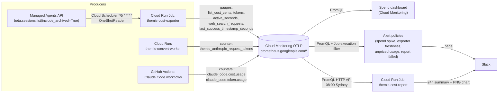

# Cost monitoring

**Related:** [Claude API WIF runbook](../runbooks/claude-api-wif.md) (how workloads exchange GCP identities for
Anthropic tokens), [Deployment](deployment.md) (GitHub-to-GCP Workload Identity Federation and deploy service account
reach), [Agent runtime](agent-runtime.md) (how the CLI drives Managed Agents sessions and writes session traces),
[Evidence full-text](evidence-fulltext.md) (the PDF convert worker that calls the Messages API directly),
[PR screenshots](pr-screenshots.md) (why Pulumi grants use predefined IAM roles rather than custom roles)

## Overview

Themis spends money on Anthropic in three places: Managed Agents sessions for the research agents, synthesizer, and
critic; the PDF convert worker, which calls the Messages API (`messages.stream` with `claude-sonnet-5`) directly for
page OCR; and Claude Code workflows in GitHub Actions for the review bot, the doc garden, and merge follow-ups. Without
client-side cost telemetry, only the monthly invoice sees all three together. Anthropic's server-side usage and cost
report endpoints cannot fill this gap for an automated service, because they require an organization-admin key
(`sk-ant-admin...`) that spans every workspace in the organization and cannot be minted through Workload Identity
Federation.

Each producer therefore exports its own usage to Cloud Monitoring in the environment's GCP project through OpenTelemetry
(`OTLPMetricExporter` targeting Google Cloud's OTLP endpoint `https://telemetry.googleapis.com:443`, which writes
`prometheus.googleapis.com/<name>/gauge` and `prometheus.googleapis.com/<name>/counter` series). Where a producer's
surface reports list-price dollars directly—Managed Agents on each `Session.usage.list_cost` field and Claude Code in
its built-in OpenTelemetry cost counter—we export those dollar figures as the headline spend, because neither can be
reconstructed from aggregate token counts alone. A session's cost includes container runtime and web searches alongside
tokens, and a Claude Code turn's cost depends on whether that individual request crossed the 200k-token context tier.
Only the convert worker lacks a provider dollar figure, so it exports a request-token counter and the Pulumi program
([`infra/themis_infra/cost_prices.py`](../../infra/themis_infra/cost_prices.py)) multiplies those token counts by a
static price table when rendering PromQL queries.

From those Cloud Monitoring series, the Pulumi program
([`infra/themis_infra/cost.py`](../../infra/themis_infra/cost.py)) builds three operator surfaces: a single 12-column
Cloud Monitoring dashboard (`Themis — Anthropic Cost`) covering all three producers, four alert policies that page Slack
on a 30-minute spend spike, a silent session exporter, unpriced convert-worker usage, or a failed morning report job,
and a scheduled Cloud Run Job (`themis-cost-report`, `0 8 * * *` `Australia/Sydney`) that posts a 24-hour hourly spend
chart and summary to Slack whenever the workspace spent money in the prior 24 hours.

## Background

### Why we cannot read Anthropic's billing API

Anthropic exposes organization-level usage and cost endpoints (`/v1/organizations/usage_report/messages` and
`/v1/organizations/cost_report`), but both sit behind an organization-admin key (`sk-ant-admin...`). That key has
administrative reach across every workspace in the organization and cannot be minted short-lived through Workload
Identity Federation (see the [Claude API WIF runbook](../runbooks/claude-api-wif.md)).

Workloads in Themis instead authenticate to Anthropic by exchanging a GCP service account identity for a short-lived
workspace token (`workspace:developer` or `workspace:inference`). Workspace tokens can run models and list resources
inside a single workspace, but cannot read organization billing reports. Observing spend without holding a long-lived
org-admin secret therefore requires reading usage from the workspace's own API surfaces and callers.

### The three Anthropic spenders

Themis makes billable Anthropic calls across three execution surfaces:

1. **Managed Agents sessions** ([`agent-runtime.md`](agent-runtime.md)): Workloads create and drive sessions on the
   Managed Agents service (`v1/sessions`). While a session runs and after it finishes,
   `beta.sessions.list(include_archived=True)` returns typed `Session` objects with `session.agent.name` and cumulative
   `session.usage`. The typed `usage` object carries `list_cost` (whole-cent USD `BetaManagedAgentsCost`),
   `active_seconds`, `server_tool_use.web_search_requests`, `input_tokens`, `output_tokens`, `cache_read_input_tokens`,
   and `cache_creation` split into `ephemeral_1h_input_tokens` and `ephemeral_5m_input_tokens`.
1. **The PDF convert worker** ([`evidence-fulltext.md`](evidence-fulltext.md)):
   [`themis/litcache/anthropic_ocr.py`](../../themis/litcache/anthropic_ocr.py) is the only place in the codebase that
   calls the Messages API directly (`client.messages.stream(...)` using `_MODEL = 'claude-sonnet-5'`), running page OCR
   outside any Managed Agents session. Each completed stream yields a final message carrying `usage` (`input_tokens`,
   `output_tokens`, `cache_read_input_tokens`, and `cache_creation_input_tokens`), `model`, and `stop_reason` (while a
   stream interrupted mid-flight records tokens seen so far under `stop_reason='unfinished'`).
1. **Claude Code in GitHub Actions**: Outside the Python codebase, `.github/workflows/internal-review.yml` and companion
   workflows run Claude Code in GitHub Actions. Claude Code ships with built-in OpenTelemetry support
   (`CLAUDE_CODE_ENABLE_TELEMETRY=1`) that emits two cumulative counters per process: `claude_code.token.usage`
   (labelled by `model` and `type`) and `claude_code.cost.usage` (labelled by `model`, in USD), configured via the
   action's `settings.env` block (including `"OTEL_METRICS_INCLUDE_RESOURCE_ATTRIBUTES": "false"` so resource attributes
   such as `service.namespace` stay on `prometheus_target` rather than being duplicated onto metric labels).

### How a Managed Agents session is priced

Calling `beta.sessions.list(include_archived=True)` returns all `Session` objects in the workspace—including archived
sessions—regardless of which machine started them or whether a caller crashed mid-run. Every session created by Themis
carries `session.agent.name` inline, and `session.usage` exposes `list_cost` (cumulative list-price cost in whole USD
cents), `active_seconds`, and `server_tool_use.web_search_requests` directly on the typed SDK model
(`anthropic>=0.96.0`).

A session's `list_cost` is the sum of three distinct charges:

- **Container runtime**: `usage.active_seconds` billed at `$0.08` per session-hour (`8¢/h`, or
  `active_seconds / 3600 * 8` cents).
- **Web searches**: `usage.server_tool_use.web_search_requests` billed at `$10` per 1,000 searches (`1¢` per search).
- **Tokens**: `Session.usage` reports session-wide token totals across the whole run. It does not break tokens down by
  model when a session switches models or spawns subagents on a cheaper model, and it does not record which individual
  turns exceeded 200k input tokens (where long-context pricing doubles the per-token rate). Subtracting the runtime and
  web-search charges from `list_cost` in PromQL (`infra/themis_infra/cost_promql.py`) isolates the residual token spend.

### Cloud Monitoring's ingestion constraints

All three producers write to Cloud Monitoring through Google Cloud's OTLP endpoint
(`https://telemetry.googleapis.com:443` in [`themis/telemetry`](../../themis/telemetry/__init__.py)), which maps each
OpenTelemetry instrument onto `prometheus.googleapis.com/<metric_name>/gauge` or
`prometheus.googleapis.com/<metric_name>/counter` and attaches the `prometheus_target` monitored resource (`project_id`,
`location`, `cluster`, `namespace`, `job`, and `instance`, populated from `GoogleCloudResourceDetector` and
`service.instance.id`).

Cloud Monitoring enforces two limits per time series (a unique combination of metric labels and resource labels):

1. **Minimum 5-second sampling period**: Writing two points to the same time series less than 5 seconds apart fails with
   `INVALID_ARGUMENT`, and the exporter drops the entire metric batch containing the offending point.
1. **25,000-series cardinality ceiling per metric name**: Minting a fresh random `instance` UUID on every short-lived
   job execution or CI step leaves a dead time series behind after each exit, steadily consuming the metric's
   cardinality budget.

## Non-goals

- **Exact reconciliation with the Anthropic invoice**: Metrics reflect list prices and ignore enterprise discounts,
  credits, and tax. The goal is catching runaway loops and tracking relative spend across agents, workers, and CI
  workflows within a few percent.
- **Automated budget cutoffs**: Alerts page Slack when spend spikes. Terminating an active session or disabling a
  workflow is an operator decision.
- **GCP infrastructure billing**: Cloud Run, Artifact Registry, Secret Manager, and Cloud Storage costs sit on the GCP
  billing account (covered by standard GCP billing budgets) and amount to a few dollars a month next to LLM spend.
- **Per-session or per-analysis cost attribution**: Attributing spend to an individual session or clinical analysis
  belongs to trace storage ([`agent-runtime.md`](agent-runtime.md))—which records each turn's token usage for
  engineering analytics on analysis runs, though only for sessions that produce a trace and without spans that can be
  summed to a session's total cost—whereas this design covers workspace-wide operational spend aggregated by agent,
  worker model, and CI workflow. Operators who need to inspect individual sessions during an incident use the CLI
  drill-down in the [Appendix](#appendix-per-session-drill-down).
- **Per-session runaway alerting**: The platform-enforced session budget set at creation guards against a single looping
  session, and the morning report is the human backstop. Per-session metric series would introduce unbounded label
  cardinality, so the monitor does not carry them.
- **Cross-workspace aggregation**: Workspaces are per environment
  ([`../runbooks/claude-api-wif.md`](../runbooks/claude-api-wif.md)), and so is the Pulumi program; each environment's
  stack monitors its own workspace.

## Design



### Observing each producer

The obvious way to record Managed Agents spend would be to emit OpenTelemetry metrics from a local caller when a session
finishes, or to sum token counts across trace files written to Cloud Storage. That approach fails in three ways: a
developer laptop does not hold GCP credentials to write metrics to the project, a caller killed mid-run (`SIGKILL` or a
lost laptop connection) never writes a final trace even though the session kept billing on Anthropic's servers, and
trace spans do not record container runtime or web-search charges.

Instead, each producer is observed where its state actually lives:

- **Managed Agents sessions via a scheduled Cloud Run Job**: A Cloud Run Job, `themis-cost-exporter`
  ([`themis/services/cost_exporter/`](../../themis/services/cost_exporter/), provisioned in
  [`infra/themis_infra/cost.py`](../../infra/themis_infra/cost.py)), is triggered every 5 minutes (`*/5 * * * *`) by
  Cloud Scheduler. Each execution pages through `beta.sessions.list(include_archived=True)` using a workspace-scoped
  Anthropic token, sums cumulative usage across all sessions by `agent` (`session.agent.name`), and flushes the totals
  once via `OneShotReader` with `service.instance.id = settings.workspace_id`. Because
  `sessions.list(include_archived=True)` is workspace-wide and includes archived sessions, every session in the
  workspace is counted regardless of how it was started or whether it has since been archived.
- **Convert worker via in-process counters**: The PDF convert worker
  ([`themis/litcache/anthropic_ocr.py`](../../themis/litcache/anthropic_ocr.py)) calls `client.messages.stream(...)`
  directly, which leaves no server-side session listing to poll. Because the worker already runs on Cloud Run under a
  GCP service account, it increments an in-process OpenTelemetry counter (`themis_anthropic_request_tokens` in
  [`themis/telemetry/`](../../themis/telemetry/)) after every stream—recording `stop_reason` from the final message on
  completion or `stop_reason='unfinished'` if the stream fails partway through.
- **Claude Code via built-in OpenTelemetry in CI**: Each Claude Code workflow in GitHub Actions
  ([`.github/workflows/internal-review.yml`](../../.github/workflows/internal-review.yml)) authenticates to GCP via
  Workload Identity Federation (`google-github-actions/auth`) and enables Claude Code's native OTLP exporter inside the
  action's `settings.env` block (`CLAUDE_CODE_ENABLE_TELEMETRY=1`, `OTEL_METRICS_EXPORTER=otlp`,
  `OTEL_EXPORTER_OTLP_PROTOCOL=http/protobuf`, `OTEL_EXPORTER_OTLP_ENDPOINT=https://telemetry.googleapis.com`,
  `OTEL_EXPORTER_OTLP_HEADERS=Authorization=Bearer <token>`,
  `OTEL_RESOURCE_ATTRIBUTES=service.namespace=<workflow>,service.instance.id=<run_id>-<run_attempt>`, and
  `OTEL_METRICS_INCLUDE_RESOURCE_ATTRIBUTES=false`), sending `claude_code.cost.usage` and `claude_code.token.usage`
  straight to Cloud Monitoring.

### Decomposing provider dollars and pricing tokens

A uniform pricing model would multiply every producer's token series by a static model price table in PromQL. That works
for the convert worker—every OCR call uses a known model ID (`claude-sonnet-5`) returned on `response.model` and renders
a single PDF page well under the 200k-token long-context threshold—but it misprices the other two producers:

- For **Managed Agents**, `Session.usage` reports only session-wide token totals. It does not record which model served
  which turn when subagents use different models or whether any turn crossed 200k input tokens.
- For **Claude Code**, `claude_code.token.usage` aggregates tokens by model across the process lifetime without
  recording which individual turns crossed 200k tokens, whereas `claude_code.cost.usage` computes each turn's dollar
  cost at the moment the turn finishes and sums the resulting dollars.

We therefore use provider-reported dollars whenever the provider supplies them (`usage.list_cost` for Managed Agents
sessions; `claude_code.cost.usage` for Claude Code) and apply our static price table only to the convert worker's token
counter when the Pulumi program renders PromQL
([`infra/themis_infra/cost_promql.py`](../../infra/themis_infra/cost_promql.py)). Baking the convert worker's prices
([`infra/themis_infra/cost_prices.py`](../../infra/themis_infra/cost_prices.py)) into the rendered PromQL rather than
into the worker container means a price update or new model entry in `cost_prices.py` takes effect on `pulumi up`
without redeploying the worker, and reprices the full historical token series on the dashboard.

To show *why* Managed Agents sessions cost what they do—separating idle container time, web searches, and token
spend—the session poller
([`themis/services/cost_exporter/sessions.py`](../../themis/services/cost_exporter/sessions.py)) exports the raw typed
fields from `Session.usage` (`list_cost` in cents, `active_seconds`, and `server_tool_use.web_search_requests`) and
[`infra/themis_infra/cost_promql.py`](../../infra/themis_infra/cost_promql.py) decomposes `list_cost` in PromQL into
three additive shares:

1. **Container runtime**: computed in PromQL from `themis_anthropic_session_active_seconds` at `$0.08/h`
   (`active_seconds / 3600 * 8` cents).
1. **Web search**: computed in PromQL from `themis_anthropic_session_web_search_requests` at `$0.01/search`
   (`1¢/search`).
1. **Tokens (remainder)**: computed in PromQL by subtracting the runtime and web-search cent rises from the
   `themis_anthropic_session_list_cost_cents` rise (`session_cents - session_runtime_cents - session_search_cents`), so
   the three shares sum to the exact provider-billed `list_cost`.

### Metric instruments and resource identity

The metric names and label schemas are defined in [`themis/telemetry/names.py`](../../themis/telemetry/names.py) and
queried by the same names in [`infra/themis_infra/cost_promql.py`](../../infra/themis_infra/cost_promql.py). Our custom
instruments already carry their unit suffix in the instrument name (`_cents`, `_seconds`) and pass no OpenTelemetry
`unit=` argument so Cloud Monitoring's OTLP mapper does not append a duplicate suffix:

| Instrument (`themis/telemetry/names.py`)                   | Cloud Monitoring metric (`prometheus.googleapis.com/<name>/<kind>`) | Labels                                                            |
| ---------------------------------------------------------- | ------------------------------------------------------------------- | ----------------------------------------------------------------- |
| `themis_anthropic_session_list_cost_cents` (gauge)         | `themis_anthropic_session_list_cost_cents/gauge`                    | `agent`                                                           |
| `themis_anthropic_session_tokens` (gauge)                  | `themis_anthropic_session_tokens/gauge`                             | `agent`, `type` (`input`, `output`, `cacheRead`, `cacheCreation`) |
| `themis_anthropic_session_active_seconds` (gauge)          | `themis_anthropic_session_active_seconds/gauge`                     | `agent`                                                           |
| `themis_anthropic_session_web_search_requests` (gauge)     | `themis_anthropic_session_web_search_requests/gauge`                | `agent`                                                           |
| `themis_anthropic_exporter_last_success_timestamp_seconds` | `themis_anthropic_exporter_last_success_timestamp_seconds/gauge`    | *(none)*                                                          |
| `themis_anthropic_request_tokens` (counter)                | `themis_anthropic_request_tokens/counter`                           | `model`, `type`, `stop_reason`                                    |
| `claude_code.token.usage` (Claude Code built-in counter)   | `claude_code_token_usage_total/counter`                             | `model`, `type`, `namespace` (on `prometheus_target`)             |
| `claude_code.cost.usage` (Claude Code built-in counter)    | `claude_code_cost_usage_USD_total/counter`                          | `model`, `namespace` (on `prometheus_target`)                     |

The choice of OpenTelemetry instrument type follows how each producer observes state:

- **Polled workspace totals are gauges**: `themis-cost-exporter` runs as a periodic Cloud Run Job that observes the
  workspace-wide sum across `beta.sessions.list(include_archived=True)`. Because each job invocation is a fresh process,
  emitting a cumulative counter from a stateless job would reset on every run, whereas emitting gauges with a stable
  `service.instance.id = settings.workspace_id` extends a single continuous time series per `agent`. After a complete
  pagination sweep succeeds, the job writes the current Unix epoch seconds to
  `themis_anthropic_exporter_last_success_timestamp_seconds`.
- **In-process event totals are cumulative counters**: Both the convert worker (`themis_anthropic_request_tokens`,
  labelled by `model`, `type`, and `stop_reason`) and Claude Code (`claude_code.cost.usage` and
  `claude_code.token.usage`) accumulate events inside a single process where totals only increase until the process
  exits. Recording them as cumulative counters lets PromQL's `increase()` sum deltas cleanly across process restarts and
  concurrent instances.

To satisfy Cloud Monitoring's 5-second sampling floor and 25,000-series cardinality limit, each producer configures its
`prometheus_target` resource labels (`job`, `namespace`, and `instance`) to match its process lifecycle:

| Producer                      | Process lifecycle                                | `instance` strategy                                                         | Export cadence                                                                                                             | Why this avoids collisions and cardinality blow-up                                                                                                                                                                                                                                                                  |
| ----------------------------- | ------------------------------------------------ | --------------------------------------------------------------------------- | -------------------------------------------------------------------------------------------------------------------------- | ------------------------------------------------------------------------------------------------------------------------------------------------------------------------------------------------------------------------------------------------------------------------------------------------------------------- |
| `themis-cost-exporter`        | Cloud Run Job triggered every 5m (`*/5 * * * *`) | Static `settings.workspace_id` (`service.instance.id`)                      | One-shot flush via `OneShotReader` at the end of each 5-minute job execution                                               | Every job execution writes to the same workspace-scoped `instance` series per `agent`, and consecutive runs are 5 minutes apart, well above the 5-second floor.                                                                                                                                                     |
| `themis-convert-worker`       | Autoscaled Cloud Run service (`max > 1`)         | Process-unique replica ID from `GoogleCloudResourceDetector`                | Buffered by `PeriodicExportingMetricReader` to every 60 seconds ([`themis/telemetry`](../../themis/telemetry/__init__.py)) | Concurrent replicas write to distinct `instance` series so they never collide, and the 60-second buffer prevents rapid back-to-back OCR calls inside one replica from writing within 5 seconds.                                                                                                                     |
| Claude Code in GitHub Actions | Ephemeral CI runner per job                      | `<github.run_id>-<github.run_attempt>` (with `namespace=<github.workflow>`) | Default 60-second periodic export plus `PeriodicExportingMetricReader.onForceFlush` on `process.exit`                      | Two concurrent PR reviews have distinct `run_id` values so their exports never collide; total series grow only by one per workflow run (well under the 25,000 limit); and keeping the default 60s interval avoids a `<5s` collision when `onForceFlush` fires on process exit shortly after a periodic export tick. |

### Querying gauges and counters in PromQL

All PromQL expressions for the dashboard, alerts, and morning report are generated by
[`infra/themis_infra/cost_promql.py`](../../infra/themis_infra/cost_promql.py).

For the convert worker and Claude Code counters, each process writes its own cumulative series identified by `instance`.
PromQL therefore evaluates `increase(metric[W])` per series first—which handles counter creation and process restarts
per worker replica or CI run—and then `sum`s across `instance`.

For the session exporter's gauges, measuring how much spend rose over a window `W` requires more care. The obvious
PromQL function for a gauge change is `delta(metric[W])`, but `delta()` breaks on a polled step gauge for two reasons:

1. **Extrapolation sawtooth**: `delta(metric[W])` takes the difference between the first and last sample in `W` and
   scales it by `W / (t_last - t_first)`. On a 5-minute poll, the first and last samples in a 1-hour window sit 55
   minutes apart. When a session spends `$1.00` in the final 5 minutes after 50 minutes of silence, `delta(metric[1h])`
   scales `$1.00` by `60 / 55` to `$1.09`, then drops back on the next poll—drawing a sawtooth across every step change.
1. **Single-sample blindness after a restart**: `delta()` requires at least two samples inside `W`. If the exporter
   restarts or is first deployed and only one poll has landed inside `W`, `delta(metric[W])` returns no data.

Instead of `delta()`, `cost_promql.py` measures a gauge's rise over window `W` by direct subtraction with a freshness
lookback `F` (`20m`, or 4 poll intervals):

```promql
last_over_time(m[20m])
  - (last_over_time(m[20m] offset W) or 0 * last_over_time(m[20m]))
```

Here `last_over_time(m[20m])` reads the gauge's current value, and `last_over_time(m[20m] offset W)` reads its value at
`t - W`. If an agent did not exist yet at `t - W`, the `or 0 * last_over_time(m[20m])` fallback supplies `0` with the
exact label set of the current series, so the entire current total counts as rise over `W`:

```
Gauge value ($)
  $12.00 |                          o-----o-----o   now: last_over_time(m[20m]) = $12.00
         |                          |
   $8.00 |        o-----o-----o-----o               t - W: last_over_time(m[20m] offset W) = $8.00
         +--------+-----+-----+-----+-----+-----+-> time
                t - W                           now
                Rise over W = $12.00 - $8.00 = $4.00 (exact, no extrapolation)
```

Using gauges of live sessions with direct subtraction carries one operational rule: **do not manually archive or delete
sessions in the workspace**. Because archiving or deleting a session removes its historical total from `v1/sessions`,
the workspace gauge steps down by that session's lifetime cost. Under subtraction, a deletion inside `W` produces a
negative spend delta until the deletion timestamp scrolls past `t - W` (1 hour on the hourly chart, 24 hours on the
daily total). Neither the exporter, `cost_promql.py`, nor the morning Slack report clamps negative deltas to zero,
because clamping a downward step while keeping subsequent upward steps would double-count spend whenever a session is
deleted and replaced.

### Identity and failure posture

Each producer authenticates with the narrowest identity that its platform and target API allow:

- **Session exporter (`themis-cost-exporter`)**: Runs under its own GCP service account with `grants.TelemetryWriter`,
  and exchanges its GCP OIDC token for a short-lived Anthropic token via Workload Identity Federation
  ([Claude API WIF runbook](../runbooks/claude-api-wif.md)). Because Anthropic's `workspace:inference` scope excludes
  `v1/sessions` and Anthropic provides no read-only workspace scope, the exporter's federation rule uses
  `workspace:developer` on its own dedicated Anthropic service account (`themis-cost-exporter-<env>`), separate from the
  application runtime's identity so its audit trail and revocation remain isolated.
- **Convert worker (`themis-convert-worker`)**: Uses its existing Cloud Run service account, which already holds
  `grants.TelemetryWriter` ([`infra/themis_infra/grants.py`](../../infra/themis_infra/grants.py)).
- **Claude Code in GitHub Actions**: Authenticates to GCP through the repository's GitHub Workload Identity Pool as a
  dedicated CI telemetry service account
  ([`infra/themis_infra/ci_telemetry.py`](../../infra/themis_infra/ci_telemetry.py)). Unlike the Pulumi deploy service
  accounts (which are restricted to specific branches and environments in [`deployment.md`](deployment.md)), the CI
  telemetry service account's WIF binding allows any workflow run in the repository on any ref or trigger event, because
  Claude Code runs on pull requests and issue comments as well as on `main`. Its only project grant is
  `grants.TelemetryWriter` (`roles/monitoring.metricWriter` and `roles/serviceusage.serviceUsageConsumer`; see
  [PR screenshots](pr-screenshots.md) for why we use predefined roles rather than a custom role).
  - *Accepted cost*: Any workflow run on any branch in the repository can impersonate the CI telemetry service account
    and write points to `prometheus.googleapis.com/*` metrics in the project. It cannot read secrets, buckets, or
    artifacts, and cannot modify infrastructure.

Across all three producers, telemetry failures are isolated so they neither fail workloads nor manufacture false spend
numbers:

- **Workloads fail open on telemetry errors**: In the convert worker, `PeriodicExportingMetricReader` exports on a
  background daemon thread that logs Cloud Monitoring errors to stderr without raising into the OCR caller. In GitHub
  Actions, the `google-github-actions/auth` step for telemetry sets `continue-on-error: true`, so a GCP WIF outage skips
  metric export for that run without failing the pull request check.
- **The session exporter fails closed on partial or malformed reads**: During a poll cycle, any page failure from
  `GET /v1/sessions` (such as a 401/403 from a broken WIF rule, a 429 rate limit, or a 5xx error) or any session that
  violates [`sessions.py`](../../themis/services/cost_exporter/sessions.py)'s schema preconditions (an unnamed
  `session.agent.name`, a non-`USD` or fractional-cent `list_cost`, or a missing required usage field; only
  `cache_creation` may be `None`) raises `SessionRecordError` and aborts the job run before calling
  `OneShotReader.collect()`. Writing a partial sum when a page failed or skipping a malformed session would dip the
  gauge and manufacture a false rebound on the next poll; writing nothing holds the previous reading steady (including
  `themis_anthropic_exporter_last_success_timestamp_seconds`) until the staleness window expires and the
  `themis-cost-exporter-freshness` alert pages. The exporter's run has a hard deadline well under its 5-minute schedule
  interval so an invocation against a slow upstream times out before the next tick starts. Scanning the full session
  list on every poll is deliberate: at current volume it is a handful of pages against a documented per-minute request
  ceiling, and the run deadline is the tripwire for revisiting incremental scans
  ([Alternatives considered](#alternatives-considered)).

### Operator surfaces: dashboard, alerts, and daily Slack report

#### Dashboard

[`infra/themis_infra/cost_dashboard.py`](../../infra/themis_infra/cost_dashboard.py) provisions a 12-column Cloud
Monitoring mosaic dashboard (`Themis — Anthropic Cost`) with an `agent_filter` dashboard template variable and four
collapsible sections (`Workspace`, `Managed Agents sessions`, `Convert worker`, and `CI (Claude Code)`):

```
+-----------------------------+-----------------------------+-----------------------------+
| Workspace 24h Spend         | Burn Rate ($/h over 1h)     | Exporter Last Success       |
|        [scorecard]          |        [scorecard]          |        [scorecard]          |
+-----------------------------+--------------+--------------+-----------------------------+
| Hourly spend by source (sessions, convert, CI)  [6 cols]  | Cumulative 24h spend        |
+-----------------------------------------------------------+-----------------------------+
| v Managed Agents sessions                                                               |
|   Hourly spend by agent            [6 cols]  | Hourly spend by component (tok/run/srch) |
|   Tokens / hour by type            [6 cols]  | Active container-hours & web searches    |
+----------------------------------------------+------------------------------------------+
| v Convert worker                                                                        |
|   Hourly spend & tokens / hour by model/type | Tokens / hour by stop_reason             |
+----------------------------------------------+------------------------------------------+
| v CI (Claude Code)                                                                      |
|   Hourly spend by workflow & model [6 cols]  | Tokens / hour by type           [6 cols] |
+----------------------------------------------+------------------------------------------+
```

The top scorecards and workspace charts answer whether total workspace spend is normal and which of the three producers
is driving it. The `Managed Agents sessions` section splits session spend by `agent` and by cost component (tokens,
container runtime, and web searches) so an idle container leak or a runaway search loop stands out immediately from
model token spend.

#### Alerts

[`infra/themis_infra/cost_alerts.py`](../../infra/themis_infra/cost_alerts.py) and
[`infra/themis_infra/cost_report.py`](../../infra/themis_infra/cost_report.py) declare four Cloud Monitoring alert
policies wired to the environment's Slack notification channel:

1. **30-minute spend spike (`themis-cost-spike`)**: Sums trailing 30-minute spend (`workspace_cents('30m')`) across
   Managed Agents sessions, the convert worker, and Claude Code in CI. When combined 30-minute spend exceeds the stack's
   `spike_cents` threshold (`$50` in `dev`), the policy pages Slack.
1. **Session exporter freshness (`themis-cost-exporter-freshness`)**: Fires when
   `absent_over_time(themis_anthropic_exporter_last_success_timestamp_seconds[25m])` holds for one 5-minute poll tick.
   We query `absent_over_time(...[25m])` rather than `time() - metric > 1500` because when the exporter stops writing,
   no new points arrive; once the PromQL lookback window expires, `time() - metric` evaluates to an empty vector and
   never triggers, whereas `absent_over_time` turns an empty 25-minute window (5 missed polls) into `1`. Because a dead
   exporter stops advancing session gauges—which would otherwise read as `$0.00` of new session spend—paging on 25
   minutes of missing heartbeats ensures exporter failures cannot masquerade as a quiet workspace.
1. **Unpriced convert usage (`themis-cost-unpriced-usage`)**: Fires when `unpriced_request_tokens('1h') > 0`—that is,
   when `themis_anthropic_request_tokens` records positive token usage in the last 1 hour under a `model` label not
   listed in [`infra/themis_infra/cost_prices.py`](../../infra/themis_infra/cost_prices.py), ensuring a model upgrade in
   `anthropic_ocr.py` cannot silently omit convert-worker spend from the dashboard and spike alert. The price table
   itself has no staleness guard: this alert catches a model ID outside the table, whereas a list price changed by
   Anthropic for an existing model ID goes unnoticed until someone edits the row (accepted because Anthropic ships a new
   model ID at a new price rather than repricing an existing ID, and list price is already an approximation of the
   invoice).
1. **Morning report job failure (`themis-cost-report-failed`)**: Watches
   `run.googleapis.com/job/completed_execution_count` for `job_name="themis-cost-report"` with `result="failed"`.
   Because `themis-cost-report` intentionally stays silent on days with zero spend, a missing morning Slack message
   cannot by itself distinguish a quiet day from a crashed job; alerting on failed job executions closes that gap.

#### Morning Slack report

[`infra/themis_infra/cost_report.py`](../../infra/themis_infra/cost_report.py) provisions a Cloud Scheduler job that
triggers the `themis-cost-report` Cloud Run Job
([`themis/services/cost_exporter/report.py`](../../themis/services/cost_exporter/report.py)) every morning at
`08:00 Australia/Sydney` (`0 8 * * *`). The job authenticates to Cloud Monitoring via ADC and posts to Slack using a bot
token from Secret Manager (`slack-bot-token`)—the one secret the monitor holds, kept on the deployment's secret path
([`deployment.md`](deployment.md)). It uses a bot token rather than an incoming webhook because the chart is a file
upload, which only the Slack Web API can perform.

On each run, `report.py` queries Cloud Monitoring's PromQL HTTP API across the trailing 24 hours: an instant query over
`24h` for total spend by producer (`sessions`—with its runtime, token, and search shares and per-agent breakdown—plus
`convert` and `ci`) and a 1-hour step range query over `24h` for the hourly series. If no counter or gauge moved in the
prior 24 hours (`not day.moved`), the job exits cleanly without posting so idle environments do not clutter Slack.
Otherwise, it renders a 24-hour stacked hourly bar chart as a PNG and uploads the chart and a text breakdown in a single
Slack `files.uploadV2` call.

### Trade-offs and limitations

- **Exporter credential reach**: Because Anthropic offers no read-only workspace scope, `themis-cost-exporter` uses
  `workspace:developer` to call `v1/sessions`, which also grants permission to create sessions and run models in that
  workspace. Isolating the exporter on its own GCP and Anthropic service accounts (`themis-cost-exporter-<env>`) keeps
  its audit log and revocation boundary separate from the application runtime. The blast radius of a compromised
  exporter credential is bounded: the workspace's own spend and rate limits cap the damage, the short-lived token is
  mintable only by the pinned GCP identity, disabling that identity revokes everything, and any spend such a compromise
  created would land on the exact dashboard and alerts this design builds.
- **Session deletion dips**: `rise()` assumes `beta.sessions.list(include_archived=True)` is append-only because Themis
  archives rather than deletes sessions. If an operator manually deletes a session, that agent's gauge steps down and
  `rise(W)` reports a smaller (or negative) rise for the next window `W` until the step ages past `offset W`.
- **Single-tier, hand-maintained convert pricing**: `cost_prices.py` prices convert-worker tokens at the base (`≤200k`
  input token) rate. Page-by-page OCR prompts are a few thousand tokens per page, well below 200k; if a direct Messages
  API caller ever sent >200k-token prompts, `cost_prices.py` would underprice those requests by 2x. Because the price
  multipliers are embedded in query expressions, editing a row reprices historical queries retroactively, and the table
  has no staleness guard against Anthropic changing the list price of an existing model ID.
- **Hard-killed CI steps**: In GitHub Actions, Claude Code flushes its final OTLP batch via `onForceFlush` on normal
  `process.exit`. If a runner step is hard-killed (`SIGKILL`) on job cancellation, turns since the last 60-second
  periodic export are not flushed.

## Alternatives considered

### Polling Anthropic's organization usage and cost endpoints

Anthropic's `/v1/organizations/usage_report/messages` and `/v1/organizations/cost_report` return server-side bucketed
token and dollar totals across an organization. However, both endpoints require an organization-admin key
(`sk-ant-admin...`), which cannot be federated via WIF and has administrative control over every workspace in the
organization. Storing a long-lived org-admin key in Secret Manager just to read dev and prod spend would violate our
credential-isolation posture ([Claude API WIF runbook](../runbooks/claude-api-wif.md)).

### Summing token usage from trace files in Cloud Storage

Summing token counts from completed session traces would miss sessions that are still running, sessions whose caller
crashed before archiving a trace, container runtime and web-search charges on sessions, and all spend from the convert
worker and Claude Code in CI.

### Recording polled session totals as monotonic counters

We considered exporting the polled workspace session totals from `themis-cost-exporter` as OpenTelemetry cumulative
counters so all three producers could be queried with `increase()`. Because `themis-cost-exporter` runs as a stateless
Cloud Run Job every 5 minutes, a process-local cumulative counter would reset on every invocation, and any session
deletion in the workspace would be misinterpreted by PromQL's `increase()` as a counter reset to zero followed by the
entire remaining workspace total as fresh spend.

### Pricing Managed Agents and Claude Code from token counters

We considered ignoring `Session.usage.list_cost` and `claude_code.cost.usage` and pricing every producer from its token
series via `cost_prices.py`. For Managed Agents, `Session.usage` lacks per-model attribution when subagents use
different models and lacks per-turn context lengths for >200k-token pricing. For Claude Code, `claude_code.token.usage`
aggregates across turns without recording which individual turns crossed 200k input tokens, whereas
`claude_code.cost.usage` prices each turn accurately before summing.

### Writing the price table as a runtime metric series

We considered having the exporter write the per-model price table as a gauge series on every run and joining it to token
series in PromQL, which would record the rate in force at each point in time. We rejected it because it turns a static
constant into a runtime write and couples every token-priced producer's dollar figure on the dashboard and alerts to the
session exporter being alive.

### Log-based metrics for the convert worker

We considered having the convert worker emit one structured log line per conversion and configuring Cloud Monitoring to
extract a log-based counter metric from it, avoiding a metric client in the worker and doubling as an audit trail. We
rejected it because log-based metrics are bespoke to Cloud Monitoring, produce a delta metric rather than a cumulative
counter, add roughly ten minutes of ingestion lag on top of the alert window, and turn a log line's field layout into a
monitoring contract.

### A BigQuery store of record for session snapshots

We considered appending per-session usage snapshots to a BigQuery table on each poll for indefinite retention,
deletion-proof history, and ad-hoc breakdowns. We rejected it because Anthropic already retains the raw session records,
duplicating them into BigQuery serves queries nothing currently asks for, and it introduces a storage dataset and a
second dashboard surface outside Cloud Monitoring.

### Incremental session scans

We considered bounding the 5-minute poll by creation date or session status instead of scanning the full workspace
session list. Bounding by creation date requires a second unbounded pass to catch older sessions that were resumed, and
filtering by status risks silently dropping sessions if the upstream status vocabulary grows. Because a full scan at
current volume is a handful of pages against a generous per-minute request ceiling, we scan in full and use the job's
run deadline as the tripwire for revisiting pagination bounds.

### Stamping a creator in session metadata

We considered stamping the caller identity in `session.metadata` at creation time to provide a "who launched it"
dimension if agent-name attribution ever blurs. We rejected it for now because it requires modifying every
session-creating call path and cannot retroactively cover existing sessions.

### Sharing a WIF federation rule on the web service account

We considered attaching the exporter's Anthropic WIF rule to the existing web application service account instead of
provisioning a dedicated `themis-cost-exporter` service account. Registering a WIF rule is gated by the same
organization-admin permission as creating an Anthropic service account, saves no setup step, and would merge the
exporter's audit attribution and revocation boundary into the web identity.

### Push events instead of polling

We considered driving session cost updates from webhook or streaming events rather than a 5-minute poll, but the Managed
Agents sessions API publishes no usage-change events outside an attached session stream.

### Routing CI telemetry through a self-hosted OTLP collector

We considered running an OpenTelemetry Collector on Cloud Run for GitHub Actions workflows to push OTLP metrics to. That
would add an internet-facing Cloud Run service and its own authentication layer for work that Google Cloud's native OTLP
ingestion endpoint (`https://telemetry.googleapis.com:443`) performs directly from the GitHub runner using a
WIF-federated service account with `roles/monitoring.metricWriter`.

### Sending the daily report from a Cloud Monitoring notification channel

Cloud Monitoring alert policies only fire when a threshold is crossed and cannot attach a rendered 24-hour PNG chart or
format a multi-query producer breakdown. Running a lightweight daily Cloud Run Job (`themis-cost-report`) from the same
container image as `themis-cost-exporter` keeps the query logic, chart rendering, and Slack upload testable in Python.

## Appendix: per-session drill-down

When the dashboard or `themis-cost-spike` alert shows a spike in `Managed Agents sessions`, an operator can inspect
individual sessions in the workspace directly with the `ant` CLI:

```sh
ant beta:sessions list --limit 50 --format json \
  | jq 'sort_by(.usage.list_cost.amount | tonumber) | reverse | .[:10]
        | map({id, title, status, agent: .agent.name,
               cost_usd: ((.usage.list_cost.amount | tonumber) / 100),
               active_s: .usage.active_seconds,
               searches: .usage.server_tool_use.web_search_requests})'
```
