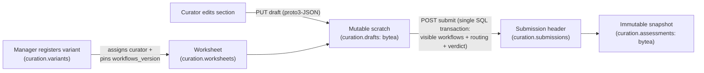

# Design: Curation surface

**Related:** [`run-review-loop.md`](run-review-loop.md) (the evaluation loop that reads agent runs against this
reference); [`svcv4-worksheet-transcription.md`](svcv4-worksheet-transcription.md) (the verbatim transcription of the
calculator's workflows, their routing, and the rarity gate); [`svcv4-interpretations.md`](svcv4-interpretations.md) (the
clinical readings of the framework); [`svcv4-classification-widget.md`](svcv4-classification-widget.md) (how the agent's
working document renders the same workflows with points and derivations);
[`evidence-interfaces.md`](evidence-interfaces.md) (the structured evidence RPCs and the shared consequence vocabulary);
[`analysis-scenarios.md`](analysis-scenarios.md) (the variant-classification scenario inputs a registration feeds);
[`workspace-model.md`](workspace-model.md) (the Project and Analysis model this surface stays separate from);
[`frontend-framework.md`](frontend-framework.md) (the Next.js web tier and IAP perimeter);
[`workbench-navigation.md`](workbench-navigation.md) (the landing page that embeds the curation panel);
[`proto.md`](proto.md) (protobuf schema and serialization rules); [`migrations.md`](migrations.md) (forward-only SQL
migration rules).

## Overview

Evaluating an autonomous ACMG/AMP/CAP/ClinGen Sequence Variant Classification v4 (**SVCv4**) run requires a human
reference that records how a curator reached a classification, not just the final class. If the reference only held a
five-tier label or a point sum, the evaluation loop ([`run-review-loop.md`](run-review-loop.md)) could not tell whether
an agent run that agreed with the final class did so for the wrong reasons, or whether a run that disagreed diverged on
a single borderline evidence code.

The curation surface ([`apps/web/src/curation/`](../../apps/web/src/curation)) is an unassisted web worksheet where
human curators classify variants across the
[ClinGen Pilot Calculator](https://calculator.clinicalgenome.org/v4/pilot/ui/classification)'s workflows. To prevent
anchoring, the worksheet renders the calculator's decision trees and applicability notes verbatim while omitting point
values, running totals, classification bands, live database retrievals, and agent outputs. A curator selects cells and
records the underlying evidence and reasoning in their own words.

For two curations of the same variant to be comparable, both curators and the agent must answer the same clinical
question. A manager therefore registers the full question up front: the variant on its transcript, the monogenic disease
entity (gene, MONDO disease term, and mode of inheritance), and the referral's clinical context. At least two curators
then complete worksheets for that registration independently and blind to one another. Measuring where two unaided
curators diverge establishes the human concordance floor per workflow, allowing the evaluation loop to separate genuine
agent defects from open clinical calls.

Because a worksheet is static reference data rather than an interactive agent session, the surface lives as a
self-contained module on the Next.js web tier with its own routes (`/curation/*`), role table, and `curation` database
schema. It shares only Identity-Aware Proxy (IAP) request verification, the Cloud SQL connection pool, and the protobuf
vocabularies used to compare a curator's answers against an agent run.

## Background

### Separating assessment from fact recovery and arithmetic

An SVCv4 classification has three distinct layers:

1. **Fact recovery** — looking up what public databases and papers say about the variant being classified (the **VBC**),
   such as its gnomAD allele frequency, its SpliceAI delta score, or a segregation count in a family study.
1. **Assessment** — judging which cell of each SVCv4 decision tree (a **workflow**, such as population frequency
   `POP_FRQ`, missense predictors `MIS_PRD`, or functional assays `*_FXN`) those facts license for a specific monogenic
   disease entity (**MDE**), and why the adjacent cells do not apply.
1. **Tally** — looking up the points assigned to each chosen cell, applying the molecular-mechanism × exon-relevance
   multiplier matrix and category combinations, and mapping the total through the gene-disease-validity (**GDV**) gate
   to one of the five classification tiers.

Fact recovery can be checked directly against upstream APIs ([`evidence-interfaces.md`](evidence-interfaces.md)), and
the point tally is a deterministic function computed by the offline library `themis.svcv4`. Assessment is the layer that
requires human clinical judgement, and no public dataset records it. Public ClinVar submissions collapse a whole
classification into a single label and a free-text paragraph, without recording which decision-tree cells were chosen,
how each workflow was routed, or which evidence codes carried the verdict.

Evaluating an autonomous run against a bare ClinVar label fails in both directions. A run can land on Pathogenic by
hallucinating a functional assay while missing a de novo observation, or it can land on Likely Pathogenic instead of
Pathogenic because one evidence code sits on an interpretive boundary. The curation worksheet therefore captures the
assessment layer cell by cell, leaving point lookup and summation to `themis.svcv4` at comparison time.

### Why assistance corrupts the reference

A reference used to grade an agent cannot be authored with the agent's help or with live scoring aids. Showing an
agent-drafted classification and asking a curator to edit it turns authorship into verification: a plausible rationale
next to a plausible cell selection is easy to approve and hard to audit for what it omitted. Pre-populating gnomAD
frequencies, VEP predictors, or ClinVar assertions on the worksheet creates a milder form of the same bias by steering
both curators toward the same pre-selected numbers instead of testing which sources and transcripts an unaided curator
consults.

Displaying point values or a running total introduces a third anchor. When a worksheet shows that a variant sits at 5.5
points—half a point shy of the 6-point Likely Pathogenic threshold—a curator is nudged to revisit an uncertain cell to
see whether the total crosses the line. The ClinGen Pilot Calculator displays points next to every option because it is
an interactive calculator; this surface strips them because it is an elicitation instrument. The only automated lookup
permitted on the surface happens before curation begins, when a manager resolves a ClinGen Allele Registry ID (`CA...`)
into its gene and transcript HGVS to register the variant.

### Measuring the human concordance floor

Two experienced curators reading the same evidence under SVCv4 do not always choose the same cell. The pilot's own
concordance among its analysts—reported in the SVCv4 working group's ACMG 2025 annual-meeting session on the slide
"Results of SVC v4.0 Pilot", covering ten variants across eight to ten analysts—was 84% at seven class levels, 86% at
five, and 91% at three (with 99.3% pairwise benign-vs-pathogenic agreement and inter-rater reliability of 0.625 to
0.627). Roughly one variant in six has legitimate expert disagreement on the final class, and per-workflow cell
disagreement is higher still.

If a variant were curated by only one person, or if two curators reconciled their answers into a single consensus row,
every difference between the agent and the reference would look like an agent error. Assigning each registered variant
to at least two curators who work blind to one another preserves their divergence as data. Where both curators choose
the same cell and mark it settled, a differing agent run is wrong; where the curators themselves split or mark a
workflow open, the evaluation loop knows that workflow is an open clinical call.

## Non-goals

- **Live evidence retrieval on the worksheet.** The surface never queries gnomAD, ClinVar, VEP, SpliceAI, or the
  literature service (`sheaf`) while a curator is working. The manager's registration-time ClinGen Allele Registry
  lookup resolves variant identity only.
- **Point arithmetic, running totals, or derived classes.** The worksheet stores selected cell IDs and curator-stated
  verdicts. `themis.svcv4` owns all point values, multipliers, and class thresholds.
- **Consensus adjudication.** When two curators disagree on a variant, the comparison view displays their answers side
  by side for a manager and the evaluation loop to read. Nothing merges or reconciles them into a third record.
- **Not a Themis Analysis.** A curation is not a session, has no working document, spawns no agent, and appears in no
  Project ([`workspace-model.md`](workspace-model.md)). It shares the deployment and the IAP boundary and nothing else.
- **Gene-specific VCEP specifications.** The first version transcribes the base SVCv4 pilot rules; VCEP-specific rule
  modifications are deferred until the base evaluation loop settles.
- **Workflow transcription mechanics.** Which calculator panels become which components, how workflow IDs are named, and
  how the population-frequency rarity gate operates are specified in
  [`svcv4-worksheet-transcription.md`](svcv4-worksheet-transcription.md).

## Design

### Module boundary and shared seams

The obvious way to host curation in the web app would be to model each worksheet as an `Analysis` inside a `Project` and
reuse the workbench's data plane ([`workspace-model.md`](workspace-model.md)). That model does not fit what a curation
does. An `Analysis` owns an Anthropic Managed Agents session, a conversation event log, a git-backed working document,
and a Project dataset boundary. A curation worksheet has no agent session, no conversation, and no patient dataset, and
its access rules must enforce inter-curator blindness rather than shared Project visibility.

The curation surface is therefore isolated in [`apps/web/src/curation/`](../../apps/web/src/curation), with page routes
under [`apps/web/src/app/curation/`](../../apps/web/src/app/curation), JSON API routes under
[`apps/web/src/app/api/curation/`](../../apps/web/src/app/api/curation), and its own `curation` schema in Cloud SQL
([`0011_curation.sql`](../../themis/migrate/migrations/0011_curation.sql)). On the default landing page (`/`), a
self-contained server component ([`panel.tsx`](../../apps/web/src/curation/ui/panel.tsx)) resolves the caller's curation
role and renders a link panel beside the Projects grid for callers who hold a role, while rendering nothing—and catching
and logging any database errors—so that an unapplied curation migration cannot break the Projects page for other users.

The module shares three seams with the rest of the web tier and nothing else:

1. **Identity verification and request isolation.** Every curation page and API route authenticates the caller through
   [`http.ts`](../../apps/web/src/curation/http.ts), which verifies the signed `X-Goog-IAP-JWT-Assertion` header via
   `getUserIdentity().assertedEmail` ([`frontend-framework.md`](frontend-framework.md)). Because the curation API uses
   plain JSON `fetch` routes rather than the workbench's Connect RPC mount, `curationContext` also calls
   `enforceResourceIsolation` directly to reject cross-site requests via Fetch Metadata headers before checking roles.
1. **Database pool and backend selector.** [`index.ts`](../../apps/web/src/curation/index.ts) selects between the live
   PostgreSQL store ([`sql.ts`](../../apps/web/src/curation/sql.ts), using the shared pool in `server/pg.ts`) and an
   in-memory fixture store ([`fixture.ts`](../../apps/web/src/curation/fixture.ts)) using `THEMIS_BACKEND`, memoizing
   both the store and the allele resolver on `globalThis` so in-memory state survives across requests in offline
   development.
1. **Protobuf serialization and shared vocabularies.** Stored assessments use `@bufbuild/protobuf` over the curation
   schema ([`curation.proto`](../../schema/proto/themis/curation/models/curation.proto)) and import the framework enums
   from [`svcv4.proto`](../../schema/proto/themis/svcv4/models/svcv4.proto) and
   [`evidence.proto`](../../schema/proto/themis/evidence/models/evidence.proto).

Isolating the module in this way costs a small amount of parallel plumbing—its own authorization wrapper
([`access.ts`](../../apps/web/src/curation/access.ts)) and error mapper
([`http.ts`](../../apps/web/src/curation/http.ts)) beside the Connect router—in exchange for keeping blindness rules
independent of Project membership and making the entire surface removable by deleting one directory and one database
schema.

### Roles and blindness enforcement

All access decisions pass through `CurationAccess` in [`access.ts`](../../apps/web/src/curation/access.ts), which wraps
the raw `CurationStore` ([`store.ts`](../../apps/web/src/curation/store.ts)) for a verified caller email. No page or API
route holds an unscoped store.

The `curation.roles` table grants two roles: `curator` and `manager`. Initial managers are seeded out of band in the
database just as `project_members` rows are. Managers can grant and revoke roles for other people through the surface,
and also hold every `curator` capability so that a lead scientist in a small team can both administer variants and
curate them. A manager cannot remove their own role (`removePerson` refuses when the target email matches the caller),
preventing accidental lock-out. A verified IAP user with no row in `curation.roles` receives `403 Forbidden` with a
message explaining that a manager must grant access; the surface's existence inside IAP is not secret.

Once a caller holds a role, `CurationAccess` enforces two rules to keep curations blind:

- **Curators only see their own worksheets.** Looking up, saving a draft on, or submitting a worksheet verifies that
  `worksheet.curatorEmail` matches the caller. An unknown worksheet ID and a worksheet assigned to someone else return
  the exact same masked `404` (`resource not found`), so a curator cannot probe whether another worksheet exists. Even a
  manager cannot open another curator's worksheet on the editing route (`/curation/[worksheetId]`).
- **Assigned managers are blinded on their own variants.** On the management view, a manager can see per-curator
  progress counts and submission timestamps (`progress`), with `submission.note` stripped so no prose leaks. However,
  the side-by-side comparison endpoint (`comparison`) refuses with `403` if the calling manager is assigned as a curator
  on that variant, and also refuses until at least two assigned curators have submitted. Without both checks, a manager
  who also curates could read a colleague's reasoning before submitting their own, or use the comparison view to inspect
  a single submitted worksheet while the second is still in progress.

### Transcribed workflows and reference modals

The worksheet renders the 23 SVCv4 evidence codes across 60 workflows (58 transcribed from the calculator plus 2 from
the supplements) grouped under the calculator's four headings (`Population Observations (POP)`,
`Clinical Observations (CLN)`, `Locus Specificity (LOC)`, and `Predicted and Functional Effect`), filtered by the
variant's registered mode of inheritance and the curator's chosen consequence class
([`registry.ts`](../../apps/web/src/curation/workflows/registry.ts)). Each workflow's `applies(routing)` predicate lists
its covered inheritance modes positively rather than negating `AUTOSOMAL_DOMINANT`. Positive predicates are also
required whenever an enum has more than two members: the calculator groups X-linked modes with autosomal dominant in one
branch and with autosomal recessive in another, so negating `AUTOSOMAL_DOMINANT` would route an X-linked dominant entity
into the recessive branch. How each calculator panel and supplement table is transcribed into React components, how
workflow and cell IDs are assigned, and how the population-frequency rarity gate clears downstream workflows when a
variant is not rare are detailed in [`svcv4-worksheet-transcription.md`](svcv4-worksheet-transcription.md).

Where the ClinGen Pilot Calculator provides reference popups next to the `POP_FRQ` disease allele frequency threshold
(**DAFT**) field, the worksheet provides two static, read-only reference modals inside a native `<dialog>`
([`reference-dialog.tsx`](../../apps/web/src/curation/ui/reference-dialog.tsx)) opened from `<ReferenceModals>` on
`POP_FRQ` and implemented in [`apps/web/src/curation/reference/`](../../apps/web/src/curation/reference):

- **Use Calculator Approach** ([`daft-calculator.tsx`](../../apps/web/src/curation/reference/daft-calculator.tsx),
  dialog title `"Determine Maximum Credible Population Allele Frequency"`) displays the transcribed calculator
  instructions, the linearised formula
  `Maximum Credible Population Allele Frequency = (Prevalence × Heterogenity) / Penetrance`, and a link to
  `https://cardiodb.org/allelefrequencyapp/`.
- **Use Binning Approach** ([`daft-binning.tsx`](../../apps/web/src/curation/reference/daft-binning.tsx), dialog title
  `"Disease Allele Frequency Threshold - Binning Approach"`) displays SM3's six DAFT lookup tables (Autosomal Dominant,
  Autosomal Recessive, X-linked Dominant Female, X-linked Dominant Male, X-linked Dominant Combined, and X-linked
  Recessive) mapping disease prevalence × penetrance (80%, 50%, 20%) to DAFT and
  `Equivalent to gnomAD v4 AC of: (based on AN = 1,600,000)`.

Neither modal is an interactive calculator and neither writes back into the worksheet; both reproduce the reference
popups verbatim so a curator can consult the threshold formula and lookup tables without leaving the page.

### Capturing cells, evidence, and reasoning

If a worksheet stored only the radio button a curator clicked, any disagreement between two curators or between a
curator and an agent run would be opaque. When Curator A selects `+2` on a functional assay workflow and Curator B
selects `0`, they might have found different papers, disagreed on whether the assay reflects the disease mechanism, or
both viewed the assay as borderline and tipped in opposite directions.

To make every divergence diagnosable, each workflow records a `WorkflowAssessment` message
([`curation.proto`](../../schema/proto/themis/curation/models/curation.proto)) with five parts:

- **Status (`status` and `status_reason`).** Every workflow begins at `ASSESSMENT_STATUS_UNSPECIFIED`. When a curator
  answers it, they mark it `SCORED`, `NOT_APPLICABLE` (the framework's own preconditions bar the workflow, such as a
  missense predictor workflow on a nonsense variant), or `NO_DATA` (the workflow applies, but no evidence exists to
  evaluate it). Choosing a cell whose point value in the framework is zero—such as an indeterminate splice prediction—is
  still `SCORED`, because evaluating evidence to zero is an affirmative judgement rather than an absence of data. When a
  workflow is marked `NOT_APPLICABLE` or `NO_DATA`, its decision-tree controls are cleared and the curator records why
  in `status_reason`.
- **Selected controls (`fields`).** Each filled control is stored as a `FieldValue` carrying `field_id`, `cell_id` (the
  framework's identifier for the decision-tree cell, empty only for un-scored input boxes like the raw gnomAD frequency
  and DAFT inputs on `POP_FRQ`), `label` (the verbatim wording rendered on screen, preserved so an answer stays readable
  even if a later transcription edits the text), and `value` (the selected option ID or the exact numeric string the
  curator typed, kept as text so float parsing cannot alter what was written).
- **Evidence vs. rationale (`evidence` and `rationale`).** The worksheet gives separate text boxes for what facts the
  call rests on (`evidence`: PMIDs, database versions, allele counts, predictor scores) and why those facts license the
  chosen cell (`rationale`). Keeping them separate lets the evaluation loop distinguish a retrieval miss from a
  reasoning disagreement. Because a cell selection without reasoning cannot be adjudicated, `CurationAccess.submit`
  refuses to submit any worksheet that has a `SCORED` workflow with a blank `rationale`.
- **Counterfactual (`nearest_alternative` and `nearest_alternative_reason`).** The curator can optionally pick the
  closest decision-tree cell they rejected (drawn from the active table's `cells`, excluding raw numeric `inputs`) and
  state what ruled it out. When an agent run lands on that exact alternative, the evaluation loop immediately knows the
  run hit a recognized boundary case rather than an arbitrary hallucination.
- **Confidence (`confidence` and `confidence_note`).** The curator marks whether they consider the call `SETTLED`,
  `LEANING`, or `OPEN`, with an optional note explaining what would resolve an open call.

Two worksheet-level sections bracket the workflows and are stored as rows in the same tables under reserved
`workflow_id` values (`routing` and `verdict` in [`sections.ts`](../../apps/web/src/curation/sections.ts)), using the
`Assessment` oneof (`WorkflowAssessment`, `RoutingAssessment`, `VerdictAssessment`):

- **`routing` (`RoutingAssessment`)** sits at the top of the worksheet. It records the variant's molecular
  `consequence_class` and a `rationale`. While `consequence_class` is `CONSEQUENCE_UNSPECIFIED`, only
  consequence-independent workflows (`POP`, `CLN`, `LOC`) appear; selecting a consequence reveals the matching predicted
  and functional effect workflows. If a curator believes the manager registered the wrong transcript, disease entity, or
  mode of inheritance, they record that objection in the routing `rationale`; if a manager agrees, the manager registers
  the other question as a registration of its own, and the first registration keeps its answers (since they answer the
  question it asked). The trade-off of fixing the question on the registration is that a registration is the question
  for every curator on it: one stated wrongly (for example, with a mistyped mode or an overly broad disease term) is
  wrong for all of them at once, and the blind pair cannot catch it because both curators answer the same wrong question
  consistently.
- **`verdict` (`VerdictAssessment`)** sits at the bottom of the worksheet. Because the worksheet computes no points, the
  curator states their overall `classification`, their holistic `rationale`, and the list of `class_determinative`
  workflow IDs whose evidence drove the outcome.

### Variant registration fixes the disease entity and clinical context

A natural temptation when building the worksheet was to let each curator fill in the disease entity, the mode of
inheritance, and a summary of the case at the top of their own worksheet. In practice, leaving any part of the clinical
question to the curator breaks blind comparison:

- **The monogenic disease entity includes the mode of inheritance.** Under SVCv4 SM21, the unit of classification is the
  MDE: a gene × disease × mode of inheritance tuple. A single gene can cause multiple distinct diseases (`LMNA` causes
  both dilated cardiomyopathy and Hutchinson-Gilford progeria syndrome), and a gene associated with the same disease
  under both autosomal dominant and autosomal recessive inheritance represents two separate entities classified under
  different thresholds and observation tables. Furthermore, SVCv4's population-frequency (`POP`) and
  clinical-observation (`CLN`) workflows route directly on the mode of inheritance, and SM3 and SM4 split X-linked
  dominant and X-linked recessive into different tables (for example, SM3's female vs. combined-sex allele frequency
  tables and SM4's tables for an affected XX individual). If two curators selected different modes of inheritance—or if
  a registration only said "X-linked"—they would see and answer different workflows.
- **The referral's clinical context is part of the question.** A variant is classified in a patient, and the referral
  that brings it to a lab describes that patient. Suppose a referral for an `FBN1` variant describes a proband with
  ectopia lentis and aortic root dilatation and mentions in its last line an aunt with the same aortic disease who
  carries the variant. When the worksheet instead had a `case` section where each curator transcribed their own notes
  from the referral, one curator transcribed the aunt into their notes while the other left her out; at `LOC_SEG`, the
  first scored an affected relative and the second had none—diverging in extracting the case from the referral rather
  than in reading the framework. Mixing the referral facts given *to* the classification with one curator's reading *of*
  them also left the automated evaluation run with no canonical clinical context to start from.

A manager therefore specifies the entire question when registering a variant in `curation.variants`
([`model.ts`](../../apps/web/src/curation/model.ts), [`registration.ts`](../../apps/web/src/curation/registration.ts)):

- `gene`, `transcript` (versioned RefSeq coding accession, such as `NM_000138.5`), `hgvs_c` (such as `c.7003C>T`), and
  an optional `clingen_allele_id` (`CA...`). Neither `transcript` nor `hgvs_c` may contain a colon, because the surface
  joins them as `transcript:hgvs_c` wherever it displays the variant's identity.
- `disease_label`, `mondo_id` (required and checked against `^MONDO:[0-9]{7}$`), and `mode_of_inheritance` (one of the
  five modes in `ModeOfInheritance`). A unique constraint on `(transcript, hgvs_c, mondo_id, mode_of_inheritance)`
  ensures each variant-and-entity question is registered at most once; classifying the same variant against a second
  disease or a second mode of inheritance is a separate registration with its own worksheets.
- `clinical_context` (trimmed, containing at least one non-whitespace character, and at most 10,000 characters to match
  `VariantClassificationInputs.clinical_context` in [`analysis-scenarios.md`](analysis-scenarios.md)). Both curators see
  this exact text at the top of their worksheets, and the evaluation loop composes the agent run's kickoff clinical
  context from the registered entity and this text, verifying that the combined string fits within the scenario's
  10,000-character limit before starting a run ([`run-review-loop.md`](run-review-loop.md)).

Five rules govern how `clinical_context` is structured and authored:

- **One prose block rather than named slots.** `clinical_context` is a single prose block rather than separate fields
  for phenotype, inheritance, and testing. A referral arrives as prose, and a sentence stating that a second variant was
  found in trans from an unaffected mother belongs to all three at once; named slots force the manager to split it and
  the curator to re-join it.
- **Curators cannot amend it or keep their own version.** A curator cannot edit `clinical_context` or save a private
  copy of it. A finding from outside the referral—such as a published paper describing the same family—belongs to the
  workflow it bears on and goes in that workflow's `evidence` field, which is the curator's own record. An objection to
  the clinical context as registered—that a finding was misread from the referral, or that the entity is wrong—goes in
  the routing `rationale`, where the compare view surfaces it beside the registration it questions.
- **De-identification discipline and referral-only scope.** Because the surface curates variants from real patient
  referrals alongside practice variants, and the text is stored in the `curation` schema and handed to the model
  provider with every classification run of the registration, `clinical_context` must stay strictly de-identified,
  carrying no patient names, hospital URNs, dates of birth, dates of service, clinician names, clinic names, or pedigree
  identifiers. It records what the referral states about the case—how the patient presents, what was sequenced, who else
  in the family carries the variant, any other variant found with it (and its phase), and any assay run on the patient's
  own sample—while excluding external evidence that curators look up during curation (which belongs in the workflow it
  bears on, such as `CLN_AFF` or `LOC_SEG`). For a practice variant with no patient, the manager records
  `"No referral: the variant is classified without a proband."`
- **Observations, never assessments.** The text states clinical observations rather than framework conclusions:
  `"ectopia lentis and an aortic root z-score of 3.4"` states the observation that a `CLN_AFF` cell is read from,
  whereas `"a phenotype highly specific for Marfan syndrome"` states the `CLN_AFF` cell itself. It states nothing the
  curator is to look up or judge—no population frequencies, no computational predictions, and no other lab's
  classification—because stating those would anchor both curators and the agent run.
- **Never worded from a submission.** A manager who also curates, or an operator writing the clinical context of an
  existing registration, may have a submitted worksheet in reach; they may consult it only to learn which referral a
  registration came from, and take no wording from it, so an agent run never reads part of an answer it is scored
  against.

### One vocabulary per concept

For the evaluation loop to compare a curator's worksheet against an agent run without lossy translation tables, every
categorical value a curator records uses the same protobuf enum that the evidence RPCs and `themis.svcv4` use:

- **`Consequence`** ([`evidence.proto`](../../schema/proto/themis/evidence/models/evidence.proto)) names the twelve
  molecular consequence classes (`MISSENSE`, `NONSENSE`, `FRAMESHIFT`, `CANONICAL_SPLICE`, `INTRONIC`, `SYNONYMOUS`,
  `INFRAME_INDEL`, `START_LOST`, `STOP_LOST`, `EXON_DELETION`, `EXON_DUPLICATION`, `NON_CODING`). `NON_CODING` appears
  in the picker ([`consequence.ts`](../../apps/web/src/curation/consequence.ts)) even though SM17 (non-coding variants)
  is unreleased and routes to no predicted-effect workflows, so a curator assigned a non-coding variant can record its
  true consequence rather than leaving routing unspecified or picking a false coding class.
- **`ModeOfInheritance`** ([`svcv4.proto`](../../schema/proto/themis/svcv4/models/svcv4.proto)) names the five framework
  modes (`AUTOSOMAL_DOMINANT`, `AUTOSOMAL_RECESSIVE`, `SEMIDOMINANT`, `X_LINKED_DOMINANT`, `X_LINKED_RECESSIVE`),
  matching ClinGen's `svcv4-model` and separating X-linked dominant from X-linked recessive as SM3 and SM4 require.
- **`Classification`** ([`svcv4.proto`](../../schema/proto/themis/svcv4/models/svcv4.proto)) covers the five standard
  ACMG classes (`PATHOGENIC`, `LIKELY_PATHOGENIC`, `VUS`, `LIKELY_BENIGN`, `BENIGN`), `NOT_ESTABLISHED` (when a curator
  or a run with open judgement inputs cannot establish a single class, distinct from an unanswered `UNSPECIFIED` field),
  and the two terminal outcomes imposed by SM18's GDV gate (`VARIANT_IN_GENE_OF_UNCERTAIN_SIGNIFICANCE` for validity
  below Limited, and `DO_NOT_REPORT` for Disputed or Refuted validity).
- **`AssessmentStatus` and `Confidence`** ([`svcv4.proto`](../../schema/proto/themis/svcv4/models/svcv4.proto)) are
  shared between the worksheet and the classification widget
  ([`svcv4-classification-widget.md`](svcv4-classification-widget.md)) so per-workflow status (`SCORED`,
  `NOT_APPLICABLE`, `NO_DATA`) and call certainty (`SETTLED`, `LEANING`, `OPEN`) compare directly.

### Registration-time allele lookup

Typing `gene`, `transcript`, and `hgvs_c` by hand when registering a variant invites transcription typos that would
persist across every worksheet assigned to that variant. When a manager has a ClinGen Allele Registry ID (such as
`CA123456`), the registration form on `/curation/manage` can resolve it via `POST /api/curation/alleles/resolve`
([`resolver.ts`](../../apps/web/src/curation/resolver.ts),
[`registry-resolver.ts`](../../apps/web/src/curation/registry-resolver.ts)).

The resolver fetches `https://reg.clinicalgenome.org/allele/CA...` with a 10-second timeout, finds the
`transcriptAlleles` entry marked `MANE Select`, splits its RefSeq nucleotide HGVS (`NM_000138.5:c.7003C>T`) into
`transcript` and `hgvsC`, and extracts `gene`, the canonical `@id` (`clingenAlleleId`), the MANE Select protein change
(`hgvsP`), and the GRCh38 `NC_` genomic HGVS (`hgvsG`). The form pre-fills `gene`, `transcript`, `hgvsC`, and
`clingenAlleleId`, and displays `hgvsP` and `hgvsG` beside the button so the manager can visually confirm the allele
before submitting the registration.

Three boundaries keep this lookup safe and honest:

- **Identity only, no crosswalks.** The ClinGen Allele Registry payload also contains links to ClinVar records and dbSNP
  rsIDs. `RegistryVariantResolver` ignores them. Surfacing a ClinVar link or classification during registration or in
  the worksheet header would reintroduce the anchoring that the unassisted worksheet is designed to prevent.
- **No fallback when MANE Select is absent.** If the allele ID is unknown (`404`), names a protein allele (`PA...`), or
  carries no `MANE Select` RefSeq transcript in the registry, the resolver raises `AlleleNotResolvedError` (returned as
  an unmasked `404` naming the reason) rather than guessing among non-MANE transcripts. If the registry times out or
  returns `5xx`, it raises `AlleleRegistryUnreachableError` (returned as `503`). In both cases the error message tells
  the manager to either retry or type the transcript identity by hand.
- **Separate from `Variant.Normalize`.** The evidence service's `Variant.Normalize` RPC translates in the opposite
  direction (RefSeq HGVS in, `CA...` out) and requires a sandbox session token minted for an agent run, which the web
  tier's curation surface does not have.

### Surface layout and navigation

The curation surface mounts five routes:

| Route                           | Audience             | Purpose                                                                                              |
| ------------------------------- | -------------------- | ---------------------------------------------------------------------------------------------------- |
| `/`                             | Any curation role    | Renders `CurationPanel` below the Projects grid, linking to `/curation` (`app/page.tsx`).            |
| `/curation`                     | Any curation role    | Lists the caller's own assigned worksheets and their status (`Pending`, `In progress`, `Submitted`). |
| `/curation/[worksheetId]`       | Assigned curator     | The worksheet editing surface for one variant assignment.                                            |
| `/curation/manage`              | `manager`            | Variant registration, curator role administration, worksheet assignment, and progress tracking.      |
| `/curation/compare/[variantId]` | Unassigned `manager` | Side-by-side read-only comparison of two or more submitted worksheets on a variant.                  |

On the worksheet and comparison routes, typography separates the two voices on the page
([`layout.tsx`](../../apps/web/src/app/curation/layout.tsx),
[`curation.css`](../../apps/web/src/curation/ui/curation.css)): every heading, applicability note, cell label, and modal
transcribed from the framework renders in the system geometric sans-serif (`framework-voice`), while everything a
curator types or selects—their prose notes, evidence citations, rationales, and comparison answers—renders in a serif
face (`Newsreader`, bound to `--font-curator-serif`). A reader scanning the page can immediately tell the standard's
words from the curator's judgement.

A curator opening `/curation/[worksheetId]` ([`worksheet.tsx`](../../apps/web/src/curation/ui/worksheet.tsx)) sees a
sticky header with the registered variant, entity, and clinical context above a two-column grid
(`grid-cols-[11rem_minmax(0,1fr)]`) pairing a sticky left-hand ledger sidebar (`<Ledger>`) with the vertical stack of
cards. The sidebar lists each visible workflow code (`● POP_FRQ`, `○ CLN_UAF`, `○ CLN_CCS`, …) with a filled dot when
its `Assessment.status !== UNSPECIFIED` and a count of `N / M` under `Recorded`, deliberately framed as a ledger rather
than a progress bar so *no data* answers do not read as unrecorded gaps:

```
┌──────────────────────────────────────────────────────────────────────────────┐
│ ← Curation   NM_000257.4:c.1988G>A                             Saved · [Submit] │
│              MYH7 · hypertrophic cardiomyopathy · MONDO:0005045 · autosomal  │
│              dominant                                                        │
│              Clinical context: Proband with a phenotype typical of the       │
│              disease …                                                       │
├──────────────┬───────────────────────────────────────────────────────────────┤
│ Recorded     │ Routing                                                       │
│   4 / 21     │   Consequence class: [ Missense ▾ ]                           │
│              │   Rationale:         [ MANE Select NM_000257.4…             ] │
│ ● POP_FRQ    ├───────────────────────────────────────────────────────────────┤
│ ○ CLN_UAF    │ POP_FRQ — Population Frequency         Status: [ Assessed ▾ ] │
│ ○ CLN_CCS    │   [Use Calculator Approach]  [Use Binning Approach]           │
│ ● CLN_AFF    │   Disease Allele Frequency Threshold:        [ 1.18e-05  ]    │
│ ○ CLN_DNV    │   Variant GrpMax Filtering Allele Frequency: [ 2.800e-7  ]    │
│ ○ LOC_SEG    │   2.800e-7 / 1.18e-05 = 0.0237× DAFT                          │
│ ● MIS_PRD    │   ■ Frequency of VBC <(1.5x of DAFT)       (POP_FRQ.bin.lt_1_5x) │
│ ● MIS_ASSOC  │   □ Frequency of VBC >=( 1.5x of DAFT ) - <(5x of DAFT )     │
│ …            │   □ Frequency of VBC >=(5x of DAFT - <(15x of DAFT)           │
│              │   □ Frequency of VBC >=(15x of DAFT)       (POP_FRQ.bin.ge_15x) │
│              │                                                               │
│              │   Evidence:  [ gnomAD v4.1.0 GrpMax FAF 2.800e-7…           ] │
│              │   Rationale: [ Below 1.5× DAFT for AD cardiomyopathy…       ] │
│              │   Confidence: (•) Settled  ( ) Leaning  ( ) Open              │
│              ├───────────────────────────────────────────────────────────────┤
│              │ Verdict                                                       │
│              │   Classification: [ Likely pathogenic ▾ ]                     │
│              │   Class-determinative workflows: [x] POP_FRQ  [x] MIS_PRD …   │
│              │   Rationale: [ Strong computational and case evidence…      ] │
└──────────────┴───────────────────────────────────────────────────────────────┘
```

(`POP_FRQ` renders its four bins as non-clickable `<DerivedRows>` (`POP_FRQ.bin.lt_1_5x`, `POP_FRQ.bin.1_5x_to_5x`,
`POP_FRQ.bin.5x_to_15x`, and `POP_FRQ.bin.ge_15x`) driven by `<RatioNote>`, and omits the `nearest` alternative picker
because its rows are derived from the two numeric inputs rather than chosen as radio options.)

As the curator works, `Autosave` ([`autosave.ts`](../../apps/web/src/curation/ui/autosave.ts)) persists each section via
`PUT /api/curation/worksheets/[worksheetId]/draft` with `{ workflowId, assessment }` in the request JSON body. Text
edits debounce for a short idle window; radio changes and field blurs flush immediately. Writes for a given section are
serialized in a per-section promise queue so an earlier network request can never overwrite a newer edit, and any write
whose serialized proto-JSON matches what the server last accepted is skipped. If a write fails, the header indicator
switches to `Failed` and retries on a timer.

When the curator clicks `Submit`, the client first calls `autosave.settle()` to flush all pending timers and wait for
in-flight writes; if any section is still failing, submission stops in the browser before calling the server. Once all
drafts are saved, `POST /api/curation/worksheets/[worksheetId]/submit` passes the optional submission note and the list
of currently visible workflow IDs (`shownWorkflowIds`). `CurationAccess.submit` verifies that every visible workflow
marked `SCORED` carries a non-empty `rationale`, and `CurationStore.submit` copies those visible workflow drafts plus
`routing` and `verdict` into `curation.assessments` inside a single PostgreSQL transaction
(`INSERT INTO curation.assessments ... SELECT ... FROM curation.drafts`). Any draft belonging to a workflow that was
hidden when the curator changed the routing consequence stays in `curation.drafts` and is excluded from the submission
snapshot, so a curator never submits an answer that was not on their screen. Submitting does not lock the worksheet; a
curator who spots an error can edit their drafts and submit again, creating a new row in `curation.submissions` whose
`submitted_at` timestamp supersedes the earlier submission.

Once at least two curators assigned to a variant have submitted, an unassigned manager can open
`/curation/compare/[variantId]` ([`comparison.tsx`](../../apps/web/src/curation/ui/comparison.tsx)) to inspect their
latest submissions side by side:

```
┌──────────────────────────────────────────────────────────────────────────────┐
│ ← Manage   NM_000138.5:c.7003C>T · FBN1 · Marfan syndrome · AD               │
│            Proband with a phenotype typical of the disease …                 │
│            Filter: (•) All workflows (12)   ( ) Divergent only (2)           │
├──────────────────────────────────────┬───────────────────────────────────────┤
│ alice@example.org (Submitted 14 Oct) │ bob@example.org (Submitted 15 Oct)    │
├──────────────────────────────────────┴───────────────────────────────────────┤
│ Verdict                                                           [DIVERGENT]│
│   Likely pathogenic                    VUS                                   │
│   Determinative: POP_FRQ, MIS_PRD      Determinative: POP_FRQ, MIS_PRD       │
│   Rationale: "Meets LP threshold…"     Rationale: "Borderline REVEL score…"  │
├──────────────────────────────────────────────────────────────────────────────┤
│ MIS_PRD — Missense Predictors                                     [DIVERGENT]│
│   Scored · Settled                     Scored · Leaning                      │
│   Cell: MIS_PRD_2 (Pathogenic)         Cell: MIS_PRD_3 (Indeterminate)       │
│   Evidence: "REVEL 0.78"               Evidence: "REVEL 0.78, AlphaMissense…"│
│   Rationale: "Above 0.773 threshold"   Rationale: "Just above cutoff; other…"│
│   Nearest alt: MIS_PRD_3               Nearest alt: MIS_PRD_2                │
└──────────────────────────────────────────────────────────────────────────────┘
```

The comparison view highlights workflows where the curators' statuses, selected cells, or verdicts differ, and provides
a filter to show only divergent rows.

### Storage and schema migrations

The curation lifecycle moves data from registration through mutable drafts to immutable submission snapshots:



#### Tables and permissions

Migration [`0011_curation.sql`](../../themis/migrate/migrations/0011_curation.sql) creates six tables inside the
`curation` schema:

- **`curation.roles`** (`email`, `role`, `added_by`, `added_at`).
- **`curation.variants`** (`id`, `gene`, `transcript`, `hgvs_c`, `clingen_allele_id`, `disease_label`, `mondo_id`,
  `mode_of_inheritance`, `clinical_context`, `created_by`, `created_at`).
- **`curation.worksheets`** (`id`, `variant_id`, `curator_email`, `workflows_version`, `assigned_by`, `assigned_at`),
  with a `UNIQUE (variant_id, curator_email)` constraint so a curator cannot be assigned twice to the same registration.
  `workflows_version` pins the constant `WORKFLOWS_VERSION` from [`version.ts`](../../apps/web/src/curation/version.ts)
  at assignment time; bumping that string when a workflow's wording or option set changes records which version of the
  transcription each stored worksheet was answered against.
- **`curation.drafts`** (`worksheet_id`, `workflow_id`, `assessment`, `updated_at`), where `assessment` is the binary
  protobuf serialization of `themis.curation.models.curation.Assessment`
  ([`curation.proto`](../../schema/proto/themis/curation/models/curation.proto)).
- **`curation.submissions`** (`id`, `worksheet_id`, `submitted_at`, `note`).
- **`curation.assessments`** (`submission_id`, `workflow_id`, `assessment`), holding the binary `Assessment` rows copied
  from `curation.drafts` when the submission was created.

Database grants enforce the mutability boundary at the schema level. The web service account receives `SELECT, INSERT`
on all six tables, `UPDATE` on `curation.drafts` alone, and `DELETE` on `curation.roles` and `curation.worksheets`
alone. Because `curation.submissions` and `curation.assessments` have no `UPDATE` or `DELETE` grants, and
`curation.submissions.worksheet_id` has no `ON DELETE CASCADE` (unlike `curation.drafts.worksheet_id`), a manager can
withdraw an unsubmitted worksheet cleanly, while any worksheet that has been submitted cannot be withdrawn or altered
out from under an evaluation round that has read it.

Neither `curation.worksheets` nor `curation.variants` carries a status column. A single module
([`status.ts`](../../apps/web/src/curation/status.ts)) derives worksheet status (`pending`, `in_progress`, `submitted`)
and variant status (`unassigned`, `pending`, `in_progress`, `part_submitted`, `complete`) from how many drafts exist and
whether each assigned worksheet has a submission. In particular, `part_submitted` is kept distinct from both
`in_progress` and `complete`: a variant with one of two curations submitted cannot yet be used for a blind comparison or
concordance check, and highlighting `part_submitted` shows a manager which variants are waiting on a second curator.

#### Schema and protobuf migrations

Three schema evolutions after `0011_curation.sql` reshaped the curation tables and serialized protos (`0012` through
`0017`), including targeted deletions of unplaceable or uncontexted rows and five explicit departures from our standard
schema-evolution rules accepted under [`migrations.md`](migrations.md)'s dev-only condition:

1. **Moving onto the shared framework enums
   ([`0012_curation_vocabulary.sql`](../../themis/migrate/migrations/0012_curation_vocabulary.sql) and
   [`0015_curation_snapshots_drop.sql`](../../themis/migrate/migrations/0015_curation_snapshots_drop.sql)).**
   `curation.proto` originally declared its own enums for consequence, classification, workflow status, and confidence,
   with different member numbers from the shared enums in `svcv4.proto` and `evidence.proto` (for example, `SCORED` was
   `3` in the local enum and `1` in `AssessmentStatus`). Two of the shared enums (`Consequence` and `Classification`)
   number their members differently from the curation-local ones they replaced, so a row written under the old numbering
   would decode without error to a member the curator never chose—the exact failure [`proto.md`](proto.md) exists to
   prevent. Renumbering stored enums in place was taken as an explicit rule-break with a closed window:
   `0012_curation_vocabulary.sql` snapshotted `curation.assessments`, `curation.drafts`, and `curation.variants` into
   `_v1` backup tables, dropped the legacy `curation.variants.inheritance` seed column, and installed the
   `curation.stamp_updated_at()` `BEFORE UPDATE` trigger on `curation.drafts` (which updates `updated_at` on every write
   unless `curation.backfill_in_progress = 'on'` is set in the transaction). A one-shot operator rewrite converted the
   stored protobuf bytes to the shared enum numbers and verified the result against the `_v1` snapshots before
   [`0015_curation_snapshots_drop.sql`](../../themis/migrate/migrations/0015_curation_snapshots_drop.sql) dropped the
   three `_v1` tables.

1. **Moving the entity's mode of inheritance onto the registration
   ([`0014_curation_registration_mode.sql`](../../themis/migrate/migrations/0014_curation_registration_mode.sql) and
   [`routing_backfill.py`](../../themis/curation/routing_backfill.py)).** When the entity's mode of inheritance and
   disease fields moved from the curator's `RoutingAssessment` (fields 1, 3, and 4, now `reserved` in
   [`curation.proto`](../../schema/proto/themis/curation/models/curation.proto)) onto `curation.variants`,
   `0014_curation_registration_mode.sql` added `mode_of_inheritance` as `NOT NULL`, backfilled autosomal and
   semi-dominant rows from `curation.variants_v1`, mapped existing `X_LINKED` registrations by gene (`F8` and `RS1` to
   `X_LINKED_RECESSIVE`; `MECP2` to `X_LINKED_DOMINANT`), enforced `^MONDO:[0-9]{7}$` on `mondo_id`, and added the
   `variants_registration_key` uniqueness constraint on `(transcript, hgvs_c, mondo_id, mode_of_inheritance)`. The
   migration halts whole, naming the rows, on any registration it cannot place (one with no recorded mode, a `mondo_id`
   outside `^MONDO:[0-9]{7}$`, or duplicate registrations for the same
   `(transcript, hgvs_c, mondo_id, mode_of_inheritance)`): an unplaceable registration without submissions is repaired
   by deleting it once its unsubmitted worksheets are gone, whereas when duplicate registrations both hold submissions,
   which answers to keep is a decision for the team before the deploy is retried. Because existing `RoutingAssessment`
   rows in `curation.drafts` and `curation.assessments` still carried the retired fields in their protobuf unknown-field
   sets, the one-shot operator tool [`themis/curation/routing_backfill.py`](../../themis/curation/routing_backfill.py)
   inspects every stored `routing` row, checks that any mode recorded in retired field 1 agrees with the variant's
   registered `mode_of_inheritance` (halting and naming the rows if a curator had answered under a different mode),
   strips the unknown fields, and writes the cleaned bytes back as the table owner (`themis-clu`). Two rule-breaks
   accompanied this step: first, because the deploy rolls Cloud Run *before* applying migrations
   ([`migrations.md`](migrations.md)), adding `mode_of_inheritance` as `NOT NULL` created a deploy-order failing window
   where curation pages and registrations failed during the rollout (and would stay stopped if `0014` halted on an
   unplaceable row); second, retiring the browser-sent `RoutingAssessment` proto fields in a single deploy rather than
   the two deploys required by [`proto.md`](proto.md) (§Schema evolution) caused any open browser tabs running the old
   bundle to fail draft saves on unknown keys until reloaded.

1. **Moving the clinical context onto the registration and retiring the `case` section
   ([`0016_curation_clinical_context.sql`](../../themis/migrate/migrations/0016_curation_clinical_context.sql) and
   [`0017_curation_case_retired.sql`](../../themis/migrate/migrations/0017_curation_case_retired.sql)).** Copying one
   curator's `case` notes into `curation.variants.clinical_context` would make that curator's reading of the referral
   the question for both curators; instead, the clinical context of each existing registration was written by hand from
   its original referral (kept in the database and never in a tracked repository file); a registration with no referral
   to write a clinical context from is a decision for the team (because its answers were given to a question nobody can
   now state), and `0017_curation_case_retired.sql` refuses to run until every registration has a `clinical_context` or
   is removed. Migration `0016_curation_clinical_context.sql` first added `clinical_context` as a nullable column on
   `curation.variants` (checked for non-whitespace content and a 10,000-character limit when present). Once every
   remaining registration had its `clinical_context` populated from its referral and any submission whose only row was a
   `case` row was deleted by hand along with its row,
   [`0017_curation_case_retired.sql`](../../themis/migrate/migrations/0017_curation_case_retired.sql) verified in a
   `DO $$` block that no `curation.variants` row had `clinical_context IS NULL` and no `curation.submissions` row
   contained only a `'case'` assessment, then executed `DELETE FROM curation.drafts WHERE workflow_id = 'case'`,
   `DELETE FROM curation.assessments WHERE workflow_id = 'case'`, and
   `ALTER TABLE curation.variants ALTER COLUMN clinical_context SET NOT NULL`. Neither
   [`sql.ts`](../../apps/web/src/curation/sql.ts) nor the Python readers filter `'case'` rows silently:
   [`rows.py`](../../themis/curation/rows.py) (`RETIRED = {'case': '0017_curation_case_retired'}`) raises a `ValueError`
   in `kind_of(workflow_id)` if a `'case'` row is ever encountered. Retiring `case` took two further rule-breaks: first,
   deleting the `CaseContextAssessment` message from a durable `models` proto with stored rows broke
   [`proto.md`](proto.md) (§Retiring an RPC or a message), failed the `backward-compatible` CI check (requiring an admin
   merge bypass under [`review-policy.md`](review-policy.md)), and took the removal in the second deploy alongside
   `0017` rather than a third deploy after stopping writes; second, deleting submitted `case` rows from
   `curation.assessments` broke the storage invariant that a submitted assessment is never touched again, so what each
   curator took from the referral is lost with their notes and a pair that diverged over the referral facts reads in the
   compare view like any other divergence.

## Alternatives considered

- **A model-authored reference.** Barring the model from authoring the reference at all: because the run under review
  and a model-authored reference share a model family, a shared misreading reads as a pass.
- **An agent-assisted worksheet.** Showing an agent-drafted classification and asking a curator to review or edit it
  anchors the reference to the agent's own retrieval and reasoning, turning authorship into verification.
- **A CSV worksheet of open calls.** Recording only a spreadsheet of disputed or borderline variants cannot express a
  complete cell-by-cell curation of a variant no reference has seen.
- **A separate app and Cloud Run service.** Deploying curation as a standalone service would duplicate the IAP gate,
  Cloud Run deployment pipeline, and request identity verification for no isolation gain beyond what a separate module
  directory and database schema provide.
- **Reuse `Project` membership for curator identity, or model curations as `Analysis` rows inside a `Project`.** Reusing
  `project_members`, `analyses`, and `AuthorizedBackend` ([`workspace-model.md`](workspace-model.md)) ties who may
  curate to the workbench's Project model, and every `Analysis` concept—an agent session, a conversation log, a
  git-backed working document, and Project-wide visibility to all members—either does not apply to an unaided worksheet
  or actively breaks inter-curator blindness.
- **Assessments carrying their own revision number, with no submission parent.** Versioning individual workflow rows
  without a parent `curation.submissions` record makes a partial resubmission indistinguishable from a full
  re-affirmation of the worksheet as a coherent snapshot.
- **One append-only tier, with every auto-save a revision.** Treating every debounced keystroke flush as an immutable
  revision conflates durability with provenance and risks reading mid-keystroke state as a submitted answer.
- **Free-form prose per code, with no options at all.** Without structured decision-tree cell selections, two curators'
  answers on a workflow stop being directly comparable by the evaluation loop.
- **Let the curator state the mode of inheritance on the routing card.** Mode of inheritance defines the clinical
  question (the MDE) rather than answering it; two curators setting different modes on their routing cards are answering
  two different questions and seeing different workflows.
- **Snapshot the `case` rows before deleting them, as `0012` did.** Because the operator writes `clinical_context` from
  the referral itself rather than copying a curator's notes, a `_v1` snapshot of `case` rows would leave a second copy
  of patient prose in a table no surface reads.
- **Retrieve the whole ClinGen Allele Registry record, crosswalks included.** Surfacing the ClinVar or dbSNP crosswalks
  returned by the registry puts another lab's classification one click away from the worksheet header, reintroducing the
  anchoring the unassisted surface prevents.
- **Restrict the consequence picker to the members the workflows branch on.** Hiding consequence classes whose
  predicted-effect supplements are not yet released (such as `NON_CODING`) makes the stored vocabulary a subset per
  consumer and prevents a curator from recording a variant's true molecular consequence.
- **Store assessments as untyped JSONB with no protobuf schema.** JSONB is inspectable directly in `psql`, and nothing
  outside the web tier and the Python evaluation loop reads these tables. We rejected untyped JSONB because the
  evaluation loop in Python and the curation surface in TypeScript must agree on field names, oneof cases, and the
  shared framework enums (`Consequence`, `Classification`, `AssessmentStatus`, `Confidence`); `buf validate` and
  generated stubs enforce that contract across both languages at build time ([`proto.md`](proto.md)).
- **Store one JSONB or `bytea` blob per worksheet instead of one row per workflow.** A single column on
  `curation.worksheets` would avoid the `(worksheet_id, workflow_id)` composite key. However, every debounced autosave
  would then perform a read-modify-write of the entire worksheet, so two sections flushing close together could clobber
  each other, and submission could not selectively copy only the currently routed workflows in SQL.
- **Compute and store the point total at submission time while hiding it from the curator.** The server could run the
  scoring rules when a worksheet is submitted and persist the resulting point total and calculated class alongside the
  curator's stated verdict. We rejected storing derived scores because SVCv4 is a draft standard whose point weights and
  thresholds can move; `themis.svcv4` computes the score from the stored `cell_id` selections when an evaluation round
  reads the submission, so a point-table update in the library never leaves stale numbers in the database.
- **Pre-populate allele frequencies and predictor scores from the evidence services.** Calling `Gnomad.DescribeVariant`
  and `Vep.Annotate` to fill in the numeric inputs on `POP_FRQ` and `*_PRD` would save curators lookup time. We rejected
  pre-population because fact recovery—choosing which gnomAD version, which population, and which transcript annotation
  to read—is part of what the reference tests; pre-filling those numbers would anchor both curators to the evidence
  service's own remapping logic rather than measuring it independently.
- **Define workflows in a declarative YAML/JSON DSL rendered by a generic form interpreter.** Most workflows are single
  radio tables, which makes a data-driven schema appealing. In practice, the irregular workflows—`POP_FRQ` with its two
  numeric inputs, DAFT reference modals, and rarity gate; `LOC_SPC` with its two-step phenotype specificity tree;
  `SPL_ASS` conditioned on the sibling `SPL_PRD` branch—force a declarative DSL to grow expressions, cross-workflow
  predicates, and custom slot hooks until the DSL is harder to read and test than explicit React components built from a
  small set of shared primitives ([`svcv4-worksheet-transcription.md`](svcv4-worksheet-transcription.md)).

## Open questions

- **Correcting a `clinical_context` once curators have answered against it.** If a manager spots an omission or error in
  `curation.variants.clinical_context` after one or both curators have already submitted worksheets against that text,
  updating the column in place would leave the existing submissions attached to a clinical context they did not read.
  Whether correcting a registration's `clinical_context` should require invalidating existing submissions, versioning
  the registration text, or registering a fresh row is left open until the need arises in practice.
- **Representing a second unrelated patient with the same variant.** Because `variants_registration_key` constrains
  `(transcript, hgvs_c, mondo_id, mode_of_inheritance)` to be unique, a second unrelated referral carrying the exact
  same variant and disease entity cannot be inserted as a second row in `curation.variants` without widening the key or
  separating the case presentation from the variant-and-entity registration. How to model multiple proband referrals for
  the same variant and MDE is deferred until the evaluation corpus encounters a repeat variant across referrals.
