# Design: Deployment — IaC, deploy auth, state, and secrets

**Related:** [`spike-infrastructure.md`](spike-infrastructure.md) (cloud topology and services the Spike runs on),
[`migrations.md`](migrations.md) (forward-only database schema runner and ledger check),
[`cost-monitoring.md`](cost-monitoring.md) (workspace spend monitoring and the CI telemetry writer identity),
[`../runbooks/fresh-environment.md`](../runbooks/fresh-environment.md) (bootstrap and first bring-up sequence),
[`../runbooks/claude-api-wif.md`](../runbooks/claude-api-wif.md) (Anthropic Workload Identity Federation for deploy and
runtime accounts), [`../runbooks/hand-driving-a-service.md`](../runbooks/hand-driving-a-service.md) (impersonating
`themis-clu` for manual backend calls).

## Overview

Themis manages its cloud infrastructure as a Python Pulumi program in [`infra/`](../../infra/), with one isolated GCP
project and Pulumi stack per environment (`dev` today, and `prod` when it exists). Because every tracked file on `main`
is mirrored to a public repository, the repository can hold cloud resource identifiers and KMS-encrypted ciphertext, but
it must never hold plaintext secret material or long-lived credentials.

Deploys run from GitHub Actions ([`.github/workflows/deploy.yml`](../../.github/workflows/deploy.yml)) only when an
operator pushes to `deployed/<env>` or dispatches the workflow on `main`. Merging a pull request lints, tests, and
builds container images without deploying, so routine merges do not overwrite a shared demo environment mid-session.

Both CI workflows and runtime services authenticate with short-lived OIDC and IAM credentials rather than stored keys.
GitHub Actions exchanges OIDC tokens through Workload Identity Federation (WIF), and runtime services reach Anthropic
and Cloud SQL via WIF and IAM database authentication. The few third-party API keys without a federation path, along
with confidential model selection, live as Cloud KMS ciphertext in
[`infra/Pulumi.dev.yaml`](../../infra/Pulumi.dev.yaml) and state in a private per-environment GCS bucket. Every IAM
binding in the Pulumi program is wrapped in a named capability component in
[`infra/themis_infra/grants.py`](../../infra/themis_infra/grants.py) so code review evaluates what an identity can do in
the system rather than raw GCP role names.

## Background

Every tracked file on `main` is mirrored to a public repository. That mirror makes plaintext secrets, service-account
keys, and identifiers of internal infrastructure outside the Spike's GCP project off-limits in tracked files and logs.
The Spike is isolated and public-endpoints-only, so its config discloses nothing about the data estate, and Cloud
resource identifiers and Cloud KMS ciphertext are safe on the public mirror because access is gated by GCP IAM, while CI
workflows, pull request comments, and run logs stay inside the private repository.

Each environment runs in its own GCP project (`cpg-themis-dev` today, and `cpg-themis-prod` when `prod` exists) from the
same Pulumi program in [`infra/__main__.py`](../../infra/__main__.py), parameterized by `Pulumi.<stack>.yaml`. Because
Pulumi needs a state bucket, a Cloud KMS key, and a Workload Identity Federation pool before its first run, an operator
with Owner permissions runs the idempotent script [`infra/bootstrap/bootstrap.sh`](../../infra/bootstrap/bootstrap.sh)
once per environment to create that substrate and delete the default VPC. After bootstrap, a single `pulumi up` manages
the rest of the project.

## Non-goals

- Cloud service topology, Identity-Aware Proxy setup, audit retention, and sandbox VM configuration
  ([`spike-infrastructure.md`](spike-infrastructure.md)).
- Artifact Registry layout, container image build mechanics, promotion paths, and preview environments beyond deploy
  authentication ([`spike-infrastructure.md`](spike-infrastructure.md)).
- Per-secret inventory and rotation cadence ([`spike-infrastructure.md`](spike-infrastructure.md)), and the step-by-step
  commands for bringing up a fresh environment ([`../runbooks/fresh-environment.md`](../runbooks/fresh-environment.md)).

## Design

### Deploy trigger and pipeline order

The obvious way to trigger deployments is to deploy automatically on every merge to `main`. That breaks while `dev`
doubles as our shared demo environment and frequently runs unreviewed branches: merging an unrelated pull request would
overwrite whatever a teammate is demonstrating without warning.

Instead, [`.github/workflows/deploy.yml`](../../.github/workflows/deploy.yml) has two explicit triggers, and merging to
`main` is neither:

- **Ad-hoc branch push:** an operator force-pushes a branch name or commit SHA to `deployed/<env>`, such as
  `git push --force origin <commit-ish>:deployed/dev`. Because the push itself triggers the deploy, the `deployed/dev`
  ref always names what is live in `dev`, and the running Cloud Run revision's image tag matches that commit SHA. The
  workflow's run list records who deployed and whether the run succeeded.
- **Reviewed workflow dispatch:** an operator triggers the workflow on `main` (`Actions → deploy → Run workflow`), which
  deploys reviewed code without moving a branch.

This trigger split is temporary while `dev` serves ad-hoc demos of unreviewed code. Once `dev` stops carrying unreviewed
demos, and for `prod` from the start, a stable environment should deploy automatically on merge to `main`
(`on: push: branches: [main]`) and omit the ad-hoc branch entirely. To keep `prod` from inheriting an ad-hoc deploy path
by accident, [`infra/bootstrap/bootstrap.sh`](../../infra/bootstrap/bootstrap.sh) binds the `deployed/<env>` ref only
when `ADHOC_DEPLOY_BRANCH` is explicitly set.

```
Trigger (private repo)              GitHub OIDC -> GCP WIF               Deploy pipeline (.github/workflows/deploy.yml)
──────────────────────              ──────────────────────               ──────────────────────────────────────────────
push deployed/dev ─────────┐
                           ├─► attribute.ref in                     ┌─► 1. Preflight migration ledger (themis.migrate --check)
workflow_dispatch on main ─┘   {refs/heads/main,                    ├─► 2. Build and push container images
                                refs/heads/deployed/dev}            ├─► 3. Update cloud resources (pulumi up)
                                      │                             ├─► 4. Apply forward-only schema (themis.migrate)
                                      ▼                             └─► 5. Sync agent declaration (tools.agents apply)
                               Impersonate themis-deploy SA
                               (GCP IAM + Anthropic WIF)
```

Within a deploy run, the workflow checks the database migration ledger against the repository tree first
([`migrations.md`](migrations.md)). It then builds and pushes the images, updates the Pulumi stack, runs database
migrations, and applies the Anthropic agent declaration (`agents/svcv4-classifier.agent.yaml`) through
[`tools/agents/`](../../tools/agents/) in that order.

The agent declaration step runs last because the skill bundled with the agent is written against a specific build. For
example, the skill calls backend RPCs by service and method name, such as `Splice.PredictDeltas`, and imports scoring
modules shipped inside the sandbox guest image, such as `themis.svcv4.frequency`. If the pipeline updated the agent
first, the new skill would call into the previous cloud stack and guest image, so any RPC or module added in that commit
would fail until `pulumi up` completed. Running the agent step last means a session started during the few minutes
between `pulumi up` and `tools.agents apply` runs the new services and guest image under the previous skill. Adding an
RPC is therefore safe in a single deploy because the previous skill never calls it. Renaming or removing an RPC requires
two deploys: the first serves both names and updates the skill to call the new name, and the second removes the old
name.

Putting the agent step last has a failure cost: if `tools.agents apply` fails after `pulumi up` and `themis.migrate`
have already succeeded, the new build continues running under the previous skill until an operator runs `tools/agents`
by hand or a later deploy succeeds. On a fresh environment whose Anthropic federation identifiers for the deploy account
are still placeholders, every deploy fails at this final step until federation is configured
([`../runbooks/fresh-environment.md`](../runbooks/fresh-environment.md)).

### Deploy authentication and authorization

CI workflows authenticate to GCP by exchanging a short-lived GitHub Actions OIDC token through Workload Identity
Federation to impersonate a service account; no service-account keys exist, and `deploy.yml` reads no GitHub repository
`secrets.*`. The agent step in `deploy.yml` authenticates to the Anthropic API as the same `themis-deploy` service
account, federated into the Anthropic workspace under a rule that pins that account
([`../runbooks/claude-api-wif.md`](../runbooks/claude-api-wif.md)), so one WIF boundary gates both cloud and agent
changes. Locally, operators authenticate with personal `gcloud auth application-default login` credentials gated by IAM.

The WIF provider configured by [`infra/bootstrap/bootstrap.sh`](../../infra/bootstrap/bootstrap.sh) sets the attribute
condition `assertion.repository == 'populationgenomics/themis-internal'`. Because GitHub OIDC tokens name their
originating repository, the public mirror (where Actions is also disabled) cannot satisfy the condition. Within
`themis-internal`, impersonation is divided across three service accounts by token claim:

| Service account       | Managed by                                                         | Permitted OIDC claim                                                | Purpose and reach                                                                                                                                                    |
| :-------------------- | :----------------------------------------------------------------- | :------------------------------------------------------------------ | :------------------------------------------------------------------------------------------------------------------------------------------------------------------- |
| `themis-deploy`       | `bootstrap.sh` + [`grants.py`](../../infra/themis_infra/grants.py) | `attribute.ref` is `refs/heads/main` or `refs/heads/deployed/<env>` | Runs `deploy.yml`. Mutates the Pulumi stack, reads/writes state, encrypts/decrypts KMS secrets, and updates the Anthropic agent.                                     |
| `themis-preview`      | `bootstrap.sh`                                                     | `attribute.event_name` is `pull_request`                            | Runs [`.github/workflows/preview.yml`](../../.github/workflows/preview.yml) on pull requests to post `pulumi preview` diffs on `dev`. Cannot mutate cloud resources. |
| `themis-ci-telemetry` | [`ci_telemetry.py`](../../infra/themis_infra/ci_telemetry.py)      | Any token from `themis-internal`                                    | Used by Claude Code workflows to write run token usage and cost metrics to Cloud Monitoring ([`cost-monitoring.md`](cost-monitoring.md)).                            |

The CI telemetry account is managed by Pulumi rather than `bootstrap.sh` because nothing needs it before the first
`pulumi up`. Its `TelemetryWriter` grant allows writing points to any metric in the project (which can create new metric
descriptors) and, through the service usage consumer role required for Telemetry API quota, listing project time series
and using service quota; it cannot read buckets, secrets, or databases.

For `themis-deploy`, scoping the WIF binding by `attribute.ref` rather than `attribute.event_name` covers both workflow
dispatch on `main` and pushes to `deployed/<env>`, while rejecting pull request runs (`refs/pull/N/merge`). This ref
binding matters because `themis-deploy` holds `roles/resourcemanager.projectIamAdmin` on its project: anyone who can run
a workflow as `themis-deploy` can grant themselves any role in the project.

An obvious way to restrict who can deploy would be to add a permission check inside `deploy.yml`. That check provides no
security: any collaborator with repository write access can push a branch and trigger `workflow_dispatch` on that
branch, causing GitHub Actions to execute *that branch's* modified copy of `deploy.yml` with the guard deleted and
`pulumi up` replaced by arbitrary commands. What stops a branch run from taking `themis-deploy` is that the dispatched
branch also sets the OIDC token's `ref` claim, so `refs/heads/<feature-branch>` fails the WIF binding check in GCP
(`deploy.yml` reads no `secrets.*`, so such a run gains nothing beyond the `GITHUB_TOKEN` any PR job already has).
Workflow-file provenance contributes nothing to the security boundary.

Because the WIF ref binding is the entire boundary, the two refs it accepts must be write-restricted in GitHub:

- `main` requires pull request review.
- `deployed/*` is protected by a GitHub ruleset (`Restrict creations`, `Restrict updates`, `Restrict deletions`) whose
  bypass list contains only the **repository-admin role**.

Bypassing the ruleset by GitHub role rather than by individual usernames keeps the deployer list out of tracked files
(`bootstrap.sh` names only git refs) and expresses "admins only" even though GitHub's OIDC token carries no role claim.
The repository-admin role is broader than the GCP `roles/iam.serviceAccountTokenCreator` holders who can deploy from a
laptop, and organization owners inherit it automatically. Gating organization owners in CI would buy nothing because
they can rewrite the repository and its rulesets anyway; the ruleset excludes collaborators who have repository write
access without admin rights, who have no other path to a GCP credential.

When enabling `deployed/<env>` on an environment, the GitHub ruleset must be active before `bootstrap.sh` adds
`refs/heads/deployed/<env>` to the WIF binding, and no `deployed/*` branch may exist beforehand. Between adding the WIF
binding and creating the ruleset, any collaborator with write access could push `deployed/dev` and impersonate
`themis-deploy`. Nor does `Restrict creations` protect a branch created before the ruleset: it only blocks future
creations, leaving a pre-existing branch frozen at whatever commit it already points to.
[`../runbooks/fresh-environment.md`](../runbooks/fresh-environment.md) orders these steps: verify no `deployed/*` ref
exists, create the ruleset, and only then run `bootstrap.sh` with `ADHOC_DEPLOY_BRANCH`.

This deploy and preview model accepts four operational costs:

- **`main` and the deployed stack drift until someone deploys.** Merging a pull request does not update `dev`.
  Migrations merged to `main` remain pending until the next deploy, which is safe because the migration runner is
  forward-only and idempotent ([`migrations.md`](migrations.md)).
- **Deployers share a single `dev` stack and overwrite each other.** The workflow concurrency group
  (`themis-deploy-dev`) serializes runs (`cancel-in-progress: false`) so two deploys do not interleave, but the second
  overwrites the first: deliberate clobbering replaces automatic clobbering rather than eliminating it. Pushing
  `deployed/dev` also applies that branch's `infra/` program, so an unreviewed infrastructure change reaches the stack
  and a broken one wedges it until someone deploys a working ref.
- **Ad-hoc deploys apply irreversible schema migrations to the shared `dev` database.** Because `themis.migrate` runs on
  every deploy and migrations are forward-only ([`migrations.md`](migrations.md)), redeploying a good commit reverts the
  cloud stack and images but does not undo schema changes. The database ledger also retains the branch's migration
  version number; if another branch reuses that version number for a different migration, the preflight check blocks
  later deploys until the ledger and tree agree ([`migrations.md`](migrations.md#checking-the-ledger-against-the-tree)).
- **Pull request previews can decrypt stack secrets.** Although `themis-preview` cannot mutate cloud state,
  `pulumi preview` executes the pull request's own copy of the Pulumi program, and `themis-preview` holds
  `roles/cloudkms.cryptoKeyDecrypter` on the stack's KMS key (because the `gcpkms` secrets manager loads on every Pulumi
  operation) along with project-wide `roles/viewer`. A malicious pull request could modify the Pulumi program to
  exfiltrate decrypted stack secrets and viewer-readable project metadata. This is tolerable while the preview token is
  `dev`-scoped (synthetic data), the `dev` stack stores no secrets, and repository membership is trusted. Before either
  trigger flips—adding the first `require_secret(...)` to a previewed stack, or adopting pull request previews when
  `prod` exists—we must reconsider granting `cryptoKeyDecrypter` to a PR-triggered identity, either by dropping
  decryption and accepting previews that cannot diff secret values or by gating preview runs behind manual approval.

### Capability-based IAM grants

The obvious way to write IAM in Pulumi is to instantiate `gcp.*IamMember` resources directly inside each service module.
That makes security review error-prone: an IAM binding states which role a principal holds on a resource, such as
`roles/cloudkms.signerVerifier` on a KMS key, rather than what that role enables in the system ("can act as any live
session against every session-scoped service").

To keep the security meaning explicit, the Pulumi program never creates raw IAM bindings directly. Every grant is a
`ComponentResource` subclass in [`infra/themis_infra/grants.py`](../../infra/themis_infra/grants.py) whose docstring
states what the holder can do and how far that authority reaches, and whose children are the IAM bindings that implement
it. Call sites name the holder and the target resource; the capability class states the meaning once, so
[`infra/__main__.py`](../../infra/__main__.py) and the service modules read as a list of who holds which capability.
Where a capability widens a human operator's reach, such as allowing
[`themis-clu`](../runbooks/hand-driving-a-service.md) to derive session bearer tokens through `SessionBearerDeriver`, it
is gated by stack config (`themis:cluDerivesSessionTokens`).

This rule is enforced by [`infra/tests/test_grants.py`](../../infra/tests/test_grants.py), which runs the Pulumi program
under mocks against `Pulumi.dev.yaml` and fails if any IAM binding resource is not a child of a component in
`grants.py`. A new grant must therefore reuse an existing capability class or define a new documented one.

Using the same mock capture, [`infra/themis_infra/grants_diagram.py`](../../infra/themis_infra/grants_diagram.py)
renders the program's grants (with every stack-gated opt-in enabled, so a stack-gated grant appears as if held) into
three diagrams under `docs/design/grants/`, and a test fails whenever a `.mmd` source lags the program or an `.svg` lags
its source. Splitting the graph into three views prevents a single unreadable hairball:

- Rectangles represent principals (service accounts, Google groups, Workload Identity Pool principal sets, or
  `allUsers`).
- Double-edged boxes represent Cloud Run services or jobs.
- Cylinders represent resources (buckets, secrets, queues, keys, or project-wide APIs).
- Solid arrows represent capabilities, labeled with the `grants.py` class name.
- Dotted `runs as` arrows connect each Cloud Run workload to its runtime service account so a reader can trace
  transitive reach across hops (for example, `allUsers` can invoke the dispatcher, the dispatcher runs as its service
  account to spawn a sandbox job, and the sandbox job's service account can invoke the sheaf service).

One visual compression applies across all three views: `themis-deploy`'s single `DeployAccountBuilder` edge in the
Platform view stands for fourteen project-level roles (`run.admin` and `iam.serviceAccountUser` can rewrite any service
and run as any account, `secretmanager.admin` can read any secret, `cloudkms.admin` can grant access to the session key,
and bootstrap's `storage.admin` reaches every bucket). Every edge in all three diagrams therefore lies within
`themis-deploy`'s reach even though individual edges are not drawn for it.

**Calls** — who may call or impersonate what:



**Data** — who may read or write which store, secret, key, or metric:



**Platform** — who may build or run workloads on the project itself:



### State, secrets, and confidential configuration

Each environment stores its Pulumi state in a dedicated private, versioned GCS bucket
(`gs://cpg-themis-<env>-pulumi-state`) inside that environment's own GCP project, so one stack can never read another's
state. The bucket enforces uniform bucket-level access and public-access prevention, with IAM restricted to that
environment's `themis-deploy` service account (read/write), `themis-preview` service account (read-only), and authorized
developers. Because [`infra/Pulumi.yaml`](../../infra/Pulumi.yaml) is shared across stacks and setting `backend:` there
would force a single bucket, the state backend is selected per environment: CI passes `--cloud-url` and local operators
run `pulumi login gs://cpg-themis-<env>-pulumi-state`.

Stacks encrypt secrets in configuration and state using Pulumi's `gcpkms` secrets provider
(`gcpkms://projects/…/locations/…/keyRings/themis/cryptoKeys/pulumi`) rather than a passphrase. A passphrase secrets
provider requires distributing and rotating a shared secret and produces ciphertext in `Pulumi.<stack>.yaml` that can be
brute-forced offline if copied from the public mirror. With `gcpkms`, decryption authority is controlled by IAM
(`roles/cloudkms.cryptoKeyEncrypterDecrypter` and `roles/cloudkms.cryptoKeyDecrypter`) on the same identity plane as
deploys, every decryption is recorded in Cloud Audit Logs, and the wrapped data key in `Pulumi.<stack>.yaml` cannot be
attacked offline without KMS access.

Workloads follow an OIDC- and IAM-first rule, authenticating with short-lived credentials wherever a federation path
exists rather than storing static secrets:

- **Anthropic API:** workload service accounts exchange GCP OIDC tokens for short-lived Anthropic credentials via
  Workload Identity Federation ([`../runbooks/claude-api-wif.md`](../runbooks/claude-api-wif.md)); no Anthropic API key
  is stored.
- **Cloud SQL:** workloads authenticate using IAM database logins tied to their runtime service accounts; no database
  password exists.
- **GCP services:** workloads use short-lived IAM credentials from the Cloud Run metadata server.

The only Secret Manager secrets are third-party credentials that have no WIF path, such as the Semantic Scholar and
OpenAlex API keys ([`infra/themis_infra/secrets.py`](../../infra/themis_infra/secrets.py)). Each value is stored as
`gcpkms`-encrypted config in `Pulumi.<stack>.yaml` and pushed by Pulumi into a Secret Manager `SecretVersion`, while the
consuming workload's service account receives `SecretReader` (`roles/secretmanager.secretAccessor`). Because Pulumi
provisions the secret container, the version, and the IAM grant together, a fresh `pulumi up` populates Secret Manager
with no manual secret-entry step. Rotating a key updates the encrypted config value and runs `pulumi up`; any value
rotated out of band uses `ignoreChanges`. Pulumi-generated provision-time secrets (such as `RandomPassword`) would use
the same `gcpkms`-encrypted state path, though none are needed while Cloud SQL uses IAM authentication.

The concrete model selection—which model ID powers which agent—is not an authentication credential, but we treat it as
confidential configuration. Public documentation and tracked files refer only to "frontier models" and never contain
concrete model IDs or per-agent model assignments in plaintext. Instead, the model ID lives as `gcpkms`-encrypted Pulumi
stack config in `Pulumi.<stack>.yaml` and is read at runtime from a Secret Manager secret or an equivalent config blob.

| Artifact                                             | Storage location and public-mirror exposure                                                                                                 |
| :--------------------------------------------------- | :------------------------------------------------------------------------------------------------------------------------------------------ |
| Pulumi program, `Pulumi.yaml`, `Pulumi.<stack>.yaml` | Tracked in this repo and mirrored publicly; secret values appear only as KMS-wrapped ciphertext.                                            |
| State checkpoints                                    | Private per-environment GCS bucket (`gs://cpg-themis-<env>-pulumi-state`).                                                                  |
| Credentials without a WIF path                       | Secret Manager at runtime; sourced from `gcpkms`-encrypted config in `Pulumi.<stack>.yaml`.                                                 |
| Anthropic, Cloud SQL, and GCP access                 | Short-lived WIF and IAM credentials; nothing stored.                                                                                        |
| Concrete per-agent model selection                   | `gcpkms`-encrypted config in `Pulumi.<stack>.yaml`, read at runtime from Secret Manager or a config blob; never plaintext in tracked files. |
| Secrets encryption key                               | Cloud KMS (`keyRings/themis/cryptoKeys/pulumi`), IAM-gated and audit-logged.                                                                |

## Alternatives considered

We evaluated Terraform/OpenTofu, imperative `gcloud` scripts, and manual runbooks against Pulumi:

- **Terraform or OpenTofu:** Terraform requires HCL, which adds a second language outside our Python toolchain (`ruff`,
  `pyright`, `pytest`). Its BUSL license, adopted in 2023, is also more restrictive than Pulumi's Apache-2.0 CLI and
  SDKs. Terraform writes secret values in plaintext inside state files, relying entirely on bucket permissions for
  confidentiality (OpenTofu supports client-side state encryption, but has a smaller ecosystem). Choosing Pulumi costs a
  smaller community and module ecosystem, though GCP resource coverage is identical because `pulumi-gcp` bridges the
  Terraform GCP provider. If self-managing state in GCS becomes burdensome, Pulumi Cloud / ESC provides a managed
  upgrade path.
- **Imperative `gcloud` scripts or manual runbooks:** Manual setup is not reproducible across environments, and shell
  scripts are neither drift-aware nor safely idempotent across resource updates and deletions. We restrict `gcloud`
  scripting to [`infra/bootstrap/bootstrap.sh`](../../infra/bootstrap/bootstrap.sh) for the small substrate that must
  exist before Pulumi's first run.
