# Design: deployment

**Related:** [`infrastructure.md`](infrastructure.md) (the environments, what differs between their stacks, and the
cloud topology a deploy produces); [`access-control.md`](access-control.md) (the ACL, the operator account `themis-clu`
and the group that may act as it); [`migrations.md`](migrations.md) (the forward-only schema runner and its ledger
check); [`review-policy.md`](review-policy.md) (who merges what, which decides what reaches `prod`);
[`cost-monitoring.md`](cost-monitoring.md) (the spend metrics the CI telemetry account writes next to);
[`../runbooks/fresh-environment.md`](../runbooks/fresh-environment.md) (the commands of a first bring-up);
[`../runbooks/claude-api-wif.md`](../runbooks/claude-api-wif.md) (the Anthropic-side identities of each environment).

## Overview

Themis runs two environments, `dev` and `prod`. Each is its own GCP project and its own Pulumi stack, and both are built
from one Pulumi program in [`infra/`](../../infra/). They are used very differently. `dev` is a shared demonstration
environment, and operators often deploy unreviewed branches to it to show work in progress. `prod` is meant for research
data and runs only reviewed code. This doc decides how code reaches each of them, which runs are able to make that
happen, and how a change to either stack is reviewed before it applies.

The difference in use decides the triggers. Deploying `dev` on every merge would overwrite whatever a teammate is
demonstrating, so `dev` deploys only when an operator asks for it. `prod` deploys every merge to `main`. It waits for
the tests of the merged commit, because two pull requests that each pass on their own can still combine into a broken
`main`. Because `dev` usually runs branch code, it cannot serve as a staging step for `prod` (§"Two environments from
one program"), so each environment builds its images from the commit it deploys.

A deploy runs as a service account that can grant itself any role in its project, so this doc has to decide which GitHub
Actions runs can obtain that account. A run obtains cloud credentials by presenting a token that GitHub signs, and the
token states facts about the run, among them the workflow file that started it and the branch that file was read from.
The realistic threat is a compromised third-party action or package running inside some CI job, because any step of a
job that may request credentials can request them for GCP. Binding the deploy account to the branch `main` would admit
every job that runs there, including jobs that never deploy. So each deploy account admits only the deploy workflow file
read from a branch that deploys that environment.

Infrastructure changes are reviewed on their pull request, which carries a `pulumi preview` against each stack. That
preview runs as a separate read-only account. The account can still decrypt the stack's secrets, because Pulumi decrypts
on every operation. We accept that in both environments on the condition that every collaborator with write access is
trusted with `prod`'s research data, and a separate secrets stack is the remedy if that condition stops holding.
Previews are not a required check, so checks that need no cloud access run the program against every stack file and
reject a `prod` stack that turns on a setting `prod` must keep off.

The rest of the doc is the machinery that makes those decisions hold: how IAM grants are written so that review sees
what an identity can do, where state and secrets live given that every tracked file is mirrored to a public repository,
and how a fresh environment is brought up for the first time.

## Background

### The public mirror

Every tracked file on `main` is copied to a public repository. That rules out plaintext secrets, service-account keys
and long-lived credentials anywhere in tracked files. It does not rule out cloud resource identifiers, such as a project
id or a service account's email, or Cloud KMS ciphertext. Knowing either gives an outsider nothing, because using them
requires GCP IAM permissions that only members of the projects hold. Workflow runs, their logs and pull request comments
stay in the private repository.

### Two environments from one program

The Pulumi program in [`infra/__main__.py`](../../infra/__main__.py) is the same for both environments. Each environment
has a stack file that gives it its own values: its project, its hostname, its Anthropic identifiers, and the settings in
which `prod` differs from `dev` ([`infrastructure.md`](infrastructure.md) owns those settings).

The obvious way to test a change before `prod` is to run it on `dev` first and treat `dev` as staging. That breaks on
where `dev`'s code comes from. An operator deploys a branch to `dev` to demonstrate it, and that branch carries its own
copy of the infrastructure program and its own migrations. `dev`'s database schema can therefore drift from the one
`main` describes. The image that ran on `dev` was usually built from a branch commit that `main` never received, and a
`main` commit usually never ran on `dev` at all. A green deploy to `dev` says little about what deploying `main` to
`prod` will do, so `prod`'s assurance has to come from checks that run against `main` itself.

### How a workflow obtains cloud credentials

No GitHub workflow holds a stored cloud credential. A job that is allowed to request one can ask GitHub for an OIDC
token, a short-lived document that GitHub signs. The token lists facts about the run as claims. A `prod` deploy's token
would carry, among others:

```
repository:    populationgenomics/themis-internal
event_name:    push
ref:           refs/heads/main     (the branch the run is on)
workflow_ref:  populationgenomics/themis-internal/.github/workflows/deploy.yml@refs/heads/main
                                   (the workflow file that started the run, and the branch it was read from)
```

GCP's Workload Identity Federation (WIF) exchanges that token for GCP credentials. Each environment has an identity pool
that trusts tokens from this repository and maps their claims to attributes. Each service account then names the
attribute values that may act as it. This doc calls the result a binding.

A run's `ref` is not only the branch of a push. A run that is scheduled, dispatched by hand, started by another
workflow's completion (`workflow_run`), or started by a pull request against `main` in the context of the base branch
(`pull_request_target`) carries `refs/heads/main` as well. Every workflow that runs on `main` in any of those ways
receives a token with that ref.

### What exists before Pulumi runs

Pulumi needs some things to exist before it first runs: the bucket that holds its state, the KMS key that encrypts the
stack's secrets, and the identity pool and service accounts that CI authenticates as.
[`infra/bootstrap/bootstrap.sh`](../../infra/bootstrap/bootstrap.sh) creates them, run once per environment by an
operator with Owner on the project. Everything else is the Pulumi program.

## Non-goals

- The environments themselves, what differs between their stacks, the cloud topology, audit logging and alerting. These
  are in [`infrastructure.md`](infrastructure.md).
- The command-by-command procedure of a first bring-up, which is
  [`../runbooks/fresh-environment.md`](../runbooks/fresh-environment.md).

## Design

### Deploy triggers

The deploy is one workflow file that carries both environments' triggers. The trigger decides a run's environment, and
the environment decides the stack, the state bucket, the identity pool, the deploy account, the image registry and the
concurrency group, so no step names a project directly.

```
dev                                                prod
───                                                ────
operator pushes a commit to deployed/dev ─┐        merge to main (push) ──────┐
operator dispatches deploy on main ───────┤        operator dispatches on main ┤
                                          │                                   ├─► lint, tests, web, schema checks
                                          │                                   │   on that same commit (all must pass)
                                          └───────────────┬───────────────────┘
                                                          ▼
                       1. check the migration ledger against the tree
                       2. build images from the commit, push to this environment's registry
                       3. pulumi up (its plan is printed in the log before it applies)
                       4. apply pending migrations
                       5. apply the agent declaration on the Anthropic side
```

#### `dev` deploys on request

The obvious trigger is to deploy on every merge to `main`. That breaks for `dev`, because it doubles as the shared
demonstration environment and often runs an unreviewed branch. Merging an unrelated pull request would overwrite what a
teammate is showing, without warning. So `dev` has two explicit triggers, and a merge is neither.

- An operator force-pushes a commit to the `deployed/dev` branch. Because the push is what triggers the deploy,
  `deployed/dev` always names what is live in `dev`, and the running revision's image tag matches that commit.
- An operator dispatches the workflow on `main` to deploy reviewed code without moving a branch.

#### `prod` deploys every merge, after its tests

For `prod` the obvious trigger is the right one: a deploy on every push to `main`, plus a dispatch on `main` to
redeploy. Nobody demonstrates unreviewed work on `prod`, and an environment that lags `main` until someone remembers to
deploy hides which change broke it.

The trigger alone is not enough, because `main`'s required checks are not strict. GitHub does not require a pull request
to be tested against the latest `main` before it merges, so two pull requests can each pass and still combine into a
broken `main`. Suppose pull request A renames a function and updates every caller, while pull request B, opened before A
merged, adds a new call to the old name. Each passes its tests on its own base. Once both merge, `main` no longer
builds. A conflict between migrations has a check of its own: if both pull requests had added a migration numbered
`0013`, the ledger check would refuse the tree ([`migrations.md`](migrations.md#checking-the-ledger-against-the-tree)).
A conflict in the code has no such check, and an ungated deploy would roll out the broken images before anyone saw the
failing tests.

GitHub can also stop the broken `main` from forming at all. Its branch rule "require branches to be up to date" makes
every pull request re-run its checks against the latest `main` before it may merge. It is available on the Team plan,
but each merge then sends every other open pull request back through CI, which serialises merges, and an admin's bypass
merge skips the rule anyway. A merge queue tests each pull request against the queue ahead of it without that churn, but
it needs the Enterprise plan for a private repository. Neither guards the deploy itself.

So `prod`'s deploy tests the commit it is about to deploy. It calls the lint, test, web and schema workflows as reusable
workflows on that commit, and its deploy job depends on all of them. A broken `main` then fails before anything reaches
`prod`, and stays undeployed until a fix merges. The cost is that those checks run twice on every merge, once on their
own and once inside the deploy. The standalone runs stay, because they report the status of every `main` commit,
including ones whose deploy was replaced by a later merge.

Deploys of one environment run one at a time. While a `prod` deploy runs, GitHub keeps at most one more queued, and a
newer merge replaces it. That loses nothing, because every deploy applies the whole of `main` at its commit, including
the migrations of any merge it skipped over.

#### The order inside a deploy

Every deploy first checks the database's migration ledger against the repository tree. It then builds and pushes the
images, updates the stack, applies pending migrations, and finally applies the agent declaration on the Anthropic side
through [`tools/agents/`](../../tools/agents/).

The agent declaration goes last because the skill bundled with the agent is written against a specific build. The skill
calls backend rpcs by name, such as `Splice.PredictDeltas`, and imports scoring modules that ship inside the sandbox
guest image, such as `themis.svcv4.frequency`. If the agent were updated first, a new skill would call into the previous
services and guest image, and anything the commit added would fail until `pulumi up` finished. With the agent last, a
session that starts in the few minutes between `pulumi up` and the agent step runs the new services under the previous
skill. Adding an rpc is safe in one deploy, because the previous skill never calls it. Renaming or removing one takes
two deploys: the first serves both names and moves the skill to the new name, and the second removes the old one.

The cost of that order shows when the agent step fails after `pulumi up` and the migrations have succeeded. The new
build then runs under the previous skill until an operator applies the declaration by hand or a later deploy succeeds.

#### Costs of the `dev` triggers

- `main` and `dev` drift apart until someone deploys. Migrations merged to `main` stay pending on `dev` until the next
  deploy, which is safe because the migration runner is forward-only and idempotent.
- Deployers share one `dev` stack and overwrite each other. Runs are serialised, so two deploys never interleave, but
  the second still replaces the first.
- Deploying a branch also applies that branch's infrastructure program, so an unreviewed infrastructure change reaches
  the stack. A broken one can wedge it. For example, a branch whose change leaves two resources in the state under one
  name makes every later `pulumi up` fail, whichever commit it deploys, until an operator repairs the state by exporting
  it, removing the duplicate and importing it again.
- A branch deploy applies its migrations to `dev`'s database for good. Redeploying a good commit restores the stack and
  the images but not the schema. The ledger also keeps the branch's migration number, and if another branch later uses
  that number for a different migration, the ledger check blocks deploys until the two agree
  ([`migrations.md`](migrations.md#recovering-from-a-ledger-mismatch)).

### Images are rebuilt for each environment

The obvious way to give `prod` tested images is to promote them: copy the image that ran on `dev` into `prod`'s
registry, so that `prod` runs exactly the bytes that were exercised. That breaks for the reason §"Two environments from
one program" gives: a `main` commit usually has no `dev` image, and where one exists, it was exercised against a stack
whose program and schema may differ from `main`'s. Making promotion work would need every `main` commit built and pushed
into `dev`'s registry, and an identity that reaches both projects' registries, which would join the two environments at
their most privileged point.

So each environment builds its images from the commit it deploys, into its own registry. The cost is that two builds of
one commit are not byte-identical. Base images are pinned by digest, so they match, but the sandbox worker's image
installs operating-system packages without pinning their versions, so a rebuild can pick up a newer package.

### Who may obtain the deploy account

Each environment has a deploy account, `themis-deploy`, which every deploy runs as. It holds the role that administers
the project's IAM policy, so it could grant itself any role. Whoever can act as it in effect owns the project, and in
`prod` the research data in it. The program never uses that reach to raise its own roles. A custom IAM role, which the
deploy account has no permission to create, is created by an operator with Owner instead: the sandbox job's role during
the first bring-up, and the preview account's lookup role by `bootstrap.sh`.

#### The threat

The binding does not guard against collaborators. They are trusted, and a maintainer is an Owner of the projects anyway,
so no rule in CI could constrain one, compromised or not. The realistic threat is code that runs inside a CI job without
anyone having reviewed it: a third-party action, or a package that a job installs, whose publisher has been compromised.
In 2025 the widely used `tj-actions/changed-files` action was taken over in this way, and its altered release dumped CI
secrets from the runs of thousands of repositories.

Every step of a job runs with that job's permissions. If the job may request tokens, any of its steps can request one
for any audience, GCP's included, and present it to every account whose binding admits the job. So the question this
section answers is which jobs' code can act as the deploy account.

#### Binding to the deploy workflow

The obvious binding is by branch: the account admits any token whose `ref` is `refs/heads/main`, and for `dev` also
`refs/heads/deployed/dev`. That keeps out pull requests and pushed feature branches. But every workflow that runs on
`main` carries that ref (§"How a workflow obtains cloud credentials"). In this repository that admits, besides the
deploy, the job that copies `main` to the public mirror and the scheduled job that tends the docs. Neither needs the
deploy account, yet every action and package either of them pulls in could take it.

So each deploy account binds to the token's `workflow_ref` claim instead, which names the workflow file that started the
run and the branch it was read from. `prod`'s deploy account admits the deploy workflow read from `main`, such as
`populationgenomics/themis-internal/.github/workflows/deploy.yml@refs/heads/main`, and nothing else. `dev`'s admits that
value and the same file read from `deployed/dev`. The mirror and docs jobs start from other files and are refused. A
feature branch's copy of the deploy workflow names its own branch and is refused too, and so is a workflow that calls
the deploy workflow as a reusable one, because the claim names the file that started the run, which is the caller's.

A re-run of an earlier deploy run keeps that run's commit and claims, so the binding admits it, and it deploys that
commit again. Re-running takes write access, which §"The threat" trusts, so the deploy does not refuse it. The cost is
that a mis-click on an old run in the Actions list rolls the environment's program and images back to that commit. The
migration ledger check stops it only where a migration has merged since.

One workflow file deploys both environments. That is safe, because the copy on `main` is reviewed code, and it alone
decides which environment a run deploys. Inside a deploy run, the jobs that run the test suites get no permission to
request tokens, so the deploy job is the only one that can. The binding value contains an `@`, which the implementation
confirms GCP accepts by exchanging a real token.

Moving `dev`'s account from the branch binding to this one is additive: the new member joins the old ones, and the old
ones go once a deploy has succeeded under the new.

The binding leaves one path open. The deploy job's own actions and packages can still act as the account, because the
job needs them to deploy. Packages wait out the repository's seven-day release-age gate before a lockfile can take them.
Actions are pinned to moving major tags, such as `@v3`, which their publisher can point at a new commit at any time, so
a compromised action reaches the deploy job on its next run. That exposure is accepted. The preview account carries a
larger one of the same kind (§"Previews against both stacks"), so hardening the deploy binding further would buy little.

#### Protecting the deploying branches

The binding admits the deploy workflow as read from two branches, so both branches must be write-protected in GitHub.
`main` requires a pull request. `deployed/*` is covered by a ruleset that restricts creating, updating and deleting
those branches, and whose bypass list holds only the repository-admin role. Naming a role rather than people keeps the
list of deployers out of tracked files, and expresses "admins only" even though GitHub's token carries no claim about
the actor's role. Organisation owners inherit the admin role. Gating them would buy nothing, since they can rewrite the
repository and its rulesets anyway. What the ruleset keeps to admins is pushing unreviewed code to the shared
environment. That is a guard on what reaches `dev`, not a judgement that collaborators with write access are untrusted:
the preview account rests on trusting every one of them (§"Previews against both stacks").

The order of enabling an ad-hoc branch matters. If `deployed/dev` is admitted by the binding before the ruleset covers
it, any collaborator with write access can push that branch and become the deploy account in the meantime. A ruleset
that restricts creation also does nothing for a branch that already exists, so no `deployed/*` branch may exist before
the ruleset does. [`../runbooks/fresh-environment.md`](../runbooks/fresh-environment.md) orders those steps. `prod` has
no ad-hoc branch, and its binding admits the deploy workflow on `main` alone.

#### The other CI accounts

The deploy account is one of the accounts that CI runs take in each project, each through its own binding:

| Account               | Who may obtain it                                                    | What it can do                                                                                                |
| :-------------------- | :------------------------------------------------------------------- | :------------------------------------------------------------------------------------------------------------ |
| `themis-deploy`       | the deploy workflow, read from a branch that deploys the environment | everything a deploy does: change the stack, read and write state, decrypt secrets, update the Anthropic agent |
| `themis-preview`      | the preview workflow, whatever triggers it                           | read the stack's state, decrypt its secrets, and make the program's lookups; change nothing                   |
| `themis-ci-telemetry` | any run of the repository, in a stack that opts in                   | write metric points and list the project's time series ([`cost-monitoring.md`](cost-monitoring.md))           |

The deploy step that applies the agent declaration signs in to Anthropic as the same deploy account, federated into its
environment's Anthropic workspace under a rule that pins that account
([`../runbooks/claude-api-wif.md`](../runbooks/claude-api-wif.md)). One binding therefore gates both the cloud stack and
the agent. Each environment has a workspace of its own ([`infrastructure.md`](infrastructure.md)).

### Previews against both stacks

Every pull request that is ready for review gets a `pulumi preview` against `dev` and one against `prod`, each posted as
a comment. A preview shows what the pull request's version of the program would change in that stack: which resources it
would create, replace or delete. For `prod` it is the only point at which a person sees an infrastructure change before
it applies, because merging deploys it. `prod`'s state can still move between a pull request's preview and its deploy,
when another pull request merges first.

Each preview runs as its stack's preview account. The obvious binding admits any run that a pull request starts, and it
admits too much for the same reason binding the deploy account to a branch did: the review and follow-up workflows also
run on pull requests, with third-party actions and an agent reading the pull request's content, and none of them needs
to decrypt a stack. So the preview account admits only the preview workflow file, whatever triggers it. A pull request's
token names the workflow file followed by the pull request's own merge ref, so the identity pool maps the file name
without its ref, and the binding matches that. The binding does not also require a pull request. Giving the preview
workflow another trigger takes write access, and anyone with write access can already reach the account by opening a
pull request, which is the path the condition below accepts. The account reads the stack's state from its bucket and
decrypts with the stack's KMS key. While the program runs, it also makes a few lookups: the project's number, the image
each service and each job is running now, and the KMS key ring. The obvious grant for those lookups is `roles/viewer` on
the project. It reads far more, including the project's logs, and with them the log of calls to upstream evidence
services, whose entries carry the variants being looked up. So the account holds a custom role with only the permissions
of those lookups, which `bootstrap.sh` creates.

Decrypt cannot be narrowed in the same way. Pulumi's KMS secrets provider decrypts the stack's data key on every
operation, preview included, so a preview without decrypt fails outright instead of showing a partial plan. A pull
request also runs its own copy of the preview workflow and its own lockfile, so any code that runs in its preview job
can decrypt the stack's secrets. That code could come from a malicious release of a dependency the pull request bumps,
the threat §"Who may obtain the deploy account" describes. It would reach every encrypted value in the stack. The most
powerful of them is the Anthropic environment key, which can claim sandbox work for the whole environment and so act
inside sessions over research data.

We accept that in both environments on one condition: the repository is private, forking is disabled, and every
collaborator with write access is trusted with `prod`'s research data. The dependency release-age gate narrows the
dependency path without closing it. This is a larger exposure than the one the deploy binding leaves open: the deploy
account reaches more, but only the deploy workflow's own actions and packages can act as it, while any pull request's
copy of the preview workflow, with the dependencies that pull request bumps, can act as the preview account. The preview
account is the one `prod` credential that any pull request can obtain. If the condition stops holding, for example once
collaborators join who have no reason to reach `prod`, the remedy is a separate secrets stack (§"Alternatives
considered").

Previews are skipped for drafts and are not a required check, so they cannot be what keeps a broken `prod` config out of
`main`. Checks that need no cloud access do that instead. The test that runs the program under Pulumi's mocks, which
already enforces the rule on IAM grants below, runs once for each stack file, so a key missing from any stack's file
fails the pull request. A second check reads `prod`'s stack file and fails if it turns on a setting `prod` must keep
off: the public bucket for PR screenshots ([`pr-screenshots.md`](pr-screenshots.md#a-stack-opts-in)), the operator's
ability to derive session bearers, or the CI telemetry account (§"What `prod`'s stack keeps off"). Both checks cover
whichever stack files exist, so they start covering `prod` on the pull request that commits its file.

### What `prod`'s stack keeps off

Some per-stack switches exist because `dev` needs something that `prod` must not have.

The CI telemetry account is the identity the Claude Code workflows write their token usage to Cloud Monitoring as. Any
run of the repository may obtain it, whatever its branch or event, and all its writers report to `dev`. In `prod` the
account would serve no workflow, and any pull request could use it to write `prod` metrics, including the spend metrics
that `prod`'s alerts read. So the account exists only in a stack that opts in, and `prod` does not.

`themis-clu` is the operator account used to call a deployed service by hand
([`access-control.md`](access-control.md#programmatic-callers) owns who may act as it). In `dev` it may also derive the
bearer token of any live session, which lets an operator act as that session while debugging. That reach is acceptable
over synthetic cases and not over research data, so it is a per-stack switch, off in `prod`.

### Capability-based IAM grants

The obvious way to write IAM in Pulumi is to create IAM binding resources directly in each service's module. That makes
review error-prone, because a binding says which role a principal holds on a resource, such as
`roles/cloudkms.signerVerifier` on a KMS key. What that role lets the holder do in the system ("can act as any live
session against every service that is scoped to sessions") is left for the reviewer to work out.

So the program never creates a raw IAM binding. Every grant is a component in
[`infra/themis_infra/grants.py`](../../infra/themis_infra/grants.py) whose docstring states what the holder can do and
how far that reaches, and whose children are the bindings that implement it. Call sites name the holder and the target,
so the program reads as a list of who holds which capability. A test runs the program under mocks and fails if any IAM
binding is not a child of such a component, so a new grant has to reuse a documented capability or define a new one.

The same capture renders `dev`'s grants into the three diagrams below, and a test fails whenever a diagram lags the
program. `dev`'s stack turns on every opt-in, so a grant that only some stacks hold still appears. Splitting the graph
into three views keeps each one readable:

- Rectangles are principals: service accounts, Google groups, identity-pool principal sets, or `allUsers`.
- Double-edged boxes are Cloud Run services and jobs.
- Cylinders are resources: buckets, secrets, queues, keys, or project-wide APIs.
- Solid arrows are capabilities, labelled with the capability's name.
- Dotted `runs as` arrows connect each workload to its runtime account, so a reader can follow reach across hops. For
  example, Anthropic's webhook calls reach the dispatcher, the dispatcher runs as its account to start a sandbox job,
  and the sandbox job's account can call the sheaf service.

The deploy account is drawn as one edge in the Platform view, although it holds every role a deploy needs, among them
the ability to rewrite any service, run as any account, read any secret and change any key's policy. Every edge in all
three diagrams lies within its reach even though none is drawn for it.

Calls, meaning who may call or impersonate what:



Data, meaning who may read or write which store, secret, key or metric:



Platform, meaning who may build or run workloads on the project itself:



### State, secrets and confidential configuration

Each environment keeps its Pulumi state in a private, versioned bucket in its own project, so one stack can never read
another's state. Only that environment's deploy account (read and write), its preview account (read) and authorised
operators can reach it. The shared project file cannot name a state backend without forcing one bucket on every stack,
so CI and operators select the backend per environment.

Stacks encrypt their secrets with Pulumi's Cloud KMS secrets provider rather than a passphrase. A passphrase would have
to be shared and rotated, and the ciphertext it produces in a tracked stack file could be attacked offline by anyone who
copies it from the public mirror. With KMS, decryption is an IAM permission on the same plane as deploys, every
decryption is logged by Cloud Audit Logs, and the wrapped data key in the stack file is useless without access to the
key.

Workloads authenticate with short-lived credentials wherever a federation path exists. Services reach Anthropic by
exchanging their GCP identity for a short-lived Anthropic token
([`../runbooks/claude-api-wif.md`](../runbooks/claude-api-wif.md)), so no Anthropic API key is stored. They reach Cloud
SQL with IAM database logins, so no database password exists, and other GCP services with credentials from the Cloud Run
metadata server.

A value that no federation path covers, such as a literature API's key or the key that signs Anthropic's webhook calls,
is encrypted config in the stack file. Where a workload reads it at run time, Pulumi creates a Secret Manager secret,
its version and its reader's grant together, so a fresh `pulumi up` fills Secret Manager with no manual step. Rotating
one means changing the encrypted config and running `pulumi up`. Some encrypted values feed a deploy-time setting
instead, such as the sign-in client's secret, which goes to IAP's settings. The ACL is the exception to all of this: the
site writes it into a secret the stack creates, and the stack never holds its value
([`access-control.md`](access-control.md#the-site-writes-the-acl-into-a-secret-themis-owns)).

Which model powers the agent is not a credential, but we treat it as confidential. Tracked files refer only to "frontier
models" and never name a model. The model id is encrypted stack config, and the deploy passes it to the agent step,
which sets it on the agent; the tracked agent declaration may not carry one.

Publishing every stack file on the mirror is safe because a stack's config names only its own environment: its project,
its accounts, its hostname and its Anthropic identifiers. `prod`'s config names no dataset and no location of research
data. Which datasets `prod` serves comes from the ACL secret, and where each sample's files live comes from the site's
metadata service at run time ([`access-control.md`](access-control.md#the-agent-reads-its-projects-dataset-as-files)),
so the tracked config discloses nothing about the data estate.

| Artifact                                       | Where it lives                                                                        |
| :--------------------------------------------- | :------------------------------------------------------------------------------------ |
| The program, the project file, each stack file | Tracked and mirrored publicly; secret values appear only as KMS ciphertext            |
| State                                          | A private bucket in each environment's own project                                    |
| Credentials with no federation path            | Secret Manager at run time, sourced from encrypted stack config                       |
| Anthropic, Cloud SQL and GCP access            | Short-lived WIF and IAM credentials; nothing stored                                   |
| The agent's model                              | Encrypted stack config, set on the agent at deploy; never plaintext in a tracked file |
| The ACL                                        | Secret Manager in each environment's project, written by the site                     |
| The secrets encryption key                     | Cloud KMS in each environment's project, gated by IAM and logged                      |

### Bringing up a fresh environment

A first bring-up of an empty project cannot run through CI. The deploy builds and pushes images before it runs
`pulumi up`, but the image registry is one of the resources `pulumi up` creates. The program also defines a custom IAM
role for the sandbox job, which the deploy account cannot create. So an operator with Owner on the project runs the
first bring-up once, and CI takes over afterwards.

The obvious procedure is a first `pulumi up` with a public placeholder image, leaving CI to deploy the real ones. It
fails on an empty project. The program uses each service's currently running image unless told otherwise, and there is
no running service to look up. Giving every service the placeholder does not rescue it either: the gRPC services probe
the gRPC health service at startup, the placeholder serves plain HTTP, and they never become ready. The evidence service
adds an ordering constraint, because it loads the gene–disease dumps at startup and fails its startup probe if they are
missing, and the job that writes them runs weekly.

So the first bring-up is a script, run once per environment, that builds the environment from the registry outwards:

1. A targeted `pulumi up` of the image registry and the project's baseline it depends on. Pulumi evaluates the whole
   program even then, so every image override is set to a placeholder, though no service is created.
1. Build and push every image from a `main` commit into that registry.
1. A targeted `pulumi up` of the resources bucket and the gene–disease refresh job, with the job's real image, then one
   execution of the job.
1. A full `pulumi up` with the real images.
1. The migrations.

The script runs on an operator's machine, but the images and the migrations do not. Container builds on a laptop depend
on its network and its CPU architecture, and an institution's TLS-intercepting proxy, for one, breaks them unless every
image is taught the proxy's certificate. The migrations run as the deploy account, which an Owner cannot act as without
granting themselves a token-creator role. Both are what the deploy workflow already does, as the deploy account, from a
`main` commit. So the script dispatches that workflow for the environment instead: once to build and push the images,
and once, after the full `up`, for a whole deploy, which runs the migrations. Until the bring-up has succeeded, the
environment's deploy runs only when dispatched; deploying every merge starts afterwards, so that no merge meets an
environment that does not exist yet.

The ACL secret comes before all of that. The auth service refuses to start without a valid ACL, and the site can only
write the ACL into a secret that exists, so a targeted `up` of the secret and the auth service's account precedes the
site's first write, and the bring-up waits for it
([`access-control.md`](access-control.md#the-site-writes-the-acl-into-a-secret-themis-owns)). Anthropic's webhook, on
the other hand, does not wait for the stack. Its URL is the environment's hostname followed by a fixed path, known from
config before any `up`, so it can be registered as soon as the hostname is chosen. Deliveries start once DNS and the
certificate are in place.

Some config values name things only the first `up` creates. Anthropic federation rules pin GCP service accounts, and the
web app's, the cost exporter's and the convert worker's accounts are created by the program. Only an Anthropic org admin
can create those rules, so the org-admin requests come in two rounds. The first, before the first `up`, creates the
environment's workspace and the rule for the deploy account, which `bootstrap.sh` has already created. The second, after
the first `up`, creates the other rules against the new accounts. The first `up` runs with placeholders for the values
the second round produces, and a second `up` applies the real ones. Until the deploy account's rule exists, every deploy
fails at its last step, the agent declaration.

`bootstrap.sh` requires the project it bootstraps and has no default, so an operator cannot bootstrap `dev` while
meaning `prod`. It ignores only errors meaning "already exists" or "not found", so that re-running it is safe, and
reports any other failure, such as a failed deletion of the default network.

### Operator tools name their project

Every operator tool that acts on a project, such as the tools that act as `themis-clu`, the resource mirror and the
literature deposit tool, requires the project as an argument instead of defaulting to `dev`'s. The same people can act
as `themis-clu` in both projects, so a silent default is the likeliest way to run a command meant for `dev` against
`prod`.

## Alternatives considered

- Terraform or OpenTofu instead of Pulumi. Terraform has the larger ecosystem and community. It lost because its
  configuration language, HCL, adds a second language outside our Python toolchain, its licence (BUSL since 2023) is
  more restrictive than Pulumi's Apache-2.0, and it writes secret values into state in plaintext, relying on the
  bucket's permissions alone. OpenTofu encrypts state on the client, but has a smaller ecosystem still. GCP coverage is
  the same either way, because Pulumi's GCP provider is built from Terraform's. If running state in our own bucket
  becomes a burden, Pulumi's managed service is an upgrade path.
- Imperative `gcloud` scripts or manual runbooks. They need no new tool, but they are not reproducible across
  environments, cannot detect drift, and are not safely idempotent across updates and deletions. `gcloud` scripting is
  kept to `bootstrap.sh`, for what has to exist before Pulumi first runs.
- No preview account in `prod`, so that no pull request job can obtain any `prod` credential. That removes the decrypt
  exposure entirely. It lost because it also removes `prod`'s plan from review: with no second approver either, a `prod`
  infrastructure change would be seen only in the deploy log, after it had applied.
- A separate secrets stack per environment, holding the secret versions, the Slack notification channel (whose token
  Cloud Monitoring needs when the channel is created) and the model id, with its own KMS key, applied only by the deploy
  and never previewed. The main stack would then hold nothing secret, which a test would enforce, and the preview
  account's decrypt would expose nothing. It is the remedy if the trusted-membership condition stops holding. It is
  deferred because it is a second stack to operate and bring up in every environment, changes to it get no preview on
  their pull request, and while the condition holds, the exposure it removes is accepted.

## Open questions

- A second approver for `prod` deploys. Under the review policy, a maintainer merges their own implementation pull
  request after their own read of it ([`review-policy.md`](review-policy.md)), and the merge deploys to `prod` without a
  second person seeing the change or its plan. The options are accepting that, or an admin-only promotion branch for
  `prod`, guarded by a ruleset in the way `deployed/dev` already is, which would put a person between the merge and the
  deploy. GitHub's own required reviewers for deployments would do the same, but on a private repository they need the
  Enterprise plan, and the organisation is on Team.
- Whether the agent's skills can be shared across workspaces. The agent declaration names its skills by id in a tracked
  file. An Anthropic token sees only the resources of its own workspace, so a skill created in `dev`'s workspace is
  presumably invisible from `prod`'s, though Anthropic's reference does not say so for skills. One lookup of `dev`'s
  skill id with a `prod` token settles it. If it holds, the skill ids become per-stack input to the agent tooling, as
  the agent id already is.
