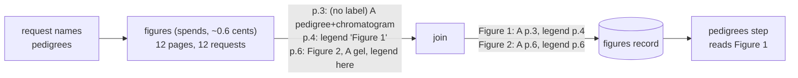

# Design: annotating a paper's figures

**Related:** [`pedigree-extraction.md`](pedigree-extraction.md) (the first step that reads this record);
[`variant-extraction.md`](variant-extraction.md) (the shape of a spending step);
[`evidence-fulltext.md`](evidence-fulltext.md) (the steps that bring a paper up to date, and the rule that naming a
target is the decision to spend); [`litcache-manifest.md`](litcache-manifest.md) (the records and refs a step writes,
and where a paper's PDF is kept); [`cost-monitoring.md`](cost-monitoring.md) (how a model priced by prompt length is
counted). Terms in [`../../GLOSSARY.md`](../../GLOSSARY.md).

## Overview

Some of what a curator needs from a paper is only in its figures. A pedigree draws who in a family is affected; a
chromatogram shows the base that changed; a protein schematic places the variant in a domain. Before any of that can be
read, something has to say where the figures are and what each one shows. The pedigree step is the first that needs
this, and choosing the papers worth reading (triage) will need it too.

The obvious way to find a figure is through the words around it: a pedigree is introduced as "pedigree" or "family
tree", and its drawing prints labels like "II-3". On 60 papers from the literature cache, those cues found 25 of 31
pages that carry a pedigree, and 37 of the 62 pages they picked carried none. The misses are not random. A pedigree
drawn without printed labels, whose legend is on another page or does not use any of the words, is invisible to text.

So Themis looks at the pages instead. One step shows a small vision model, Haiku 5.5, each page of a paper's PDF on its
own, and records every figure it finds: each panel with its page, a box around it, and every kind drawn in it, one of
which is "pedigree". The pages' answers are then joined into the paper's figures, each with its label and the place of
its legend. On the 60 papers this found all 31 pedigree pages that Sonnet 5.5 finds, for 0.6 cents a paper. The record
is stored under a `figures` ref, the manifest's pointer to a paper's current record of a kind
([`litcache-manifest.md`](litcache-manifest.md)), and the steps that read figures start from it.

## Background

### What a paper's figures look like in its PDF

The literature cache keeps a paper's PDF and a markdown rendering of its text
([`litcache-manifest.md`](litcache-manifest.md)). It does not keep a publisher's figure images, so the PDF's pages are
the only image of a figure that Themis has. A paper with no PDF has no figures to annotate.

A figure on a PDF page can be drawn as vector graphics, with its labels as real text, or pasted in as a raster image,
with its labels part of the picture. The PDF's text layer sees the labels of the first kind only. A figure is usually
made of panels, lettered A, B, C, and a panel is the unit a reader needs: one figure can hold a pedigree in panel A and
the chromatograms of its family in panel B. A single panel can also draw two kinds of thing at once. A common layout
draws a family's pedigree with a sequence trace under each person, and that panel is both a pedigree and a chromatogram.

The figure's legend is a block of text, usually directly below the figure. It is sometimes on the facing page, and in an
author manuscript the legends are often gathered on pages of their own, away from the figures. A large figure can also
run across two or more pages, its label printed once.

### Asking a model where something is

A Claude model can report where things are in an image as pixel coordinates of the image it was given, with the origin
at the top left. Two facts about this shape the design. The coordinates are in the image as the model received it, after
any shrinking the API applied, so the step sends each page at a size the API will not shrink and converts the
coordinates back to the page. And the boxes are approximate: a box drawn by the model can clip a figure's edge or take
in some of its margin.

### The papers measured

Two sets of papers are measured throughout. The test set is 60 papers drawn from the literature cache, described in the
Appendix, with Sonnet 5.5 reading every page as the reference. The canary is the 488 papers of an earlier run of
case-record extraction: the first 500 papers, by random id, of the cache's seed corpus. 479 of them have a PDF. The seed
corpus is mostly case reports, so the canary has far more pedigrees than the literature at large (36% of its papers with
a PDF draw one), and the share of pages that are pedigrees in it is not the share elsewhere.

### Haiku's price depends on the length of the request

Haiku 5.5 has two list prices. A request whose prompt is over 100,000 tokens pays five times as much for every one of
its tokens ([`cost-monitoring.md`](cost-monitoring.md)). A page sent at the size this step uses costs about 4,800
tokens, so a request carrying more than about 20 pages crosses the boundary. In the 479 canary papers, 56 had more than
20 pages, and they held 36% of all pages.

## Non-goals

- **Reading what a figure says.** This step says where a figure is and what it shows. Reading the family in a pedigree
  or the base in a chromatogram is the job of the step for that kind.
- **Tables set as text.** A table typeset as text is in the markdown rendering already. A table pasted in as an image is
  annotated, with its own kind.

## Design

### One request per page

A request that names a target needing figures runs the `figures` step on the paper. The obvious design shows the model
every page of the paper in one request. It sees the paper's layout as a whole: it can join a figure on one page to its
legend on the next, and follow a figure that runs across pages. This design was built first, and two facts broke it.

The first is the price boundary. A paper of more than about 20 pages pays five times as much for every page, and long
papers hold a third of all pages, so one request per paper costs an estimated 1.7 cents a canary paper against 0.7 cents
for requests kept under the boundary. The second is that seeing the whole paper did not find more pedigrees. On 221
canary papers, per-page requests found every pedigree page the whole-paper request found, and 7 more, each confirmed by
Sonnet: three pages of a supplementary figure holding 18 family pedigrees, a pedigree in a graphical abstract printed
twice, a figure page with four families' pedigrees, and an unlabelled illustration of a family. The whole-paper request
flagged one page per-page did not, and it held references, not a pedigree.

So the step renders each page and sends it to Haiku 5.5 as a request of its own, at most eight of a paper's pages at
once. The model answers through a tool: every figure drawn on the page, with its label as printed there, the box of its
legend if the legend is on the page, and its panels, each with a box and every kind drawn in it; and every legend on the
page, with the label it begins with. The page number comes from the request, never from the model.



The instructions and the tool are the same for every page of every paper, and are cached; the page is not, since only a
repair would send it again. A page costs about 5,000 input tokens and 120 output tokens.

The step sends only images. Giving the model each page's text layer as well seemed likely to help it find legends, and
it did not: on the 60 papers it found the same pedigree pages with or without the text, and the text doubled the cost.
Sending only images also means a paper's cost depends only on how many pages it has, and that a scanned PDF with no text
layer is annotated like any other.

Each page is sent at the largest size the API accepts without shrinking it, 2,576 pixels on its long side. At the
smaller standard size, a third of the tokens, the model missed 2 of the 31 pedigree pages and drew 16 boxes that were
malformed or off their page.

### What a pedigree is, and why a panel has several kinds

With one kind per panel, a pedigree drawn with a chromatogram under each person forces a choice. The model usually
chooses "pedigree", but not always: shown one such page five times, it called the panel a chromatogram once. Seeing the
legend on the next page tipped it to "pedigree" every time, which is why the whole-paper request did not show the
problem. So a panel names every kind drawn in it. In the canary, 12% of panels had more than one kind, and 52 of them
were a pedigree with chromatograms.

Several kinds per panel invites the opposite error. A workflow diagram with three person icons over the words "Family
members" came back as a pedigree. The prompt therefore defines a pedigree by its drawing: individuals as squares,
circles or diamonds, joined by lines between partners and lines down to their children. Person icons, the word "family",
or a key of pedigree symbols on its own are not a pedigree, and a panel has a kind only when that kind of drawing is in
it, not because its text mentions it. On the disputed canary pages this cut the pages wrongly called pedigrees from 14
to 8 and kept every pedigree a curator would read. The one drawn family it now leaves out is an unlabelled illustration
of identity by descent, which carries nothing a reader could extract.

Most of the 8 that remain are pages carrying only a legend that describes a pedigree; seen alone, the page invites the
model to report the figure the legend describes. Each costs one Sonnet read, about 8 cents, which ends in "no pedigree".
A prompt rule against them cost a real pedigree page in 40, so they are accepted (§Open questions).

### Joining pages into figures

A page seen alone cannot say which legend on another page is its figure's, or that it continues the figure before it.
The step joins the pages' answers deterministically, by these rules, in page order:

1. A label counts only when some legend in the paper carries it, the legend the answer attached to the drawing included.
   A page holding the second half of a figure can come back labelled with a guess: one test paper's page 5 came back as
   "Figure 3", and the paper has no Figure 3. A drawing whose label does not count is treated as unlabelled, and if it
   takes a legend by rule 4, it takes that legend's label.
1. Drawings on neighbouring pages that share a counted label are one figure, its panels in page order. "Figure S2" and
   "Supplementary Figure 2" are the same label. The same label far from the figure's pages starts another figure, since
   one of the two is a misreading.
1. A labelled figure whose answer gave it no legend looks for one with its label. It tries a page next to its own first,
   then its own pages, then the nearest page. A neighbouring page comes first because the model attaches a legend that
   is on the figure's own page to the figure itself; a legend with the same label left unattached on the same page is
   more often the model echoing the label from the drawing than a second caption.
1. An unlabelled drawing with no legend of its own looks for a legend no other figure claims. A legend is claimed by any
   drawing in the paper that prints its label. The drawing tries its own page first, then the page before and the page
   after. Each page's unclaimed legends go to that page's own drawings before any neighbour's, so a page that only
   continues a figure never takes the legend of the figure drawn on the next page.
1. An unlabelled drawing that finds no legend continues the figure before it in reading order: the last figure on its
   page, or else the last on the page before. A page can come back as one labelled figure and two unlabelled drawings
   that are its other panels.

A legend goes to one figure, except that figures sharing a label share it. The model reports a figure's legend twice, on
the figure and in the page's list, with boxes drawn by eye; two boxes that mostly overlap and name no different figures
are one legend.

For example, take a paper whose page 4 draws "Fig. 1" with its legend, and whose page 5 draws the rest of it and comes
back labelled "Figure 3". It records one figure, "Fig. 1", with panels on pages 4 and 5 and its legend on page 4: rule 1
discards the label "Figure 3", and rule 5 joins page 5 to the figure before it. Now give the same paper a page 6 that
draws "Figure 2" with no legend, and a page 7 that holds only the legend "Figure 2". Rule 3 gives Figure 2 the legend on
page 7, the next page. And if page 6's drawing printed no label at all, rule 4 would give it the same legend: page 7's
legend names no figure any drawing prints, so it is unclaimed, and it is on the page after.

On the 60 papers, the join gave every pedigree figure the legend page the whole-paper request gave it. Neither is
reliable for a legend on another page, though. The canary has 15 pedigree figures whose legend the whole-paper request
put on another page, and an earlier version of the join was checked on them against the PDF's text layer, taking a line
that begins with the figure's label as its caption. In 11 of the 15 the text layer pointed to one caption page that told
the two answers apart; in the other 4 it pointed to two pages or none. Of the 11, one request per page was right in 6
and the whole-paper request in 6: both in 2, each alone in 4, and neither in 1. The pedigree step shows the model a
figure's legend page when that is another page, so a wrong legend page costs an image that does not help, and could
mislead the reading if that page's legend describes another family.

### The record

The record lists a paper's figures. Each figure has its label as printed, the place of its legend, and its panels. A
place is a page of the PDF and a box on that page. A panel has its letter, its kinds, and its place. For example:

```
figures {
  label: "Figure 1"
  legend { pdf_page: 4  box { ... } }
  panels { label: "A"  kinds: [FIGURE_KIND_PEDIGREE, FIGURE_KIND_SEQUENCE_CHROMATOGRAM]  place { pdf_page: 3  box { ... } } }
  panels { label: "B"  kinds: [FIGURE_KIND_GEL_OR_BLOT]                                   place { pdf_page: 3  box { ... } } }
}
figures {
  label: "Figure 2"
  legend { pdf_page: 6  box { ... } }
  panels { label: ""  kinds: [FIGURE_KIND_CHART]  place { pdf_page: 6  box { ... } } }
}
```

Boxes are stored as fractions of the page, measured from its top-left corner, as the variant records' boxes are, rather
than in the pixels of the image the model saw. A step that reads the figure re-renders that part of the page at whatever
size it needs, and the box still means the same place. Each panel carries its own page, so a figure drawn across two
pages is two sets of panels under one figure.

The kinds are a closed list: pedigree, clinical photograph, medical imaging, microscopy, sequence chromatogram, gel or
blot, sequence alignment, gene or protein schematic, protein structure, chart, table image, diagram, and other. It
covers what the pedigree step needs and the kinds triage is likely to ask about. A new kind is added to the list, which
leaves existing records valid, and the harness version changes with it, so a request that cares re-annotates.

Each record carries a construction, a description of how it was made: here the model and the harness version. The
harness version is a digest of everything the model is given, as for the variant extraction, with a revision number for
changes the digest cannot see, such as the join rules. A change to either makes existing records stale for a request
that names the target.

### The step checks every box before it accepts a page's answer

Each box has to be four numbers making a box of at least a few pixels on the page image, and each kind has to be on the
list. An answer that fails goes back to the model with the reason, in the same conversation, as the variant and pedigree
steps do. About 2% of pages need a repair. A figure reported with only its legend on the page is read as that legend,
which is how the model reports a page that carries a legend whose drawing is elsewhere.

A page whose answer still fails after two repairs, that the model refuses, or that the API refuses as malformed, ends
the step without a record, and the job log keeps the reason as a permanent failure: the same page would fail the same
way again. The paper's other pages still run to their end, so every turn that was paid for is counted. A failure another
attempt could clear, such as a stream that breaks off mid-answer or a request that fails in transit, leaves the step to
be retried, as for the other spending steps.

The obvious alternative keeps the other pages: a record that lists the failed page with its reason, as the pedigree
record lists a figure it could not read ([`pedigree-extraction.md`](pedigree-extraction.md)). It lost because a figure
record with a page missing is wrong in ways no reader of it can see. The missing page may be the one that draws a
pedigree, and a paper whose record shows none settles as having nothing to read, which looks the same as a paper that
has no pedigree. It may hold the legend of the figure on the page before, which the join then gives to some other
figure, or leaves the figure without. Its drawings may continue a figure, and the next page's drawings then continue the
wrong one. The cost is that a paper with one such page has no figure record and no pedigrees read, and the job log names
the page.

That a box is on its page does not make it accurate. A reader of a figure pads its box before using it, and the pedigree
step shows the model the whole page anyway, with the figure's box as a pointer to where to look.

### Haiku 5.5, not Sonnet

The obvious choice is the stronger model, since finding figures is the gate in front of everything that reads them.
Sonnet 5.5 was run as the reference on the 60 papers, each seeing the whole paper. Haiku 5.5 agreed with it on every
paper and every page as to whether a pedigree was there. Where both models drew a box around the same panel, they gave
it the same kind 617 times in 645, and none of the 28 disagreements involved a pedigree. Haiku cost $0.46 for the 60
papers, and Sonnet $8.55. A hand check of the drawn boxes found them all in place, with Haiku's boxes a little looser
than Sonnet's more often than the reverse. Haiku seeing one page at a time found the same 31 pages.

## Alternatives considered

- **One request per paper.** It lets the model join a figure to a legend on another page, but a paper of more than about
  20 pages pays five times as much, and on the canary it found fewer pedigree pages, not more (§One request per page).
  It also asks the model for each panel's page number, which a request per page fixes.
- **Pages in groups of up to 20, overlapping by a page.** It keeps every request under the price boundary and some of
  the whole-paper context, at the price of merging the groups' answers, which is the same join with more cases. The
  whole-paper context it keeps found no extra pedigree in the measurement.
- **Text cues.** Free, and they need no model. They lost on the measurement in the Overview: a fifth of the pages that
  carry a pedigree are missed, and most pages they pick carry none. A wasted Sonnet read of a page costs more than
  annotating a whole paper.
- **grus's vision detector.** grus trained a small open-weight model to answer "is this a pedigree?" for a figure image,
  and it finds 92% of pedigree figures in the open-access corpus. It needs separate figure images, which the cache does
  not keep, and a GPU host the worker does not have. It answers one question about one kind, where this record serves
  every step that reads figures.
- **The PDF as a document block.** The API accepts a PDF directly and shows the model each page as an image with its
  text. The images are sized by the API, so the step could not convert the model's coordinates back to the page.
- **A key of pedigree symbols in the prompt.** An image of the standard's symbols would cost little, read from the
  cache. The pedigree misses measured so far were a choice between two kinds both drawn in a panel, which a symbol key
  does not settle; it would help with unusual drawings, of which none has been seen missed.

## Open questions

- **Legend-only pages called pedigrees.** About 7 in 220 canary papers. A check that a pedigree panel's box covers drawn
  content in the PDF (images or vector paths, not text alone) would catch them in born-digital PDFs, though not in
  scanned ones, where every page is one image. Worth building if their Sonnet reads become a noticeable cost.
- **A gold set.** The measurements compare Haiku with Sonnet, plus a hand check that the boxes are in place. A set of
  papers with hand-marked figures and legends would give recall against the truth, and settle how well legends on other
  pages are joined.
- **Very long PDFs.** A PDF with its supplement can run to hundreds of pages. The step annotates at most 100 pages, a
  bound on what one paper spends; whether longer papers deserve their supplement's figures is open.
- **Publishers' figure images.** A paper fetched as XML with no PDF has no figures to annotate. If the cache kept the
  publisher's figure images, the step could annotate them, each with its caption from the rendering.
- **Triage.** Triage decides which papers are worth reading before a request is made, and it will want to know what
  figures a paper has. Whether it reads this record or annotates figures itself is for its design to settle.

## Appendix

### The 60-paper measurement

Papers drawn at random from the literature cache's full-text papers with a PDF of at most 40 pages, in three groups: 30
whose text cues pick a page, 20 with family language (proband, kindred, affected relatives) but no cue, and 10 others.
620 pages in all, at the high-resolution size.

| run                                     | pedigree pages found (Sonnet: 31) | other pages called pedigree | cost, 60 papers |
| --------------------------------------- | --------------------------------- | --------------------------- | --------------- |
| Haiku 5.5, whole paper, images and text | 31                                | 0                           | $0.99           |
| Haiku 5.5, whole paper, images only     | 31                                | 0                           | $0.46           |
| Haiku 5.5, whole paper, standard size   | 29                                | 0                           | $0.12           |
| Haiku 5.5, one page per request         | 31                                | 1                           | $0.36           |
| Text cues (no model)                    | 25 (of 62 pages picked)           | 37                          | free            |

On the whole-paper runs, Haiku's pedigree boxes overlapped Sonnet's with a median intersection-over-union of 0.91; the
standard size drew 16 boxes that were malformed or off their page. Sonnet placed the legend of 18 figures on a different
page from the figure, 5 of them pedigrees. The 20 papers with family language and no cue had no pedigrees. Only 3 of
these 60 papers cross the price boundary, so the cost of one request per page against one per paper understates the
saving on real papers.

### The canary comparison

The 171 canary papers in which the whole-paper request found a pedigree, and 50 drawn at random from those in which it
found none: about 2,900 pages, $1.77 with one request per page. Sonnet judged each page on which the two designs
disagreed, asked only whether a pedigree is drawn on it.

| pages                                     | count |
| ----------------------------------------- | ----- |
| both designs call it a pedigree           | 194   |
| per-page only, and Sonnet sees a pedigree | 7     |
| per-page only, and Sonnet sees none       | 14    |
| whole paper only, and Sonnet sees none    | 1     |

The 14 are the disputed pages the stricter definition of a pedigree then cut to 8, while flagging all 40 of a sample of
the agreed pedigree pages.
