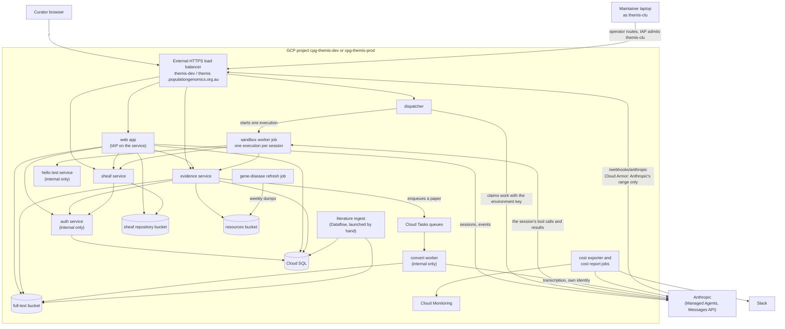

# Design: infrastructure and environments

**Related:** [`deployment.md`](deployment.md) (how a stack is deployed, who may deploy it, its state and secrets),
[`data-retention.md`](data-retention.md) (what Themis keeps, for how long, and how an erasure works),
[`security.md`](security.md) (public ingress and exfiltration channels), [`access-control.md`](access-control.md) (IAP,
the ACL, and how the agent reads a Project's dataset), [`services.md`](services.md) (the data-plane gRPC services),
[`cost-monitoring.md`](cost-monitoring.md) (Anthropic spend and its alerts),
[`../runbooks/fresh-environment.md`](../runbooks/fresh-environment.md) (bringing up an environment),
[`../runbooks/claude-api-wif.md`](../runbooks/claude-api-wif.md) (the Anthropic identities each environment needs).

## Overview

Themis runs in two environments. `dev` is shared by the team. It runs synthetic cases and CPG's open datasets, doubles
as the demo environment, and is deployed by hand from whichever branch someone wants to show. `prod` is built to hold
CaRDinal research data, carries it once the conditions under [Real data in prod](#real-data-in-prod) hold, and is
deployed from `main`. Themis is a research tool in both environments.

Each environment is a GCP project of its own, driven by its own stack of one Pulumi program in [`infra/`](../../infra/),
with its own Anthropic workspace and its own Slack app. No resource in one environment names a resource in the other, so
a mistake in dev cannot reach prod's data, and each environment's spend can be read on its own. The two share only what
sits above them: the Anthropic organization, the site account that writes each environment's ACL, and the group of
operators who may act as the operator account.

Because both stacks run the same program, every way in which prod must differ from dev has to be a setting in its stack
file. The database tier and the minimum and maximum instance counts are constants in the program, so they move into
stack config, with dev's current values in dev's file. A TLS 1.2 minimum on the load balancer and deletion protection on
the session-token key go into the program for both stacks, since dev loses nothing by having them.

Real data adds controls that dev could do without. Every log entry stays in Australia, in a regional log bucket the
program creates. Audit logs record who read a secret, an object or a database row, including the values each query
carried. Operational alerts report a failing job before a curator notices stale data. And the site lists a CaRDinal
dataset in prod's ACL only while a short set of conditions holds, among them a decision by CPG's data governance on
where Anthropic stores session content.

This doc covers the cloud resources around the services: the environments, the topology, the per-environment settings,
logs and audit, backups, alerting, budgets and local development. How a stack is deployed is in
[`deployment.md`](deployment.md), and what is kept and how it is erased is in [`data-retention.md`](data-retention.md).

## Background

### The platform

Themis's services run on Cloud Run, as services that answer requests and as jobs that run to completion. Structured data
lives in one Cloud SQL for PostgreSQL instance per environment, and durable blobs (working documents, papers, reference
data) live in GCS buckets. The web app runs behind Identity-Aware Proxy (IAP), a Google-run proxy that admits a request
only once its sender has signed in with a Google account.

The agent loop runs at Anthropic, through Managed Agents ([`managed-agents.md`](managed-agents.md)). The agent's tool
calls run inside our own project, in a sandbox worker job that Cloud Run starts for each session. The data-plane
services ([`services.md`](services.md)) are the gRPC services that the web app and the sandbox call to read and write
evidence, working documents and access decisions.

A Pulumi *program* is the code that declares the resources, and a *stack* is one instance of it, with its own state and
its own config file. [`deployment.md`](deployment.md) explains how a stack is bootstrapped and deployed, why committed
config holds secrets only as ciphertext, and why dev cannot stand in as a staging environment for prod
([`deployment.md`](deployment.md#two-environments-from-one-program)).

### Real data

CaRDinal is CPG-managed, consented research data ([`../PRODUCT.md`](../PRODUCT.md)). Several decisions across the design
docs were accepted on the condition that the data is synthetic, and prod breaks that condition:

- The PR preview account can decrypt the stack's secrets, which [`deployment.md`](deployment.md) now accepts on a
  trusted-membership condition instead.
- A destructive migration was allowed while no environment held data worth keeping; [`migrations.md`](migrations.md) now
  requires expand and contract everywhere.
- The log of calls to upstream evidence services names the variant each call is about and is readable by every project
  log viewer; [`security.md`](security.md) restates that acceptance for prod.
- What is kept, and for how long, was left open; [`data-retention.md`](data-retention.md) decides it.
- The residual exfiltration channel through the agent's web tools was accepted with synthetic data in mind; it is one of
  the conditions under [Real data in prod](#real-data-in-prod).

## Non-goals

- Application code for the web tier and the agent, which [`frontend-framework.md`](frontend-framework.md) and
  [`agent-runtime.md`](agent-runtime.md) cover.
- Authorization, roles and Project membership, which [`access-control.md`](access-control.md) and the application own.
  The infrastructure provides the perimeter, and the site the secret the ACL lives in.
- Multi-tenant isolation, and billing or onboarding for external customers.
- Google Cloud Identity Platform for curators without a Google account. IAP admits any Google account, and a curator
  without one can register a Google account on their existing institutional email address, so a second identity provider
  would add a component without admitting anyone new.

## Design

### One project, one stack and one workspace per environment

The obvious way to stand up a new environment inside CPG is to reuse an existing project, such as a development project
that already has billing and a budget. That would tie Themis's IAM bindings, service accounts and logs to datasets and
workloads Themis has no business with, and nobody could say from Themis's config alone what the environment can reach.

So each environment gets a dedicated project in the CPG organization, `cpg-themis-dev` and `cpg-themis-prod`, and its
own stack. Every resource name is scoped to its project, so the two stacks cannot collide, and no resource points at
another project. Each environment owns one of each of the following:

| Per environment                      | Why it is not shared                                                                     |
| ------------------------------------ | ---------------------------------------------------------------------------------------- |
| GCP project                          | IAM, logs, budget and blast radius stay per environment                                  |
| Pulumi state bucket and KMS key      | a credential for one stack's state cannot decrypt the other's secrets                    |
| ACL secret                           | the site writes each environment's Projects and people separately                        |
| Anthropic workspace                  | separate spend limits, Managed Agents resources and spend accounting (below)             |
| Slack app, spend and alerts channels | a post shows which environment sent it, and dev's token cannot post into prod's channels |

Some things are shared because they sit above the environments. The Anthropic organization holds both workspaces. The
site's deploy account, one account at CPG, creates and writes each environment's ACL secret. And one Google group
decides who may impersonate each project's operator account, `themis-clu`, which
[`access-control.md`](access-control.md) argues.

The Anthropic workspace (`themis-dev`, `themis-prod`) holds the environment's agent, skills, self-hosted environment and
sessions, and carries the environment's spend limit. Sharing one workspace between dev and prod would break the cost
monitor ([`cost-monitoring.md`](cost-monitoring.md)), because each environment's cost exporter reads spend scoped by the
workspace its token belongs to. If prod's sessions ran in `themis-dev`, dev's exporter would count them as dev spend,
and prod's exporter would count dev's demos as prod spend. Prod's workspace leaves inference geography at the workspace
default; what that means for where session content is processed is in [`data-retention.md`](data-retention.md).

Each workspace federates a set of the environment's GCP service accounts into Anthropic, and only an org admin can
register them. Some of those accounts exist only after the first `up`, so a new environment needs org-admin requests
before and after its first deploy; [`deployment.md`](deployment.md#bringing-up-a-fresh-environment) owns that sequence,
and [`../runbooks/claude-api-wif.md`](../runbooks/claude-api-wif.md) has the names and the procedure.

Prod sits directly under the organization, as dev does, rather than in a folder with stricter org policies (see
Alternatives considered). The organization does not enforce Domain Restricted Sharing on prod's project, the org policy
that limits IAM grants to the organization's own domain, and IAP's grant to all authenticated users depends on that.

The cost of this layout is a bootstrap step, two rounds of Anthropic requests and a Slack app for every environment. It
is paid once per environment.

### What differs between dev and prod

The obvious premise for a second environment is that it is the same program with a second stack file: copy dev's config,
change the project, the hostname and the keys, and deploy. For resource names that holds. It fails for the settings that
make an environment production-grade, because those are constants in the program, so prod could only differ from dev by
a program change that would also change dev.

So those settings become stack config, and dev's file holds the values dev runs on:

- **The Cloud SQL tier, availability and maintenance window.** The obvious choice for prod is a dedicated-core tier with
  a standby in a second zone, because a shared-core tier carries no SLA and its CPU can be throttled under sustained
  load. Prod's load does not call for it: a handful of curators, each driving one Analysis at a time, is the load dev
  already carries on its shared-core tier in a single zone. So prod starts on dev's tier and availability. What the tier
  decides is speed and uptime, not whether data survives: backups, point-in-time recovery and deletion protection are
  the same on every tier ([Backups](#backups)). A tier change is an in-place update with a restart of a few minutes, and
  the database saturation alerts ([Alerting](#alerting)) are the signal for it. Prod also sets a maintenance window, so
  that the platform's updates restart the instance at a quiet hour.
- **Minimum instances for the web app and the auth service.** Every request a curator makes passes through both, and
  both scale to zero when idle, so a curator who opens prod after a quiet spell waits for the web app to start, and then
  for the auth service it calls. A warm instance of each would remove that wait, but it costs more than the database:
  the auth service keeps its CPU allocated, so a standing instance is billed at the full instance rate. Prod starts at
  zero, as dev runs, and the setting is there for when curators notice the wait.
- **Maximum instances on the services that hold database connections.** Each service caps its own instance count, and
  each instance keeps a pool of connections. The tier admits a fixed number of connections, so the caps have to be sized
  against it. The shared-core tier admits 25, and the auth service and the web app at their caps claim most of those.
  The caps live in each stack's config beside its tier, so a larger tier and the caps it allows change together.
- **The trace sample ratio**, which is per stack. Prod starts by tracing every request, as dev does, while its traffic
  is small.

Some opt-ins are also per stack, and prod keeps them off: the public PR-screenshot bucket, the operator account's
ability to derive a live session's bearer, and the CI telemetry account. Which of these prod may hold, and the checks
that enforce it on every PR, are in [`deployment.md`](deployment.md#what-prods-stack-keeps-off). The full-text work
sweep, which finds papers the conversion queue lost, stays unscheduled in both stacks and runs by hand
([`evidence-fulltext.md`](evidence-fulltext.md)); its design is about to change, and prod follows dev until it does.

Where dev loses nothing by a setting, the program changes for both stacks. The load balancer's HTTPS proxy gets an SSL
policy with a TLS 1.2 minimum: without one, it gets GCP's default policy, which still admits TLS 1.0. The session-token
KMS key gets deletion protection. A session's bearer token is derived from the session's id with this key when the
session starts, and derived again each time the dispatcher starts a worker for it. A replacement key derives a different
bearer, which no longer matches the one recorded when the session started, so every live session would be locked out of
the data plane.

### Topology

Each environment runs the same set of services and jobs, behind one external HTTPS load balancer. The figure shows one
environment, with the hostname of each.

Every public route reaches a Cloud Run service through the load balancer:

- Curators reach the web app at `/`. IAP is enabled on the web app's Cloud Run service, not on the load balancer, and
  admits any signed-in Google account. The auth service then decides what that account may see from the ACL
  ([`access-control.md`](access-control.md)).
- Anthropic delivers its "run started" webhook to the dispatcher at `/webhooks/anthropic`. Anthropic cannot present a
  Google credential, so this route has no IAP. A Cloud Armor policy admits only Anthropic's published outbound range,
  and the dispatcher checks each delivery's signature. The dispatcher accepts traffic only from the load balancer and
  from inside the project, so its own `run.app` URL cannot be used from the internet to bypass the policy.
- Maintainers reach the evidence and sheaf services on operator routes, where IAP admits only the `themis-clu` operator
  account ([`../runbooks/hand-driving-a-service.md`](../runbooks/hand-driving-a-service.md)). The auth service has no
  route on the load balancer at all; only callers inside the project reach it.

The rules for what may be public at all, and the exceptions, are in
[`security.md`](security.md#ingress-from-the-public-internet). The list of services and what each serves is in
[`services.md`](services.md).

The jobs run to completion and nobody calls them over HTTP. The dispatcher claims each new session's work from Anthropic
and starts one sandbox worker execution for it, handing the worker the credentials it needs to receive the session's
tool calls. Cloud Scheduler starts the gene-disease refresh, which writes the dumps the evidence service loads at
startup, and the cost exporter and cost report, which read Anthropic's usage and post to Slack. The convert worker is a
service, but nothing calls it except the Cloud Tasks queues the evidence service fills. Literature ingestion runs as a
Dataflow pipeline that an operator launches by hand.

### Audit logging

GCP writes every project's logs to a global log bucket named `_Default` unless told otherwise. A global bucket may store
entries outside Australia, while the database and its backups are pinned to Australian regions. Several kinds of log
entry carry case content: the upstream-call log names the variant each call is about, the sandbox worker logs the labels
the agent gives its commands, and the audit entries below carry query values. So the program creates a regional log
bucket in `australia-southeast1` and routes the `_Default` sink into it, in both stacks. How long entries stay there is
decided in [`data-retention.md`](data-retention.md). The `_Required` bucket, which holds Admin Activity audit logs,
stays global, because the platform fixes its location. The cost falls on whoever reads logs: the console's log explorer
searches the default buckets unless told otherwise, so a reader selects the regional bucket explicitly.

GCP always writes Admin Activity audit logs, which record every change to a resource's configuration, such as a new IAM
binding or a deleted bucket. The obvious position is that these are enough. They record nothing about reads, though. In
prod, an operator who reads a CaRDinal Analysis's working document out of the sheaf bucket, or a secret out of Secret
Manager, would leave no trace.

So the program gains an audit module, in both stacks, that turns on Data Access audit logs for Secret Manager, Cloud
KMS, Cloud SQL and GCS. For Cloud SQL that is not enough on its own, because its Data Access audit logs record calls to
the Cloud SQL Admin API, such as a connection or the issue of a client certificate, and not the queries run once
connected. The module therefore also turns on pgAudit, PostgreSQL's audit extension, for every database role, logging
each statement together with the values bound into it. Without the values, a parameterised read is logged as
`SELECT … FROM analyses WHERE id = $1`, which says that someone read an Analysis but not which one, and a search is
logged without what was searched for.

Logging the values has a consequence: every value a statement carries is copied into the logs. That includes the
clinical context, the prompts and the rationales a curator enters, since the web app writes each of them with an
`INSERT`. [`data-retention.md`](data-retention.md) lists the logs among the copies an erasure does not reach. The volume
is small at Themis's traffic, about the same order as the request logs the load balancer and Cloud Run already write.
Running the module in dev as well means it is exercised before prod depends on it.

The upstream-call log stays in the same bucket as every other log, readable by the project's log viewers; the reasoning
for accepting that in prod is in [`security.md`](security.md).

### Backups

The Cloud SQL instance takes daily backups and keeps a window of write-ahead log for point-in-time recovery
([`infra/themis_infra/sql.py`](../../infra/themis_infra/sql.py) holds the counts). Backups go to a second Australian
region, a separate failure domain from the instance. The location is set explicitly, because leaving it unset lets Cloud
SQL choose the enclosing `asia` multi-region, which would put the backups offshore. The instance also refuses deletion,
both through Pulumi and through the Cloud SQL API.

The buckets that hold working documents and papers keep object versioning on, with soft delete off and a lifecycle rule
that removes an overwritten or deleted version after a fixed window. That window is the recovery window for an
accidental overwrite. GCS's own soft delete would also guard against accidents, but its window cannot be cut short for
an object that is already soft-deleted, so a deliberate delete would stay recoverable for the full window. Versioning
lets a deliberate delete of every version take effect at once. An erasure relies on that: it deletes every version of an
Analysis's objects, so nothing it removes lingers in the bucket ([`data-retention.md`](data-retention.md)). The
resources bucket holds data the program can regenerate, such as the gene-disease dumps and reference mirrors, and is not
versioned. The Storage section of [`infra/README.md`](../../infra/README.md) gives each bucket's policy.

### Alerting

In dev, a failure is noticed by whoever is using dev at the time. In prod, that person is a curator. A gene-disease
refresh that fails every week leaves the evidence service on dumps that grow staler each week, and nothing reports it
until someone sees an old date in an Analysis. The only alerts so far are the spend monitor's
([`cost-monitoring.md`](cost-monitoring.md)) and one on the ACL, raised when the auth service rejects a new ACL version
([`access-control.md`](access-control.md)).

So the program adds Cloud Monitoring alert policies, in both stacks, for the failures a curator would otherwise find
first. Every policy reads a metric, never a log line: a log-match alert depends on the exact wording and severity a
process happens to print, which nothing tests.

- A failed run of any Cloud Run job, the sandbox worker and the gene-disease refresh among them.
- Server errors from each service a curator's request or an agent's session passes through. For an HTTP service that is
  its 5xx count, which Cloud Run records. A gRPC service reports an application error as a status inside an HTTP 200, so
  Cloud Run sees only transport failures there. The gRPC services therefore record the standard OpenTelemetry RPC
  metric, each call's duration labelled with its final status, and the alert counts calls that end in a server-side
  fault (`INTERNAL`, `UNKNOWN`, `UNAVAILABLE`, `DATA_LOSS`). A caller's mistake, such as `NOT_FOUND`, does not page.
- Saturation of the Cloud SQL instance: CPU, disk and connections.
- Expiry of the load balancer's certificate.
- A rejected ACL. The auth service records the outcome of every attempt to load a version.
- A failed deploy. A deploy is a GitHub Actions run rather than a Cloud service, so its last step records the run's
  outcome, success or failure, as a metric point under the deploy account.

Latency is deliberately not alerted on yet. For the services that stream (the web app's session events, sheaf's packs)
Cloud Run's latency is a stream's lifetime rather than a measure of health.

The policies are program-managed, since the deploy account holds the monitoring roles. They post to the environment's
operational alerts channel through that environment's Slack app, which keeps operational incidents out of the spend
channel, and the ACL-rejection alert moves to the alerts channel as well. Slack refuses a post from a bot that has not
been invited to the channel, and Cloud Monitoring does not report the refusal, so each channel is checked with a test
notification when it is created.

#### When an incident closes

Cloud Monitoring opens an incident when a policy's condition starts to hold and closes it when the condition stops
holding. A policy whose close means the failure is over posts to Slack on both, so the channel shows whether a failure
still needs someone's attention.

For a condition over a rate, such as a service answering 5xx or a saturated database, a close means that: the incident
closes once the rate falls back. A job's failure is different, because it is an event rather than a rate. The obvious
condition counts failed runs over a window, an hour say, and opens while the count is above zero. The incident then
closes when the hour has passed, whatever happened since. On 4 November the cost exporter failed once at 18:00 UTC, its
next run at 18:05 succeeded, and the incident stayed open until 19:06. A message on that close would have said only that
an hour had gone by.

So for a job that runs on a schedule, the condition is "the latest run failed": the policy compares the time of the
job's last failed run with the time of its last successful one. The incident opens at a failure and closes after the
next success. The comparison looks back seven and a half days, longer than the gap between two runs of the weekly
gene-disease refresh.

Looking back that far costs speed. Cloud Monitoring evaluates a policy less often the further back its query reads: as
often as every 30 seconds up to 25 hours back, every 5 minutes up to 8 days back, and every hour or more beyond that
([PromQL-based alerting policies](https://docs.cloud.google.com/monitoring/promql/promql-in-alerting)). These policies
stay inside the 5-minute band, so an incident opens within five minutes of the failure that decides it. Monitoring
closes it the larger of 270 seconds and two evaluation intervals after the condition last held, so about ten minutes
after the run that resolves it.

A job that runs on demand has no next run that repairs a failure. The sandbox worker runs once per agent session, so a
later session's success says nothing about the session that lost its sandbox. Its policy keeps the event form, with a
window just long enough for Monitoring to see the failure, and posts when it opens only. Failures of one job within
about ten minutes share an incident, and the incident's text says how to list them. The work sweep, the job that reads
the literature store and queues the papers still to convert for the convert worker, has its schedule paused in both
stacks, so it runs only by hand and takes the same policy.

A deploy and an ACL load take the "latest" form too. Every deploy records its outcome, so a failed deploy's incident
closes when a later deploy succeeds. With the same seven-and-a-half-day look back, a failed deploy that no later deploy
follows within that time closes without a recovery; since every merge deploys prod, a fix normally follows sooner. The
auth service records, for each outcome of a load, the time it last happened. A value of 1 for "rejected" and 0 for
"loaded" would not do: the auth service scales to zero, and a series that nothing writes any longer would read as the
condition no longer holding. Times survive an instance that has stopped, so the policy can compare the latest refusal
with the latest successful load across all instances.

Cloud Run records two counts per job. The count of finished executions, which looks like the natural one, records only a
few of them: over eight days in prod it saw 14 of the cost exporter's 351 successful runs. The count of finished task
attempts records every attempt, so the policies read that. Every job runs a single task, so an attempt is a run. That
has one consequence for a job that retries: the gene-disease refresh may retry once, so a failed first attempt opens an
incident that its successful retry closes.

### Data prod starts with

Some of what the running system reads is created by neither the bootstrap nor `pulumi up`.

The literature corpus is the largest part: the full-text store of converted papers, the crosswalk that maps a paper's
identifiers to its entry, and the GeneReviews chapters. Prod copies dev's built paper store and rebuilds the crosswalk
from the store's manifests, rather than re-running the ingest, because a re-run would pay for every paper's
transcription a second time. The store holds public literature and no case data, so copying it from dev moves nothing
that dev's looser controls could have touched. Dev's seed dump, from which dev's corpus was ingested, is kept until
prod's corpus exists.

The reference mirror is loaded into prod's resources bucket by the resource mirror tool. No running service reads it
yet, so it does not hold up anything else.

### Budget and standing cost

Each project has a GCP budget, set in CPG's infrastructure repository rather than in this program, so that the budget
sits with the organization's other budgets. Prod's budget unlinks billing when it is exceeded, as a hard cap on what a
runaway resource can cost. When billing is disabled, GCP stops the project's resources, and Google may delete them if
billing stays disabled, which includes the Cloud SQL instance and its backups. So an operator relinks billing promptly
after the budget trips. The GCP budget also does not cover Anthropic: what prod's agent can spend is capped by the prod
workspace's spend limit, and tracked by the cost monitor ([`cost-monitoring.md`](cost-monitoring.md)).

Cloud Run services and jobs scale to zero when idle in both environments. The standing cost is resources that run
whether or not anyone uses Themis, chiefly the Cloud SQL instance and the load balancer, and it is about the same in
both.

### Real data in prod

The site decides which datasets an environment serves, by listing them in that environment's ACL
([`access-control.md`](access-control.md)). The site lists a CaRDinal dataset in prod's ACL only while each of the
following holds. Each condition is owned by the doc linked from it.

- **CPG's data governance accepts where Anthropic keeps session content.** Session transcripts are stored in the US
  ([`data-retention.md`](data-retention.md#session-transcripts-are-stored-in-the-us), which owns the decision), so a
  dataset whose consent or ethics approval does not allow that cannot be listed.
- **The agent can reach case data only through the designed data path.** In that path, the trusted sandbox worker mounts
  the Project's dataset storage read-only and binds only the sample files the agent asks for into its guest
  ([`access-control.md`](access-control.md#the-agent-reads-its-projects-dataset-as-files)). That path is what confines a
  session to its own Project's data, so a dataset is listed only once the path exists and is the agent's only way in.
- **The residual exfiltration channel through the agent's web tools is accepted for real data.** A page the agent reads
  can plant links, and a later fetch can reveal which of them the agent chose. For example, a poisoned page lists one
  link per possible answer to "does this case carry variant X", and the fetch of one link tells the page's author the
  answer. The channel was accepted, together with the output and citation monitoring that watches it, with synthetic
  data in mind ([`../plans/self-hosted-sandbox.md`](../plans/self-hosted-sandbox.md#2-the-self-hosted-contract)). A real
  dataset is listed only once that acceptance has been made for real data, or the channel has been closed.
- **The dataset's participant metadata carries no direct identifiers.** The agent may read the site's participant
  metadata in Metamist, CPG's sample registry, and relies on the convention that identifiers, free-form metadata and
  phenotype notes hold no name, date of birth, medical record number or address. Metamist does not enforce the
  convention, and the metadata changes after any one check. So the convention is the site's ongoing commitment for every
  dataset prod's ACL lists, and someone with read access to the dataset confirms it with a scan before its first
  listing.

### The agent runtime and the sandbox boundary

The agent loop runs at Anthropic, and the web app is a thin client of it ([`agent-runtime.md`](agent-runtime.md),
[`managed-agents.md`](managed-agents.md)). The agent's tools run in the sandbox worker job in our project, inside an
isolated guest with no network and no credential for private data ([`sandbox-worker.md`](sandbox-worker.md)). The guest
reaches the data plane only through Unix-socket hatches that inject the session's token
([`sandbox-rpc-exposure.md`](sandbox-rpc-exposure.md)).

At the IAM boundary, write permissions are split by who authored the data. The data-plane services are the only writers
of agent-authored content, and they bind every write to its Analysis through the session's token. The web app writes
only the rows it owns: Analyses, per-session grants, and the curator's own uploads. In the designed data path, the
trusted worker, not the guest, holds the grant to read a Project's dataset ([`access-control.md`](access-control.md)).

### Local development and tests

Running the whole system on a laptop would mean emulating Anthropic's agent loop and seeding local copies of the
literature and reference data. That emulation would need maintaining and would add little, because the agent's behaviour
is only meaningful against real tools and data. Pull-request CI, on the other hand, has no cloud access at all, so every
test it runs has to be hermetic.

So the web app, the agent and the tests are each developed against a different backend:

- The web app runs locally against the fixture backend, which serves seeded example data from memory, so a UI change
  needs no cloud access ([`apps/web/README.md`](../../apps/web/README.md)).
- The agent and its tools are iterated against dev: a developer deploys their branch to dev, runs a session there, and
  reads the trace.
- Tests run with no cloud access. Every service has a fixture backend that runs in-process
  ([`services.md`](services.md#fixture-isolation-and-fail-loud-seeding)), so the unit-test loop runs even on a machine
  without Docker. Tests that need real PostgreSQL or GCS semantics run against a PostgreSQL container and a fake GCS
  server, and skip cleanly where no Docker daemon is reachable.

Everyone shares the one dev environment, so concurrent changes to its schema, services or agent need coordination. If
shared dev becomes a bottleneck, the remedy is a further stack per developer, each in its own project, rather than
partial isolation inside one project. Schema migrations stay forward-only and reach dev only through the deploy
([`migrations.md`](migrations.md)).

## Alternatives considered

- **Putting prod in a folder with stricter org policies.** A folder would apply organization-wide guardrails to prod
  without anything in this program, which is a better place for a guardrail than code a deploy can change. The usual
  guardrails each forbid something Themis uses. `constraints/sql.restrictPublicIp` forbids the Cloud SQL instance's
  public IP, which exists only so that the Cloud SQL connector can reach it; the instance refuses every direct
  connection. `constraints/iam.allowedPolicyMemberDomains` (Domain Restricted Sharing) forbids IAP's grant to all
  authenticated users, which external curators need. `constraints/compute.vmExternalIpAccess` forbids the Dataflow
  workers' external IPs, which were chosen over a Cloud NAT gateway to avoid its cost; under the folder, Themis would
  pay for the gateway instead. The folder lost because it would need an exception for the first two, and the exceptions
  would then hold the real policy.
- **A Cloud Armor policy in front of the web app.** IAP admits any Google account, so a signed-in account that is on no
  Project in the ACL still reaches the web app. The auth service refuses it at its first call, so it reaches no data,
  but it can still send requests. Rate-based Cloud Armor rules would bound a flood of such requests before it reaches
  Themis code. It lost because what such a flood costs is compute, which the services' instance caps already bound, and
  the one route without IAP, the dispatcher's webhook, has a source-range policy of its own.
- **Copying dev's images into prod instead of rebuilding them.** [`deployment.md`](deployment.md) argues this one.

## Open questions

- Whether the organization enables some Data Access audit logs above the project. Dev's project has no audit config of
  its own, and only an org admin can check the organization's. The audit module is needed either way, so that the
  project's coverage does not depend on a setting outside it.
- How to detect Anthropic auto-disabling the webhook. Anthropic disables a webhook endpoint after a run of failed
  deliveries, and the queue-depth alert designed to catch it
  ([`../plans/self-hosted-sandbox.md`](../plans/self-hosted-sandbox.md)) reads queue statistics with an org API key.
  That conflicts with the spend monitor's rule of holding no identity with admin reach
  ([`cost-monitoring.md`](cost-monitoring.md)), so it needs a design of its own. Until one exists, a disabled webhook
  shows up as sessions that never start.
- Whether separate workspaces isolate rate limits. The per-environment workspace assumes they do, but Anthropic's
  reference documents some Managed Agents request limits per organization, which would let a busy dev throttle the start
  of prod's sessions.
- Whether the `hello` test service ships to prod. It holds no data, but the sandbox job can reach it.
