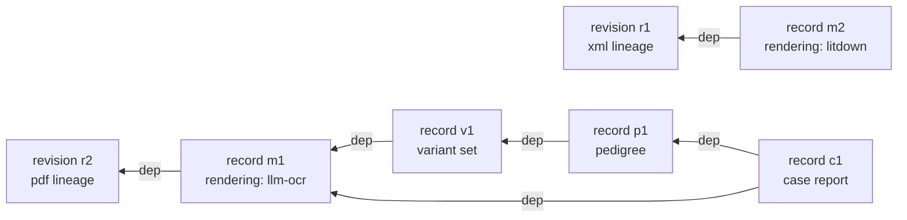

# Design: the litcache manifest

**Related:** [`proto.md`](proto.md) (how at-rest records are serialised, and how their schemas may change),
[`evidence-fulltext.md`](evidence-fulltext.md) (how a paper's text is produced, and how readiness is read off the
store), [`literature-evidence-layer.md`](literature-evidence-layer.md) (the interface that serves the store to the agent
and the browser), [`../plans/literature-cache.md`](../plans/literature-cache.md) (the build plan).

## Overview

Themis's full-text store keeps each paper as a directory in a bucket, named by the paper's `doc_id`. Most of what a
directory holds is bytes named by their own content hash: the PDF and XML a paper was fetched as, and the markdown made
from them. A name of that kind says what the bytes are, but not whether they belong to the paper. One object in each
directory says that: the manifest. A paper exists for every reader once its manifest is committed, and it holds exactly
what the manifest names.

The manifest records two kinds of thing. It records what was *captured*: the source files, each a lineage of revisions
that carries its own licence. And it records what was *derived* from them. Today the only derived artifact is a
rendering, the markdown a reader quotes. The extractions that come next read a rendering and feed each other. A variant
set is extracted from a rendering, a pedigree is built from variant sets, and a case report is written from a pedigree
and the text.

That chain is what shapes the design. Every derived artifact is recorded the same way, as a *record* keyed by the hash
of its bytes, naming the hashes it was made from and how it was made. A chain of any depth is then a path from record to
record. A paper can also hold several candidates at one level, such as a rendering converted from the publisher's XML
and an older one transcribed from a PDF. So the manifest holds *refs* as well: one name per kind, each pointing at the
record a reader should use. The run that produces a record moves the ref when the new record is the better one. The
choice is therefore made once, when the record is written, and every reader follows the same name.

Beside the manifest sits `metadata.pb`, the paper's bibliographic record as each index published it
([The bibliographic record](#the-bibliographic-record-metadatapb)).

## Background

### A paper's directory, and why it needs a manifest

A paper's files are *content-addressed*: each is stored under a name made from the sha256 of its bytes. That has three
consequences the rest of the design leans on. Writing the same bytes twice produces one object, so a write can be
repeated safely. An object never changes after it is written, since different bytes would have a different name. And a
reference to an object by its hash is also a check that the bytes are the ones meant.

What a content-addressed name cannot say is whether the bytes belong to the paper. A writer that crashes halfway through
storing a paper leaves objects behind, and they look exactly like the objects of a finished paper. So one object in the
directory is named by its role rather than its content: `manifest.pb`. It is written last, and only if no manifest is
there yet, so the first writer to finish wins and a second learns it lost. Readers go to the manifest and nowhere else.
An object no manifest names is inert, which is what makes a crashed write harmless.

The manifest is a binary protobuf, defined in
[`litcache.proto`](../../schema/proto/themis/litcache/models/litcache.proto). The examples below show it as JSON for
reading only.

### What the manifest has to say

A paper's primary artifact can change while its identifiers stay the same. PubMed Central reissues an article's XML as
`PMC2992036.1` and later `PMC2992036.2`, and a publisher corrects a PDF without minting a new DOI. The change is to one
file, not to the paper as a whole: a corrected XML leaves the PDF beside it untouched.

Licence varies the same way, file by file. The JATS XML a paper is fetched as from PubMed Central's open-access subset
can carry a CC-BY licence inside it, while a PDF of the same paper supplied by a person's institutional access carries
none. A licence recorded once for the whole paper would be wrong for one of the two.

A paper's text reaches a reader as markdown, and there is more than one way to make it. Converting the publisher's XML
reproduces the paper faithfully. Transcribing a PDF with a vision model gets close, and an older converter got less
close. So the route a rendering took decides how far it can be trusted, and a paper can hold renderings made by several
routes at once.

Quotes are stored against a rendering's bytes, because quoting is done on text. A quote made last month may refer to a
rendering made from a revision the store has since replaced, and it has to keep resolving. It also has to be upgradeable
to the current revision, by finding the same words in the newer text.

### Derived artifacts depend on each other

Renderings are the first artifact the store derives, and they will not be the last. Each extraction that follows reads
something the store already holds and produces something a later step reads in turn. A rendering is made from a source
revision, a variant set is extracted from a rendering, a pedigree is built from variant sets, and a case report is
written from a pedigree together with the paper's text, so it depends on two artifacts of different kinds.

At any level a paper can hold more than one candidate: two renderings, or two variant sets extracted with different
prompts. A step can read only one of them, and which one it read is part of what it produced. A variant set extracted
from an approximate rendering is a different result from one extracted from the faithful one.

## Design

### Captured files are lineages of revisions

The obvious way to record what a paper was fetched as is one entry per paper: its PDF, its XML. That breaks on the first
reissue, because there is then a second XML with the same role and nowhere to put it. A paper-wide snapshot, where each
change produces a new version of the whole record, breaks the other way: it records a change to the XML as a change to
the PDF too.

So each captured artifact is a *lineage*, named by a stable handle such as `xml` or `pdf`, and a lineage holds an
append-only list of *revisions*, one per fetched byte-set. A lineage's current revision is the one captured most
recently, judged by its capture time and never by its position in the list. A reissue appends a revision to the `xml`
lineage and leaves the `pdf` lineage alone. The handles in use are `pdf` and `xml`, one per media type. The handle is an
open namespace rather than the media type, because two lineages could share a media type: XML converted from a scraped
web page would enter as XML under a handle of its own.

Licence and access sit on the lineage, because that is the level at which they vary. They hold across all of a lineage's
revisions and differ between a paper's lineages. A lineage also records where its licence string came from. It was
either read out of the fetched bytes, as a JATS `<license>` element is, or asserted by an access authority because the
bytes carry none. The store keeps the raw string as the fetcher returned it, without mapping it onto an SPDX identifier.

Each revision records where its bytes came from: the open-access source that served them, the seed corpus, a person's
upload, or the open-access location Unpaywall lists for the paper. The last is how a paper ingested by its identifier
alone comes to hold a PDF. Take the preprint `doi:10.21203/rs.3.rs-4272138/v1`. No source serves its XML, so the
conversion lane fetched the PDF at Unpaywall's best open-access location and recorded it as the one revision of a `pdf`
lineage. A PDF carries no licence in its bytes, so the lineage's terms are the ones Unpaywall states for that same
location, `cc-by` and free to read, recorded as asserted. Unpaywall's terms describe one copy of a paper, which is why
they are taken only with the copy they describe.

Because the terms belong to the lineage, a revision joins a lineage only on that lineage's terms. A PDF obtained on
different terms from a PDF the paper already holds, such as an open-access copy beside one captured through
institutional access, is a lineage of its own under a handle of its own.

Two lineages can therefore hold the same bytes. Say a curator supplies a PDF, captured through their library, and the
identical file is later found at an open-access location. The same revision hash then sits in both lineages, under
different terms. A record's dep names bytes, not a lineage, so a rendering transcribed from that PDF resolves to both.
That needs no tie-break, because the bytes are the same: the least restrictive terms of any lineage holding them apply
to them, and to everything derived from them. Free to read outranks every other access, so in the example the rendering
is open access, whichever lineage the transcription read its bytes from. Nothing yet reads more than whether a text is
open, so the order among the restricted kinds of access waits until something does.

Supplementary files, such as figures and data tables, are recorded in a separate list that doubles as the register of
files known but not yet fetched. A paper can list hundreds of them: one paper in the dev corpus lists 340, and more than
half of all papers list some. A known file has a name but no content hash until it is fetched. A fetched file records
the sha256 of its bytes and when it was fetched, and its bytes sit content-addressed beside the paper's other files.

The hash is what lets a derived artifact name a supplementary file as its input, as a variant set extracted from a
supplementary spreadsheet does. That only works if the hash stays listed for as long as anything depends on it. So the
list is append-only. When a publisher reissues `mmc1.xlsx` with a corrected row, the corrected file is a second
`mmc1.xlsx` entry with a later capture time, and the first entry stays. A variant set extracted from the first version
still names bytes the manifest lists.

A file's role is read from the XML rather than recorded. The publisher's original file name is kept, and the XML refers
to files by that name: in a sample of 1,680 papers, 98.5% of their files are referenced, two thirds inside a figure and
a quarter as supplementary material. A figure that the XML refers to by `href` is matched to the list by name when the
XML is rendered.

### Every derived artifact is a record, keyed by its bytes

The obvious way to record a new kind of derived artifact is a map of its own on the manifest, the way renderings were
recorded until now: a map from each rendering's hash to how it was made. Each kind would then be fully typed, and a
reader of variant sets would never see a pedigree. That works for one level. It breaks at the second, because the
artifacts depend on each other across kinds. Each per-kind map has to invent its own way of naming its inputs.
Renderings named theirs by a lineage handle plus a revision hash. A reader following a case report back to the words it
cites would have to learn every kind's scheme on the way down, and every new kind would add a map and a write path of
its own.

So every derived artifact is a *record* in one map on the manifest, keyed by the sha256 of the artifact's bytes. A
record holds three things: the hashes it was derived from (its *deps*), when it was produced, and how it was made (its
*construction*). The construction is a choice with one arm per kind. A rendering's arm names its converter, the
converter's version, and the model where a vision model transcribed a PDF. A dep is a bare hash. Its role is read from
what it resolves to: a source revision, a fetched supplementary file, or a record whose construction says what kind it
is.

Every extraction takes this shape, however many inputs it reads. A knowledge-unit extraction is one document of units,
with the rendering it read as its dep. A variant extraction is likewise one document, with the rendering and any
supplementary spreadsheet it read as its deps. A written description of a figure has two: the figure's image, and the
PDF revision its bounding box was found in. The artifact's bytes sit beside the manifest, content-addressed at a path
its kind determines, exactly as a rendering's markdown always has.

The chain from the Background then looks like this, with toy hashes:



Following a case report back to its text is now one walk: `c1` names `m1`, and `m1` names revision `r2` of the PDF
lineage. The walk is the same whatever kinds it passes through.

A new kind needs a new arm in the manifest's schema, which is a contract change and is reviewed as one. That is the
right place for the review, because the construction is the part of a record a later reader relies on to judge it.

A dep does not say which input it was, so a reader that needs to know resolves it. A case report that read both the
paper's rendering and a supplementary file's rendering tells them apart by following each one step further, to the
source it was made from.

Keying by bytes has a cost of its own. Two runs that produce identical bytes produce one record, and the record keeps
only the deps and construction of the run that finished most recently. A rendering re-made by a newer converter version
that happens to output the same markdown therefore records the newer version and loses the older. That is the right
answer for the store's readers. A quote cites bytes, and identical text is the same text to everything that reads it.

### A ref names the record a reader should use

Several records of one kind can sit side by side, and a reader needs one of them. The obvious way to pick it is at read
time: rank the candidates on each read and serve the best. That is how the canonical rendering was chosen until now, by
converter fidelity with recency breaking a tie. It has real virtues. A re-render can never leave the choice stale,
because nothing stored records the choice. And a change to the ranking takes effect on the next deploy.

It breaks at the second level of the chain. Which rendering a variant set was extracted from is part of the variant set,
so the choice of rendering has to be made before the extraction runs and recorded with what it produced. Read-time
ranking also puts the ranking in every reader. One reader ranks renderings by converter, another ranks variant sets by
prompt version, and each has to agree with the writers about what "better" means. The read surface depends on that
agreement: the agent's read, the quote matcher and the document pane have to serve the same text, or a quote validated
against one rendering fails to locate in another ([`literature-evidence-layer.md`](literature-evidence-layer.md)).

So the manifest stores the choice, as a map of *refs* from a name to a record's key. The run that produces a record
moves the ref when its record is better than the one named. Each kind has its own rule for "better"; for an extraction
it might be the newer prompt version. For a rendering it is the fidelity ranking: a rendering converted from source XML
is preferred to a PDF transcription, a vision-model transcription is preferred to the older converter, and recency
breaks a tie. The record and the ref that names it land in one write, and the manifest's schema refuses a ref that names
no record it holds. Nobody moves a ref by hand.

Names are simple. A kind's name refers to the paper itself: `markdown` names the rendering a reader is served, and
`variants` names the current variant set. A supplementary file's record of the same kind is named after the file, as in
`markdown/table-s2.docx`. Each question a reader asks then has a direct answer from the one manifest it has already
read. It looks up the paper's text by name. It reaches each supplementary file's text by walking the manifest's list of
files and looking up each file's name. And it finds every rendering ever made by filtering the records by kind.

A stored ref can point at a record built on an input that has since been replaced. Take the figure above. Rendering
`m2`, converted from the XML, lands after `m1`, so its run moves `markdown` from `m1` to `m2`. The `variants` ref still
names `v1`, which was extracted from `m1`. Nothing is wrong with that. Rendering `m1` is still held, so `v1` and
everything built on it stays consistent, and every quote in it still resolves. But `v1` is no longer built on the
current text, and that is visible: a record is current when each of its deps is the record its kind's ref names, and
`v1`'s dep is not. Records that are not current are the extraction lane's work, found by reading the store rather than
recorded anywhere else. A reader that needs a consistent chain, such as a variant together with the words it cites,
follows deps down from the record it starts at rather than looking up the current ref at each level.

The cost of storing the choice is the read-time design's virtue turned around. A change to the ranking reaches existing
refs only when something recomputes them, where a read-time ranking would have applied it on deploy.

### Path layout

The manifest and the bibliographic record sit at the paper's root, named by role. Everything else is content-addressed,
under a directory for its kind:

```
manifest.pb
metadata.pb
sources/pdf/<rev-hex>.pdf
sources/xml/<rev-hex>.xml
renderings/<md-hex>.md
supplementary/<hex>.jpg
```

A second revision appends `sources/xml/<new-rev-hex>.xml`, and a re-render appends `renderings/<new-md-hex>.md`. Old
objects persist, so old quotes keep resolving. Every hash in the manifest and every filename stem is the same bare
sha256 hex digest, with no prefix and no transform between the two.

`metadata.pb` sits beside the manifest and is the one artifact that may be regenerated after the commit: the manifest
holds no hash of it, and its bytes derive from the paper's identifiers through the resolver ladder rather than from
anything in the directory, so re-deriving it refreshes the bibliographic record while every source and rendering stays.
Which changes that refresh serves, and which need the corpus rebuilt, is decided with the record
([The bibliographic record](#the-bibliographic-record-metadatapb)).

The obvious place to write `metadata.pb` is with the other objects, before the manifest commits, so that a reader never
finds a manifest without its record. That order is safe for the content-addressed objects because each is named by its
content: two writers storing the same bytes produce one object, and two storing different bytes produce two.
`metadata.pb` is named by the `doc_id` alone, and two seeds reach the same `doc_id` when they share an identifier. Say
one seed is keyed by a DOI, and a second seed, keyed by the PMID of a different paper, names that DOI in its Docling
origin by mistake. The crosswalk gives both one `doc_id`. Resolution is keyed by the identifiers each seed carries
rather than by the DOI they share, so the second seed gets its PMID's PubMed record. If both writers pass the manifest
check before either commits, the create-only commit stops the second manifest but not the second record, and whichever
manifest commits can end up beside the other seed's record with nothing to notice it.

So `metadata.pb` is written after the commit, and only from a record of the paper the manifest describes. The writer
whose commit wins writes it straight away. Any other writer that finds the manifest committed, by the manifest check or
by losing the commit, writes the record only when the paper is missing one and the ids its seed claimed are the ones the
manifest records, since only then is its record the one a metadata refresh would resolve. That check covers the loser
that is really the winner, too: a commit whose response is lost is retried by the storage client and fails as if another
writer had won. Whichever of the two seeds above loses claims ids the other's manifest does not record, so it writes
nothing.

The cost is a window in which a committed paper has no record, a state the reader already handles by titling the paper
with its DOI or PMID. If the writer stops inside that window, the record stays missing until the paper is next ingested,
and a metadata refresh fills any paper still missing its record.

The same race costs more when the loser has done real work. Bulk ingestion claims a paper's ids, then spends minutes
fetching and converting before it commits. If an agent asks for the same paper in that window, the on-demand ingest
commits a manifest holding only the paper's ids, and the bulk writer's commit fails. Its PDF and rendering are in the
bucket, but nothing names them. For a paper that is not open access, the conversion lane cannot reach that PDF, so the
paper ends with no text although its seed was converted.

So a writer that finds the manifest committed joins it rather than discarding its work. In one read-modify-write
conditional on the manifest's generation, it adds its sources, renderings and files, and moves the `markdown` ref if a
rendering it adds outranks the one named. It joins only when every id its manifest would record is one the committed
manifest records. The weaker test, that none of its ids contradicts the manifest's, admits the second seed above: its
PMID contradicts nothing in a manifest that records only the DOI, and its PDF would land in the other paper's directory.

An on-demand ingest records the DOI, PMID and PMCID it was asked for or the index returned, which usually covers what a
seed carries. Where it does not, the bulk writer still loses its work: a seed carrying a PMCID the index did not return,
an alias DOI where the index returns the primary one, or a Bookshelf chapter, whose accession the on-demand path does
not record. An open-access paper among them recovers when the conversion lane renders it again.

A join can leave a paper holding two seeds' work where a sequential run would have kept one: two PDFs of the same paper,
each with its rendering, when both seeds reached the `doc_id` concurrently. The ranking picks the rendering served, as
it does for any paper holding more than one.

### A change to the manifest's shape pauses the writers instead of carrying both forms

[`proto.md`](proto.md#schema-evolution) sets the rule for a change to a stored record that the compatibility gate would
refuse. The new form lands as a new field beside the old one, every stored record is rewritten into it, and only then is
the old field retired, with its number and name reserved. The usual way across the gap is for every reader to accept
either form for a while, and for every writer to fill both.

For the manifest, that period would be code written only to be deleted. The manifests live in one bucket, and the only
code that reads or writes them is code this repository deploys. So the gap is crossed by ordering the steps instead:

1. Every manifest writer pauses: the conversion queue is paused, and no ingestion runs. A metadata refresh writes only
   `metadata.pb`, so it can run throughout.
1. A one-off tool rewrites each manifest into the new form, leaving the old field in place, so readers still running the
   previous code keep working.
1. Readers and writers that use only the new form deploy. The rewrite then runs again, to catch any manifest a writer
   touched despite the pause, and a check confirms that no manifest is left in the old form.
1. Writers resume. The old field is then retired, and the tool is deleted with it.

Renderings moved into records this way. Each manifest had held them in a map of their own, and the rewrite copied each
entry into a record, set the `markdown` ref by the fidelity ranking, and filled each fetched supplementary file's hash
from the path its bytes are stored at, which already names them. One manifest's renderings, before and after:

```json
"renderings": {
  "dd4306e5…": { "from_source": "xml", "from_revision": "647ab726…", "converter": "litdown", "converter_version": "0.3.0" }
}
```

```json
"records": {
  "dd4306e5…": { "deps": ["647ab726…"], "rendering": { "converter": "litdown", "converter_version": "0.3.0" } }
},
"refs": { "markdown": "dd4306e5…" }
```

Every quote survived the move, because a record's key is the same markdown hash the map used.

The rewrite replaces each manifest with a read-modify-write conditional on the manifest's generation, so a manifest a
writer touches during the run is read again rather than overwritten. The bucket keeps each object's earlier generations
for 30 days, which is the way back until writers resume; after that, a manifest written by the new code is one the
previous readers cannot read. The cost is the pause: conversions wait in the queue for as long as it lasts, rather than
run.

## The bibliographic record: `metadata.pb`

Beside `manifest.pb`, at the paper's root rather than under a content hash, sits `metadata.pb`: the paper's bibliography
— title, authors, journal, abstract, the identifiers its index lists. The manifest says what we hold of a paper and
under what terms; `metadata.pb` says what the paper is. It is regenerated wholesale from its source, never edited in
place ([`proto.md`](proto.md), bucket 1). This section decides what the record is, and how a reader tells.

**The record is kept whole, in the schema its index publishes.** A paper's metadata is stored as the record its index
published, in that index's own schema, rather than as a subset of its fields chosen at write time. A subset carries only
what its author foresaw needing, and what it dropped is gone until someone re-fetches; the whole record costs kilobytes
and answers questions nobody has asked yet. The same test rules out storing one index's record mapped into another's
schema: a Crossref work squeezed into `PubmedArticle` keeps only the fields PubMed happens to have a slot for, and a
reader can no longer tell which index answered ([`literature-evidence-layer.md`](literature-evidence-layer.md), a
discovery rpc is a query against one named source). So each index has a schema of its own here. PubMed's is NLM's,
generated from its DTD ([`proto.md`](proto.md), Generated upstream schemas); Crossref's and OpenAlex's are mirrors of
the JSON each publishes, hand-authored and loaded strictly ([`proto.md`](proto.md), Mirrored upstream schemas). The same
reasoning makes the literature interface answer a PMID with PubMed's record whole, so a run's triage read and the
store's copy are the same record kind through the same converter — not the same bytes, since the store's copy is taken
at ingest and the run's at query time, and indexes revise records.

**One field per index.** `metadata.pb` is a typed envelope, `PaperMetadata`
([`litcache.proto`](../../schema/proto/themis/litcache/models/litcache.proto)): one field per index a paper can be
resolved from, each holding that index's record whole, and a protovalidate constraint that at least one is set. The
fields are independent because the indexes are: a paper PubMed indexes may also have an OpenAlex record, and a preprint
PubMed does not index has a Crossref or OpenAlex record and no PubMed one. Which record a reader prefers when several
are present — PubMed's title over Crossref's, say — is a policy of the one function that derives the summary, below, not
a slot in the envelope. The envelope records what each index states and nothing about their precedence, so a new index
is a new field and changes no reader of the others.

**PubMed's record has two kinds, and its field says which.** Most PMIDs name a journal article, but a PMID can also name
a book NCBI hosts on its Bookshelf, or a chapter of one — a GeneReviews chapter, the expert-written summary of a gene or
condition that a variant analysis cites routinely. PubMed's schema gives the two kinds different records,
`PubmedArticle` and `PubmedBookArticle`, that share no top-level shape: a journal record hangs off a citation with a
journal, a book record off a document with a book. Protobuf's wire format carries field numbers, not a type, so bytes
read as the wrong message may decode without error into a record that means nothing, and a store that can hold either
has to write down which one it holds. The envelope's `pubmed` field is therefore a message of its own, `PubmedRecord`,
whose `oneof` has an arm per kind and requires exactly one set — the structural move the access disposition on a lineage
makes too. The exclusivity is PubMed's own rule, a PMID names one record, stated in the type; it is why the two kinds
are arms of one field where other indexes are fields of their own.

**A mirror is loaded strictly, so a lagging mirror fails the paper rather than thinning the record.** Crossref and
OpenAlex publish JSON, and neither publishes a schema a generator consumes the way `pubmed-proto` consumes NLM's DTD:
each publishes an OpenAPI description of its HTTP API, and each description lags and mis-states the records the API
serves — OpenAlex's by a dozen top-level keys, Crossref's by keys and shapes it never lists. Each mirror is therefore
hand-authored against the live records, and a hand-authored schema can lag the upstream. A lagging schema that dropped
the keys it lacked would lose data at write time for good, so the loader refuses a record carrying a key the mirror
lacks: the paper is dead-lettered as schema drift naming the field, and the fix is the field. Nothing lossy is ever
written; the cost is that ingestion of papers resolved through that index pauses until the mirror catches up, which for
OpenAlex is as often as it adds fields. Two upstream shapes have no proto equivalent — an array of arrays, an object
whose values are arrays — and the loader wraps them into messages before the parse; it also drops the null array
elements proto3-JSON cannot hold, except inside a positional array such as a date's parts, where a null between stated
parts fails the parse rather than shifting them. A round trip over live records, parse then serialise then compare, is
what checks that the wrapping and the mirror lose nothing.

**The summary is derived, never stored.** Consumers want a bibliography in one shape — a title, a year, an author list —
without switching on which index answered. That shape is computed from the envelope by one function beside the proto,
and is not a field of it. A stored projection goes stale with every change to the rule that derives it: a chapter with
no title of its own falls back to its book's, say, and the next such rule would leave every stored summary wrong until a
corpus rewrite, at which point the store's rule for derived artifacts would want a summariser version on it, as a
rendering carries its converter's. Derived on read, the same change is a deploy. Adjudicating between coexisting records
lands in the same function.

**An envelope with no record is corruption.** The at-least-one constraint is enforced where the record crosses a
boundary: the writer validates the envelope before it writes, and a reader that parses one fails rather than reading it
as a paper without metadata. A paper no index has a record for is not ingested at all — the resolve ladder dead-letters
it — so an empty envelope never means "metadata not yet resolved"; it means the bytes are wrong.

**A book record carries an identifier of its own.** Beside the PMID, Bookshelf names a chapter by an accession (`NBK…`),
and the accession is how the chapter's text is addressed: Europe PMC serves a chapter's BITS XML under its accession at
the `bookXML` endpoint — a different endpoint and corpus from the JATS article XML behind the plain Europe PMC source
kind. The lineage it produces records a distinct source kind for two reasons: the producer maps the upstream that served
a body onto a `SourceKind` and refuses a body from an upstream it has no kind for as a permanent anomaly, so a new
upstream needs a member; and the member records which corpus the bytes came from. The accession joins the manifest's
external ids (`ExternalIds.bookid`) on the footing every external id there has: an id in the manifest is one the
crosswalk claimed — that is what keeps the crosswalk rebuildable from the manifests alone — so the accession is minted
like the others rather than merely recorded.

**An additive change needs only a refresh or a rebuild; a destructive one is an expand/contract change.** The compat
gate holds `litcache.proto` and the two mirrors to additive evolution ([`proto.md`](proto.md#schema-evolution)). Every
reader therefore already parses the records written before an additive change. What such a change can still need is the
stored records brought up to it, because a field the envelope or a mirror gains is empty in every record written before
it. A change confined to the record is met by a metadata refresh, and a change to the conversions needs a full rebuild.
Every `metadata.pb` in the store is re-derivable from its source (PubMed's XML, Crossref's or OpenAlex's JSON) through
the ladder that resolved it at ingest. So a record is brought up to a change by re-deriving it, not by rewriting stored
bytes or teaching readers a second decoding. Both are operator runs
([`reingest-literature-seed-corpus.md`](../runbooks/reingest-literature-seed-corpus.md)), and which one a change needs
turns on what else has to change:

- A *metadata refresh* re-resolves every paper's bibliographic record through that ladder — efetch for a PMID,
  litfetch's DOI resolution and then OpenAlex for the rest — and overwrites `metadata.pb`. Manifests, conversions and
  `doc_id`s stay untouched: the record derives from nothing in the paper's directory and nothing there derives from it
  ([Path layout](#path-layout)), so it is the one artifact a committed paper can have re-derived. It is the path for a
  change confined to the record (a field the envelope or a mirror gains, say) and the only route to an own-index record
  for a paper first resolved through Crossref or OpenAlex: the raw record was never kept, so no rewrite of the stored
  bytes could produce it.
- A *full rebuild* — the crosswalk table truncated, the `papers/` prefix cleared, the seed re-ingested on Dataflow — is
  the path when the conversions themselves must change: ingestion skips a paper whose manifest exists, and nothing
  regenerates a committed paper's sources or renderings in place.

After an additive change, neither run leaves the readers a fallback to carry: the gate held every schema change on main
to additive, so every record written from main parses under the current schema. A destructive change to a stored record,
the kind the gate refuses, is different. [`migrations.md`](migrations.md#how-it-runs) lets a destructive change skip the
expand/contract shape only in an environment that holds no data worth keeping and no users to fail, and a store whose
corpus is kept is not such an environment. A destructive change here is therefore an expand/contract change, as
[`proto.md`](proto.md#schema-evolution) sets out for every at-rest contract. The step that rewrites every record before
the old field is retired is a metadata refresh, a full rebuild, or, for a change to the manifest's shape that leaves the
conversions alone, a rewrite of the manifests themselves
([A change to the manifest's shape](#a-change-to-the-manifests-shape-pauses-the-writers-instead-of-carrying-both-forms)).
Changing what a field means in place is never open. Protobuf bytes carry field numbers and wire types, not names or
meanings, so a record written before the change would decode without error into the new meaning.

## Quote-reference model

The cite model the knowledge-unit layer anchors against. The manifest side is settled: a quote names a rendering by its
record's key, the hash of the markdown it was taken from. The anchor and the offsets cache below are provisional.

- **Durable anchor** (write-once, in the knowledge-unit record): `{paper_id, document_id, quote, exact}`, where
  `document_id` is a rendering's key. It holds no offsets, because offsets go stale on a re-render. The verbatim `quote`
  is the durable anchor instead. A quote is not immortal, since the source text itself can change, but it degrades
  detectably (`exact -> fuzzy -> unlocatable`) where offsets would silently point at the wrong words.
- **Exported without the quote** as `{paper_id, document_id, ref_id}`. The quote stays in the knowledge-unit record, so
  a share carries no copyrightable text.
- **Resolved-offsets cache** (derived, recomputable, mutable): `(ref, rendering) -> spans`, with a status of `exact`,
  `fuzzy` or `unlocatable`. Any offset hint lives only here, never in the durable anchor. Re-aligning can move the
  status either way: a `fuzzy` hit can recover to `exact` against a better rendering.
- **Resolution walk:** the rendering's key → its record → the record's dep, a source revision → that revision's bytes →
  re-align the quote. A PDF with a text layer gives a bounding box from its characters; otherwise the quote maps into
  the XML or text.
- **Upgrade across revisions:** from the rendering's record, find the lineage its dep belongs to and that lineage's
  latest revision. If it is newer, re-render by the same route over the latest revision and re-align the verbatim quote.
  `unlocatable` is the explicit signal that the source changed under the quote.
- **Two ways a quote is minted, one model:** the knowledge-unit extractor aligns its quotes offline. When the agent
  cites, the read tool serves markdown together with its rendering's key, verifies the agent's quote verbatim against
  the served bytes (rejecting a quote the text does not contain), and mints `{paper, document, quote}`. That also seeds
  the offsets cache, since the rendering is known and current.

### Reference and anchor types

Concrete shapes for the cite model. These live in knowledge-unit records and a derived cache, not in the manifest, and
are provisional: `ref_id`, the status values and the span type are not yet frozen.

```proto
message SourceAnchor {
  string paper_id = 1;     // doc_id
  string document_id = 2;  // a rendering's record key
  string quote = 3;        // verbatim, against the rendering's bytes
  bool exact = 4;          // false once only fuzzy realignment held
}
message SharedAnchor {     // exported form — quote stripped
  string paper_id = 1;
  string document_id = 2;
  string ref_id = 3;
}
message ResolvedSpan { int32 start = 1; int32 end = 2; }
message OffsetsCacheEntry {
  string ref_id = 1;
  string rendering = 2;    // rendering key the spans were computed against
  repeated ResolvedSpan spans = 3;
  string status = 4;       // "exact" | "fuzzy" | "unlocatable" — a proto-canonical enum once frozen
}
```

## Alternatives considered

- **A derived artifact stored beside the paper under a name computed from its input, outside the manifest.** A variant
  set extracted from rendering `m1` with prompt version 3 would live at a name made from `m1` and `3`, and its existence
  would mean it is done. That needs no write to the manifest, no schema change per kind, and no contention between an
  extraction and anything else writing the paper. It lost at the first level holding two candidates. The next step's
  input is then a choice rather than a computation, and a name computed from one particular input cannot record which
  candidate was chosen. Nothing would list what exists either, short of listing the bucket.
- **Refs in an object of their own beside the manifest.** Refs would then never contend with writes to the records. It
  lost because recording an artifact and moving the ref that names it could no longer happen in one write, so a ref
  could briefly name a record the manifest does not hold. Nor could one check confirm that every ref resolves.
- **A record keyed by its bytes, its deps and its construction together.** Every distinct way of producing the same
  bytes would then keep its own record, and no construction would ever be overwritten. It lost because no reader would
  answer differently: a quote cites bytes, and two routes to identical text yield the same text.

## Open questions

- **Licence on supplementary files.** A supplementary file carries no licence of its own, so it is read under the
  paper's. A data file published under different terms, CC0 beside a CC-BY article say, would need its own, which is a
  new optional field when something needs it.
- **Materialising references from primary to secondary artifacts.** They are matched by name at render time. An index of
  them is an additive change if the read path ever needs one.
- **Where the fidelity ranking lives, and how a model counts in it.** Writers now apply the ranking when they move the
  `markdown` ref. Whether a newer model outranks an older one on the same converter is not yet settled.
- **Converter-specific fields on a rendering.** A rendering's construction requires a model exactly when the converter
  is a vision model, enforced by a constraint on the message. If more converter-specific fields appear, they could
  arrive as a per-converter choice beside the common fields. Moving the common fields into that choice would be an
  expand/contract change.
- **A Bookshelf accession at the door.** Whether `MaybeIngestPapers` accepts `bookid:` beside `doi:`, `pmid:` and
  `pmcid:` is held in [`literature-evidence-layer.md`](literature-evidence-layer.md#open-questions).
- **Falling back to an equivalent work for entitlement.** A knowledge unit anchored to a work a reader is not entitled
  to see, such as a licensed paper, could be shown against an equivalent work they can see, such as a preprint linked to
  it by an equivalence edge, by re-aligning the same quote into that work's rendering. The pieces exist. Whether to
  expose it, and how entitlement composes across a set of equivalent works, is open.
