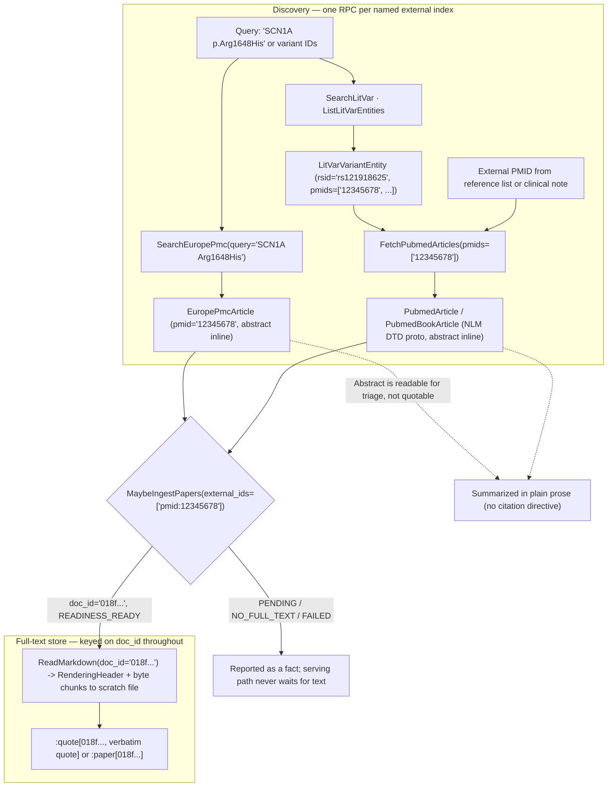

# Design: the literature evidence layer

**Related:** [`evidence-fulltext.md`](evidence-fulltext.md) (full-text ingestion, conversion, and readiness derivation),
[`litcache-manifest.md`](litcache-manifest.md) (per-paper manifest, source lineages, content-addressed renderings, and
recorded licence), [`document-pane.md`](document-pane.md) (workbench paper reveal and quote highlighting),
[`evidence-interfaces.md`](evidence-interfaces.md) (sibling fact interfaces and shared error taxonomy),
[`sandbox-rpc-exposure.md`](sandbox-rpc-exposure.md) (agent RPC exposure rules), [`services.md`](services.md) (service
port and adapter pattern). Terms in [`../../GLOSSARY.md`](../../GLOSSARY.md).

## Overview

An Analysis run asks two distinct questions about the published literature: *what has been published about this?* and
*can we read and quote its full text?* Public literature indexes answer the first question across millions of papers,
while only the corpus Themis has ingested and converted can answer the second. The literature evidence service
([`literature.proto`](../../schema/proto/themis/rpc/literature.proto), implemented in
[`themis/services/evidence/literature/`](../../themis/services/evidence/literature/)) answers both questions behind one
gRPC interface while keeping discovery hits strictly separate from readable, citable papers.

In the discovery group, each RPC queries one named external index (`SearchEuropePmc`, `SearchLitVar`,
`ListLitVarEntities`, `FetchPubmedArticles`) and returns records in that source's own schema alongside its match census,
without mapping records into a shared schema or offering page cursors. Because the variant literature index splits one
variant across multiple recogniser entities, `SearchLitVar` returns every candidate entity with per-identifier agreement
verdicts rather than merging or filtering them. Discovery records carry inline abstracts so a run can triage papers and
summarize findings in plain prose, but discovery results carry no store identifier and cannot be quoted.

To read or cite a paper, a caller passes scheme-qualified external identifiers (`pmid:`, `doi:`, `pmcid:`) to
`MaybeIngestPapers`, which is the single entry point into the full-text store. `MaybeIngestPapers` resolves or mints the
internal UUID (`doc_id`), reports derived full-text readiness, and enqueues background conversion when text is still
pending, without ever fetching or converting text on the serving path. Every store read (`ReadMarkdown`, `Validate`,
`PollFullTexts`, `DescribePaper`, `ResolveContent`, `Locate`) and every citation directive (`:quote`, `:paper`) keys on
`doc_id` alone. When a paper is ready, `ReadMarkdown` streams the complete canonical markdown rendering to a file in the
sandbox workspace, named by the content hash of its bytes so both working-document quotes and reusable knowledge units
extracted above this layer resolve permanently against the exact text that was read. Throughout the interface, expected
absences are returned as structured fields in the response, while infrastructure failures and invalid inputs fail with
gRPC status codes.

## Background

Themis pools facts extracted from the scientific literature across Projects, where each fact carries a citation pointing
to its source document while the source documents themselves remain governed by the institutional licensing of the user
who obtained them ([`../PRODUCT.md`](../PRODUCT.md) §7). In addition, external publications are untrusted content that
an agent must reach only through a curated tool surface ([`../PRODUCT.md`](../PRODUCT.md) §9). Literature access is
therefore mediated by a typed gRPC service that we control rather than direct network fetches from inside a run.

Two consumers call this service. First, the sandboxed analysis agent discovers papers, reads their markdown renderings,
and cites them in a working document; because the sandbox has no network access and no cloud credentials, every outbound
query and storage read happens inside the service on the agent's behalf. Second, the workbench backend-for-frontend
(BFF) resolves paper metadata, storage locations, and quote highlight coordinates for the browser's document pane
([`document-pane.md`](document-pane.md#backend-seam-structured-over-connect-bytes-over-presigned-redirects)).

Behind the discovery RPCs sit three live public indexes, each chosen for what it indexes best:

- **Europe PMC** indexes the full text of open-access articles, preprints, and PMC-only deposits that have no PubMed ID.
  Keyword searches (`SearchEuropePmc`) ask Europe PMC because variant notations and assay names routinely appear only in
  an article's body or tables rather than its title or abstract.
- **PubMed (`efetch`)** serves the authoritative bibliographic record behind a PMID in a single batch call. Calling
  `FetchPubmedArticles` returns the exact `PubmedArticle` or `PubmedBookArticle` structure that the full-text store
  embeds in a paper's stored metadata, so triage reads and stored records share one bibliographic schema.
- **NCBI LitVar2** runs an entity recogniser over publication text to index variant literature. LitVar2 keys each entity
  on whichever identifier string the recogniser found in the text — an rsID, a ClinGen allele ID, or a bare amino-acid
  or coding change under a gene — rather than on a normalized genomic variant. As a result, a single biological variant
  is routinely split across several LitVar2 entities with disjoint or partially overlapping paper lists, and some
  entities are indexed under legacy numbering that no current identifier constructs.

Behind the store RPCs sits the **full-text store**, a single object-storage bucket that holds everything Themis has
captured or derived for a paper. While a public index states that a paper exists, the full-text store determines whether
Themis can serve its text. Inside the bucket, **litcache** ([`litcache-manifest.md`](litcache-manifest.md)) organises
one directory per paper (`papers/{doc_id}/`) containing captured source files (publisher XML and PDFs), converted
markdown renderings, extracted figures and supplementary files, and a manifest recording each lineage and the licence or
access terms under which it was obtained. Sources and derived renderings are written additively and content-addressed by
the SHA-256 hash of their bytes: re-fetching a source adds a revision, and re-running a converter adds a rendering. A
citation recorded against a rendering hash therefore resolves to those exact bytes for as long as the paper remains in
the store.

## Non-goals

- **Fetching or converting full text on the serving path.** Serving RPCs only report whether full text is already ready
  or read existing objects from the store. As detailed in [`evidence-fulltext.md`](evidence-fulltext.md), cheap XML
  conversions take seconds and PDF transcriptions take minutes, so waiting for production inside a read RPC would turn a
  lookup into a request timeout.
- **No entitlement, for now.** Although each paper's manifest records its licence
  ([`litcache-manifest.md`](litcache-manifest.md#recorded-licence)), the RPCs here do not yet inspect it: any
  authenticated caller that reaches the service can read any paper in the store. Agent reads carry a session token to
  enforce the evaluation data cutoff, and `MaybeIngestPapers` requires an admitted caller because enqueuing a conversion
  can spend model budget ([`evidence-fulltext.md`](evidence-fulltext.md)), while browser reads through the BFF carry no
  session ([`sandbox-rpc-exposure.md`](sandbox-rpc-exposure.md)). Gating a read by the reader's institutional access is
  a requirement this interface will have to grow, and it will need a decision about what a reader who may not open a
  cited paper sees instead.
- **Accepting external identifiers on store read or citation RPCs.** Resolving a PMID, DOI, or PMCID to a `doc_id`
  happens exclusively in `MaybeIngestPapers`, so every downstream RPC deals only in internal store identifiers.
- **Searching over the subset of papers held in the full-text store.** Discovery RPCs query live public indexes to
  answer what has been published. Searching specifically over papers already ingested into the store (by keyword or
  embedding) answers a different question and would be added as a separate RPC rather than a flag on the live index
  searches.

## Design

### One discovery RPC per named source

A tempting simplification for a literature service is to define a single `Search` RPC and a common `Article` message, or
to reuse NLM's `PubmedArticle` schema for results returned by Europe PMC. That mapping breaks as soon as two indexes
disagree on what a publication record contains. Europe PMC earns its place in the system specifically for records that
do not fit NLM's journal-article DTD: preprints without a PMID where the publisher stands in for a journal, records with
year-only publication dates that would have to invent a month and day to fit a structured date, and Europe PMC-specific
flags such as `is_open_access` and `in_epmc`. Conversely, inventing a lowest-common-denominator record drops the
detailed MeSH headings, grant lists, and book-chapter metadata that PubMed provides, while encouraging callers to treat
records from different indexes as interchangeable.

Instead, each discovery RPC queries one named external index and returns that source's own record shape:

| RPC                   | External source | What it does                                                                                                                                                                            |
| --------------------- | --------------- | --------------------------------------------------------------------------------------------------------------------------------------------------------------------------------------- |
| `SearchEuropePmc`     | Europe PMC      | Runs a keyword query against the live index and returns ranked `EuropePmcArticle` records (with inline abstracts) plus the upstream match count (`total_found`).                        |
| `FetchPubmedArticles` | PubMed `efetch` | Fetches PubMed's complete record (`PubmedArticle` for journal articles, `PubmedBookArticle` for book chapters such as GeneReviews) for a batch of PMIDs, plus `pmids_without_record`.   |
| `SearchLitVar`        | NCBI LitVar2    | Resolves variant identifiers to candidate `LitVarVariantEntity` records, returning each entity's labels, per-identifier agreement verdict, total matched PMID count, and top PMIDs.     |
| `ListLitVarEntities`  | NCBI LitVar2    | Lists every `LitVarVariantEntity` indexed under a gene symbol, ordered from most-published to least-published, to surface entities indexed under legacy or non-standard change strings. |

Every RPC and response message names the specific source or payload it handles (`SearchEuropePmc`,
`FetchPubmedArticles`, `SearchLitVar`, `ListLitVarEntities`, `ReadMarkdown`) rather than using generic verbs. When a new
literature index is added, it arrives as its own RPC with its own record message, leaving existing callers untouched.

The variant literature RPCs (`SearchLitVar` and `ListLitVarEntities`) live on this literature interface rather than on
the genomic variant interface or in a standalone two-RPC LitVar service (an exception to the one-interface-per-source
default in [`evidence-interfaces.md`](evidence-interfaces.md)) because their output is literature: entities carrying
ranked PMID lists that a caller turns into bibliographies through `FetchPubmedArticles`. Variant identifiers here are a
search key for finding papers alongside keyword queries, and splitting them into a separate interface would divide
literature discovery across two services for no consumer benefit.

The full-text store applies the same source-fidelity rule at rest in a paper's `metadata.pb`: it keeps the verbatim
PubMed DTD proto alongside raw Crossref and OpenAlex JSON strings and derives Themis's normalised bibliographic fields
from them ([`litcache-manifest.md`](litcache-manifest.md#the-bibliographic-record-metadatapb)).



### Searching by census instead of paging

None of the three search RPCs (`SearchEuropePmc`, `SearchLitVar`, `ListLitVarEntities`) returns a pagination cursor.
Instead, each response pairs its bounded list of results with the census count of everything that matched before the
budget cut:

- `SearchEuropePmc` returns up to `max_results` articles (default 10, ceiling 25) alongside `total_found` from Europe
  PMC.
- `SearchLitVar` returns matched entities alongside `total_entities` (the count before the entity fan-out ceiling of 8),
  and each `LitVarVariantEntity` carries up to `max_results` PMIDs (default 25, ceiling 50) alongside that entity's
  `total_found` PMID count in LitVar2.
- `ListLitVarEntities` returns up to `max_entities` entities (default 50, ceiling 200) alongside `total_entities` (the
  count of entities on the gene after any `contains` substring filter, before the `max_entities` cut).

For example, if `SearchEuropePmc(query="SCN1A", max_results=10)` returns 10 articles and `total_found: 412`, the caller
immediately sees that it is looking at the top 10 of 412 matches. If the caller needs different results, it refines the
query, raises the budget up to the ceiling, or — when `SearchLitVar` reports `total_entities: 11` beside 8 returned
entities — queries a specific dropped entity by passing its `litvar_id` (`litvar@rs121918625##`) back to `SearchLitVar`.
The response does not echo the requested `max_results` or the server's ceiling, since the caller already knows what it
asked for and can see the length of the returned slice.

Omitting pagination cursors trades away exhaustive walkability, which an analysis reading loop does not use: a run reads
the top-ranked papers and narrows its query rather than paging through a thousand hits. In return, the service avoids
per-call cursor state and stale-cursor failures while still telling the caller via two integers whether results were
truncated and by how much.

### Returning candidate entities from LitVar2

When a caller searches LitVar2 for a variant (for example, supplying `gene: "SCN1A"`, `hgvs_p: "p.Arg1648His"`,
`rsid: "rs121918625"`, and `caid: "CA123456"`), the obvious design would be for the service to resolve those strings,
keep only the LitVar2 entity that matches the variant, and return one merged list of PMIDs. That design fails because
LitVar2 keys entities on the raw identifier strings its text recogniser extracted from papers, and the service has no
way to tell whether a label mismatch comes from an alias in the paper or from a genuinely different variant:

- If an entity is labelled with a superseded gene alias (`FEB3A` instead of `SCN1A`), its gene symbol differs from the
  request even though the entity indexes the exact variant the caller wants.
- Conversely, if an entity carries a different ClinGen allele ID (`CA999999` instead of `CA123456`), the two IDs denote
  different alleles by construction.

Silently filtering out entities with differing labels risks dropping the only entity that holds a key paper, while
silently unioning them mixes papers about different alleles. `SearchLitVar` therefore returns every entity reached by
any supplied identifier, unmerged, and attaches an `IdentifierAgreement` verdict to each entity for each identifier kind
(`rsid`, `caid`, `gene`, `hgvs_p`, `hgvs_c`):

```
SearchLitVar(gene="SCN1A", hgvs_p="p.Arg1648His", rsid="rs121918625")
  ├─ Entity 1: litvar@rs121918625## (total_found=18, pmids=["12345678", ...])
  │    agreement: rsid=AGREES, gene=AGREES, hgvs_p=AGREES, caid=UNCOMPARED
  └─ Entity 2: litvar@CA999999##    (total_found=3,  pmids=["87654321", ...])
       agreement: rsid=DIFFERS, gene=AGREES, hgvs_p=UNSTATED, caid=UNCOMPARED
```

Each field takes one of four values: `AGREES` (the entity's label matches the request), `DIFFERS` (the entity states a
conflicting label), `UNSTATED` (the caller supplied the identifier, but the entity carries no comparable label), or
`UNCOMPARED` (the caller did not supply that identifier kind). Label disagreements are facts about how LitVar2 indexed
the literature, so they are reported in the response rather than raised as errors, leaving the caller to weigh weak
disagreements (gene aliases) against strong ones (conflicting ClinGen allele IDs).

This candidate-entity contract has three explicit consequences for callers:

1. **Entity PMID sets overlap and must be deduplicated by the caller.** Records under a ClinGen allele entity are often
   a subset of the records under an rsID entity for the same variant. A single PMID can appear under multiple returned
   entities, so neither the `pmids` lists nor the `total_found` counts can be summed directly.
1. **Entities carry PMIDs rather than inline bibliographies.** Returning full article records inside `SearchLitVar`
   would force a shared record budget across candidate entities and complicate truncation accounting. Returning PMIDs
   keeps the budget per entity, and the caller spends a `FetchPubmedArticles` call only on the PMIDs from the entities
   it accepts.
1. **An empty entity list is a valid answer about the index.** A paper that mentions a variant only in non-standard
   prose is not indexed under any LitVar2 entity and must be found through `SearchEuropePmc`.

Merging entities across variants or combining bibliographic records across sources belongs above the discovery RPCs. In
particular, cross-source bibliographic merging happens inside the store's `metadata.pb` normalisation, where all source
records for a single `doc_id` sit side by side.

### Entering the full-text store through `MaybeIngestPapers`

External identifiers cannot serve as the primary key of the full-text store: preprints and book chapters may lack a PMID
or a DOI, and a single paper often acquires multiple identifiers (a preprint DOI, a published DOI, a PMID, a PMCID) at
different times. The store therefore keys every paper on an internally minted UUID, the `doc_id`, which names the
paper's directory (`papers/{doc_id}/`) and is the only identifier accepted by store read RPCs and citation directives.

`MaybeIngestPapers` is the single RPC that translates external identifiers into `doc_id`s. It accepts a batch of up to
10 scheme-qualified external identifiers (`pmid:12345678`, `doi:10.1038/s41588-023-01521-x`, `pmcid:PMC7654321`) and
maps them through the **crosswalk** table (`external_id -> doc_id`). Qualifying every identifier with its scheme
(`pmid:`, `doi:`, `pmcid:`) keeps the RPC independent of which discovery source produced the hit and prevents ambiguous
parsing between bare numbers and publisher strings.

Each identifier kind is normalised at the boundary that owns it:

- At the crosswalk boundary (`MaybeIngestPapers`), the service validates the `scheme:value` syntax and folds case only
  for case-insensitive schemes (`doi:` values are lowercased; `pmid:` requires digits without leading zeros; `pmcid:`
  requires `PMC` followed by digits), preserving case for schemes where case is significant.
- At the PubMed and LitVar2 boundaries, which never touch the crosswalk, PMID inputs accept common display variants
  (`PMID:12345678`, whitespace, or leading zeros) and normalise them to canonical digit strings.
- Across all RPCs, a malformed identifier fails the entire call with `INVALID_ARGUMENT` rather than returning an empty
  or unmatched result, so a syntax mistake is never mistaken for a paper that does not exist in the index or store.

Inside `MaybeIngestPapers`, looking up an existing paper and minting a new `doc_id` are separated so that read misses
never pollute the crosswalk:

1. **Read-only lookup first.** A pure lookup never mints a `doc_id`. If a lookup minted a UUID without writing a paper
   manifest, it would return a `doc_id` that points to nothing in object storage and would permanently claim that
   external identifier in the crosswalk.
1. **Verified ingest on a miss.** When an external identifier misses in the crosswalk, `MaybeIngestPapers` verifies the
   work against upstream metadata indexes, claims its identifiers in the crosswalk (or adopts an existing claim), and
   commits the paper's initial metadata and manifest to the store
   ([`evidence-fulltext.md`](evidence-fulltext.md#an-id-the-corpus-does-not-hold-is-brought-into-the-store),
   [`litcache-manifest.md`](litcache-manifest.md#identity-and-equivalence)).
1. **Enqueueing conversion without waiting.** If the resolved paper's full-text readiness is `PENDING`,
   `MaybeIngestPapers` enqueues a background conversion request and returns `READINESS_PENDING` immediately
   ([`evidence-fulltext.md`](evidence-fulltext.md#the-worker-runs-one-paper-to-a-fixed-point)). The `Maybe` in the RPC's
   name reflects that a call may match an already-ready paper, start a background ingest, or report that no upstream
   index recognises the identifier (`UNKNOWN_PAPER`), all without blocking on full-text production.

`MaybeIngestPapers` is the only RPC on the literature interface that writes to storage or touches the relational
crosswalk database. Its permissions reflect its two-step write: the service holds `INSERT`-only privileges on the
crosswalk table (so it can claim new identifiers but never delete or repoint existing claims) and read-write access on
the full-text bucket (where code invariants guarantee that committed revisions and renderings are only added, never
overwritten). Every other RPC on the service reads object storage or live HTTP indexes alone.

Because the crosswalk contains only identifiers captured at ingestion, looking up a `pmcid:` for a paper that was
ingested under only its DOI and PMID misses even though the paper is in the store — and `MaybeIngestPapers` cannot cover
that miss either, because its metadata resolution ladder keys on a PMID or a DOI. Closing this gap means resolving
identifiers against one another in front of both, which puts a network round trip on a request path; it is deferred
because ingestion captures a DOI and a PMID for most papers.

### Selecting the canonical rendering and deriving readiness and provenance

A single paper in the store can accumulate multiple markdown renderings over time — for example, a transcription from an
author manuscript PDF followed later by a direct conversion from publisher JATS XML, or a re-conversion after a parser
upgrade. If the agent, the quote validator, and the workbench document pane each chose among renderings independently, a
quote validated during a run could fail to locate when opened in the browser.

To guarantee that every consumer sees the same text for a paper, the store maintains a single **canonical rendering** in
the manifest's `markdown` ref, selected at write time by the converter ranking in
[`litcache-manifest.md`](litcache-manifest.md#a-ref-names-the-record-a-reader-should-use), and every read RPC follows
that ref.

Alongside the canonical rendering, the store RPCs return two per-paper enums that are derived on each read from the
manifest rather than stored in a separate status database:

- **`Readiness`** reports whether full text can be served: `READY` (the `markdown` ref points to a rendering), `PENDING`
  (conversion is still in progress or queued), `NO_FULL_TEXT` (no open-access or supplied source could be obtained),
  `FAILED` (conversion failed terminally across available sources), or `UNKNOWN_PAPER` (the store holds no manifest for
  that `doc_id` or external ID). [`evidence-fulltext.md`](evidence-fulltext.md) defines the exact derivation rules over
  manifest lineages.
- **`TextProvenance`** reports the access terms of the source lineage behind the canonical rendering: `OPEN_ACCESS` when
  the lineage's recorded access disposition is free to read (including an uploaded PDF whose licence is open access),
  `SUPPLIED` when the lineage came from an institutionally captured source or a user-uploaded PDF without an open-access
  disposition, and `TEXT_PROVENANCE_UNSPECIFIED` when the disposition is licensed, unknown, or missing. Nothing defaults
  to `OPEN_ACCESS` because open access is a positive claim about licensing; `SUPPLIED` lets a run state that a finding
  relied on text provided through human institutional access while remaining fully citable.

This enum is named `TextProvenance` to keep it distinct from the `Provenance` message returned by the genomic and
clinical evidence interfaces ([`evidence-interfaces.md`](evidence-interfaces.md)), which records which upstream database
version produced a structured fact.

### The store's read surface

Once `MaybeIngestPapers` has returned a `doc_id`, six read-only RPCs serve the paper to the agent and the workbench BFF:

| RPC              | Caller | What it does                                                                                                                                                              |
| ---------------- | ------ | ------------------------------------------------------------------------------------------------------------------------------------------------------------------------- |
| `PollFullTexts`  | Agent  | Returns current `Readiness` for a batch of up to 100 `doc_id`s from their manifests, without minting identifiers or enqueuing conversions.                                |
| `ReadMarkdown`   | Agent  | Server-streaming RPC that yields a `RenderingHeader` (`rendering_key`, `size_bytes`, `provenance`) followed by raw UTF-8 byte chunks, or a single `FullTextUnavailable`.  |
| `Validate`       | Agent  | Checks whether a verbatim quote locates inside a paper's canonical markdown rendering, returning `VALID`, `INVALID`, or `UNCHECKED` for each entry in a batch (up to 50). |
| `DescribePaper`  | BFF    | Returns a paper's title, available representations (`has_markdown`, `markdown_from_xml`, `has_pdf`), `default_representation`, and extracted figures/supplementary files. |
| `ResolveContent` | BFF    | Resolves a representation (`MARKDOWN` or `PDF`) or associated `file_path` to its bucket/object coordinates and MIME type so the BFF can stream or presign the bytes.      |
| `Locate`         | BFF    | Locates a verbatim quote inside a chosen representation (`MARKDOWN` or `PDF`) and returns highlight coordinates (`MarkdownLocation` or `PdfLocation`) or `not_located`.   |

Four design choices shape how these six RPCs work together:

1. **Separating batch readiness from single-paper content.** Checking which of fifty candidate papers have servable text
   is a cheap manifest check (`MaybeIngestPapers` or `PollFullTexts`), whereas returning fifty full-text renderings in
   one batch response would exceed gRPC message limits and flood the caller with unread text. Readiness is therefore
   queried in batches (capped at 10 external IDs for `MaybeIngestPapers` and 100 `doc_id`s for `PollFullTexts`), while
   `ReadMarkdown` reads one paper at a time. No batch RPC blocks server-side waiting for a pending conversion to finish;
   a caller that wants to wait sleeps in its own process and calls `PollFullTexts` again.
1. **Streaming the complete rendering to a sandbox file.** Paper renderings range from tens of kilobytes to over a
   megabyte, and truncating a paper to a token budget makes tables or methods sections at the end of a long paper
   unreachable. `ReadMarkdown` instead streams the entire canonical rendering: the first frame is a `RenderingHeader`
   carrying the manifest `rendering_key` (the SHA-256 hash of the markdown bytes), `size_bytes`, and `TextProvenance`,
   followed by `bytes` chunks of at most 1 MiB so every frame stays well inside gRPC's 4 MiB default message limit.
   Inside the sandbox, the agent's helper script writes the stream to a scratch file and retains the file only after
   verifying that the received byte count matches `size_bytes` and its SHA-256 digest matches `rendering_key`. That
   check guarantees the agent never reads a truncated prefix of a paper, and the agent then searches and reads the local
   file with standard file tools so only the passages it inspects enter its model context.
1. **Returning object coordinates to the BFF rather than proxying PDF bytes.** While the agent only reads markdown text,
   the browser document pane also renders publisher PDFs and supplementary files that routinely exceed gRPC message size
   limits. `ResolveContent` therefore returns the storage bucket, object key, and content type rather than raw bytes,
   leaving the BFF (which holds the user authorisation boundary) to stream or presign the object for the browser.
1. **Running one server-side quote matcher over markdown.** Both `Validate` (called by the agent while drafting) and
   `Locate` (called by the BFF when a user clicks a quote) run the exact same matcher (`anchorite`) over the canonical
   markdown rendering's bytes ([`document-pane.md`](document-pane.md#highlight-resolution-server-side-one-matcher)).
   Consequently, any quote that passes `Validate` against a given rendering will highlight cleanly in the document
   pane's markdown view. Because live quote matching against PDF page coordinates is not yet implemented, `Locate`
   against a live PDF representation returns gRPC `UNIMPLEMENTED` and `Validate` on a PDF-only paper returns
   `VALIDATION_OUTCOME_UNCHECKED` with `REASON_NO_USABLE_TEXT`. Returning `not_located` or `INVALID` for a PDF-only
   paper would falsely claim that the quote is absent from the paper when the service simply cannot check the PDF yet.
   The offline fixture backend seeds pre-computed `PdfLocation` bounding boxes so the document pane's PDF highlight UI
   can be developed and tested ahead of a live PDF matcher.

### Separating expected absences from faults

Across both discovery and store RPCs, the interface distinguishes expected data absences (which a run should reason
about and report) from infrastructure or caller faults (which should fail the RPC or trigger a retry).

On the store RPCs:

- **Single-paper lookup for an unknown `doc_id`** (`DescribePaper`, `ResolveContent`, `Locate`, `ReadMarkdown`) fails
  with gRPC `NOT_FOUND`, because the caller passed a `doc_id` that does not exist in the store.
- **Batch readiness or validation for an unknown paper** (`MaybeIngestPapers`, `PollFullTexts`, `Validate`) returns a
  per-entry outcome (`READINESS_UNKNOWN_PAPER` or `REASON_UNKNOWN_PAPER`) rather than aborting the batch with
  `NOT_FOUND`, so one unrecognised identifier never discards the results for the remaining entries in the batch.
- **A known paper whose full text is not servable** returns a modelled `FullTextUnavailable` outcome in `ReadMarkdown`
  carrying its `Readiness` (`PENDING`, `NO_FULL_TEXT`, or `FAILED`) rather than a gRPC error.
- **A broken manifest invariant** — where `manifest.json` names a canonical `markdown` rendering key whose object is
  missing from the bucket — fails with gRPC `INTERNAL`. Returning `NOT_FOUND` (which the shared retry policy treats as
  terminal) would misreport data corruption as a normal missing paper. By contrast, requesting a representation or
  associated file that the paper genuinely does not have in `ResolveContent` or `Locate` returns `NOT_FOUND`.
- **Malformed identifiers or oversized batches** fail the entire request with `INVALID_ARGUMENT`. The service never
  silently truncates an oversized input batch, because a dropped request item would be indistinguishable from an
  identifier that matched nothing.
- **Crosswalk database faults** distinguish transient outages from misconfiguration: an unreachable database fails with
  `UNAVAILABLE` (which callers retry), whereas calling `MaybeIngestPapers` on a deployment configured without a
  crosswalk DSN fails with `FAILED_PRECONDITION` (which is never retried).

On the discovery RPCs, upstream index absences are likewise modelled in the response message. In `FetchPubmedArticles`,
a PMID that does not exist in PubMed is listed in `pmids_without_record` rather than omitted silently or raised as an
error; a PMID that points to a Bookshelf chapter (such as a GeneReviews entry) is returned in `book_articles` as a
`PubmedBookArticle` alongside `articles`; and an article that has no abstract in PubMed arrives as a complete
`PubmedArticle` with an empty abstract field. None of those outcomes can be fixed by retrying or by ingesting the paper.
When an upstream HTTP index itself times out, rate-limits, or fails, the discovery adapter maps the failure onto the
shared evidence error taxonomy ([`evidence-interfaces.md`](evidence-interfaces.md)) without retrying internally, leaving
retry and backoff to the caller's gRPC retry helper.

### Exposing literature RPCs to the sandboxed agent

Each RPC in [`literature.proto`](../../schema/proto/themis/rpc/literature.proto) declares individually whether it is
exposed across the sandbox hatch via the `(themis.rpc.agent_exposed)` method option
([`sandbox-rpc-exposure.md`](sandbox-rpc-exposure.md)). Eight RPCs are exposed to the agent: `SearchEuropePmc`,
`SearchLitVar`, `ListLitVarEntities`, `FetchPubmedArticles`, `MaybeIngestPapers`, `PollFullTexts`, `ReadMarkdown`, and
`Validate`. The remaining three RPCs (`DescribePaper`, `ResolveContent`, and `Locate`) serve only the workbench BFF and
are omitted from the sandbox hatch catalog.

Even though `ResolveContent` already returns a paper's storage coordinates, the agent reads papers exclusively through
`ReadMarkdown` for three reasons:

1. **Centralised rendering and provenance logic.** The literature service owns canonical-rendering selection, readiness
   derivation, and `TextProvenance` derivation; having the sandbox guest read bucket objects directly would duplicate
   that logic inside the guest where it could drift.
1. **Auditability at the hatch.** Every `ReadMarkdown` call crosses the sandbox hatch and is recorded in the session's
   event log, providing a complete audit trail of which papers and rendering hashes a run read.
1. **No storage credentials in the sandbox.** The sandboxed guest has no network route and no cloud storage credentials,
   so a bucket/object coordinate returned by `ResolveContent` cannot be dereferenced from inside the sandbox.

The BFF's access pattern is the mirror image: the BFF runs with storage credentials and serves bytes to the browser via
presigned URLs or streams, so `DescribePaper`, `ResolveContent`, and `Locate` exist specifically for it and require no
evaluation session ([`sandbox-rpc-exposure.md`](sandbox-rpc-exposure.md)).

Three of the agent-exposed discovery RPCs (`SearchEuropePmc`, `SearchLitVar`, and `ListLitVarEntities`) accept
agent-composed strings such as keyword queries, gene symbols, HGVS strings, and LitVar entity IDs. Under the sandbox
security model ([`security.md`](security.md) §What counts as an exfiltration channel), those strings are an accepted,
bounded residual rather than an arbitrary exfiltration channel: each value is URL-encoded into a fixed query parameter
or single path segment sent to a hardcoded public index endpoint (Europe PMC or NCBI LitVar2), so the agent cannot
control the request destination, and every outbound query is logged at the hatch boundary.

In practice, the agent's literature loop follows five steps:

```
1. Discover PMIDs/DOIs via SearchEuropePmc, SearchLitVar, or ListLitVarEntities
   (or start from a PMID in a clinical note or reference list)
2. Triage candidate papers via FetchPubmedArticles or inline Europe PMC abstracts
3. Resolve chosen external IDs via MaybeIngestPapers(["pmid:12345678", ...]) -> doc_id + Readiness
4. For READY papers, stream ReadMarkdown(doc_id) into a verified scratch file and read/search locally
5. Draft citations (:quote[doc_id, ...], :paper[doc_id]) and verify quotes with Validate
```

If `MaybeIngestPapers` or `PollFullTexts` reports that a paper's full text is unavailable (`PENDING`, `NO_FULL_TEXT`, or
`FAILED`), the agent reports that state in its working document rather than attempting to work around it. Reading a
paper's supplementary files from the agent is deferred: although the store holds extracted supplements and
`DescribePaper` lists them for the browser, neither `DescribePaper` nor a supplement-reading RPC is exposed to the agent
until supplementary files have converted text renderings of their own.

### Citing papers in working documents and knowledge units

When an agent writes a working document, it cites literature from the full-text store using two markdown directives that
the workbench renders interactively ([`agent-output-rendering.md`](agent-output-rendering.md),
[`document-pane.md`](document-pane.md)):

- `:quote[doc_id, verbatim quote]` anchors a claim to a specific verbatim passage from the paper's canonical rendering.
- `:paper[doc_id]` cites a paper as a whole without anchoring to a single passage.

Clicking either directive in the workbench opens the paper in the document pane. For `:quote`, the BFF calls `Locate` to
highlight the passage inside the displayed representation; if `Locate` returns `not_located` (for instance, because a
rendering was updated after the quote was written), the workbench renders a drifted-citation warning rather than
failing. Because both directives accept only a `doc_id`, the citation grammar itself enforces that every cited paper has
passed through `MaybeIngestPapers`. Claims drawn from an abstract on a discovery record, a structured database fact, or
a guideline specification use plain prose rather than `:quote` or `:paper`, since none of them has a rendering in the
full-text store for a directive to resolve against.

Reading and citing a paper in one Analysis run also supports a higher-level layer above this interface: distilling a
paper's full text into reusable **knowledge units**. A knowledge unit is an atomic assertion stripped of the original
paper's phrasing and paired with a citation (`SourceAnchor`, defined in
[`litcache-manifest.md`](litcache-manifest.md#quote-reference-model)) to the exact passage in the rendering from which
it was extracted. A single paper yields many knowledge units. When a future run asks whether published functional assays
show that a variant impairs channel function, the knowledge-unit layer retrieves the relevant atomic assertions,
evaluates whether each supports or refutes the claim, and returns a cited tally (for example, four supporting reports
and one conflicting report) without re-reading every paper from scratch. Whenever a user or agent wants to verify a
load-bearing assertion against the primary literature, they follow its citation back into this interface through
`Locate` and the document pane, just like a working document's `:quote` directive.

Keeping knowledge units in a layer above the literature evidence service preserves the boundary between shareable facts
and licensed source texts ([`../PRODUCT.md`](../PRODUCT.md) §7): knowledge units can be pooled across Projects and
institutions because they carry pointers (`doc_id` and `rendering_key`) rather than copies of the paper, while opening
the underlying paper text goes through the full-text store under the reader's access. Because a knowledge unit outlives
the run that extracted it and must remain verifiable even after new source revisions are fetched or newer converters
move a paper's `markdown` ref, its `SourceAnchor` records the content-addressed `rendering_key` returned in
`ReadMarkdown`'s `RenderingHeader`. That content hash guarantees that the unit's quote resolves against the exact bytes
from which it was extracted, or against nothing at all.

### Depositing supplied papers and switching backends

When open-access harvesting cannot obtain a paper's full text, a human can supply the PDF under institutional access
through two routes:

1. **Institutional mirror deposit.** Outside the full-text store and outside this service, an institution can maintain a
   durable **mirror** of PDFs acquired under its subscriptions. A **deposit** job takes each PDF from the mirror,
   resolves its external identifiers, mints or adopts its `doc_id` in the crosswalk, writes the PDF to the store as an
   institutionally captured source revision, and runs the standard PDF-to-markdown converter. Because crosswalk minting
   adopts existing `doc_id`s, all store writes are content-addressed, and existing renderings short-circuit conversion,
   re-running a deposit over the entire mirror is idempotent. The deposit runs under the ingestion worker identity
   rather than the literature service identity, so the mirror remains the authoritative copy of those PDFs and disaster
   recovery simply re-runs the deposit. Downstream, a deposited paper works like any other ready paper in the store,
   distinguished only by its `SUPPLIED` text provenance. (The store and provenance contract support mirror deposits
   today; the CLI or batch tooling that drives a mirror deposit is not built yet.)
1. **Per-Analysis curator upload.** A curator can also upload PDFs directly onto an Analysis's literature list in the
   workbench, reconciling each PDF against an index record before claiming a `doc_id`, as designed in
   [`supplied-papers.md`](supplied-papers.md).

Behind the gRPC servicer sits a single `LiteraturePort`
([`themis/services/evidence/literature/`](../../themis/services/evidence/literature/)) with two implementations selected
by one configuration switch (`live` vs `fixture`, following [`services.md`](services.md)). Whereas the `live` backend
queries the full-text store bucket, the crosswalk database, and the three public HTTP indexes, the `fixture` backend
serves deterministic in-memory records and seeded quote locations for tests and offline evaluation. Using a single
switch across both discovery and store reads guarantees that a run is either completely live or completely offline;
splitting the switch per data source would create hybrid modes (such as live index searches paired with fixture
full-text reads) whose results cannot be interpreted.

When the service starts in `live` mode, the store adapter verifies that it can read the full-text bucket by performing a
1-key bucket listing before serving traffic, exiting immediately if the check fails. Without that startup probe, a
misconfigured bucket name or missing storage IAM grant would cause every manifest read to miss and report
`UNKNOWN_PAPER` or `NOT_FOUND`, allowing an analysis run to conclude silently and wrongly that Themis holds no full text
for any paper.

## Alternatives considered

- **Using one shared bibliographic record across discovery RPCs.** We considered inventing a common `Article` message or
  reusing `PubmedArticle` for `SearchEuropePmc` hits. While a single message type simplifies caller code that only wants
  a title and abstract, mapping Europe PMC's JSON into NLM's DTD drops preprint and open-access fields and forces fake
  month/day values onto year-only dates, while a custom common schema drops PubMed's richer NLM metadata. Returning each
  source's own schema preserves every field the source publishes.
- **Serving PMID batch lookups from Europe PMC instead of PubMed `efetch`.** Using Europe PMC for `FetchPubmedArticles`
  would reduce the service from three upstream HTTP clients to two. However, a PMID is PubMed's native key, `efetch`
  natively serves batches of PMIDs in one request (whereas Europe PMC requires emulating batch lookup via an `EXT_ID`
  boolean disjunction query), and the full-text store embeds PubMed's `PubmedArticle` proto in `metadata.pb`. Keeping
  PubMed `efetch` avoids maintaining two different bibliographic schemas for the same PMID across discovery and storage.
- **Returning inline bibliographic records inside `SearchLitVar`.** Embedding article records directly in each
  `LitVarVariantEntity` would save the caller a follow-up `FetchPubmedArticles` call. However, because one variant fans
  out to up to 8 overlapping entities, inline records would require a shared record budget across entities and complex
  per-entity truncation reporting. Returning ranked PMID lists keeps truncation per entity (`pmids` vs `total_found`)
  and lets the caller fetch full records only for the entities it accepts.
- **Accepting external identifiers directly on store read RPCs.** Letting `ReadMarkdown`, `DescribePaper`, or `Validate`
  accept either a `doc_id` or a `pmid:`/`doi:` string would save one RPC call when opening a paper. We rejected this
  because citations (`:quote[doc_id, ...]`, `:paper[doc_id]`) and scratch files must key on `doc_id` anyway, and
  isolating external-ID resolution inside `MaybeIngestPapers` keeps every other RPC free of crosswalk database
  dependencies and upstream ingest side effects.
- **Returning raw file bytes from `ResolveContent` or adding a general file-streaming RPC.** Streaming PDFs or
  supplementary files through the gRPC service would unify metadata and byte delivery in one call, but publisher PDFs
  and supplements routinely exceed gRPC message limits and the sandboxed agent only consumes markdown text. Having
  `ResolveContent` return storage coordinates for the BFF while `ReadMarkdown` streams markdown to the agent matches
  each caller's transport and security boundary.
- **Returning `ReadMarkdown` in a single unary response truncated to a character budget.** A unary RPC that clips long
  papers at a line boundary is simpler than server streaming and bounds context size if a caller prints the response
  directly into an LLM prompt. Because our agent helper writes the rendering to a local file in the sandbox and inspects
  it with search and file-reading tools, a server-side budget saves no model context and makes the end of long papers
  (often containing supplementary tables or methods) unreachable without a multi-call paging loop.
- **Mounting the full-text store bucket into the sandbox filesystem.** We considered mounting the full-text bucket
  read-only into the sandbox job and providing a tool that binds `papers/{doc_id}/` into the guest container on demand,
  which would avoid copying markdown bytes into the sandbox's in-memory filesystem and allow lazy reads of large files.
  We rejected this for four reasons:
  1. It requires granting the sandbox worker job IAM read access to the entire full-text bucket, whereas streaming via
     `ReadMarkdown` keeps storage credentials strictly inside the `evidence` service.
  1. Because the sandbox worker launches a fresh guest container with a fixed filesystem view on every command, a bind
     mount requested by a tool could only take effect on the *next* command and would add mutable mount state to the
     session definition.
  1. Across multi-turn sessions that resume on a new sandbox worker job after workspace git restore
     ([`sandbox-worker.md`](sandbox-worker.md#the-work-item-is-acked-once-restore-proves)), previously bound paper
     directories would disappear unless re-bound from session state, whereas files written into the workspace or scratch
     by `ReadMarkdown` follow ordinary file semantics.
  1. It saves neither a tool call (the agent makes one call either way) nor meaningful memory: in our corpus, the
     largest supplementary files are dominated by embedded images (an 847 MB spreadsheet contains roughly 18,000
     characters of text, and a 508 MB Word document roughly 8,500 characters), and even the largest plain-text
     supplements (up to 75 MB) fit comfortably in the sandbox job's memory.

## Open questions

- **Surfacing paper retractions on the read and citation surfaces.** The litcache manifest records retraction notices on
  a paper without purging the paper ([`litcache-manifest.md`](litcache-manifest.md)), but none of the discovery or store
  RPCs currently exposes a retraction flag, so an analysis run or document pane renders a retracted paper like any
  other. We need to decide how `ReadMarkdown`, `DescribePaper`, and rendered `:quote` / `:paper` directives surface
  retraction status.
- **Validating quotes when a paper's canonical rendering advances mid-run.** `ReadMarkdown` returns the `rendering_key`
  that was canonical when the agent captured the file, whereas `Validate` currently checks quotes against whichever
  rendering the paper's `markdown` ref points to when `Validate` is called. If a higher-ranking XML rendering lands in
  between, a verbatim quote copied from the agent's captured file can fail validation. Allowing `Validate` to accept the
  optional `rendering_key` from `RenderingHeader` (matching what a knowledge unit's `SourceAnchor` already records)
  would close this race.
- **Citing and validating passages from supplementary files.** Once supplementary files gain markdown renderings and an
  agent read path, `:quote[doc_id, verbatim quote]` still names only a `doc_id`, which is insufficient to tell
  `Validate` or `Locate` which supplementary file the quote came from. Extending the directive grammar to name an
  associated file is open.
- **Accepting NCBI Bookshelf accessions (`bookid:NBK...`) in `MaybeIngestPapers`.** A GeneReviews chapter's URL carries
  its Bookshelf accession (`NBK...`) where a citation carries its PMID, and the store already mints `bookid:NBK...` as
  an external ID in the crosswalk alongside the chapter's `metadata.pb` record
  ([`litcache-manifest.md`](litcache-manifest.md#the-bibliographic-record-metadatapb)). Whether `MaybeIngestPapers`
  should accept `bookid:` at the door alongside `pmid:`, `doi:`, and `pmcid:` is undecided.
