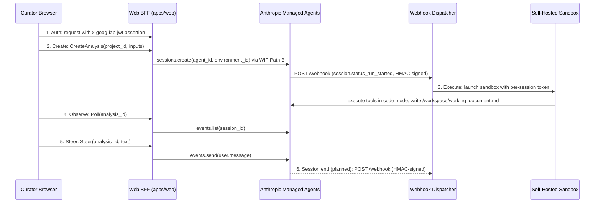

# Design: Managed Agents wiring

**Related:** [`agent-runtime.md`](agent-runtime.md) (runtime semantics for coordinator, sub-agents, structured output,
and trace), [`frontend-framework.md`](frontend-framework.md) (web tier, poll-through observation, durable trace, and
authentication), [`workspace-model.md`](workspace-model.md) (Projects, Analyses, working documents, and authorization
boundary), [`sandbox-worker.md`](sandbox-worker.md) (execution sandbox, Unix-socket hatches, and session tokens),
[`spike-infrastructure.md`](spike-infrastructure.md) (deployables, service identities, and write boundaries),
[`security.md`](security.md) (chokepoint rule and webhook verification), [`conversation-view.md`](conversation-view.md)
(curator steering and conversation thread), [`../runbooks/claude-api-wif.md`](../runbooks/claude-api-wif.md) (Workload
Identity Federation for Anthropic API access).

## Overview

A single variant curation run starts when a curator submits a case in the browser and ends when the completed Analysis
is persisted in Cloud SQL. Along the way, the run crosses the web backend-for-frontend (BFF), Anthropic Managed Agents,
our self-hosted execution sandbox, our internal evidence and persistence services, and the webhook dispatcher. No single
component design document owns that entire path. This document is the map: the order of the hops, and which design
document decides each; it states no mechanism the linked documents already state, and summarizes how credentials are
partitioned so that neither Anthropic's hosted loop nor the untrusted sandbox code holds standing write access to
internal state. The vertical is built end to end against the self-hosted sandbox; the durable trace and the source view
are not yet built. See each linked document for its own state.

## Background

Themis uses Anthropic Managed Agents to run the [`svcv4-classifier`](../../agents/svcv4-classifier.agent.yaml) agent
loop while keeping genomic evidence services, curation persistence, and code execution inside our own Google Cloud
project. Splitting the hosted model loop from our internal services introduces two boundary problems across the life of
an Analysis:

1. **Request and event routing across trust boundaries.** Curators reach the web tier through Identity-Aware Proxy
   (IAP), whereas Anthropic's control plane runs outside our network and cannot present an IAP assertion when delivering
   session lifecycle webhooks.
1. **Credential isolation.** The model loop needs to run Python against internal gRPC services and author
   `/workspace/working_document.md`, but untrusted code inside the sandbox must not hold long-lived GCP credentials or
   unscoped database write access.

## Design

### End-to-end case lifecycle

A curation case moves through six hops from submission to session completion:

1. **Authenticate the curator.** The curator's browser reaches the web application
   ([`apps/web/src/server/`](../../apps/web/src/server/)) through IAP. The BFF verifies the `x-goog-iap-jwt-assertion`
   header at its server entry chokepoint, then asks the auth service whether the ACL admits the curator, before it
   constructs a request context. See [`frontend-framework.md`](frontend-framework.md) (§Auth),
   [`access-control.md`](access-control.md) and [`security.md`](security.md).
1. **Create the Analysis and session.** The BFF checks that the authenticated curator belongs to the target Project,
   writes the `analyses` row in Cloud SQL, and creates the Managed Agents session against Anthropic's API using Workload
   Identity Federation (WIF Path B). See [`workspace-model.md`](workspace-model.md) and
   [`../runbooks/claude-api-wif.md`](../runbooks/claude-api-wif.md).
1. **Execute tools in the sandbox.** When the session starts a run, Anthropic delivers an HMAC-signed
   `session.status_run_started` webhook to the dispatcher
   ([`themis/services/dispatcher/`](../../themis/services/dispatcher/); see
   [`security.md`](security.md#the-sandbox-dispatchers-webhook)), which launches our self-hosted sandbox worker
   ([`themis/services/sandbox_worker/`](../../themis/services/sandbox_worker/),
   [`agents/selfhosted.environment.yaml`](../../agents/selfhosted.environment.yaml)). The agent investigates the case in
   code mode and writes `/workspace/working_document.md` while the sandbox worker emits live tool spans during
   execution. The `postern` (`bubblewrap`) guest holds no credentials; the host-side Unix-socket hatches attach the
   per-session token to outbound calls. See [`sandbox-worker.md`](sandbox-worker.md) and
   [`agent-runtime.md`](agent-runtime.md).
1. **Observe the live session.** While the session is active, the browser polls the BFF. On each poll, the BFF
   authorizes the curator against the Analysis's Project membership, reads the session's event log from Anthropic
   (`events.list`), and projects those events into the browser display model. See
   [`frontend-framework.md`](frontend-framework.md) (§Session observation).
1. **Steer the running agent.** When a curator interjects in the conversation thread, the browser calls the BFF's
   `Steer` RPC, which appends a `user.message` event to the same Managed Agents session. See
   [`conversation-view.md`](conversation-view.md).
1. **Archive the durable trace (planned).** When the session ends, Anthropic will deliver a session-end webhook to the
   dispatcher, and the durable trace will be built in Cloud SQL from one `events.list` read (see
   [`agent-runtime.md`](agent-runtime.md) and [`frontend-framework.md`](frontend-framework.md) §Durable trace).

### Identity split across components

To prevent any single compromised process or prompt-injected tool call from gaining unrestricted access to both the
model control plane and internal databases, each runtime component holds only the credentials required for its step in
the lifecycle:

- **Anthropic Managed Agents** runs the model loop and holds no Themis credential beyond the session it was created
  with.
- **The web BFF** holds the WIF identity used to call Anthropic's API and a display-scoped Cloud SQL identity for
  reading and creating Analyses.
- **Internal services** hold the Cloud SQL and storage write identities for persisting agent-authored content.
- **The sandbox guest** holds no credentials of its own; the worker's host-side Unix-socket hatches inject the
  short-lived per-session token on outbound requests from the guest.

This separation costs an extra local hop across the Unix-socket hatch and through internal gRPC services whenever the
agent reads evidence or writes outputs, but it ensures that arbitrary Python executed by the agent cannot extract a
database or GCP credential from its environment. The complete service-account and identity table lives in
[`spike-infrastructure.md`](spike-infrastructure.md).

## Alternatives considered

### MCP servers reached directly by the managed loop

The Anthropic managed loop could call tightly typed Model Context Protocol (MCP) tools over a network tunnel,
authenticating with a per-session bearer token minted for each Analysis. Hosting MCP tools directly avoids running a
sandbox container per active session and gives the model structured tool schemas without a local execution environment.
We rejected this approach because reaching internal services from Anthropic's cloud requires either an Anthropic beta
tunnel we do not control or an internet-facing endpoint on our side, and because an LLM executes long chains of discrete
tool calls less reliably than it writes Python against generated gRPC stubs in code mode (see
[`sandbox-worker.md`](sandbox-worker.md)).

### A webhook receiver on the BFF

When a session finishes, a planned extension to the webhook pipeline will materialize the durable trace into Cloud SQL.
Putting a webhook receiver on the BFF would keep durable-trace materialization inside the same service that already
calls `events.list` during live polling and already connects to Cloud SQL. We rejected a BFF webhook route because
Anthropic cannot present an IAP credential; accepting webhooks on the web tier would require carving an unauthenticated
path through the IAP-gated surface and duplicating the HMAC verification endpoint that `themis-dispatcher` already
operates.
