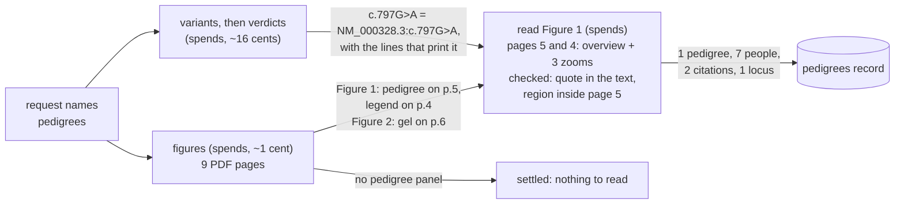

# Design: extracting pedigrees from a paper

**Related:** [`figure-annotation.md`](figure-annotation.md) (the record of a paper's figures, which says where its
pedigrees are); [`variant-extraction.md`](variant-extraction.md) (the variant steps, whose shape this doc follows);
[`evidence-fulltext.md`](evidence-fulltext.md) (the steps that bring a paper up to date, and the rule that naming a
target is the decision to spend); [`litcache-manifest.md`](litcache-manifest.md) (the records and refs a step writes,
and where a paper's PDF is kept); grus's IR design,
[`docs/design/ir.md`](https://github.com/populationgenomics/grus/blob/main/docs/design/ir.md) in the public grus
repository. Terms in [`../../GLOSSARY.md`](../../GLOSSARY.md).

## Overview

A curator weighing whether a variant segregates with disease in a family needs to know who in that family is affected,
who carries the variant, and how they are related. Papers state most of that only in a pedigree figure: the text says
"the proband's maternal uncle was also affected" for one person, and the figure draws the other twenty. So Themis has to
read the figures, and turn each pedigree into a record that says who is in it and how they relate, in a form a program
can reason over and draw again.

That form already exists. grus, CPG's public pedigree library, defines a meaning-only record of a pedigree: who is in
it, their gender and clinical status, and their matings and children, with no coordinates. Its renderer draws the record
back to a standard pedigree deterministically, and its importers read PED, kinship2, Phenopackets and Open Pedigree.
grus's internal extraction work has also measured how to read pedigrees off a page: a model shown the whole page, with a
tool that re-renders any region of it at full resolution, reads 87% of synthetic pedigree pages exactly with Sonnet 5.5,
at 11 cents a page. Without that tool it loses about 40 points.

So this doc brings grus's record and grus's reading into Themis in the shape the variant steps already have. The paper's
figure record ([`figure-annotation.md`](figure-annotation.md)) says which of its figures are pedigrees, on which pages,
and where their legends are. A spending step reads each pedigree figure, a page at a time, with grus's prompt and its
zoom tool, and records a grus pedigree set for the paper. Every pedigree in it cites the page region it was read from,
and every fact the figure does not draw cites the sentence that states it. Before the step accepts the record, it checks
it against the paper: every quoted sentence has to be in the text, and every cited region has to lie on its page. A
record that fails goes back to the model to fix in the same conversation. The reader also records the genotypes the
paper states, naming each allele as the paper prints it and by the checked name the variant steps found for it, so that
a case record can tell which validated variant each person carries.

Themis depends on grus for the record's definition rather than keeping a copy. grus owns the pedigree schema and keeps
the same compatibility discipline as Themis's own contracts, so a change to the record is made once, in grus, and Themis
takes it by moving a version pin.

## Background

### Pedigrees and their drawing standard

A pedigree is a family tree drawn to a clinical standard (Bennett et al., 2008, revised 2022). Each person is a symbol:
a square for a man, a circle for a woman, a diamond where the gender is not stated. Filling a symbol says the person is
affected by a condition, and a figure with several conditions divides the symbol and keys each part in a legend. A slash
marks someone deceased, and an arrow marks the proband, the person whose case brought the family to attention. Two
partners are joined by a horizontal line, doubled when they are related by blood. Their children hang from a line below,
in birth order. Rows are generations, numbered I, II, III from the top, and people are numbered within each row, so
"II-3" is the third person in the second generation.

Most of a pedigree's meaning is in thin marks: the slash, the double line, a dot for a carrier, the short bar that joins
twins. Those marks are what a reader misses when the figure is small.

### The record: grus's pedigree set

grus's record says who is in a pedigree and how they relate, never where anything is drawn. Each person is keyed by
their drawn label, generation and index, so "II-3" stays "II-3" from the figure to the record. Each mating names its two
partners and lists its children in birth order, which lets single parents, separated couples, consanguinity and
childlessness each be stated directly. A person's clinical status is a list, one entry per condition, because one symbol
can show several. The conditions themselves are declared once for the whole set and referred to by id.

A pedigree set holds every pedigree read from one source, and carries citations. A citation is either a region of one
page of the source or a verbatim quote from it. Each pedigree points at the region it was drawn in. A fact the figure
does not draw, such as a condition's name that only the caption gives, is attached to the people it applies to with the
quote that states it.

A shortened example:

```
conditions { id: "k1" name: "junctional epidermolysis bullosa" }
pedigrees {
  labels { text: "Family 1" }
  labels { text: "LAMA3" kind: LABEL_KIND_GENE }
  individuals { generation: 1 index: 1 gender: GENDER_MAN }
  individuals { generation: 1 index: 2 gender: GENDER_WOMAN }
  individuals { generation: 2 index: 1 gender: GENDER_WOMAN proband: true
                conditions { condition_id: "k1" status: CONDITION_STATUS_AFFECTED } }
  individuals { generation: 2 index: 2 gender: GENDER_WOMAN deceased: true }
  matings { partner_a { generation: 1 index: 1 } partner_b { generation: 1 index: 2 } consanguineous: true
            offspring { child { generation: 2 index: 1 } } offspring { child { generation: 2 index: 2 } } }
  evidence: "c1"
  supports { field: "condition.name" condition_id: "k1" citations: "c2" }
}
citations { id: "c1" region { page: 3 x0: 52 y0: 410 x1: 300 y1: 610 } }
citations { id: "c2" quote: "junctional epidermolysis bullosa" }
```

A region is in grus's convention: its page counts from 0, and its corners are in PDF points from the page's top-left.
Themis's figure record counts pages from 1 and gives boxes as fractions of the page, so the step converts between the
two when it stamps a citation.

The record holds no coordinates for the people, and that is deliberate. If it held them, a reading could get every
position right and every relationship wrong, and a comparison of positions would not notice. Because the renderer is
deterministic, a record that draws back to a different family points at the reading. grus's IR design argues this in
full ([`ir.md`](https://github.com/populationgenomics/grus/blob/main/docs/design/ir.md)), and its contract is
[`pedigree.proto`](https://github.com/populationgenomics/grus/blob/main/schema/proto/grus/models/pedigree.proto).

### What a paper gives the step to read

The literature cache keeps a paper's PDF and a markdown rendering of its text
([`litcache-manifest.md`](litcache-manifest.md)). The rendering comes from the publisher's XML where there is one, and
is otherwise a transcription of the PDF's pages. A transcription carries the captions but does not mark which page each
came from.

Themis's variant steps have read the same rendering already ([`variant-extraction.md`](variant-extraction.md)). The
first lists each variant the paper names, as printed and as the model rewrote it in HGVS. The second, validation, checks
each rewriting against the reference sequence it names and records a verdict per variant: the expression it chose, or
none when no rewriting holds. The step gives the reader the paper's checked variants, with the lines of the rendering
that print them, for what the figure does not draw: the variant a symbol stands for. The cache does not store a
publisher's figure images yet, so the PDF is the only image of a figure the step has. A paper the cache holds no PDF for
is not read for pedigrees. A PDF page has one property the reading relies on: it can be re-rendered at any resolution,
so zooming into a region shows marks that the page-sized image lost.

### The papers measured

The measurements below are on the canary, the set of papers the figure doc describes
([`figure-annotation.md`](figure-annotation.md), "The papers measured"): 479 papers with a PDF from the cache's seed
corpus, mostly case reports, so 36% of them draw a pedigree, far more than the literature at large. The genotype
measurement re-reads the 88 of them whose earlier pedigree reading recorded a genotype or variant label beside a person.

## Non-goals

- **Inferring what a figure does not state.** The record says what the figure draws and what the text states about this
  family. It never infers a mode of inheritance from the pattern of affected people, because a pattern fits several
  modes and the curator, not the reader of the figure, weighs them. grus's record makes this a rule of the schema.
- **Pedigrees in other species.** The drawing standard is for human families, and the record's gender and condition
  model follows it. A mouse breeding scheme drawn with the same symbols is not read.

## Design

### The steps, from request to record

A request that names the `pedigrees` target first brings the paper's figure record and its variant verdicts up to date,
then runs the pedigree step on them. Following one paper through:



The pedigree step lists the figures that have a pedigree panel. A paper with none settles there, without reaching the
reading model. The step then reads each page a listed figure draws pedigrees on in a conversation of its own, a few at a
time, checks what each returns against the paper, and records one pedigree set for the paper under the `pedigrees` ref.

### The figure record decides what is read

The obvious free way to find pedigrees is through the text: a pedigree is introduced as "pedigree" or "family tree", and
its drawing prints generation labels like "II-3". Measured on 60 papers, that finds 25 of the 31 pages that carry a
pedigree, and 37 of the 62 pages it picks carry none. A pedigree drawn without printed labels, whose legend is on
another page or does not use the words, is never found, and every page picked in error costs a Sonnet read of about 11
cents.

So the pedigree step reads what the paper's figure record calls a pedigree. That record comes from a small model looking
at each page in turn, which on the same papers found all 31 pedigree pages and one other, for under a cent a paper
([`figure-annotation.md`](figure-annotation.md)). The unit the step reads is a page of a figure, shown with the figure's
legend: a page with two families in one figure is one read, a figure drawn across two pages is two, and a figure whose
legend is on the next page is read with that page beside each of its own.

A paper is read in at most eight conversations. Figures are taken whole, in the figure record's order, and a figure that
would take the paper past eight is left out; the record lists only the figures it read. Of the 27 papers among the 60
with a pedigree, 24 had one pedigree figure and none had more than three, so the cap only bounds what an unusual paper
can spend.

### The model reads the whole page, and zooms

The obvious input for reading a pedigree is the figure alone, cropped from the page at the highest resolution available.
grus measured that against the alternative, and the crop loses twice. The legend sits beside the figure, not in it, and
it is where the symbol key, the condition names and the panel labels are. And a sharper image does not help, because the
API shrinks every image to the same maximum size before the model sees it: a 130-person pedigree rendered at 7,900
pixels reaches the model at about a third of that.

So the read step shows the model each page the figure's pedigree panels are on, whole, at the largest size the API
accepts, and the page of the figure's legend if that is another page. It names the figure, and gives the box of each
pedigree panel as a pointer to where to look, since the figure record's boxes are approximate. It also gives the model a
`zoom` tool. The model asks for a region of one of those pages, and the step re-renders that region from the PDF at full
resolution and returns it as a new image. The model is told to confirm every thin mark in a zoom before it records it.
On grus's synthetic ladder of pedigree pages with known answers, this reads 87% of pages exactly with Sonnet 5.5, at
$0.11 a page. Opus 5.5 reads 94%, at $0.21 a page, so it costs twice as much for seven more pages in a hundred. The read
step uses Sonnet 5.5. The model is part of the harness version, a digest of everything the model is given that a record
carries; a record from another harness version is stale for a request that names its step. So moving to Opus later
re-reads only the papers a request names.

The prompt is grus's extraction prompt and its page and citation addenda, folded into Themis, with genotypes added (next
section). It carries the drawing standard: how to map each symbol, what each line means, which marks to confirm in a
zoom. It also forbids the model to infer what the figure and the paper do not state, and requires every fact taken from
the text rather than the drawing to cite the sentence it came from.

### Genotypes, named from the paper's checked variants

A case record needs to say which validated variant each person in a family carries, and a pedigree says it only in
shorthand. Of 1,036 genotype and variant labels drawn beside people in the canary's pedigrees, 40% are written in
variant notation ("c.797G>A/+"). The rest are "M1/M2", "+/-" or "T/G", whose meaning is in a legend, a key, a table or a
sentence of the text. The obvious answer is to match the labels to the paper's validated variants in code once both are
recorded. That links 82% of the labels written in variant notation and almost none of the others: "M1" names no variant,
and a paper rarely has only one to choose from.

So the reader records genotypes as grus's genotype table: the loci the set's people are genotyped at; each allele with
its symbol and what the figure, its legend or the paper says it is, as printed; and each person's genotype, as allele
copies. A label keeps its text and points at the loci it shows. For a legend saying "M1, c.1234A>G; M2, c.2000del", the
set declares one locus in SLC26A4 with the alleles "+" (the reference), "M1" (c.1234A>G) and "M2" (c.2000del). The
proband drawn with "M1/M2" carries [M1, M2], and the label points at that locus. The reader records a genotype only
where one is stated for that person. A bare variant label that does not say how many copies names no locus, and an
obligate carrier is never filled in.

To name what a symbol stands for, the reader needs what the paper says about it. The obvious source is the paper's whole
text. The variant steps have already read that text, though: they list each variant the paper names, checked against its
reference sequence, with the lines that print it, and a legend that keys "M1" to a variant is one of those lines. So the
reader is given that list instead, before the page. It is the same for every figure page of the paper, so it is marked
for the API's prompt cache, and the paper's other pages read it from the cache rather than paying for it again. The list
holds each variant that passed its check, with the lines that print it, and leaves out a variant with no verdict that
chose an expression, and one the paper places in a mouse or another species that is not human
([`variant-extraction.md`](variant-extraction.md), "The allele is chosen at validation"). Variants the paper observed
come before those it only cites, and the list is cut at a bound, so a paper that tabulates hundreds of cited variants
keeps its families' own. The reader records each allele's checked name as an HGVS identifier beside the name the paper
prints. A case record then joins a person to a validated variant through that identifier.

Re-reading 88 canary papers four ways settled the choice:

| the reader is given                                 | labels pointing at a locus | non-reference alleles named | people linked to a validated variant | cost |
| --------------------------------------------------- | -------------------------- | --------------------------- | ------------------------------------ | ---- |
| the pages alone                                     | 78%                        | 67%                         | 380                                  | $11  |
| the pages and the paper's text                      | 84%                        | 72%                         | 407                                  | $16  |
| the pages and the checked variants with their lines | 89%                        | 83%                         | 588                                  | $12  |
| the pages, the text and the variants                | 87%                        | 82%                         | 569                                  | $24  |

The variants link 45% more people than the whole text, for three quarters of its cost, and the text adds nothing beside
them. A hand review of a sample where the two disagreed favoured the variants: what the figure prints is rarely a full
genotype, and the variants give each allele a name checked against a transcript. A figure page costs about 11 cents, and
a paper that passes triage, the screen still to be built that picks the papers worth reading, about 6 cents in all:
every one gets the small figure model, and the 36% of the canary's papers with a pedigree are read by Sonnet. That
average holds only for a set as rich in pedigrees as the canary; where fewer papers draw one, it falls toward the figure
model's cent, and a paper that does draw one still costs its figure pages.

The price is an ordering. The pedigree step now waits while the paper's variant steps have work, and reads their
verdicts when there are any. A paper whose variant steps settle without verdicts, with no variant-like string in its
text or an extraction that fails, is read with none. The pedigree record depends on the verdicts it read, so new
verdicts make it stale, and a request that names pedigrees also runs the variant steps, which a case record needs
anyway.

### The record is grus's pedigree set, unchanged

The obvious Themis record would wrap grus's pedigree set in a message of Themis's own, adding which page or figure each
pedigree came from. It is not needed, because grus's citations already say that. A citation's region names a page, and
its document id is left for the caller to stamp. The step stamps it with the hash of the PDF revision the page belongs
to. A paper's pedigrees then form one pedigree set, with every pedigree traceable to the exact page it was read from.

One set per paper, rather than one per page, also keeps the conditions consistent. A paper that draws the same disease
in three families declares it once, and all three pedigrees refer to it. Take a paper with three pedigree figures.
Figure 1's legend says "Usher syndrome, autosomal recessive"; Figure 2's says "Usher syndrome" and states no mode;
Figure 3 shades its affected people and names nothing. The merged set declares two conditions:

```
conditions { id: "k1" name: "Usher syndrome" inheritance: INHERITANCE_AUTOSOMAL_RECESSIVE }
conditions { id: "k2" name: "" }
```

The step matches conditions across figures by name, so Figures 1 and 2 share k1. A mode one figure states holds for one
that names the same condition without a mode, because the second figure's silence does not contradict the first. Had
Figure 2 said "X-linked", the two would contradict each other, and k1 would state no mode. Figure 3's condition, named
by nothing, is k2. Every figure's unnamed condition in one paper is taken to be that same k2. That can be wrong: a paper
could shade a deaf family in one figure and a cardiomyopathy family in another, both unnamed. It is accepted because an
unnamed fill almost always means "affected by the condition this paper is about", and keeping one condition per figure
would split that one condition across a paper's families for nearly every paper to guard against a rare one.

Loci are declared once too. grus tells loci apart by their gene and their printed name, and refuses a set that declares
two loci with the same gene and name; so the step joins a locus two figures both declare into one, and joins their
alleles. Take a paper whose Figure 1 legend says "SLC26A4: M1, c.1234A>G" and draws "+" for the wild type, and whose
Figure 2 legend says "SLC26A4: M2, c.2000del" and draws "WT". The merged set declares one SLC26A4 locus with three
alleles: the reference ("+" in Figure 1, which Figure 2's "WT" is mapped to), M1 and M2. A figure that names an allele
the other leaves unstated fills it in, since silence does not contradict.

Had Figure 2 keyed "M1" to c.2000del, the two figures would say different things about one symbol at one locus. The
conditions rule keeps both figures and drops the contested mode; the locus rule cannot do the same, because a genotype
"M1/+" is only worth recording with what M1 is, and a merged M1 with its name dropped would link Figure 2's family to
Figure 1's variant. A second SLC26A4 locus for Figure 2 is refused by grus. So the first figure read keeps the locus,
and Figure 2's genotypes at it are dropped. Its people keep their labels, so "M1/+" is still printed beside each one,
pointing at no locus. The drop is logged by the worker but not recorded in the set: a reader of the record sees Figure
2's people with labels and no genotypes, the same as a figure that stated none.

What Themis adds is only what is Themis's: a record construction that says how the set was made, and a ref that names
the current set. The construction holds the harness version, a digest of everything the model is given, as the variant
extraction does: the model and its settings, the prompt, the tool definitions and the grus version whose schema the
answer was checked against. A change to any of them makes existing records stale for a request that names the target.
The record is made from the figure record and the variant verdicts as well as the paper's text, so a new figure record
or new verdicts make it stale. The construction lists the figures that were read, by their place in that figure record,
so a later reader can tell a figure that turned out to hold no pedigree from one that was never read. A figure whose
answer was never accepted is listed with the reason, as the next section describes.

### The read step accepts only what the paper bears out

The obvious shape, given the variant steps, is a second free step that checks the stored record and records what held,
as the variant steps do. That shape pays for variants because a variant's check depends on code and reference data that
change after the record is written: a fix to the checking library or a newer reference sequence can turn a variant that
failed its check into one that passes, and re-running the free step finds that out for nothing
([`variant-extraction.md`](variant-extraction.md)).

The checks a pedigree record needs are not like that. Each of them has one answer for a given record and paper:

- grus's rules for a pedigree set hold. Positions are unique, every person a mating names exists, and every citation id
  resolves.
- Every quote citation appears in the paper's text or in the text layer of a page the model was shown, since a key
  printed inside a figure is on the page but not in the rendering. Both are compared ignoring markup and spacing, as the
  variant step compares a mention with its line ([`variant-extraction.md`](variant-extraction.md), "A mention is cited
  by its line"). A quote that is not in the text is the clearest sign of a fact the model supplied itself.
- Every region citation lies inside its page.

Recording a failed check after the conversation has ended only marks a record that was paid for and cannot be mended.
Checked inside the conversation, a failure can still be fixed. So the read step checks the model's answer before it
accepts it, and a failure goes back to the model with the reason. Say the model records X-linked inheritance with a
quote the caption does not contain. The step answers that the quote is not in the paper, and that the model should cite
the sentence that states the inheritance or drop it. The model drops it, because the caption only names the gene, and
the record that is stored says nothing about inheritance.

Whether a pedigree draws is left out on purpose. grus's renderer raises an error for the few shapes it cannot draw yet,
rather than drawing something wrong, and that set shrinks as grus improves. The answer would be stale as soon as grus
changes, and whatever shows a pedigree finds out when it draws it.

The cost is a turn of the conversation for each failed check. A page whose answer is still rejected after two repairs,
or that the model refuses, is listed in the record under its figure with the reason, and the other pages' pedigrees are
kept: one bad page does not throw away the pages already paid for. Only a paper where no page is accepted ends without a
record, and the job log records the failure, as it does for a variant extraction that does not finish.

### grus is a dependency, at a pinned version

The obvious way to use another repository's schema is to copy its proto file into Themis's schema tree, where Themis's
breaking-change check guards it. That gives Themis control, and it makes two copies of a contract that one team owns.
Every IR change would be made twice, and the second copy would drift from the first between the two edits.

So Themis depends on grus as a package, at a pinned version, the way it already takes ClinVar's and PubMed's record
schemas. grus keeps the same rule Themis keeps for its contracts: a change to the schema adds to it and never breaks a
record that exists. A grus release that changes the IR reaches Themis when the pin moves, and that move also changes the
harness version, so the records made with the older IR are re-read only when a request asks for them.

### Where the records live

Each paper's pedigree set sits in its prefix in the literature cache bucket, under the `pedigrees` ref, as the variant
records do. Nothing is stored in Postgres. The drawn pedigree is not stored either. The renderer is deterministic, so
whatever shows a pedigree draws it from the record when it needs it.

## Alternatives considered

- **Run grus as its own service or job, outside the worker.** grus is a library, and running it apart from the other
  steps would keep its dependencies out of the worker image. It lost because a paper's steps share everything else: the
  paper's sources, the job log that records what each step spent, the rule that a request decides what is spent, and the
  records and refs. A separate runner would rebuild each of those.
- **Read a cropped figure instead of the page.** A crop costs fewer image tokens than a page. It lost on grus's
  measurement: the crop drops the legend, and the API shrinks a large crop to the same size as a page, so it buys no
  resolution.
- **Choose pages by text cues.** Free, and it needs no model. It lost on the measurement above: it misses a fifth of the
  pages that carry a pedigree, and most of the pages it picks carry none, each costing a wasted read.
- **Give the reader the paper's whole text.** It is what a person reading the paper would use, and it is in the cache
  already. It lost on the measurement above: it links fewer people than the checked variants with their lines, at a
  third more cost, and adds nothing beside them.
- **Read each pedigree page without its legend's page.** It is simpler: one page image per conversation before the
  zooms. It lost because a pedigree's legend is on another page about one time in six, and the legend is where the
  conditions and the symbol key are.

## Open questions

- **Whether Sonnet holds up on real pages.** The ladder is synthetic: clean vector drawings with printed labels. A
  review of hand-checked pedigrees from real papers is in progress. If Opus reads real pages much better than Sonnet
  does, the ladder understates the gap and the choice is worth making again.
- **Publishers' figure images.** A paper fetched as XML with no PDF is never read, because the cache keeps no figure
  images. Storing them would let the step read such a paper, with the figure's caption from the rendering in place of
  the page around it. A figure image cannot be re-rendered, so zooming into it only crops it, and how much of the zoom's
  gain survives that is unmeasured.
- **The variants' cache point when figures are read at once.** A paper's figures are read a few at a time, so those that
  start together each write the variant list to the cache instead of reading it. Most papers have one pedigree figure;
  starting the others after the first's opening turn would save a few cents on those that have several.
- **Joining a pedigree to the case record's family.** The case-record work reads the same families from the text, and in
  its corpus run the text and the figure agree on who is affected for 91% of individuals. Joining the two lets each
  check the other. The join waits for the case records to come into Themis.

## Appendix

### grus's reading ladder

Synthetic pedigrees drawn by grus and kinship2 onto A4 journal-style pages, at three sizes ("rungs" 4, 7 and 8; the
largest reach about 120 people), 20 seeds each, read by five models with and without the zoom tool: 1,200 page reads for
about $222, with prompt v13 and page prompt v6. One cell, rung 7 drawn by kinship2, is left out: kinship2 overprints its
genotype lines there, and no model can read them. A page is read exactly when the record matches the known answer person
for person.

| model      | pages read exactly, with zoom | mean cost per page |
| ---------- | ----------------------------- | ------------------ |
| Opus 5.5   | 94%                           | $0.21              |
| Sonnet 5.5 | 87%                           | $0.11              |
| Fable 5.1  | 73%                           | $0.61              |
| Haiku 5.5  | 62%                           | $0.010             |
| Haiku 4.5  | 0%                            | $0.16              |

Without zoom, each model reads about 40 points fewer pages exactly.
