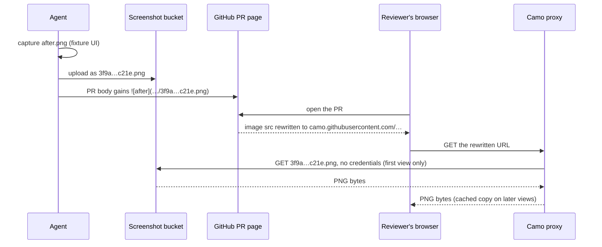

# Design: PR review screenshots

**Related:** [`deployment.md`](deployment.md) (the Pulumi stacks and the capability grants this bucket is built from);
[`../plans/screen-and-mirror-workflow.md`](../plans/screen-and-mirror-workflow.md) (the public mirror of every tracked
commit, which rules out committing the images).

## Overview

A pull request that changes a rendered surface has to show the surface in its description, before and after. An agent
can build the web app offline and capture those screenshots itself. What it cannot do is attach them, because GitHub
offers no API for attaching an image to a PR. So the agent uploads each capture to a storage bucket of our own and puts
a markdown image link in the PR body instead.

GitHub does not let the reader's browser fetch that link. Its image proxy fetches the image on the reader's behalf,
anonymously, so the bucket has to be readable with no credentials at all. That makes it the one public bucket in the
project, and the rest of the design limits what public means. Anyone can fetch an object whose name they already hold,
but nobody can list the bucket. Each object is named by the SHA-256 hash of its content, so a name cannot be guessed.
Every image is of the app running on invented fixture data, so even a leaked name exposes no participant data.

Objects are kept forever, because a PR is a permanent record and its images should outlive any cache. The developers who
upload can also delete, so a capture that turns out to show something it should not can be withdrawn at once.

## Background

The repo's working rules ask that a change to a rendered surface ship with screenshots in its PR description. A reviewer
cannot see layout, spacing or state in a diff, and prose describing them cannot be checked. The web app runs against a
fixture backend that serves invented data, so capturing a screenshot needs no cloud access: build the app, start it,
drive it to the state under review, and take the picture. All of that is automatable, and agents do it.

Attaching the image is where automation stops. When a person drags an image into a PR description, the browser uploads
it to a GitHub endpoint that serves only the web UI. That endpoint authenticates with the browser's login cookie and
rejects API tokens with a 422. An agent working from the command line therefore has the file but no way to attach it.

Markdown can link an image that lives anywhere, so the gap closes if the image is hosted somewhere GitHub can reach. How
GitHub reaches it decides most of this design. GitHub rewrites every external image in rendered markdown to go through
its proxy, Camo:



Camo presents no credentials when it fetches, so the image must be readable by anyone. And the bucket serves each
distinct image roughly once, because Camo caches it and every later view reads the cached copy.

The other constraint is the mirror. Every commit on `main` is copied, unchanged, to the public `themis` repository. Any
file committed to the repo is therefore published, which rules out the most obvious place to keep an image (see
Alternatives considered).

## Non-goals

The bucket holds screenshots of the fixture UI and nothing else. A screenshot of real data must never be uploaded to it.
The screenshot rule already treats a state reachable only against real data as not capturable, so that case never
produces an image to host.

The bucket is not a general asset host. No running service reads it, and no other kind of content goes into it. Keeping
it to one purpose keeps its one exception to the project's private-storage posture narrow and easy to audit.

## Design

### Public read by URL, without listing

The question is who may read the bucket. The obvious answer for a sensitive-sounding store is to keep it private and
hand out access per object. Google Cloud Storage does this with signed URLs, which embed a credential and need no change
to the bucket's permissions. A signed URL expires after at most seven days, though. Camo eventually evicts its cached
copy, refetches from the bucket, and finds the link dead, so a PR from last month would show a broken image.

Restricting reads by network does not work either. Camo's egress addresses are neither published nor stable, so there is
no allow-list that admits GitHub and refuses everyone else.

That leaves anonymous reads, and the remaining decision is what anonymous readers may do. The stock recipe for a public
bucket grants everyone the object-viewer role. That role carries two permissions: `storage.objects.get`, which fetches
an object by name, and `storage.objects.list`, which enumerates the bucket. With both, anyone could list every
screenshot ever uploaded. The bucket instead grants everyone a predefined legacy role whose only permission is `get`. A
request for a known object name succeeds, and a request to list the bucket is refused:

```
GET  https://storage.googleapis.com/<bucket>/3f9a…c21e.png   →  200, the PNG
GET  https://storage.googleapis.com/<bucket>                 →  403, no listing
```

The grant is the `PublicObjectReader` capability in [`grants.py`](../../infra/themis_infra/grants.py), and the bucket is
built in [`screenshots.py`](../../infra/themis_infra/screenshots.py).

Every other bucket in the project enforces public-access prevention, and this one has to opt out of it. The bucket also
needs two organisation policies to stay unenforced above the project: public-access prevention, and the domain
restriction on who can be granted a role. If either were ever enforced, `pulumi up` would fail on the grant to everyone,
so nothing has to check for them in advance. The cost is that reads are uncapped and unmonitored. Anyone holding a URL
can fetch it at the project's expense. That is accepted, because the objects are small and Camo fetches each one roughly
once.

### Content-addressed object names

Without listing, a reader can only fetch a name they already know, so the names carry the confidentiality. Each object
is named by the SHA-256 of its bytes. A name is 256 bits of hash, so nobody can reach an object without having been
given its link.

The same choice settles two other questions. Uploading identical bytes twice produces the same name, so a repeated
capture is stored once and its link is unchanged. And an object can never change under its name, since different bytes
would hash to a different name. Uploads are therefore marked immutable and cacheable for a year, and Camo and browsers
never need to revalidate them.

The names carry no PR number or branch. The PR body already records which images belong to which PR, so the bucket is a
flat store of content.

### Kept forever

The obvious lifecycle for review artefacts is a TTL: delete screenshots after the PR merges, or after some months. A PR
stays readable forever, though, and its images are part of what it records. Once Camo's cache evicts an image, a deleted
object becomes a broken image in a merged PR that someone later reads to understand a change.

So nothing expires. The bucket uses Autoclass, which moves objects nobody reads down to colder storage classes, ending
at Archive. Autoclass charges no retrieval fee when a cold object is read again, so an old PR's image costs nothing
extra to view.

### Uploaders can retract

Uploads use the developer's own `gcloud` credentials, through the same Google group that admits developers to the dev
app. No service account exists for this, so the agent uploads with credentials it already has.

Least privilege suggests giving that group only the right to create objects. But a capture that turns out to show
something it should not is world-readable at a permanent URL. Whoever can publish to the bucket has to be able to
withdraw from it without first finding a project owner. So the group holds object admin, which covers browsing,
uploading and deleting. The cost is that any member of the group can delete any screenshot, including another
developer's.

Withdrawal also has to take effect at once. By default Cloud Storage keeps a deleted object recoverable for seven days,
and during that window it can still be retrieved. Soft delete is turned off on this bucket, so a delete is final.

One copy remains outside our control. Camo may go on serving its cached copy for a while after the object is gone. A
takedown is therefore: delete the object, remove the link from the PR body, and accept that tail.

### A stack opts in

Only the dev stack has a bucket. Screenshots are of the fixture UI, which is a development artefact, so no other
environment has a reason to expose a public bucket.

Each stack must state whether it hosts the bucket; the setting has no default. A default of "no" would be safe on its
own, but the risk lies elsewhere. A new stack is usually made by copying the dev stack's configuration, and a copied
"yes" creates a world-readable bucket in that environment without any error. Making the setting required means it
appears in every stack's configuration as a line someone has to read and decide on.

### The upload helper

[`tools/screenshot/upload.py`](../../tools/screenshot/upload.py) turns one or more PNG files into the lines to paste
into a PR body. It hashes each file, uploads it under its hash, and prints one markdown image link per file, in the
order given:

```
$ uv run --group screenshot python -m tools.screenshot.upload before.png after.png


```

The hashing convention lives in this one place, so an agent's step stays a single command. Standard output carries only
the link lines, and any notes go to standard error, so the whole of the output can be pasted. Each upload is conditional
on the object not existing yet. When that condition fails, the hash is already stored, so the helper reports it and
still prints the link.

The helper fails as a whole. It reads and checks every file before uploading any, and prints no link until every upload
has succeeded. A run that fails partway therefore leaves nothing half-pasted into a PR body. It also refuses any file
that is not a PNG, because every object is served as a PNG image and anything else would arrive broken in the browser.

## Alternatives considered

**Attach through GitHub's own uploader, driven by browser automation.** A logged-in browser session, driven by a script
or by a browser-control tool, can perform the drag-and-drop upload a person would. GitHub then hosts the image and
restricts it to people who can see the repository. That is better confidentiality than a public bucket, with no
infrastructure of our own. It lost because the endpoint is undocumented and accepts only a login cookie. Every developer
would need a maintained, logged-in browser session for their agent, and the automation would break without warning
whenever GitHub changed the form. A write to a bucket does not decay that way. Browser automation remains the fallback
if the public bucket ever has to go, and a change of organisation policy is the likeliest reason it would.

**Commit the images to the repository**, plainly, through git LFS, or on an orphan branch. This needs no new
infrastructure, and the images would be versioned beside the change. On `main`, though, the mirror would publish them.
On a branch that is never mirrored, they would not render, because GitHub serves raw files from a private repository
only to authenticated users, and Camo presents no credentials. Every image would also stay in the repository's history
for good.

**A third-party image host**, such as Imgur. This needs no infrastructure and works today. It lost because it sends our
UI to a service whose terms and retention we do not control, with no access control, and its links rot when the host
deletes old uploads.

**A custom role holding only `storage.objects.get`**, instead of the predefined legacy role. Its permission set would be
identical, and its name would say what it grants, which the legacy role's name does not. It lost on lifecycle. Creating
a role needs `iam.roles.create`, which the CI deploy identity does not hold, so the deploy would fail. The preview would
not catch that in advance, because the preview identity can read roles and renders a clean plan. Deleting a custom role
also reserves its id for 7 to 37 days, so tearing down and recreating the stack would fail in that window.

**Keep a person in the loop**, with the agent producing the images and a developer attaching them by hand. This needs
nothing built. But every rendered-surface PR would then stall on a manual step, which is the gap this design exists to
close. A person remains in the loop only where there is nothing to capture offline.
