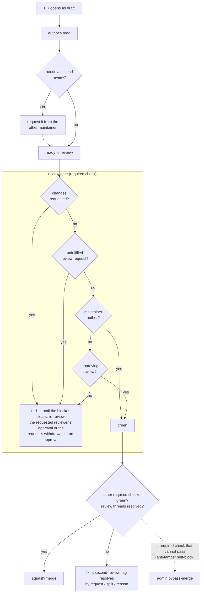

# Design: review and merge policy

**Related:** [`../plans/screen-and-mirror-workflow.md`](../plans/screen-and-mirror-workflow.md) (the PR-time screen and
public mirror this policy gates), [`../plans/doc-garden.md`](../plans/doc-garden.md) (a bot contributor under this
policy), [`proto.md`](proto.md) (schema evolution rules for interface PRs), [`migrations.md`](migrations.md) (SQL
migration runner and deploy substitutions)

## Overview

Requiring a human approval on every pull request turns the review queue into a bottleneck for a small maintainer group
and spends review attention on routine implementation changes instead of design docs, interface contracts, and database
migrations. This doc splits contributors into two review tiers and encodes them in a custom `review gate` status check
([`.github/workflows/review-gate.yml`](../../.github/workflows/review-gate.yml)) rather than a flat GitHub approval
count. Maintainers (direct admin collaborators) normally merge their own implementation PRs after reading the diff
themselves; a review from another maintainer is expected when changing design docs, interface contracts, or database
migrations, and allowed on any PR. Every other contributor (other organization members and bots) requires an approving
review from a maintainer. Encoding the two tiers in `review gate` lets maintainers merge routine implementation PRs
without ticking the admin bypass checkbox on every landing, reserving the ruleset bypass for genuine check-level
exceptions while keeping direct pushes to `main` closed.

## Background

In a small maintainer group, a blanket requirement for a second human review on every PR creates a queue where routine
implementation changes compete for attention with high-leverage changes to design docs, interface contracts, and
database schemas. Meanwhile, implementation PRs are already adversarially self-reviewed before opening
([`../../CLAUDE.md`](../../CLAUDE.md)) and checked by the PR-time LLM review.

The threat model is honest oversight
([`../plans/screen-and-mirror-workflow.md`](../plans/screen-and-mirror-workflow.md)). Contributors and organization
admins are trusted, so the review machinery exists to remind a careful author of the workflow rather than to defend
against a malicious insider.

## Design

### Two review tiers: maintainers and other contributors

A flat GitHub approval requirement treats every author and every diff identically. To focus human review where it
matters without blocking routine work, the policy defines two tiers keyed on whether the PR author is a direct admin
collaborator on the repository:

- **Maintainers (direct admin collaborators).** Maintainer PRs do not require approval from another maintainer by
  default. Because code in this repository is largely agent-written, the author's own read of the diff serves as the
  human review for an implementation PR: the author opens the PR as a draft and marks it ready for review only after
  completing that read. Design docs, interface changes to proto contracts or data-contract docs, and database migrations
  ship in their own PR and get an explicit review request from another maintainer while the PR is still a draft, after
  the author has vetted the diff and stopped churning. Manual review requests survive the draft phase (unlike
  `CODEOWNERS` auto-requests, which wait until a PR is marked ready), so the request is on record before CI checks and
  the review bot first run. A maintainer can also request a review on any implementation PR (e.g. when touching an
  unfamiliar area). Once a review is requested, waiting for it is enforced by `review gate`: the check stays red until
  the requested reviewer submits an approving review or the request is withdrawn, and a comment-only review does not
  satisfy it.
- **Every other contributor (organization members with write access and bots such as
  [`doc-garden`](../plans/doc-garden.md)).** PRs from non-maintainers require one approving review, which in practice
  comes from a maintainer. Nothing automatically requests a review when a PR opens; maintainers pick up these PRs by
  watching the repository.

Deciding whether a maintainer PR needs a second review is a human judgment call backed by a machine reminder. The
PR-time LLM review includes a second-review concern
([`.github/review/second-review.md`](../../.github/review/second-review.md)) that flags design, interface, or migration
changes when no reviewer has been requested, and flags implementation code mixed into a contract PR beyond the bounds
below. Each flag is posted as a review thread, so the ruleset's required thread resolution blocks merging until the
author requests a review, splits the PR, or resolves the thread with a written reason. This polarity is deliberate: a
machine verdict that grants merge permission would have to be hardened against tampering, whereas a machine flag that
opens a review thread only needs a visible override recorded on the PR.

### What an interface or migration PR can carry alongside the contract

Shipping an interface or migration change in its own PR ahead of its implementation means the repository must still pass
every required check at the split point. A diff containing only the `.proto` or `.sql` file often fails type checking,
exhaustiveness tests, or lint gates unless the contract PR carries the minimal glue needed to keep checks green:

- **Retiring a field or declaring an RPC ahead of its handler.** Retiring a proto field takes at least two PRs. The
  interface PR is purely additive, introducing the replacement field while leaving the retiring field in place. The
  implementation PR stops setting the old field; deleting the field and reserving its number and name rides in that same
  implementation PR only when [`proto.md`](proto.md#schema-evolution) permits the version skew (for example, a
  browser-sent field can be deleted only after the change that stops sending it has deployed), and otherwise follows in
  a separate cleanup PR. Declaring a new RPC in an interface PR before its handler exists similarly requires temporary
  type-checker glue. In TypeScript, the interface PR widens the service implementation type to
  `Partial<ServiceImpl<T>>`, and the implementation PR narrows it back so the compiler catches any unimplemented
  handler. Python has no `Partial<>` equivalent: `mypy-protobuf` marks every RPC method on the generated servicer base
  class as abstract, so Pyright rejects a servicer class that implements only a subset of methods even though gRPC
  itself returns `UNIMPLEMENTED` at runtime for unoverridden methods. Rather than writing stub methods that duplicate
  the generated base class, the interface PR suppresses Pyright's abstract-usage check where it instantiates the
  servicer, and the implementation PR removes that suppression as it fills in the handler.
- **Adding a union member covered by exhaustiveness tests.** Some schema additions cannot be separated from the surfaces
  that render them because tests enforce exhaustive handling across every member. For example, adding a new scenario
  member to `AnalysisInputs` ([`analysis-scenarios.md`](analysis-scenarios.md)) fails the tests verifying that every
  scenario is named, labeled, and rendered, so those rendering surfaces ship in the same PR as the schema addition.
- **Adding a migration with deploy substitutions or a new generated stub directory.** A SQL migration that references a
  `${VAR}` placeholder is rendered from the substitution map in
  [`.github/workflows/deploy.yml`](../../.github/workflows/deploy.yml) ([`migrations.md`](migrations.md)), and a test
  verifies that every placeholder in committed SQL has a matching deploy entry, so the `deploy.yml` entry ships with the
  migration. Similarly, when a new proto package introduces a new directory of committed generated stubs, its Ruff
  exclusion in [`pyproject.toml`](../../pyproject.toml) ships in the interface PR so the lint gate passes.

### Encoding the tiers in the `main` ruleset and `review gate`

GitHub's built-in ruleset approval count is a single flat integer across all PR authors, so it cannot require zero
additional approvals from maintainers while requiring one approval from everyone else. Instead, the `main` branch
ruleset configures no ruleset-level approval count and delegates the review requirement to the `review gate` required
status check ([`.github/workflows/review-gate.yml`](../../.github/workflows/review-gate.yml)):

`review gate` posts a commit status to the PR head SHA following the verdict chain in the diagram above. An unfulfilled
review request takes precedence over an existing approval from that reviewer, because re-requesting a review means "look
again". When a reviewer submits any review (including a comment-only review), GitHub removes them from the PR's live
requested-reviewers list. To prevent a comment-only review from satisfying the gate, `review gate` reconstructs pending
requests from the PR's request and request-removal timeline events: only an approving review submitted after the newest
request, or an explicit withdrawal of the request after that request, satisfies it. Because a submitted review consumes
the live request on GitHub, withdrawing a request after a reviewer has left a comment-only review requires re-requesting
that reviewer and then removing the request; the same two-step removal clears a request accidentally sent to a bot or a
team that cannot approve.

The workflow triggers on `pull_request_target` and `pull_request_review` without checking out PR code, so the workflow
on `main` evaluates every PR and a PR cannot edit its own gate. The ruleset requires the posted commit status context
`review gate` rather than the GitHub Actions job's own check run, because the job exits zero even when the status it
posts is `failure`. The required-check entry in the ruleset specifies no `integration_id`, which allows a maintainer to
post a status manually via the GitHub API when a PR predates the check and has no new push or review event to trigger
the workflow.

On each run, `review gate` queries the repository's direct admin collaborators live to determine the maintainer set.
Organization owners inherit the admin role (along with the ruleset bypass) but are not direct collaborators unless
explicitly added, so only direct admin collaborators self-merge through the gate. Because changing a collaborator's role
does not fire a pull request event, an open PR reflects a role change only on its next push or review event.

The rest of the `main` ruleset and repository configuration pairs with `review gate` as follows:

- **No `CODEOWNERS` file.** GitHub automatically requests a review from every matching code owner when a PR is marked
  ready for review, with no setting to turn auto-requests off. Any `CODEOWNERS` entry would notify every maintainer on
  every PR, defeating the request-only workflow where a review notification signals that the author specifically asked
  for a second pair of eyes.
- **Approvals and changes-requested persist across pushes.** Pushing new commits does not dismiss existing approvals,
  which avoids re-notifying a reviewer whenever an author fixes a typo or rebases an already-reviewed diff.
  Symmetrically, a `CHANGES_REQUESTED` review keeps `review gate` red across pushes until that reviewer approves or
  dismisses their review; if that reviewer was also explicitly requested, dismissing the review returns the PR to
  waiting on their approval.
- **Non-strict required checks and draft behavior.** Every commit to `main` must land through a pull request with
  resolved review threads, linear history (squash-merge only, with force-pushes and branch deletion disabled), and nine
  non-strict required status checks: `review gate`, `regex screen`, `review + LLM screen`, `pre-commit`, `pytest`,
  `pytest-sandbox`, `web`, `backward-compatible`, and `regen-is-fresh`. The checks are non-strict because requiring PR
  branches to be up to date with `main` before merging would invalidate every open PR whenever another PR lands, forcing
  a rebase and a full CI and LLM-review re-run per merge while binding only non-admin contributors. Instead, semantic
  conflicts between concurrent PRs surface within minutes of landing when the same checks run on the push to `main`.
  Required checks other than `review gate` skip draft PRs (`review gate` posts `pending` on drafts and evaluates when
  the PR goes ready), so a chain of draft PRs remains untested by CI until each PR is marked ready for review.
- **Pull-request-only admin bypass.** The ruleset grants bypass access to the *Repository admin* role in **pull requests
  only** mode. Because the bypass applies only to pull requests, admins cannot push commits directly to `main`; every
  commit passes through a PR where the leak screen runs before the commit mirrors to the public repository. And because
  routine maintainer merges pass `review gate` without using the bypass, ticking the admin bypass checkbox at merge time
  marks one of two genuine check-level exceptions:
  1. Merging a PR that edits [`.github/workflows/internal-review.yml`](../../.github/workflows/internal-review.yml),
     which fails its own `review + LLM screen` check because `claude-code-action` refuses to run a workflow file that
     differs from the default branch — the admin bypass-merges instead of temporarily un-requiring the check.
  1. Merging a deletion from an at-rest proto contract past `backward-compatible` after every stored artifact using that
     schema has been deleted first, an exception permitted only while no production environment exists
     ([`litcache-manifest.md`](litcache-manifest.md#the-move-off-the-mirrors)).

Applied on `themis-internal`: ruleset `main` with `review gate` among the required checks and no ruleset-level approval
count; classic branch protection and `.github/CODEOWNERS` removed.

## Alternatives considered

- **`CODEOWNERS` with required code-owner review** (the original encoding). This encodes "a maintainer must approve"
  directly in GitHub, but GitHub's automatic review request on ready-for-review cannot be disabled—even routing
  ownership through a team still places every PR into every team member's review-requested queue. Rejected because
  auto-requesting on every maintainer PR creates notification noise that drowns out intentional review requests.
- **`CODEOWNERS` narrowed to design, interface, and migration paths** (machine-enforcing the two-PR split). Rejected
  because deciding which changes warrant another maintainer's review is a judgment call the maintainers trust each other
  to make, and the repository's interface surface does not match a clean file glob (for example, a Python port `abc.ABC`
  or a data-contract section lives alongside implementation files).
- **Classic branch protection with `enforce_admins` disabled.** This gives admins the same merge-button experience with
  a smaller settings surface, but disabling `enforce_admins` also permits direct `git push origin main` by admins, which
  would skip the PR-time leak screen and mirror unscreened commits publicly within minutes. The ruleset's
  pull-request-only bypass keeps direct pushes closed.
- **Restricting valid approvals to maintainers.** Without `CODEOWNERS`, an approval from any organization member with
  write access satisfies `review gate`, so two non-maintainers could in principle approve each other's PRs. Accepted
  because organization members with write access are inside the trusted circle under our threat model, and a failing
  required check still blocks them since only repository admins hold the ruleset bypass.
- **A ruleset-level approval count of 1 with routine admin bypass** (the prior encoding). Because a flat approval count
  cannot distinguish maintainers from other contributors, every self-merged maintainer PR had to tick the admin bypass
  checkbox, turning the bypass log into routine noise instead of a record of exceptional merges. Moving the tier logic
  into `review gate` returns the admin bypass to genuine check-level exceptions.
- **A bot-applied `self-mergeable` label feeding `review gate`** (having the review bot label maintainer PRs whose scope
  needs no second review, and passing `review gate` when the label is present). Rejected because of its security and
  usability polarity: any contributor with write access can apply a label, so trusting a label to grant merge permission
  would require verifying the labeling actor (building anti-insider machinery our threat model does not otherwise need),
  and any bot false negative would force maintainers back to ticking the admin bypass checkbox. GitHub ruleset
  conditions cannot express label-based rules natively either, as they only match ref names. Using the second-review
  concern in the LLM review preserves the bot's judgment while flipping the polarity: the bot can only raise a review
  thread, and overriding a false positive only requires resolving one thread with a reason.
