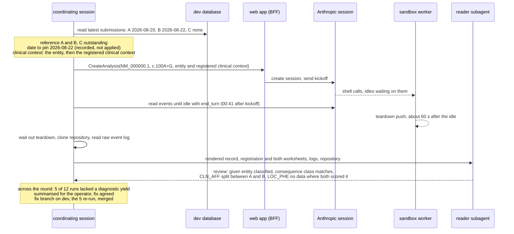

# Design: the run-review loop

**Related:** [`curation-surface.md`](curation-surface.md) (the worksheet a run is read against);
[`svcv4-classification-widget.md`](svcv4-classification-widget.md) (the typed record a classification run produces);
[`analysis-scenarios.md`](analysis-scenarios.md) (the scenario and kickoff a run is created from);
[`sandbox-worker.md`](sandbox-worker.md) (the worker whose teardown push collection waits for);
[`workbench-workspace.md`](workbench-workspace.md) (the workspace repository collection clones);
[`sandbox-rpc-exposure.md`](sandbox-rpc-exposure.md) (the data cutoff, which no service applies yet);
[`agent-runtime.md`](agent-runtime.md) (the coordinator and the reviewer copy it briefs);
[`../runbooks/hand-driving-a-service.md`](../runbooks/hand-driving-a-service.md) (the `themis-clu` account the loop acts
as).

## Overview

The agent gets better when someone finds where it goes wrong and fixes the cause. The run-review loop does that on
variants whose answer is already known: curators have classified them on the curation worksheet. A round, coordinated
from a Claude Code session, runs the agent once on every such variant, collects what each run produced, and hands each
run to a fresh-context Claude Code subagent that reads it against the curators' worksheets. The coordinating session
then summarises the findings for the operator, and the two decide in conversation what to fix. A fix is tried on dev
before it is merged.

The loop runs against the dev deployment only, acting as the programmatic account `themis-clu`. The curators' worksheets
are recorded in dev, and collecting a run needs a signing grant that only the dev stack gives that account. Runs are
created through the web app's own create path, the one a curator's browser uses, so a round measures what a curator
gets.

Creating a run, waiting for it to end and collecting it take a scenario's inputs and know nothing about variants. Only
the reference and the reader's instructions are specific to a scenario, so another scenario can reuse that half
unchanged. Variant classification is the one scenario built. A run has ended when the agent hands the turn back to the
user, which the harness reads from the Anthropic session directly. A run still going at the round's deadline is
interrupted; its pushed work is still collected, because the workspace is a git repository the worker pushes on the way
out.

Since a model reads every run anyway, code does only what a model is bad at. It decodes the binary classification record
and the stored worksheet rows into readable text, and it fails loudly on a reference it cannot use. The reader does all
of the comparing, cell by cell.

A registration states the question: one variant against one entity, a disease under one mode of inheritance, and the
clinical context of the patient the variant was found in. Its curators answer that question, and the round states the
same entity and clinical context in the run's first message, and nothing from any submission, so the run answers it too.
A variant enters a round as soon as one assigned curator has submitted a complete worksheet, and its reference is the
latest submission of each curator who has; where curators disagree, that is a finding about the reference and is never
graded. The platform does not yet hide evidence newer than the reference, so the round records the date it would pin and
the reader accounts for later evidence by hand.

## Background

### What a run is

A run is one Analysis created from the variant-classification scenario: a transcript, a coding change written in HGVS
notation (`c.100A>G`), and the clinical context in prose. The web app's backend-for-frontend (the BFF) renders those
three fields into the agent's first message, the **kickoff**, which also carries the working document's outline
([`analysis-scenarios.md`](analysis-scenarios.md)). It creates an Anthropic Managed Agents session against the deployed
agent and sends the kickoff into it.

Anthropic runs the agent loop. The agent is a coordinator that delegates to copies of itself in separate threads, and
one of those copies is a reviewer: once the draft exists, the coordinator briefs a copy with fresh context to read the
draft against the evidence and report where they diverge ([`agent-runtime.md`](agent-runtime.md)). The agent's shell
commands run in our sandbox worker, a Cloud Run Job started for the session ([`sandbox-worker.md`](sandbox-worker.md)).

The agent writes into the Analysis's workspace, a git repository that it commits to and pushes from inside the sandbox
([`workbench-workspace.md`](workbench-workspace.md)). Every revision of the working document is a commit. The
classification itself is a typed record, a serialized protobuf message committed beside the document as
`assets/svcv4.binpb`, which the workbench draws as the SVCv4 classification widget
([`svcv4-classification-widget.md`](svcv4-classification-widget.md)). For every code the framework admits on the
variant's paths, the record carries a status (scored, not applicable or no data), the decision-tree cell, the evidence,
the reasoning and how open the agent considers the call. It also carries the routing and the class. Every point, total
and class in it was computed by the classification library, `themis.svcv4`, not typed by the model.

Everything the session did is in its **event log** at Anthropic: each turn, tool call, result and thread, with the
session's status changes. The workbench shows a curator a projection of that log, built by the BFF for display
([`conversation-view.md`](conversation-view.md)).

### What a run is read against

SVCv4, the ClinGen pilot of the points-based ACMG/AMP framework, splits a classification into three layers
([`curation-surface.md`](curation-surface.md) §"Three layers"). Fact recovery finds what is known about the variant.
Assessment turns each fact into a code at a strength by choosing a decision-tree cell. Tally sums the codes to a class.
Retrieval is the evidence services' job and the tally is the library's, so the layer that needs a human reference is
assessment.

The framework classifies a variant against a Monogenic disease entity (MDE): a gene, a disease and a mode of
inheritance, where an allelic disorder that arises by a different mechanism is a different disease. A gene curated for
one disease as both dominant and recessive carries two entities, and the population and clinical workflows score the
same facts differently under each.

The curation worksheet records the assessment layer. A manager registers a variant against a disease, named by its MONDO
term, and one of the framework's five modes of inheritance, and writes the clinical context: the referral's clinical
facts, in prose. The gene, the disease and the mode together fix the entity, so a disease the gene causes under two
modes is two registrations ([`curation-surface.md`](curation-surface.md) §"The registration states the question, mode
included"). The manager then assigns curators. Each curator sees the registered entity and clinical context read-only
and answers alone, blind to the others. Per workflow (the calculator's question block for one code) the curator records
the status, the cell, the evidence apart from the rationale, the nearest cell they did not choose and why, and how open
the call is: settled, leaning or open. Per worksheet they record the routing (the consequence class and the reasoning
behind it) and the class with the calls that decided it. A worksheet is committed by submitting it, and each submission
keeps its date. The worksheet and the run's record use the same status, confidence and mode vocabularies, and the same
cell ids for the codes priced per observation.

A curator is not ground truth. In the SVCv4 pilot, analysts classifying the same ten variants agreed 84% of the time at
seven class levels ([`curation-surface.md`](curation-surface.md) §"Two curators, blind"). So a run that differs from a
curator inside the range the curator said was open has not made a mistake, and two curators who differ have found
something about the variant or the framework.

### Why a human authors the reference

The reader that judges a run is a Claude model, and so is the agent. If a model also wrote the reference, a misreading
the two share would read as agreement. A curator's worksheet is the one input to the loop that no model touched, which
is why the worksheet is unassisted ([`curation-surface.md`](curation-surface.md) §"Assistance anchors").

## Non-goals

- A single accuracy number. The loop exists to find defects worth fixing, and a score rolled up over a few dozen
  variants, against curators who agree 84% of the time with each other, would move with the noise and hide which layer
  failed. Estimating accuracy is the benchmarking question [`../PRODUCT.md`](../PRODUCT.md) §11 leaves open.
- Checking the library's arithmetic. The tally is tested by the library's own suites and the calculator oracle
  ([`evidence-interfaces.md`](evidence-interfaces.md) §"Eval: the contract, runs read against curations, then the
  calculator oracle"), outside the loop. Every number in a run's record came from the library, so the reader reads the
  facts and the assessment, not the sums.
- A second turn. A round never answers the questions a run ends with. Any answer would come from the reference, which
  would make the reference an input to the run it is meant to judge.
- Deploying. A round measures what dev runs at the time and records it.

## Design

### One round, traced through one variant

Take `NM_000000.1:c.100A>G` in a gene called GENE1 here, registered against disease X under autosomal dominant
inheritance, with curators A, B and C assigned. A and B have submitted and C has not. The variant, the gene, the disease
and every value below are placeholders: an example naming a real variant beside a defect a run showed is a page the
agent's web search could find (§"Round output stays untracked").



The coordinating session reads the submissions from the dev database. A and B have submitted, so the variant enters the
round with their latest submissions as its reference, and the round records C as outstanding. Both submissions decode
and both state a routing and a class, so the variant can run. B submitted last, so the round's date is 2026-08-22. The
kickoff's clinical context states the registered entity, disease X (MONDO:0000000) under autosomal dominant inheritance,
and then the clinical context registered with the variant. The session creates the Analysis through the BFF, as
`themis-clu`, in the Project the round runs in.

While the agent works, the session goes idle many times waiting for the worker to answer a shell call, and those idles
are not an end. Forty-one minutes after the kickoff it goes idle with the stop reason `end_turn`: the coordinator and
every thread, the reviewer included, have stopped. The coordinating session waits for the worker to push and exit, then
clones the repository and reads the session's raw event log, every thread included.

Code renders the run's final record, the registration and each curator's submission into text, and the reader receives
them with the logs and the repository. Its review finds that the run classified against the entity it was given. Of the
gene's curated records for disease X it took the one curated under autosomal dominant inheritance, and it routed on
missense as both curators did. On `CLN_AFF` the run chose the specific-phenotype row. A chose the highly-specific row
and marked the call leaning, so the run sits inside A's openness, and B chose as the run did. The split between A and B
is a finding about the reference. On `LOC_PHE` the run recorded no data, where both curators scored it from a published
diagnostic yield. The event log shows the agent searching for a yield figure and finding none that the literature tools
serve, so the finding is that the agent had no route to that figure. The in-run reviewer had checked the absence against
what the services returned and agreed with it, which was right given what it could reach.

Across the round's twelve variants, the coordinating session sees the missing diagnostic yield in five reviews and puts
that to the operator, with the five reviews' passages on it. They agree the agent needs a route to published yields. The
change is tried on dev before it is merged: the fix's branch is deployed, the five variants are run again, and their new
reviews no longer report the gap.

### Dev only, as `themis-clu`

The loop is a development tool and runs against the dev deployment, never against production. Three facts bind it there.

The reference lives in dev. Curators record their worksheets on the curation surface of the dev deployment, and the
round reads the submissions from that database as `themis-clu`, whose login can read it. Dev holds no real case data, so
the clinical contexts registered there are practice or synthetic material, and dev's grants stay sized for that
([`deployment.md`](deployment.md)).

Collecting a run needs the run's session token. The token is a keyed hash of the session id, and deriving it takes a KMS
signing grant on the session-token key. `themis-clu` holds that grant only where the stack opts in, which dev does and
production must not: whoever holds it can act as any live session, and a production session may be real
([`deployment.md`](deployment.md)).

The runs themselves are evaluation work. They spend tokens, occupy workers and create Analyses, and nothing about them
belongs in a deployment curators use for real cases.

`themis-clu` is the account a person impersonates to drive a deployed service by hand
([`../runbooks/hand-driving-a-service.md`](../runbooks/hand-driving-a-service.md)). It reaches the web app through IAP
with a token it signs itself, and the app authorizes it like any user, on its email. So the round runs in a Project
whose membership includes `themis-clu`, seeded out of band as every membership is. The event log is read from Anthropic
with the operator's own credential for the dev deployment's Anthropic workspace, since the account has no Anthropic
identity.

A consequence is that a round measures dev as it stood that day. A fix the round motivates ships through the ordinary
deploy, and the next round measures it there.

### A run is created as a curator's would be

The round creates every run with the BFF's `CreateAnalysis`, the call the create form makes. The BFF renders the kickoff
from the scenario's inputs, creates the session against the deployed agent, derives the session token, inserts the
Analysis row, and the dispatcher starts a worker. Each of those steps is part of what a curator gets, so each is under
test. A side effect is useful: a round's Analyses appear in the Project's list in the workbench, so anyone can open a
run and see exactly what a curator would have seen.

The repository has a second way to create an Analysis, [`tools/pi_analysis.py`](../../tools/pi_analysis.py). It writes
the Analysis row directly, with a session id the platform never created, for a harness that drives its own agent loop
outside the platform. It fits that harness because there is no platform session to start. For this loop it would skip
the kickoff, the session and the worker, which are the parts being measured.

### The run half knows nothing about variants

The loop has two halves with a clean line between them. The run half takes a Project and a scenario's inputs, exactly
the message `CreateAnalysis` takes, and returns a collected run: the repository, the event log, the provenance and how
the run ended. Nothing in it mentions a variant, a code or a curator.

The scenario half is everything else: where the reference comes from, how the inputs are built from it, how the
reference is rendered for the reader, and the reader's instructions. For variant classification that is the curation
worksheet. A scenario whose reference is a case record rather than a worksheet would supply its own inputs, reference
and reader's instructions, and reuse the run half as it is.

The cost of the seam is that the run half cannot know what a scenario's run is supposed to produce, so it cannot check
that the record exists. That check belongs to the scenario half, which reports a run with no record as a run that
produced nothing to compare.

### When a run has ended

A round has to know when to collect. The obvious source is the BFF's `Poll`, which the workbench calls every few
seconds. But `Poll` returns a projection built for display, and that projection drops the session's status events and
stop reasons. Deciding that a run has ended from display rows would be a guess. So the harness reads the session's
events from Anthropic directly; it needs that log for collection anyway.

The session's status aggregates its threads: while any thread is running, the session reports running. The states the
harness reads, and what each means for a run:

```
session event                         meaning for the run
running                               not an end: the agent or one of its threads is working
rescheduled                           not an end: the platform is recovering the session after an error
idle, stop reason requires_action     not an end: the worker is answering a shell call
idle, stop reason end_turn            ended: the agent handed the turn back and waits for a user
idle, stop reason retries_exhausted   failed
terminated                            failed
error, retry status retrying          recorded: the platform retries
error, retry status exhausted         recorded: the session idles with retries_exhausted next
error, retry status terminal          recorded: the session terminates next
anything else                         the harness stops deciding and reports the event
```

An idle with `end_turn` is the agent waiting for a human, and in a round no human answers, so it is the end. The
classification instructions tell the agent to finish the work, list the calls worth a curator's judgement, and end its
turn. A turn that ends early with a question is also an end, since nobody will reply, and the reader treats it as a
finding: the instructions say never to block on a question. The session is idle before its first message too, so an idle
counts as the end only after the session has reported `running` following the kickoff. The harness finds the kickoff by
the time the platform stamped on it when it processed it. It cannot use the kickoff's place in the event list, because
the platform may list an event stamped at the kickoff's own instant ahead of it.

An error is recorded and never decides the run on its own. An error event carries no thread id, so it may come from a
child thread, a reviewer copy whose model request failed, say, while the coordinator carries on and finishes the run.
What the run came to is decided by the session-level status that follows: an idle with `retries_exhausted` or a
termination fails it, and an idle with `end_turn` ends it as usual.

A failure is recorded with the event that caused it, and the round goes on with the other variants. The BFF sets no
spending budget on a session, so the budget stop reason cannot arise; the harness treats it, like any event it does not
model, as a sign that its own model of the session is wrong. It stops deciding rather than guessing: it reports the
event, and the run is not collected as ended. The deadline below still applies to such a run, since an unmodelled event
can turn out to be transient, and a harness that simply walked away would leave the session running with nobody to stop
it.

### A run still going at the deadline is interrupted

Every run has a deadline, set per round well above the longest ordinary run and recorded with the round. A run can miss
it for good. If a worker dies after it has taken the session, the session waits forever for a shell result nobody will
send ([`sandbox-worker.md`](sandbox-worker.md) §"The work item is acked once restore proves").

One answer is to record the timeout and leave the run alone, on the grounds that an interrupted run has nothing to read.
That premise does not hold. The agent commits and pushes as it works, and when the session goes idle the worker pushes
any commit the agent left unpushed. An interrupted run's repository holds everything it committed.

So at the deadline the round interrupts the run, through the BFF's `Interrupt` as a curator's stop button does. An
interrupt stops every thread and the session idles with `end_turn`; nothing in the log marks the idle as an interrupt,
so the harness records that it sent one. The round then collects as for any other end. An interrupt the session does not
answer with an idle within a grace period is sent again, a bounded number of times, after which the run is reported and
left uncollected. Interrupting stops the spending and frees the worker, and it makes the repository final before the
round reads it, where a run left going could push afterwards. The cost is that the reader receives a run cut off
partway, whose document may be half written. The reader reads it as a partial run, and the timeout is a finding in
itself.

### What is collected

Collection happens after the worker has exited, not at the idle. The worker's session loop returns about a minute after
an `end_turn` idle, and only then does it push what the agent left unpushed ([`sandbox-worker.md`](sandbox-worker.md)
§"The session's release lands about a minute after its last turn"). The worker exits only after that push, and a push
that fails makes it exit with an error, so the Cloud Run execution's outcome would be the exact signal. The round cannot
read it safely yet (§Open questions), so it waits a settle period comfortably past that minute before it clones. The
round refuses a settle period with too small a margin over that minute, because a clone taken before the push lands
misses the run's last work without any error.

The repository is cloned whole with [`tools/clone_analysis.py`](../../tools/clone_analysis.py), which derives the
session token and serves the clone through the sheaf service. The clone holds every revision of the document and of the
record, each a commit, and the reflog that times each publish. A reader can therefore see how the classification changed
over the run, including what the reviewer's findings changed.

The event log is read raw from Anthropic, for the session and for each thread. It carries what the BFF's display
projection drops: status changes and stop reasons, errors with their retry status, where a thread's context was
compacted, and each model request's timing and usage. A thinking event in the log marks that the model thought and when;
the thinking itself is not in the log.

The provenance of a run is the agent version the session ran. The session records a snapshot of the agent taken when it
was created, with its version and every skill pinned to a version; the deploy refuses a skill pinned to `latest`, so the
snapshot names exact skill content. The agent's metadata at that version names the git commit each of our skills was
published from, so a finding can be traced to the instructions the run actually read. A round whose sessions ran
different agent versions, because a deploy landed mid-round, is not one round, and the coordinating session reruns the
stragglers rather than decide across both. A rerun moves the straggler's old run aside and creates a new one, since
resuming the old run would only collect the same version again. The kickoff text needs no separate record, since it is
the first message in the event log.

Collection keeps the raw artifacts and renders nothing. Rendering is a separate step, so a fix to the rendering never
needs the runs again.

### A variant enters a round with its first complete submission

The obvious rule waits for every curator assigned to a variant, the state the curation surface calls complete. It keeps
each variant's reference whole: every curator's answer is there, so a split between them always shows. It also lets one
curator who has not got to a variant hold it out of every round, however many colleagues have answered it. A single
curator's worksheet is a usable reference on its own, since the reader compares a run with each curator separately
anyway. Measuring how far two curators spread is the curation surface's job, and this loop does not need both answers to
do its own.

So a variant enters a round when at least one assigned curator has submitted (a complete worksheet, below). The
reference is the latest submission of each curator who has, frozen when the round is prepared. A curator who has not
submitted is absent from that round's reference, and the round records who is outstanding, so the reader knows the
reference is partial. In the trace above, C submitting on 2026-08-25, after the round was prepared, changes nothing in
that round; C's answer joins the reference in the next round that variant enters. The cost is that a variant with one
submission has no second curator to show a disagreement, so a call on which the curators would have split reads as a
run's divergence from one curator. The reader weighs that call by the openness that curator recorded, as it does for any
other.

A submitted worksheet need not be finished. The curation surface accepts a submission that answers anything at all, so a
curator can submit without choosing a consequence class or a class, and such a submission leaves the reader nothing to
compare the run's routing or class with. The round holds it out of the reference as it would an unsubmitted worksheet,
and the other curators' submissions stay in. It records the curator as left out, with what they left unset, so the
reader knows why the reference is partial. A variant whose every submission is incomplete waits, like one nobody has
submitted, until a complete submission arrives. Failing the variant instead would let one unfinished worksheet hold out
its colleagues' answers, which is why this section does not wait for every curator either.

The reference takes each curator's latest submission. A curator may submit again after a discussion with a colleague,
and that later answer is no longer blind. Blindness is what the concordance measurement needs, and that measurement is
the curation surface's, not this loop's. A run should be read against what the curator now stands behind. The cost is
that a resubmission after discussion can bring two curators closer and hide a disagreement the loop would otherwise
report about the reference, so the rendered reference says how many submissions each curator made and when.

Code fails a variant loudly, and names it, when its reference cannot be used. A stored row may not decode, may hold a
different section from the one its row id names, or may carry a field the schema no longer declares, such as a routing
row written before the routing's entity fields were retired. A registration may name its disease by a MONDO term with no
label, which the kickoff could not state as an entity. One curator's own two submissions may tie for the latest, and
then no submission is that curator's latest. And the clinical context the round composes (next section) may be longer
than the create request allows, so that `CreateAnalysis` would refuse the kickoff; the round never truncates it.
Everything else a submission may leave blank (a nearest alternative, a confidence note) is the curator's answer, and the
reader weighs it.

### What the kickoff carries

The kickoff carries what the create form carries: the transcript and the coding change from the registration, and the
clinical context, which is prose. The round composes the clinical context from the registration alone. It opens with the
registered entity, the disease by its label and MONDO term and the mode of inheritance, stated as the entity to classify
against. The registration's clinical context follows: the referral's clinical facts, which the manager wrote when
registering the variant and every curator was shown read-only ([`curation-surface.md`](curation-surface.md) §"The
clinical context is part of the question"). For the trace above:

```
Entity to classify against: disease X (MONDO:0000000), autosomal dominant.

Proband 1: an adult with the disease's typical presentation; a multi-gene panel for the disease, no other variant of
interest found.
```

The entity is stated because it is part of the question. SVCv4 classifies a variant against an entity, mode included,
and the registration says which entity the curators classified against. Take a gene curated for one disease under both
dominant and recessive inheritance. The same variant against each of the two entities is a separate question with its
own answer, and under the recessive one every affected proband is scored from the biallelic table. A run given only the
variant would have to choose the question itself, and one that chose the recessive entity where the curators answered
the dominant one would differ from them in every clinical workflow, so its review would say nothing about assessment.
Whether the run then classified against the stated entity is still read (§"Reading a run"), because the classification
instructions tell the agent to classify the entity a clinical context states, and a run that drifts to another one has
not followed them.

Nothing from any submission reaches the kickoff. A submission is the answer the run is read against, and that includes
anything a curator writes about the case: such a note can carry the referral, but also a value the curator worked out or
looked up, and nothing in it marks which is which. The registration's clinical context is written from the referral
alone, so the run and every curator are given the same facts, and a difference between them in a case code is a
difference in reasoning about those facts. A variant registered with no patient behind it, as some of the pilot's
practice variants are, says so in its clinical context, so the run is told there is no proband rather than left to read
meaning into silence.

Everything a worksheet holds is withheld from the run: the gene, the consequence class, the codes, the evidence and the
class. So when the reference relies on a fact the run never received, the finding is that the agent had no route to the
fact. The response is to build the route, because putting the fact in the prompt would teach to the test. Knowing the
entity still leaves the run fact recovery to do around it. The gene–disease service returns every curated record on the
disease term, under every mode and from every source, each with its source's own mode term
([`evidence-interfaces.md`](evidence-interfaces.md#goal-is-the-gene-disease-relationship-valid-and-by-what-mechanism)).
The run has to pick the record that describes the given entity, and that record's validity level gates the class. Which
record it picked is part of what the reader judges.

### The date a run may see up to

A run that classifies with evidence published after the curator submitted has not out-reasoned the curator. The curated
variants were classified over months, and the literature and the databases keep growing, so left alone the comparison
drifts. The platform's answer is a data cutoff: an evaluation session carries a date, and every evidence service answers
as of that date ([`sandbox-rpc-exposure.md`](sandbox-rpc-exposure.md) §"Masking is the first use"). That document leaves
the choice of date to the harness. No service applies a cutoff yet, and the loop does not build one.

The round chooses, per variant, the date of the latest submission among the curators in the reference. Take A submitting
on 2026-08-20 and B on 2026-08-22. Pinning the earlier date keeps every curator ahead of the run, but a paper published
on 2026-08-21 that B used would then be invisible to the run. The reader would report that the agent had no route to it,
and the loop would set out to build a route to something the platform already serves. Pinning the later date lets the
run see that paper, which A could not have seen. That case is visible, though: the reader sees the paper's date beside
A's submission date. One choice produces false findings that cost work, and the other produces visible differences that
cost a sentence in a review, so the round pins the later date.

The round records the date with the run, together with the fact that no service applied it. Until the platform applies a
cutoff, the reader does the accounting by hand. Cited evidence dated after a curator's submission is evidence that
curator could not have seen, and the reader names it as such and grades it on neither side. That accounting has a limit:
newer evidence that steered the run without being cited leaves no mark the reader can find.

The date comes from the curators' submissions, so the round records it for the reader and sends it nowhere: a run is
given the registration and nothing from a submission (§"What the kickoff carries"). How a cutoff would reach a run, and
from where, is left to the masking design (Open questions). Whatever it decides, the hand accounting stays for one
source. The agent's web search runs at Anthropic, outside every service a cutoff reaches, so a fact the run took from a
search result can still postdate the reference.

### Code renders, and the reader compares

A model reads every run, so code does only what a model is bad at. The run's record is a serialized protobuf message,
and the curators' answers are stored protobuf rows; a model cannot read either. Code decodes both and writes them out as
YAML through protobuf's canonical JSON mapping, so every field the message sets appears under its proto name, an enum as
its member's name and a timestamp as an RFC 3339 instant. The mapping drops a field the schema does not name without a
word, so code checks for one first and stops the rendering if it finds one. That covers every field of the record
([`svcv4_classification.proto`](../../schema/proto/themis/widgets/models/svcv4_classification.proto)) and of each
submission ([`curation.proto`](../../schema/proto/themis/curation/models/curation.proto)). It renders the registration
too: the entity, with its mode written as the same `ModeOfInheritance` member name the record uses, and which curators
are in the reference, which were left out and which are outstanding, so the reader sees what both sides were given. Code
also fails loudly on a reference it cannot use, as above. It compares nothing.

The obvious alternative is a code-level diff. Since the two sides share their vocabularies and the per-observation cell
ids, code could join them and list every cell where the run and a curator differ. That would be cheap and repeatable. It
breaks on the judgements the loop exists to make. In the trace above, a diff marks the run's `CLN_AFF` as different from
A's. Whether that matters depends on A having marked the call leaning, on B agreeing with the run, and on which case
facts the run was given, and none of that is a property of the two cells. A diff would also mark a run that reached A's
cell by a route A would reject as a match. A path code (one of the variant-type codes scored on a path through a
decision tree) has no cell id at all, and the record carries the agent's own statement of the cell it read
([`svcv4-classification-widget.md`](svcv4-classification-widget.md) §"The library's vocabulary"). A run classified
against another entity makes every cell comparison beneath it meaningless. The reader would have to read every cell
anyway, and a diff placed in front of it is a conclusion it would be tempted to grade instead of the reasoning.

### Reading a run

Each run is read by one Claude Code subagent with fresh context. It receives the reader's instructions, the collected
run (both event logs, the repository and the rendered record), the rendered registration, each curator's rendered
submission in the reference, and what the round recorded: how the run ended, whether the round interrupted it, and the
date and the fact that no service applied it. It receives nothing else: no other variant's review, and no impression
from the coordinating session. It treats the run's own account of what it did as a pointer to where to look, and the
event log as the evidence.

The reader compares the run with each curator separately, workflow by workflow. It first lists every difference it
finds, with what each side's call rested on. Only then does it explain each difference, from the explanations below, or
says that none of them applies. An explanation is a tag on a difference and never removes one from the review, so a
difference that no explanation fits stays visible. The explanations were written before any round had run, so they are a
starting set: the coordinating session adds, drops or rewrites them from what rounds show, as it does with any other
prompt.

- Routing is compared first, as routing. The run was told the entity, so the first question is whether it classified
  against that disease under that mode. A run that classified against another entity has diverged from its instructions,
  which is a finding, and its cells are not graded against the curators', since they answer a different question. A run
  whose consequence class differs from a curator's has taken a different path, and the cells that class selects are not
  graded against that curator's.
- The curated record the run took its validity level from is read as fact recovery. A run that gated the class on a
  record curated under another mode has applied a level that does not belong to the entity.
- A difference inside the openness the curator recorded is not a defect. A call marked leaning or open admits its
  neighbouring cells, and a settled one does not.
- Where the curators disagree with each other, on a cell, the consequence class or the class, the reader records a
  finding about the reference and grades the run against neither. A curator who has not submitted, or was left out, is
  absent, and a reference of one curator shows no such disagreement.
- Evidence dated after a curator's submission is a difference in what each side could see, and it is graded on neither
  side.
- A fact the reference used and the run never had is a missing route, stated with the route that should exist.

The in-run reviewer is part of the system under review, and the reader is outside it. The event log holds the brief the
coordinator gave the reviewer and the report it returned, and the document records which findings the coordinator
overruled. So the reader can say what the reviewer caught, what it missed, and whether the coordinator was right to
overrule it. Those observations bear directly on the bet that a fresh-context reviewer beats self-review
([`../PRODUCT.md`](../PRODUCT.md) §11).

A review is prose. It opens with one line saying whether the run reached a sound classification, which needs sound
reasoning as well as a matching answer, or could not be checked at all. Every finding follows. The instructions forbid
ranking findings, because a reader that has seen one variant cannot know how many others a finding touches.

### Deciding what to fix

The loop finds and explains failures, and the decision about what to fix stays with the operator, in conversation with
the coordinating session. Once the readers are done, the session summarises the round for the operator with pointers
into the reviews. It says which differences look like defects in the agent or its services, which are about the
reference (curators who disagree, a worksheet's own data, how a registration was written), and which turn on a reading
of the framework where the instructions and the curators' practice part. The last kind is the operator's to settle:
changing the agent to match the curators there would teach it the answers rather than the framework. What to fix, and
what to leave, is then decided in that conversation.

A loop over a fixed set of variants drifts towards fitting them: the cheapest change that makes a finding go away is
usually narrower than the principle behind it, and on the variants that motivated it a special case reads as well as a
principle. So before writing an instruction change that might be shaped that way, the session can have it checked for
generality. A subagent that has seen none of the variants, nor the material they were curated from, reads the proposed
change against the framework's text and asks which codes and cells it governs, where it would be wrong, and whether it
can be stated without naming a variant.

A fix is also tried on dev before it is merged. What would count as fixed is said before the re-run, the fix's branch is
deployed to dev, and the variants that showed the finding are run again and read. One run per variant makes that a
coarse test: it shows a fix that leaves the finding in place or breaks something new, and it measures no rate, which
suits a loop whose work for now is finding what is broken. Deploying an unmerged branch is acceptable because dev is the
only deployment the loop touches.

### Round output stays untracked

Every tracked file is mirrored to a public repository. The reviews, the event logs and the rendered worksheets quote
curators' rationales, which are not for the public mirror, so a round's output stays in a gitignored directory on the
operator's machine. The fixes are tracked, and they name prompts, services and framework clauses, never a curator, a
variant or anything a curator wrote. The variant is excluded too, because the agent searches the web, and a public
record pairing a variant with a known defect is a page a later run could find.

## Alternatives considered

- A procedure for deciding what to fix: rank findings by how many of the round's variants each touches, draw one line
  per round between the fixed and the declined, keep a tracked record of every declined finding, and hold a random share
  of variants out to test each fix against. Rounds would be comparable, and a round whose findings were all fixed or
  declined would mark a stopping point. It lost because the loop is a convenience layer for a conversation between the
  operator and the coordinating session. In a round of a few variants the counts barely separate one finding from
  another, and a codified line would take a decision that belongs to the operator.
- Run each variant several times per agent version. Each finding would then have a rate, and a consistent failure would
  stand apart from a one-off. It lost because the loop's work for now is finding what is broken, which shows in a single
  run, and rounds repeat, so a real failure keeps coming back. Several runs of one variant would also have the reader
  compare runs with each other as well as with the curators.
- Reuse a run in a later round when its agent version still matches. A round would pay only for the variants whose
  version changed, and an earlier run could be read again once more curators had submitted. It lost because a run is one
  draw from a non-deterministic agent: reused as the version's answer, it would hide exactly the variation a fresh run
  shows.
- Render the record and the rows in protobuf's text format. It is as standard as the JSON mapping and needs as little
  code. It lost on timestamps, which the text format writes as epoch seconds, while the reader compares evidence dates
  with curators' submission dates throughout a review.
- Score each run's class against the curators' classes. A single number per round would make progress easy to chart. It
  lost because an exact class match is not meaningful inside the curators' own disagreement, and because a run that
  reaches the right class from wrong facts is the failure the loop most needs to see.
- Collect through the BFF's workspace relay instead of a derived token. The BFF already relays the repository's ref
  document and signs download URLs for its packs, for the curator's browser, and it checks only Project membership. A
  harness using it would need no grant that can act as any session, which would remove one of the reasons the loop is
  bound to dev. It lost because rebuilding a repository from those packs is a second implementation of what the clone
  tool and the sheaf service already do, and the loop is bound to dev by its reference in any case. If the loop ever has
  to run elsewhere, this is the route to take.
- Add a run state to the BFF's `Poll`. The harness would then need only the web app to know when a run ended. It lost
  because the harness reads the raw event log for collection regardless, and a field the curator's contract carries for
  a harness's sake is a field the contract has to keep.
- State the entity in fields of its own on the create request: a MONDO term and a mode beside the transcript and the
  coding change. The run would read its entity from typed values rather than from prose, and the request's validation
  could check them. It lost for the reason the `Poll` field lost: the create request is the curator's contract, and the
  harness alone would need the fields. The classification instructions already take the entity from the clinical context
  wherever it is stated, which is also where a curator who knows the entity writes it.

## Open questions

- Waiting for the worker's execution instead of a settle period. A teardown push slower than the settle period is missed
  without any error. The reader can still spot one after the fact, as a commit the event log mentions and the clone
  lacks, but nothing fails.

  Two things keep the round from reading the execution. The only place an execution names its session is its environment
  overrides, and whoever can read an execution through the Cloud Run API also reads the environment key and the session
  token stored beside the session id ([`../plans/self-hosted-sandbox.md`](../plans/self-hosted-sandbox.md) §7, "Override
  visibility"). And a session can have more than one execution, when a spawn dies before it takes the session and the
  dispatcher spawns another.

  The smallest addition that keeps those secrets out of reach is a record outside the execution's spec. The worker
  already logs the session id when it starts serving and a line when the teardown push lands; one structured final entry
  carrying the session id and the outcome would let the round wait for it and fail loudly on a failed outcome. That
  needs a new grant: log read on the sandbox job's logs for the identity the round runs as.

- Where a run's data cutoff comes from. The date the round records is the latest curator's submission date, which a run
  must not be given, since nothing from a submission reaches a run. A cutoff could instead be part of the registration,
  the date the question was posed, or come from a masking design that covers more than this loop. That design is not
  done yet, and until it is no date reaches a run.

- Web search under a cutoff. No platform cutoff reaches a search that runs at Anthropic. Either the reader's hand
  accounting stays for search results permanently, or an evaluation session runs without web search and loses whatever
  the agent finds only there.
