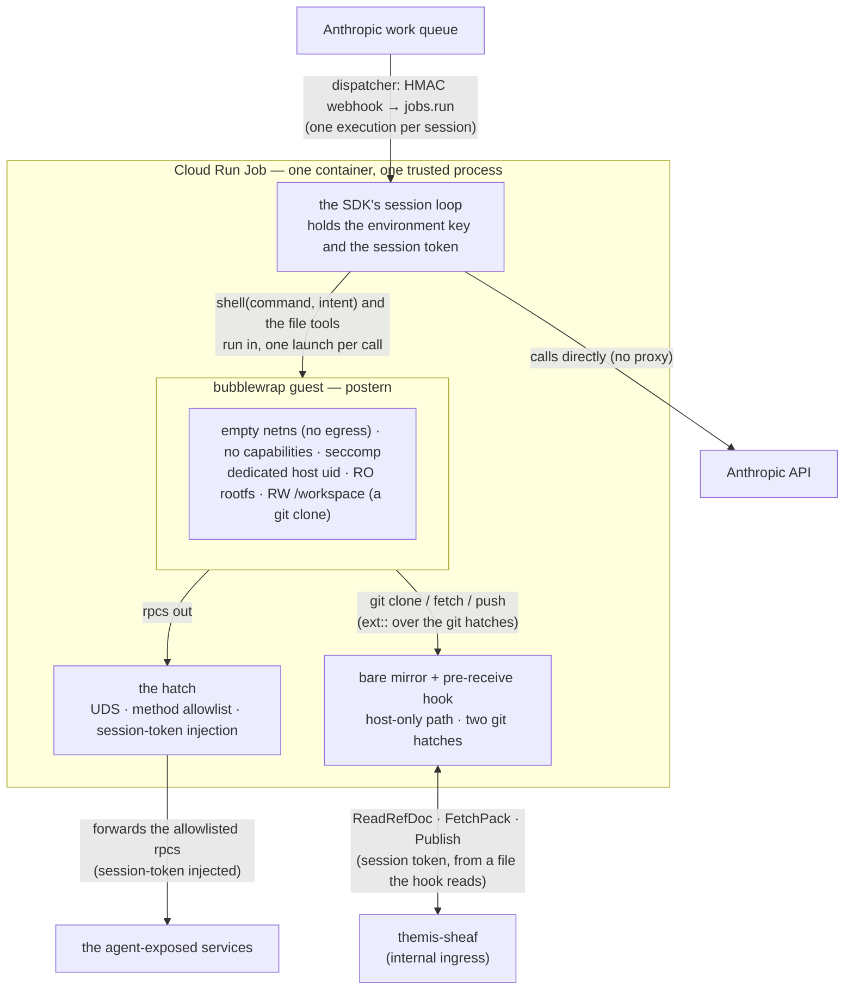
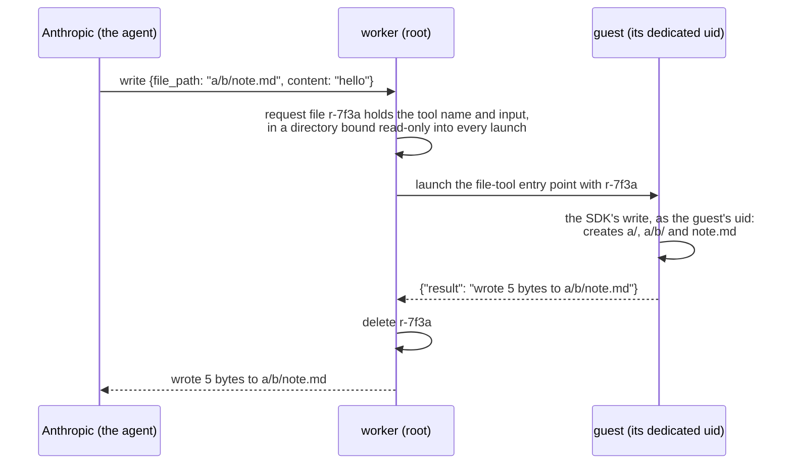

# Design: the sandbox worker

**Related:** [`sandbox-rpc-exposure.md`](sandbox-rpc-exposure.md) (which RPCs the guest may call through the hatch, and
how that set is declared); [`../plans/self-hosted-sandbox.md`](../plans/self-hosted-sandbox.md) (the dispatcher, the
credential model, and the session lifecycle this execution model sits inside); [`sheaf.md`](sheaf.md) and
[`sheaf-service.md`](sheaf-service.md) (the repository backing `/workspace`, and the service the worker reaches it
through); [`../runbooks/self-hosted-sandbox.md`](../runbooks/self-hosted-sandbox.md) (operating the sandbox);
[`services.md`](services.md) (the data-plane services the hatch reaches)

## Overview

Themis runs the agent's tool execution inside CPG's network rather than on Anthropic's servers because tool calls read
genomic data and call internal services ([`../PRODUCT.md`](../PRODUCT.md) §9). Running model-written code inside our
network requires isolating each session's execution, bounding what internal and external services that code can reach,
and persisting the files it produces after the container exits.

Rather than splitting a session across an untrusted agent container and a trusted credential-injecting sidecar, the
sandbox worker runs as one trusted process per session. That process holds the Anthropic environment key and the
per-session token, runs the Anthropic SDK's session loop, and launches a
[bubblewrap](https://github.com/containers/bubblewrap) guest for every tool that runs model commands or touches the
workspace. The guest runs as a dedicated host user ID (`uid`) that owns nothing else on the host, inside an empty
network namespace with no network interfaces. Because the guest has no network interface, egress is blocked at the
kernel namespace level without an egress firewall, a DNS sinkhole, an internal load balancer, or an Anthropic reverse
proxy. The guest's only exits are Unix domain sockets into the trusted worker: a method-allowlisted gRPC hatch that
injects the session token before forwarding calls to internal services, and two git stream hatches.

The guest's `/workspace` directory is a git clone of the Analysis's sheaf repository, served over those two git hatches
from a bare mirror that the worker maintains at a host-only path. The worker holds no object-storage credential; its
mirror reads and publishes through the `Sheaf` gRPC service using the session token, which scopes every call to that
session's Analysis. The agent commits and pushes its own work—including the working document, which is an ordinary file
in the repository—and any uncommitted changes are discarded when the session ends.

## Background

Anthropic hosts the model and owns the conversation state for each agent **session**, while tool execution runs in our
GCP project. When a session needs tool execution, Anthropic sends a webhook to our dispatcher, which starts one Cloud
Run Job execution and injects the session's identifiers and its session token minted with a Cloud KMS MAC key.
Everything upstream of that job launch—the dispatcher, the credential derivation, and the work-queue lease model—is
defined in [`../plans/self-hosted-sandbox.md`](../plans/self-hosted-sandbox.md); this document covers what runs inside
the Cloud Run Job execution once it starts.

Inside the job, the Anthropic SDK's worker loop claims a **work item** for the session, consumes the session's event
stream, and dispatches tool calls to our Python handlers. Five behaviors of the SDK's loop shape the worker's design:

- The loop consumes the session's event stream internally and yields only tool calls to the caller, so turn boundaries
  are invisible to our code.
- The loop releases the work item when the session terminates, or after an idle timeout (one minute by default) elapses
  following an end-of-turn event.
- The loop runs one tool call at a time under a per-tool deadline, abandons any call that overruns its deadline, and
  does not cancel an in-flight call when the session ends.
- At the start of each execution, the loop downloads the session agent's skills into the working directory with
  owner-only (`0700`) permissions. Because the platform's skill conventions expect those files under
  `/workspace/skills`, that download fixes the working directory as **`/workspace`**.
- The SDK ships built-in file tools (`read`, `write`, `edit`, `glob`, and `grep`) that resolve every path against
  `/workspace`, follow symlinks, and reject any resolved path outside `/workspace`. The SDK documents these tools as
  safe to run without a sandbox on the premise that they execute as the same user as the agent's shell, where they can
  reach nothing that a shell command could not already reach.

To isolate model execution, the worker uses [postern](https://github.com/populationgenomics/postern), our
bubblewrap-based sandbox library. For each command, postern spawns a **guest** process in its own user namespace under a
non-root `uid`, with all Linux capabilities dropped, an empty network namespace, a read-only root filesystem assembled
at image build time, and a seccomp filter that fails closed on an unrecognized architecture. Within the guest,
`/workspace` is the only persistent writable directory. On the host side, postern provides a reference-closed workspace
accessor that resolves one path component at a time so that the trusted process never follows a guest-planted symlink or
special file out of `/workspace`.

Because the guest has no network interface, its only exits are Unix domain sockets that postern binds into the sandbox:

- The **hatch**, a gRPC server in the worker that refuses any method outside an explicit allowlist. In **code mode**,
  the model calls internal services by writing Python scripts against generated gRPC stubs that dial the hatch rather
  than by chaining discrete tool calls.
- Two **git hatches**, stream sockets through which the guest's `git` binary reaches the worker's **mirror** (a bare
  copy of the Analysis repository kept at a host-only path).

Every isolation control in postern aborts the launch rather than degrading quietly if the host kernel cannot enforce it
(for example, when unprivileged user namespaces are disabled), and postern provides a boot self-test that launches a
real guest to verify enforcement before the worker serves traffic. Two adversarial security reviews of postern confirmed
that this namespace isolation holds without an egress firewall or an internal load balancer.

## Non-goals

- **General-purpose pass-through methods on the hatch.** The hatch exposes no methods shaped like `fetch(url)` or
  `query(sql)`. When an exposed RPC's answer depends on the session—such as a Project's scope or a literature data
  cutoff—the upstream service derives that scope server-side from the worker-injected session token rather than from a
  guest-supplied argument. A general-purpose method would move that scope decision inside the sandbox.
- **Direct guest access to the `Sheaf` service.** The agent reaches its repository using stock `git` against the
  worker's mirror over two stream hatches, each of which splices bytes to a single fixed git command (`upload-pack` or
  `receive-pack`). The `Sheaf` service behind the mirror is reachable only by the worker, and no hatch method forwards
  to it. Any future guest-facing storage API would need to be scoped and size-capped by design rather than added by
  placing the raw `Sheaf` RPCs on the allowlist.
- **Network-layer egress filtering for the guest.** Because the guest runs in an empty network namespace with no network
  interfaces, this design defines no host or CIDR allowlists and has no firewall policy over guest traffic.
- **Anthropic SDK memory stores.** When a session has a memory store attached, the SDK downloads it as worker-owned
  files (`0600`) and syncs them from the worker between tool calls, which makes them unreadable to file tools running as
  the guest's `uid`. Memory stores can be attached only at session creation, and the web application creates every
  session without one; the worker rejects any session that carries a memory store rather than serving it with tools that
  cannot read its memory.

## Design

The worker is a single Python package, [`themis/services/sandbox_worker/`](../../themis/services/sandbox_worker),
running as one Cloud Run Job execution per session:

### One trusted process, not two containers

The obvious layout for isolating agent tool execution is a two-container pod: an untrusted container running the SDK's
worker loop with `bash` and the file tools executing inside it, beside a trusted sidecar that holds credentials and
injects them into outbound calls. Because that layout puts model code inside a container with a network interface,
containing its egress from the outside requires a dedicated network subsystem: a separate VPC, a deny-all egress
firewall with an allowance for Anthropic, a Cloud NAT gateway, a DNS sinkhole, and an internal load balancer to give
internal services a host-filterable private IP address.

Running untrusted code inside an empty network namespace eliminates that entire network stack. The worker runs as a
single trusted process that holds the environment key and the session token, calls Anthropic directly, and marshals each
tool invocation into a bubblewrap guest with no network interfaces. Egress containment is enforced by the absence of a
network interface in the guest's namespace (which fails closed) rather than by firewall rules (which fail open when a
rule is misconfigured).

Each component omitted from the infrastructure is a direct consequence of namespace-level containment:

| Not built                                                                                          | Why it is unneeded                                                                                                                                                                                     |
| -------------------------------------------------------------------------------------------------- | ------------------------------------------------------------------------------------------------------------------------------------------------------------------------------------------------------ |
| An internal load balancer                                                                          | Its only job is providing a host-filterable private address for a host-filtering egress firewall. Without that firewall, the worker dials each internal service directly at its own `run.app` URL.     |
| A dedicated VPC, a deny-all egress firewall with an Anthropic allowance, a NAT, and a DNS sinkhole | The guest's empty network namespace blocks all egress at the kernel boundary.                                                                                                                          |
| A reverse proxy in front of Anthropic with a path allowlist                                        | Only an untrusted sandbox reaching Anthropic through a credential injector needs a path filter. Here the trusted worker calls Anthropic directly, and the guest cannot reach it at all.                |
| A gRPC forwarding sidecar                                                                          | The gRPC forwarders run inside the trusted worker process on a Unix socket bound into the guest.                                                                                                       |
| A separate container running the SDK's worker                                                      | The session loop runs in the trusted worker process, with `shell` replacing the SDK's built-in `bash` tool.                                                                                            |
| Custom ID-token audiences on internal services                                                     | The worker dials each service at its own `run.app` URL and mints ID tokens for that URL. Maintainer calls through the load balancer carry tokens for the same URL, which IAP passes through unchanged. |

The worker container itself has ordinary egress: a NAT route to Anthropic and Direct VPC egress onto the shared services
network to reach internal-ingress services. Only the bubblewrap guest runs without a network.

### The guest's world is assembled at build time

The worker image builds the guest's root filesystem as a separate multi-stage tree (`/opt/guest-root` in
[`Dockerfile`](../../themis/services/sandbox_worker/Dockerfile)) and binds it read-only at launch. The guest sees none
of the worker's userland, dependencies, or credentials. Its mount namespace contains only that read-only root, a
writable `/workspace`, a private `/tmp`, the system `/etc/gitconfig` required by its `git` binary, the file-tool request
directory, and the hatch sockets.

Before claiming work, the worker runs postern's boot self-test (`Sandbox.verify()`) and exits immediately if isolation
is not enforced on the host. On an environment without bubblewrap or unprivileged user namespaces—such as a developer's
laptop—the worker refuses to start rather than running model code unsandboxed, failing to the safe side of a deployment
mistake.

Beyond the Python interpreter, `git`, the gRPC runtime, and the working-document linter (shipped so the agent can check
its own output inside the sandbox), the guest rootfs includes the **guest SDK**
([`themis/services/sandbox_worker/guest/`](../../themis/services/sandbox_worker/guest), imported inside the guest as
`themis.agent`). The guest SDK provides one stub accessor per exposed service over a single shared channel to the hatch.
Those accessors are generated from the same proto option (`admits_caller = CALLER_AGENT`) that generates the hatch's
method allowlist ([`sandbox-rpc-exposure.md`](sandbox-rpc-exposure.md)), so the calls the guest SDK offers and the calls
the hatch admits cannot drift apart.

The guest SDK exists so that model-written Python scripts call internal services through `themis.agent` rather than over
raw gRPC stubs. Each of its three core modules prevents a failure mode that would otherwise cause a script to lose work
it had already completed:

- **Default per-call deadlines (`themis.agent.channel`).** Raw gRPC defaults to an infinite deadline. If an upstream
  service hangs on an unbounded call, the script waits until the worker's enclosing tool deadline abandons the entire
  `shell` call—discarding the unprinted results of every earlier RPC in the same script. Leaving deadline configuration
  to each model-written snippet provides no protection because the snippet that forgets `timeout=` is the one that
  hangs. The shared channel installs a client interceptor that fills in a 90-second default deadline
  (`DEFAULT_TIMEOUT_S` in [`guest/channel.py`](../../themis/services/sandbox_worker/guest/channel.py)) whenever the
  caller specifies none, set below the enclosing `shell` tool call's timeout (`SHELL_TIMEOUT_S` in
  [`tool.py`](../../themis/services/sandbox_worker/tool.py)). An unbounded RPC cannot be reached through the SDK, and a
  wedged upstream fails inside the snippet with margin to print what it got and exit rather than hanging until the shell
  is killed from outside.
- **Whole-response rendering (`themis.agent.display`).** When a snippet prints only the response fields it thought to
  ask for, the field explaining an unexpected result—such as why a lookup returned empty—goes unread. `display.show`
  renders every set field of a protobuf response (including unknown fields from newer service deployments) within a
  20,000-character budget:
  - Any individual string, `bytes`, `google.protobuf.Struct`, or `google.protobuf.Any` field over 2,000 bytes or
    characters is replaced in the rendered output by a size marker (for example, an upstream payload in `resp.raw`
    renders as `<elided: 48210 bytes; 6 key(s): allele_id, clinical_significance, ...>`), while the field's value stays
    intact on the message object.
  - If the whole message still exceeds the character budget, any submessage taking more than a quarter of the budget is
    replaced by a summary marker naming its type, size, and set fields
    (`<elided: 14200 chars of ...; show(resp.<field>) renders it whole>`) so a large record does not push subsequent
    fields past the cutoff.
  - If the rendering still overruns the budget, the head survives: the tail is cut on a line boundary, open braces are
    closed, and a trailing marker states how many characters were cut.
- **Status-aware retries and session-local caching (`themis.agent.retry`).** External biomedical APIs behind the
  evidence services fail intermittently. `retry.call` reissues transient gRPC statuses (`UNAVAILABLE`, `ABORTED`,
  `INTERNAL`, `UNKNOWN`) that indicate the call never reached an answer, while returning settled statuses (`NOT_FOUND`
  for a missing record, `INVALID_ARGUMENT` for a rejected request) immediately so retries do not spend the upstream's
  rate limit. It applies a single wall-clock budget across all attempts and exponential backoff waits in place of the
  channel's per-call default, and supports an opt-in response cache under `/workspace/scratch` (the git-ignored scratch
  directory) to spare repeated calls within the session.

### The hatch is the capability boundary

The guest's exit to internal services is a gRPC server ([`hatch.py`](../../themis/services/sandbox_worker/hatch.py))
listening on a Unix domain socket inside the sandbox. It admits only the methods on a generated allowlist and rejects
everything else with `PERMISSION_DENIED`. That allowlist is generated directly from RPC options in `.proto` files so it
is never maintained by hand ([`sandbox-rpc-exposure.md`](sandbox-rpc-exposure.md)).

The worker registers one forwarding servicer per exposed service. Each forwarder injects the per-session token as
request metadata and forwards the call over a channel authenticated with the worker's own Cloud Run service identity.
Because the forwarder supplies both the credential and the upstream channel, the guest holds no credential it could
exfiltrate and learns no upstream address it could try to dial directly: the guest names a method, and the trusted
worker decides where it goes. The worker holds one channel per upstream Cloud Run *deployment* rather than one per
service interface, since a single deployment such as `themis-evidence` serves multiple gRPC interfaces
([`services.md`](services.md)). Because a forwarded call can trigger outbound requests from the upstream service to a
third party, an RPC qualifies for exposure only if its outbound calls are destination-fixed and query-only
([`sandbox-rpc-exposure.md`](sandbox-rpc-exposure.md) §Security).

Server-streaming RPCs forward the same way, yielding one message at a time as each arrives under a single deadline for
the whole stream; `Literature.ReadMarkdown` uses this path to stream a paper's full markdown text regardless of length
([`literature-evidence-layer.md`](literature-evidence-layer.md#the-stores-read-surface)). If a stream fails partway
through, it terminates with the upstream's status code, while the messages already yielded remain delivered to the
guest. Because a failed stream has handed the guest a prefix rather than the complete answer, the guest-side helper
`themis.agent.fulltext.capture_markdown` ([`fulltext.py`](../../themis/services/sandbox_worker/guest/fulltext.py))
writes streamed chunks to a staging file, verifies the total byte count and SHA-256 digest against the stream's header,
and discards the file unless the entire stream arrives intact. If the guest abandons a stream early, the hatch cancels
the upstream call immediately rather than letting it hold one of the hatch's serving threads until its deadline.

When an upstream RPC fails, the hatch forwards the upstream gRPC status code so the guest can distinguish a settled
answer from a fault, and strips the error's `details` text unless the upstream servicer marked that text as its own
using [`themis/common/authored_status.py`](../../themis/common/authored_status.py) (`x-themis-status-authored` trailing
metadata). When the mark is absent, the guest receives only the status code's bare name (such as `"UNAVAILABLE"`).

This stripping rule is necessary because the gRPC runtime, Cloud Run, and the ID-token metadata plugin synthesize their
own error strings under the same status codes that application servicers use, and those strings name internal
infrastructure the guest must not learn:

- For a failed channel or an exceeded deadline, gRPC writes error details containing the upstream's resolved address.
- For authentication failures, Cloud Run and the ID-token plugin set `UNAUTHENTICATED` or `PERMISSION_DENIED` with
  details naming the target service URL and IAM audience.

Marking a status with `authored_status.abort` is therefore a promise about its text that the hatch trusts without
parsing, and marked text is read both by the agent in the sandbox and by users in the browser. A marked message names
the RPC, the upstream by its public label or host, the status and reason the upstream returned, and what the caller sent
(for example, `"ClinVar returned HTTP 503 for VCV000012345: Service Temporarily Unavailable"`). It must never carry:

- an internal address (a Cloud Run service URL, a Cloud SQL instance name, or a queue path);
- a full URL with its query string;
- a credential or any header value;
- a database or driver's raw error text; or
- our NAT egress IP address, which some external upstreams echo back in error responses.

Any diagnostic text that might contain one of those items is written to the worker or service log, and the gRPC status
is left unmarked.

### The workspace is a repository, and the agent's git is the only git in it

`/workspace` is a clone of the Analysis's sheaf repository ([`sheaf.md`](sheaf.md)), and every `git` command that
touches `/workspace` runs inside the bubblewrap guest
([`guest_git.py`](../../themis/services/sandbox_worker/guest_git.py)): the initial clone at session start, the agent's
own commits and pushes during the session, and a final push of all branches at teardown so any commit the agent made and
forgot to push survives. Because the guest owns `/workspace` (`.git` included), running `git` from the trusted worker
process in `/workspace` would execute whatever `core.hooksPath` or a clean filter pointed at inside the process holding
the credentials. Two mechanisms prevent any host-side `git` from running in `/workspace`:

- **Filesystem ownership.** The guest owns `/workspace` under a dedicated host `uid`, so any host-side `git` invocation
  in `/workspace` is rejected by git's repository ownership check (§"The guest runs as a uid that owns nothing").
- **Static AST check.** A test over the worker package
  ([`test_git_guard.py`](../../themis/services/sandbox_worker/tests/test_git_guard.py)) asserts that the package imports
  no process spawners of its own and passes `'git'` only to the guest sandbox or the mirror's stream hatches.

The worker makes no commits on the agent's behalf beyond a single initial commit that seeds `.gitignore` (`scratch/` and
`skills/`) when cloning an empty repository. Any changes the agent has not committed when the session ends are lost, and
the agent's instructions state this explicitly. Commits that the agent made and left unpushed are published by the
teardown push; if a branch is refused during that push, the worker pushes each unpushed branch on its own and preserves
any branch the repository still refuses under `refs/stranded/<session-id>/<branch>` for a later session to merge.

The only host-side `git` processes run against the worker's mirror: a bare repository in a private host directory that
is never bound into the guest ([`git_hatches.py`](../../themis/services/sandbox_worker/git_hatches.py)). The guest's
`git` reaches the mirror over two stream hatches using `ext::` URLs—one splicing to `git upload-pack` and one to
`git receive-pack`. Because each socket is wired to a single git service, the socket itself is the capability, and a
guest holding only the fetch socket cannot push. Before either hatch hands a connection to `git`, it syncs the mirror to
the repository's current state in `Sheaf`, so git's own fast-forward check rejects stale pushes in the common case. A
push then runs the mirror's pre-receive hook, which refuses any push that rewrites history, modifies a protected path
(`scratch`, `skills`, or `.mailmap`), introduces a commit or tag in any identity other than the agent's
(`Themis agent <agent@localhost>`, set in the guest's `/etc/gitconfig` and passed to the hook; [`sheaf.md`](sheaf.md)
§"Protecting what the agent must not write"), adds a path the workbench's git library cannot read, or alters a user's
judgement in a widget asset ([`widget_check.py`](../../themis/services/sandbox_worker/widget_check.py)), and publishes
the rest.

The mirror reads and publishes through the `Sheaf` gRPC service ([`sheaf-service.md`](sheaf-service.md)) rather than
talking to GCS directly. The worker holds no bucket credential and makes no `Auth` service call; its only credential for
the repository is the session token, which `Sheaf` resolves to the Analysis whose repository every call acts on. Checks
that depend only on the ref document—that a publish matches the current generation, deletes no ref, and advances the
reflog—run inside `Sheaf`. Checks that require inspecting git objects—fast-forward history, protected paths, and commit
identity—run in the worker's pre-receive hook, which is the only place that holds the unpacked objects. Because
`git receive-pack` spawns the hook with a scrubbed environment and parses packfile bytes composed by the guest, the
session token reaches the hook via a file path rather than an environment variable: at session start, the worker writes
the token to an owner-only file (`0600`, `session-token.json`) inside the mirror's host-only directory and deletes it
with the mirror at teardown. Both the hook's arguments and the sync-state file it reads contain only the path to that
token file, so no guest-visible path and no subprocess environment or argument list ever holds the token itself. The
client implementing this protocol is [`themis/clients/sheaf/store.py`](../../themis/clients/sheaf/store.py), and the
mirror and hook live in [`themis/sheaf/wire/`](../../themis/sheaf/wire).

The working document is an ordinary file in the repository, committed and pushed by the agent, and the worker keeps no
separate copy of it ([`workbench-workspace.md`](workbench-workspace.md) §"Where things are stored"). An edit to the
working document is therefore durable under the exact same condition as any other file edit: once the agent has
committed it and a push has landed. The worker runs its teardown push both when the session loop raises an exception and
when Cloud Run sends `SIGTERM`, so a committed but unpushed edit survives both. Only an abrupt exit that gives the
worker no chance to run teardown, such as an out-of-memory kill, loses commits made after the agent's last push.

Treating the repository as the session's deliverable establishes two failure policies:

- **Restore is fail-closed.** If cloning `/workspace` fails at startup, the worker aborts the spawn. An Analysis with no
  repository yet clones an empty one and seeds it with `.gitignore`; a repository with no working document starts
  without one for the agent to create.
- **A refused push is the agent's to resolve using git's own error output.** Because repository history is append-only,
  force-pushes and branch deletions are rejected, and a push that has fallen behind the remote tip tells the agent to
  pull and push again. The `Sheaf` service's size ceilings bound what a single push may publish
  ([`sheaf-service.md`](sheaf-service.md) §Deployment), since the pushed bytes come from the guest and a sheaf store
  never reclaims objects.

The skills that the SDK downloads into `/workspace/skills` on every spawn remain owned by the worker (`root`). Before
the session starts, the worker removes any non-directory the clone placed at `/workspace/skills` without following
symlinks and opens the downloaded skills directory to world read and traverse (`0555`/`0444`) so the guest can read the
skill files without modifying them. Because `skills/` is both ignored by `.gitignore` and protected by the pre-receive
hook, stale skill copies are never pushed or restored.

### The guest runs as a uid that owns nothing

The worker runs as `root` (uid `0`) in its container, and bubblewrap maps the guest onto whichever host `uid` bubblewrap
itself runs as. If bubblewrap ran as `root`, the guest would map to host uid `0`. Even with all capabilities dropped, a
guest mapped to host uid `0` would still own every root-owned file it could reach by ordinary permissions, and the Linux
kernel exempts uid `0` from the process-count limit (`RLIMIT_NPROC`) that postern sets to stop fork bombs. Worse, a
guest that escaped its mount namespace would run as the same user as the worker process and could read the worker's
environment through `/proc`, including the Anthropic environment key.

To prevent this, the deployment configures a dedicated host `uid` and `gid` (`61000:61000` in
[`infra/themis_infra/sandbox.py`](../../infra/themis_infra/sandbox.py)), and the worker drops privileges to that
identity when launching bubblewrap. Every file the guest creates is therefore owned by a `uid` that owns nothing else on
the host. Running bubblewrap under an unprivileged `uid` requires the host kernel to permit unprivileged user
namespaces; if the host kernel disallows them, the boot self-test fails and the worker exits rather than running the
guest as `root`.

This `uid` separation also provides the structural enforcement keeping the worker's `git` out of `/workspace`. Because
`git` refuses to operate on a repository owned by another user (`fatal: detected dubious ownership`, from which `root`
is not exempt), any host-side `git` command in `/workspace` fails immediately unless someone adds a `safe.directory`
override that would be visible in code review. Integration tests
([`test_uid_mapping.py`](../../themis/services/sandbox_worker/tests/test_uid_mapping.py)) clone, commit, and push from
the `uid`-mapped guest and verify that a subsequent host-side `git status` in `/workspace` is refused.

### Every tool that touches the workspace runs in the guest

The obvious place to run the file tools (`read`, `write`, `edit`, `glob`, and `grep`) is directly inside the worker
process alongside the session loop, where the Anthropic SDK provides them and where they add zero per-call launch cost.
The SDK documents these tools as safe without a sandbox on the premise that they run as the same user as the agent's
shell. In our worker, they would not: the worker runs as `root`, while `/workspace` belongs to the guest's dedicated
`uid`, which can create arbitrary files and symlinks inside it. Running the file tools as `root` in `/workspace` breaks
in three ways:

1. **A `root` tool cannot always write to the guest's files.** Postern sets `/workspace` to mode `01777` (sticky and
   world-writable) so an unprivileged guest can create files in `/workspace` without replacing files it does not own. In
   a sticky world-writable directory, Linux's `fs.protected_regular` sysctl (enabled by default on Ubuntu and
   Container-Optimized OS) refuses `open(..., O_WRONLY | O_CREAT)` on an existing file when that file belongs to neither
   the opening process nor the directory's owner—and `root` is not exempt. After the guest clones the repository at
   startup, every checked-out file in `/workspace` belongs to the guest's `uid`, so an agent's `edit README.md` from a
   `root` file tool fails with `Permission denied`. Because `fs.protected_regular` is a host kernel setting, the worker
   cannot count on it being off.
1. **The guest cannot update or replace files written by `root`.** A file created by a worker-side tool belongs to
   `root` with mode `0644` inside the sticky `/workspace` directory. The guest can neither overwrite that file in place
   nor unlink and recreate it, so a subsequent `git checkout` or `git pull --rebase` in the guest fails unless the
   worker `chown`s every path created by a tool call down to the guest's `uid`.
1. **Worker-side tools follow guest-planted symlinks as `root`.** Each SDK file tool checks that its resolved target
   path lies inside `/workspace` and then opens the path in a separate step. A guest process running between the check
   and the open could swap a directory on that path for a symlink, redirecting `root`'s read or write to any path in the
   worker container's filesystem (such as `/proc/self/environ`). Although the SDK currently runs tool calls one at a
   time and each `shell` call runs in a bubblewrap PID namespace that dies when the call finishes, relying on sequential
   execution treats how the worker calls postern today as a security boundary; streaming command output, background
   jobs, or concurrent tool dispatch would open that race window immediately.

To eliminate all three problems, the worker runs every file-tool call inside the guest under the guest's own `uid`
([`file_tools.py`](../../themis/services/sandbox_worker/file_tools.py)), restoring the single-user model the SDK's file
tools assume. Every file the agent creates or edits then belongs to the guest's `uid` without post-call `chown` steps,
and any symlink inside `/workspace` resolves against the guest's read-only root filesystem, which holds no credentials.

Inside the guest, the entrypoint ([`guest/file_tool.py`](../../themis/services/sandbox_worker/guest/file_tool.py)) runs
the Anthropic SDK's own tool implementations rather than a custom reimplementation. The model has learned the exact
behavior of those tools—what their error messages say, that `write` through a symlink writes to the target, and that
`read` on an image or PDF returns the encoded content block—and running the SDK's code directly preserves all of that
behavior without maintaining a copy. The cost is shipping the `anthropic` SDK (with its HTTP client and validation
library) inside the guest rootfs and importing it on every file-tool call. Because the base image omits standard-library
`.pyc` bytecode and the guest rootfs is mounted read-only, an uncompiled image recompiles bytecode on every launch and
takes 0.47 seconds to import the entrypoint; precompiling bytecode into the image at build time reduces that import to
0.26 seconds (measured in Docker on a laptop; on Cloud Run the measured cost is several times slower—about 0.86 seconds
of a ~1.2-second call, mostly `import anthropic`). Because each tool call already waits seconds on model inference and
the session event stream round trip, this per-call import cost is accepted.

Each file-tool call spawns a fresh bubblewrap guest rather than sending a request over a socket to a persistent guest
process. Spawning bubblewrap takes a few milliseconds; the 0.26-second import is what a persistent guest would save.
While a persistent guest running under the guest `uid` would be just as safe against symlink and ownership races,
spawning a fresh guest per call buys three operational simplifications:

- **Each launch reads its mount configuration afresh.** Bubblewrap sets up bind mounts, environment variables, and
  limits at launch time, so the worker can mount something new between one call and the next—such as a file attached to
  the session after it began—without restarting anything. A guest that stays up keeps the mounts it started with.
- **A call's deadline terminates everything the call started.** Because the guest's PID namespace dies with the call, a
  hung tool or stray child process leaves nothing behind for the next call.
- **No guest outlives a tool call.** Session teardown has no background daemon to stop before running its final push.

The worker passes the tool request to the guest as a JSON file in a required read-only bind directory
(`/run/themis/file-tool-requests`) because postern's `run_python` passes code in an environment variable, and Linux caps
a single environment string at 128 KiB (`MAX_ARG_STRLEN`), which would reject a `write` call carrying a larger file.
Marking that bind mount as required ensures that bubblewrap aborts the launch if the directory is missing rather than
failing inside the guest. The entrypoint script resides in the read-only guest rootfs and runs under `python3 -I` so the
guest cannot shadow or replace the code that executes; even if the agent invokes `file_tool.py` directly from `shell`,
it runs under the same guest `uid` and gains no extra capability.

Similarly, the `shell(command, intent)` tool ([`tool.py`](../../themis/services/sandbox_worker/tool.py)) marshals every
command into the guest with no host-side fast path. Commands run through postern's hatch-bound `run_python` entrypoint,
which exports `$POSTERN_HATCH` into the environment so any `python3` process spawned by the shell command inherits the
hatch socket address and can call internal services in code mode. The `shell` tool also takes an `intent` string—a short
model-supplied label for the command—which the workbench renders in the UI and the worker logs beside the exit code as a
worker-side audit trail. Among the platform's web tools, web search runs on Anthropic's servers without touching the
worker or sandbox, and the agent has no web fetch tool because fetching arbitrary URLs printed by tools would act as an
exfiltration channel ([`security.md`](security.md#what-counts-as-an-exfiltration-channel)).

The only remaining place where the worker writes directly into `/workspace` is the SDK's initial skills download before
any tool runs; those files stay owned by the worker (`root`), opened to guest reading and protected from guest writes
(§"The workspace is a repository, and the agent's git is the only git in it").

With every workspace tool running as the guest `uid`, the isolation boundary no longer depends on running one guest at a
time. Two guests running concurrently in `/workspace` under the same `uid` share the `uid`'s process limit and container
memory and can only race each other's files, just as two processes of the same user can. Postern already supports
concurrent guest launches from a single sandbox instance, so adding command output streaming, background jobs, or
parallel tool dispatch in a turn would not weaken the boundary. Only one ordering rule would be required: the teardown
push must wait until every guest process has exited, rather than merely until its handle is closed, because postern's
asynchronous close returns while a guest is still in its termination grace period.

### The session's release lands about a minute after its last turn

The SDK's session loop returns when the session terminates, or when its idle interval (60 seconds by default) elapses
with no new events following an end-of-turn idle event. Consequently, the worker's teardown push of commits that the
agent left unpushed runs roughly one minute after the turn completes. For example, in one measured session, the harness
recorded the session as settled at `07:58:20`, and the worker's teardown push ran at `07:59:20`.

Any downstream reader of the repository must account for that one-minute lag when waiting for commits the agent made
without pushing. Commits that the agent pushes explicitly during a turn appear in the repository as soon as `git push`
completes.

### The work item is acked once restore proves

The dispatcher polls Anthropic's work queue without acknowledging claimed items, leaving each work item reclaimable
until the worker takes responsibility for it. The worker acknowledges the work item immediately after `/workspace`
restore succeeds and before entering the session loop. That ordering achieves two properties simultaneously: a worker
spawn that dies before restore completes leaves the item unacknowledged so it re-surfaces on a later poll, while an
active session that runs longer than the reclaim window (600 seconds) is removed from the reclaimable set and is never
reclaimed and double-dispatched mid-flight.

When `/workspace` restore fails, the worker distinguishes between a permanent repository **verdict** and a transient
**fault**:

- **Verdict (terminal):** The `Sheaf` service refuses the session token (`PERMISSION_DENIED` or `UNAUTHENTICATED`), or
  the repository's ref document is corrupt or names a packfile that is missing. Because a fresh spawn would hit the
  exact same error, the worker acknowledges the item (to stop reclaim) and stops it (to end the item). This is the only
  case where the worker stops a work item itself; once the session loop begins, the SDK force-stops the item on every
  exit (shielded against cancellation), so a worker-initiated stop would race the SDK and trigger a conflict response
  the SDK tolerates and we do not.
- **Fault (retryable):** Any failure that is not a permanent verdict—such as a guest `git` command failing, a node-local
  fault, or the `Sheaf` service being unreachable—propagates uncaught and leaves the work item unacknowledged so that
  reclaim retries it on a fresh spawn after the outage clears.

The trade-off of acknowledging before the session loop is that a worker death *after* the ack wedges the session: the
work item is no longer in the reclaimable set, and the dispatcher drains the queue only when a `run_started` webhook
fires, which an idle session waiting for tool results never re-emits (§Open questions).

### The design is verifiable offline

The worker's test suite ([`themis/services/sandbox_worker/tests/`](../../themis/services/sandbox_worker/tests)) runs
offline without bubblewrap by faking only the narrowest external seam: the SDK's session event stream. The repository
path is not faked: tests run the real `Sheaf` servicer in-process over a local storage backend, connect the bare mirror
through the real `Sheaf` client, and run a real `git` binary against the host-side git hatch sockets, exercising the
full production path outside of namespace creation. Because the guest-side file-tool entrypoint (`guest/file_tool.py`)
is a standalone CLI program, its unit tests run it directly against a temporary directory without a sandbox.

Isolation properties that only a real bubblewrap launch can prove—passing the boot self-test gate, running in an empty
network namespace, binding only the hatch sockets, mapping the guest to the dedicated host `uid`, and keeping
guest-created files writable through the guest file tools—are gated on bubblewrap being installed on the host, so they
run in CI and skip explicitly on a developer's laptop rather than silently passing against a mock.

## Alternatives considered

- **An untrusted agent container beside a trusted credential-proxy sidecar.** Weighed in §"One trusted process, not two
  containers": containing an untrusted container requires a dedicated VPC, egress firewall, NAT, DNS sinkhole, and
  internal load balancer, and the sole benefit—running the SDK's worker loop unmodified around `bash`—is not worth
  operating a separate network stack.
- **An egress firewall around the sandbox instead of an empty network namespace.** A firewall fails open whenever a rule
  is missing or misconfigured, whereas an empty network namespace has no interface and no rule to get wrong. A
  firewall's only advantage—allowing sandboxed code to dial a curated set of external hosts directly—is unnecessary
  here, because the agent reaches external data through allowlisted internal RPCs where that curation belongs.
- **A shell-less, trimmed guest root filesystem.** Stripping shell utilities from the guest rootfs adds no real security
  because containment rests on the empty network namespace, dropped capabilities, seccomp filter, and unprivileged
  `uid`, all of which hold regardless of which binaries are present in the read-only image. Trimming the userland would
  only deprive the model of standard command-line tools it expects to use.
- **Running file tools in the worker and `chown`ing created paths down to the guest's `uid`.** This avoids shipping the
  SDK in the guest rootfs and avoids spawning a guest per file-tool call, and it lets the guest modify files that a tool
  created. However, it leaves the other two failures intact: Linux's `fs.protected_regular` still blocks the `root`
  worker from overwriting files the guest created, and worker-side tools still follow guest-planted symlinks as `root`.
- **A `/workspace` owned by the guest's `uid` (mode `0755`) without the sticky bit.** Having postern create a mapped
  workspace owned by the guest with mode `0755` instead of `01777` is a small change in one place, and
  `fs.protected_regular` no longer applies because the directory is no longer sticky and world-writable. However,
  worker-side file tools would still follow the guest's symlinks as `root`, and without the sticky bit the guest could
  also replace a `root`-owned file in `/workspace` with a symlink.
- **Running file tools in an unsandboxed helper process dropped to the guest's `uid`.** Dropping a worker-side helper
  process to the guest's `uid` without bubblewrap avoids per-call sandbox startup and keeps the SDK out of the guest
  rootfs while fixing file ownership. However, a symlink inside `/workspace` would resolve against the worker
  container's root filesystem rather than the guest's, exposing any world-readable file in the worker image and making
  safety depend on auditing that image's permissions.
- **One long-running guest serving file tools over a socket from the worker.** A persistent guest pays the Python import
  cost once per session and serves each file-tool call in a socket round trip with the same `uid` and mount isolation.
  However, its bind mounts are fixed when it starts, a hung call requires detecting the stall and restarting the daemon,
  and session teardown must stop the daemon before pushing (§"Every tool that touches the workspace runs in the guest").
- **A custom guest-side file-tool implementation instead of the Anthropic SDK's.** Writing our own `read`, `write`,
  `edit`, `glob`, and `grep` scripts would keep the `anthropic` package out of the guest rootfs and eliminate its
  0.26-second import. However, every detail the model relies on—from exact error messages to symlink and image
  handling—would have to be replicated and kept in sync with the SDK by hand.

## Open questions

- **Automatic recovery for a wedged session.** If a worker container dies after acknowledging its work item, nothing
  re-drains the item because the dispatcher polls only on `run_started` webhooks (§"The work item is acked once restore
  proves"). Recovering wedged sessions automatically will require a periodic reclaim tick independent of the webhook.
- **Bounding guest memory with a dedicated cgroup.** Today the container's 2 GiB memory limit bounds the trusted worker
  and the bubblewrap guest together, giving a one-session blast radius if a guest exhausts memory. Postern's per-process
  address-space cap (`RLIMIT_AS`) is left unset, and placing the guest in a delegated child cgroup would isolate the
  worker process from a guest OOM if Cloud Run permits cgroup delegation. Postern's default per-run process-count cap is
  also not yet exercised by integration tests.
- **Package location in the repository tree.** The worker lives at `themis/services/sandbox_worker/`, whereas
  [`../repo-structure.md`](../repo-structure.md) reserves `apps/` for deployable applications and defines
  `themis/services/` as gRPC servicers—which the sandbox worker is not.
