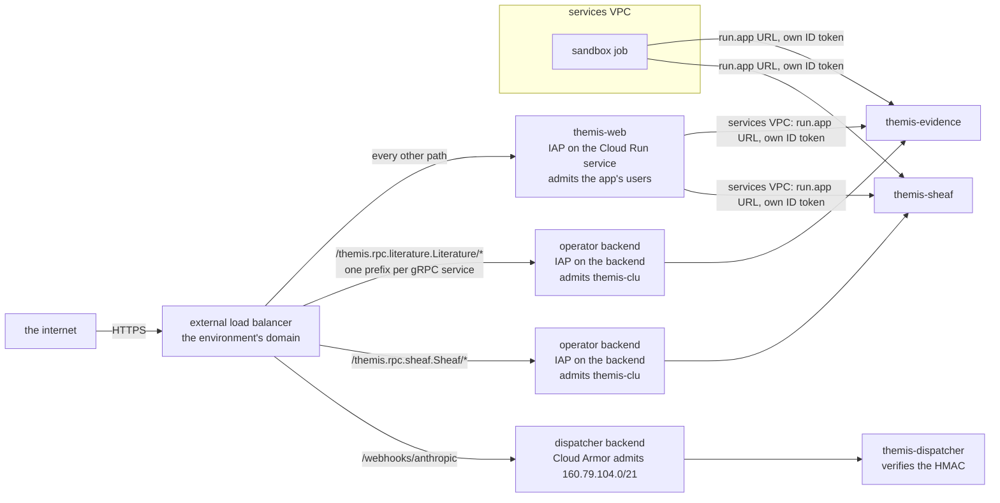
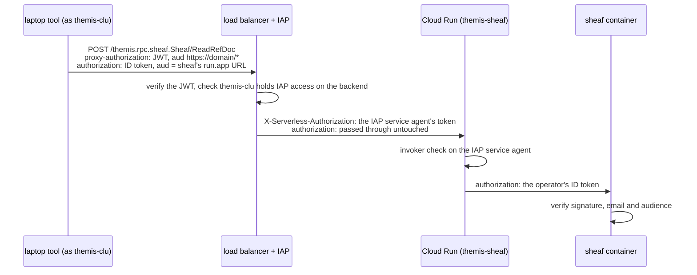

# Design: security architecture

**Status:** current **Related:** [`frontend-framework.md`](frontend-framework.md) (§Auth — the web request-auth
chokepoint), [`sandbox-worker.md`](sandbox-worker.md) (the hatch the sandboxed agent's calls leave through),
[`sandbox-rpc-exposure.md`](sandbox-rpc-exposure.md) (the condition an rpc meets before the agent may call it),
[`workspace-model.md`](workspace-model.md) (cross-Project default-deny), [`pr-screenshots.md`](pr-screenshots.md) (the
one public bucket), [`spike-infrastructure.md`](spike-infrastructure.md) §6 (the deployables diagram),
[`../PRODUCT.md`](../PRODUCT.md) §9 (security posture this implements)

## Overview

Cross-cutting security rules, distinct from the per-area docs that own each mechanism. Each is stated once here rather
than re-argued per area:

- **Every critical security check runs at a single default-on chokepoint** — never as a step each call site opts into.
- **An outbound request carrying untrusted text is an exfiltration channel when the untrusted side can influence where
  the bytes go, or can read them back later** — not merely because untrusted text crossed the perimeter.
- **A request from the public internet passes IAP before it reaches anything Themis runs**, unless it is bound for a
  named exception that carries controls of its own. IAP is Google's identity-aware proxy: it refuses a request that
  carries no Google identity it admits, so a flaw in our code that fires before our own authentication is out of an
  anonymous attacker's reach.

## Background

A security check that each call site must remember to invoke is a latent hole. The default is *unprotected*, and an
omission — a new route, a new tool, a new egress path — is indistinguishable from a deliberate exemption. The system is
only as safe as its least careful addition, and that addition is reviewed by someone who has to notice an *absent* line.
Request auth, egress restriction, data-boundary enforcement, and sandbox tool-gating all share this shape.

The second rule answers a different problem: a test that fires too often stops discriminating. The analysis agent is
untrusted code reading untrusted text — published papers, third-party records — and the evidence rpcs it calls reach
public databases on its behalf. That outbound hop is not incidental to the product; a variant lookup *is* a request to
NCBI or VariantValidator with the caller's identifier in it. If every such hop counted as the external-channel leg of
the lethal trifecta ([`../PRODUCT.md`](../PRODUCT.md) §9), the trifecta would close on the product's first feature, and
"this is an exfiltration channel" would carry no information. What has to be decided, once, is which hops an attacker
can actually get data out through.

The third rule is about the other direction: what a request from the internet reaches before anyone has checked who sent
it. Every Themis service authenticates its callers, but a request is parsed by the framework, its libraries and the
authentication code itself before that check can finish. A flaw in any of them that fires on an unauthenticated request
is open to every scanner on the internet, and such flaws keep being found in the stack the web tier runs on.

## Design

### One default-on chokepoint

A critical security check MUST be a single chokepoint that is **enforced by default**, with exemptions **explicitly
allowlisted** in one place.

- **Default-deny.** Absence of an explicit decision denies. A new code path inherits the check for free; exempting it is
  a visible, reviewable edit to the allowlist — not a matter of remembering to add a line. The reviewer reads a present
  entry, never has to spot a missing one.
- **One implementation.** The check's logic lives once and is shared. Call sites neither re-implement nor re-decide it.
- **At the resource, not only the perimeter.** The authoritative check sits where the protected resource is actually
  accessed. A perimeter gate (an HTTP proxy, an API gateway) is defense-in-depth *on top*, never the sole authority: a
  framework bug (e.g. Next.js CVE-2025-29927 skipped middleware via a request header) or a routing change that silently
  drops coverage can bypass a perimeter while the resource-side check still holds.
- **Fail loud.** A check that cannot run — missing config, unverifiable input — denies and raises. It never degrades to
  allow ([`../style/general.md`](../style/general.md) "Fail loud").

"If at all possible" is a real qualifier. Where a language or framework offers no default-on seam, the fallback is the
narrowest shared wrapper *plus* a lint/CI rule that fails when a call site skips it — the allowlist enforced
mechanically, not by convention. A per-call-site check guarded only by reviewer discipline does not satisfy this rule.

### What counts as an exfiltration channel

An outbound request that untrusted text reaches is an exfiltration channel unless both of these hold:

- **Destination-fixed.** Scheme, host, port and route come from code constants, and no parameter is one the upstream
  itself dereferences as a location — a `url=` it fetches, a callback it calls, a redirect target it hands back. The
  untrusted text appears only as a percent-encoded parameter value, a path segment or a request body, so it selects what
  comes *back* and never where the request *goes* — a body cannot steer a URL assembled from constants, which is why our
  gnomAD GraphQL query and our ClinVar batch fetch are inside this and not exceptions to it. That second half cannot be
  read off our call site: a location parameter leaves our own URL constant and the call a read, so both legs look
  satisfied here while the upstream carries the text on to a host the attacker named — the same shape as a URL built
  from fetched data, one hop out.
- **Query-only.** The call's effect is to select a response. A call that *deposits* the text — a submission, a comment,
  an upload, anything the upstream stores and later serves to someone else — is a publication channel, because the
  reader on the far side can be whoever planted the text.

The two legs meet at the route. *Query-only* is asserted of an endpoint — this route on this host only answers — so a
caller who can steer the route leaves the assertion nothing to attach to. Unencoded text in a path segment does exactly
that: a `/` or a `../` walks onto a sibling route, and where the call carries no query parameters of its own, everything
after a `?` is the caller's as well. A host that answers reads on one route and takes a submission on another is then a
publication channel whose destination never moved, and the verb does not deny it (below).

The query has the same failure, one step further on. Unencoded text in a query string assembled by hand lets the caller
*add* a parameter rather than fill one — and the parameter worth adding is the location parameter the first leg bars us
from passing, so the attacker supplies from inside the value what our code was careful never to name. We do not assemble
query strings: every outbound call hands its parameters to the HTTP client, which encodes them, so an `&` in a search
term stays inside that term's value instead of starting a parameter of its own. That is an invariant to keep rather than
a defect to fix, and it is the reason percent-encoding the caller's text is not hygiene about which record comes back —
it is what holds both legs up.

Where both hold, an attacker who has smuggled instructions into evidence text can make our service ask a public database
an arbitrary question, and learns nothing: the bytes land in NCBI's request log, which they cannot read. A destination
of their own is what they need, and destination-fixedness is what denies it.

That last clause is the criterion's premise rather than an aside, and it is worth being exact about what it assumes.
Assume every request we make is logged and kept somewhere. What the premise does *not* rest on is the operator: not that
they are careful with our queries, and not that they are large enough to lose something by mishandling them. A public
archive is under no duty to screen what it is sent — if we put a secret in a submission it publishes, that is our doing
and not a lapse of theirs, and an upstream's standing bounds nothing. The assumption is mechanical, and it is two facts
about a named host: it answers what we ask and keeps no copy it serves on to someone else, and it has no parameter that
sends the request somewhere else. Neither is visible from our call site, which is why each is recorded per host in
[`destinations.py`](../../themis/services/evidence/upstreams/destinations.py) rather than left to whoever writes the
next adapter. So the free-text identifier such an rpc takes — a gene symbol, an HGVS descriptor, a search term — is
bounded by *where* it can be put, not by how long it is or what it looks like.

Three things the criterion deliberately does not rest on:

- **Not the HTTP verb.** Query-only is a property of the upstream operation, not of the method: our gnomAD adapter's
  GraphQL query and our ClinVar batch fetch are both POSTs that only read, and a GET against an endpoint that records
  what it was asked would be a deposit. This leg is therefore asserted by whoever exposes the rpc, from what the
  upstream does with the request — it cannot be read off the call site.
- **Not a size cap or a rate limit.** A secret fits in a short string and a single request, so neither bounds what
  leaves in a request's content; offering one as the remediation for an exfiltration finding mistakes cost for
  confidentiality. The exception is the channel that puts nothing in the request at all — the third residual below,
  where a request budget is the only bound there is. Otherwise both are controls for cost and abuse, which the exposure
  condition covers on its own terms ([`sandbox-rpc-exposure.md`](sandbox-rpc-exposure.md) §Security).
- **Not a closed value set.** Where a parameter's domain is finite, a constrained type is the better interface and
  [`../PRODUCT.md`](../PRODUCT.md) §9 asks for it. It is not what confines this channel: with the destination fixed, an
  accepted value and a rejected one leak the same nothing, and most of these parameters have no finite domain anyway (an
  HGVS descriptor, a literature query). Validating a gene symbol against HGNC would buy clearer errors, at the price of
  a symbol list that is stale the day a gene is renamed — a trade worth arguing on those merits, not as a leak control.

Three residuals, which are the reason this is a criterion applied per rpc and not a blanket exemption: two are
properties of the upstream, and the third carries nothing in the request at all. The upstream sees the text, so anyone
who can read the upstream's view of it — its logs, or a query it stores and serves back — holds a channel; that is a
property of the upstream, which is why *query-only* is asserted about a named upstream rather than assumed of all of
them. And a destination that is fixed today stops being fixed the moment a URL is built from fetched data rather than
from a constant: a host read out of a record, a link followed out of a search result, a redirect chased. That shape *is*
a channel, and catching it is what the criterion is for.

The third carries nothing in the request. *Whether* we ask, and *when*, is visible to the upstream and to anyone reading
its logs, so an attacker who can steer what the agent decides to look up can signal in the timing and count of our
requests alone — a few bits at a time, with nothing in any request that the two legs above inspect. Nothing here bounds
it and nothing cheaply can, because the traffic is indistinguishable from work. What would bound it is a budget on how
many requests one session may make — the exposure condition's cost clause doing confidentiality work as a side effect —
and no such budget exists: the exposed rpcs bound their own latency, not their rate. What exists instead is the record:
every upstream call the shared client completes is logged with the URL asked, and the environment keeps its logs — these
and every other, the window is the project's — for as long as it keeps its audit logs, so a pattern that looks like
signalling is answerable after the fact even though nothing stops it in the moment. That record holds the caller's
identifiers — the gene symbol, descriptor or coordinate a case was looked up by — and its readers are whoever holds
log-viewer on the project. That set is already the set who can read the case itself, so the record widens no one's
reach; the entry would need its own bucket in an environment where the two came apart. We accept the residual on those
terms — detection rather than prevention, while the bandwidth stays this low. It is named so that a wider version of the
same shape is recognised rather than rediscovered.

Destination-fixedness is a property of code, and by the chokepoint rule above, a property each call site holds by
remembering to hold it is not held. It splits in two, and only one half is held today.

*Which host* is reachable is a chokepoint for everything riding the evidence image's shared client, which is every live
upstream call it makes: the client is built with the admitted set, so a request to a host with no determination raises
before it leaves, at the request rather than at a perimeter. Adding an upstream is an edit to
[`destinations.py`](../../themis/services/evidence/upstreams/destinations.py) that a reviewer reads. What keeps calls on
that client, though, is the shape of the adapters — each is handed it rather than building one — and not a rule that
fires when someone builds their own, which is the weaker form this section warns about. Two clients are already built
elsewhere, both deliberately outside the set and neither carrying caller text: the gene-disease refresh job, whose URLs
are constants and which follows redirects the admitted set could not allow, and the litcache ingest.

*Where the text lands inside that host's URL* is not. Each adapter percent-encodes its own path segments and hands its
own parameters to the client, adapter by adapter, and one unencoded interpolation is all it takes to lose the route.
Making that half structural too is the open question below.

The ordering this suggests is worth stating, because it is already how the gene-disease sources work: a hop you do not
make cannot leak. Where a source publishes in bulk, a periodic refresh into our own bucket removes the channel outright
— ClinGen's validity and dosage tables, GenCC and PanelApp are read from that copy, so no caller's text reaches those
hosts at all. Only what cannot be mirrored is queried live, against the admitted set.

### Ingress from the public internet

The question is which requests from the internet may reach a Themis process at all. The rule is that a request from the
internet passes IAP before it reaches anything Themis runs, unless its destination is one of the exceptions listed
below.

The obvious answer is that each service authenticates its own callers, and every one already does. Cloud Run checks a
caller's ID token against the service's invoker bindings. The web tier verifies IAP's signed assertion, the dispatcher
verifies an HMAC signature, and the data-plane interceptor verifies the calling account again
([`rpc-authorization.md`](rpc-authorization.md)). What this gets right is where the check sits: at the resource, as the
chokepoint rule above asks. What it leaves open differs by service.

On the web tier it leaves open everything a request touches before the app's own check completes. CVE-2025-29927 let one
request header skip Next.js middleware, which is where many apps authenticate. CVE-2025-55182, disclosed in December
2025, was remote code execution in React Server Components, triggered by a single unauthenticated request. The web tier
runs on both frameworks. With IAP in front, neither flaw is open to an anonymous scanner, because Google's proxy refuses
a request that carries no admitted Google identity before it reaches our container.

On the data-plane services, Cloud Run's invoker check already runs before any of our code, so the gap is a different
one. If their ingress were open to the internet, an ID token taken from the web tier or the sandbox could be replayed
from the attacker's own machine until it expired. The data-plane services therefore take traffic only from inside the
project and from the load balancer, and their one route from the internet passes IAP like the web tier's.

IAP admits a request only from a principal holding IAP access on the resource it fronts, and the accessors differ
between the web tier and the data-plane services. On the web tier they are the people who use the app, which can be as
wide as any signed-in Google account, where the app's own access list decides what each account sees. There IAP turns an
anonymous attacker into one who must hold a Google account, but it does not narrow the attacker to our users. On the
data-plane services the one accessor is the automation account `themis-clu`, which a maintainer acts as by impersonating
it; who may do so is a group membership
([`../runbooks/hand-driving-a-service.md`](../runbooks/hand-driving-a-service.md)). No person calls evidence or sheaf in
normal use: the web tier and the sandbox worker call them from inside the project, and only a maintainer driving a
service by hand comes from outside.

Callers in the project reach a data-plane service at its `run.app` URL over the services VPC, presenting their own ID
token, which Cloud Run checks against the invoker bindings. The web tier joins that VPC for this, with all of its
outbound traffic routed through it. Routing only private address ranges through the VPC would not do: a `run.app` URL
resolves to Google's public addresses, so the call would leave by the public path, and Cloud Run counts a request as
internal only when it arrives over a VPC in the project. Routing everything has two costs. The web tier can now reach
internal-only services it has no business calling, such as the hello service, at the network level; their invoker
bindings, which do not name the web tier, still refuse it. And its calls to Anthropic go through the VPC's NAT gateway,
which bills each gigabyte it carries and which every such call then depends on. Google warns that a new instance on this
kind of egress can wait for its first outbound connections, but on the development deployment in October 2026, joining
the VPC added at most two seconds to the web tier's cold start, and the first request after it read the database in
about 30 ms.

A maintainer on a laptop goes through the load balancer instead. A Cloud Run service can serve several gRPC services, as
evidence does. The load balancer sends the method paths, `/<package>.<Service>/…`, of each of them to one backend for
that Cloud Run service, its operator backend, which has IAP enabled on it. The load balancer ends a request to such a
backend after 60 minutes, which bounds the longest stream a maintainer can hold open. The call carries two tokens, both
minted as the automation account:

The ID token in `authorization` is why each data-plane service checks its audience itself. IAP calls Cloud Run as its
own service agent, so Cloud Run's invoker check admits the agent, and the caller's ID token reaches the container
without Cloud Run examining it. Without the service's own check, a token minted for another audience passes: on dev, a
token the automation account minted for `https://unrelated-audience.invalid` was accepted through IAP. Each service
refuses a token minted for anything but its own URL, which the deployment hands it at startup, and a service that is not
told its URL fails to start. Of the two URLs Cloud Run serves a service at, it is the one built from the service's name,
the project number and the region, because that one is known before the service exists.

A project has one IAP service agent, and it holds the invoker role on evidence and sheaf, so whoever passes any IAP gate
in front of those services reaches them. The program therefore allows IAP in two places only: on each data-plane
service's operator backend, which admits only the automation account, and on the web tier's Cloud Run service. The check
below holds the program to both. An IAP grant made by hand at the project level would pass every operator backend at
once, and nothing in the program can see it.

#### The exceptions

The internet reaches these without IAP, because IAP cannot sit in front of them, and each has controls that take its
place.

##### The sandbox dispatcher's webhook

Anthropic notifies the dispatcher by webhook when a session needs a sandbox, and Anthropic cannot present a Google
identity, so IAP would refuse every delivery. The dispatcher authenticates each delivery by its HMAC signature
([`sandbox-worker.md`](sandbox-worker.md)). In front of that check, a Cloud Armor policy on the dispatcher's
load-balancer backend admits only Anthropic's published outbound range, `160.79.104.0/21`, and denies every other
source; Anthropic commits not to change the range without notice, and publishes no IPv6 range, which the load balancer's
IPv4-only address matches. The service takes only internal and load-balancer traffic, so from the internet its `run.app`
URL offers no way around the policy; a workload inside our VPC can still reach that URL, and for it the signature is the
only check. The range is shared by every Anthropic customer, which means a request from it says nothing about who sent
it: the policy keeps scanners away from the dispatcher's HTTP stack, and the signature stays the authentication
([`spike-infrastructure.md`](spike-infrastructure.md) §6, the deployables diagram).

##### The PR screenshots bucket

A pull request that changes a rendered surface links screenshots, and GitHub fetches each image anonymously through its
image proxy, so the objects have to be readable without credentials. Anyone may read an object by its name, and nobody
may list the bucket. Each name is the SHA-256 of the image's content, so a name cannot be guessed, and every image is a
capture of the app running against fixture data. Only an environment that opts in has the bucket
([`pr-screenshots.md`](pr-screenshots.md)).

##### Cloud SQL's public IP

The database instance has a public address, because some of its clients are on no network the services share: the laptop
tools and the CI migrate step have no VPC, and the Dataflow ingestion workers run on a network of their own. A private
address would put each of them on the database's VPC. The public address takes no direct connection. The instance lists
no authorized networks, so its firewall refuses every client, and it requires the Cloud SQL connectors, so it refuses a
connection that does not arrive through one. A connector authenticates to the Cloud SQL Admin API, which issues it a
short-lived client certificate only if its principal holds `cloudsql.client`, and then logs in with IAM database
authentication. So the first check on this path is an IAM decision that Google makes, which is the role IAP plays on the
others.

#### Scope

The rule covers the routes by which a request reaches a process we run. A signed URL is outside it: the sheaf service
and the web tier hand out time-limited URLs to objects in our buckets, and Cloud Storage checks the signature before it
serves a byte, with no Themis code on the path. The Dataflow workers' external addresses are outside it too, because no
firewall rule admits a connection to them from outside their own subnet.

#### The check

The rule is enforced by [`infra/tests/test_public_ingress.py`](../../infra/tests/test_public_ingress.py), which runs the
Pulumi program under mocks and reads every resource it declares. It holds each route in from the internet to the rule
above, and each exception to the controls its section names; each test is named for the property it checks. The
exceptions are a list beside the test in the infra code, each entry pointing at its section above, so adding one is a
reviewed edit to the code and to this doc.

Infrastructure code has no runtime seam to put a gate in, so this test is the mechanical rule that the chokepoint
section asks for where no such seam exists. It reads resources by kind, whichever module declares them, so a new
service, bucket or backend is held to the rule without anyone remembering to add it. It sees the program and not the
project, so a service or a grant created by hand in the console is outside it.

### Where the rules land

- **Web request auth** — a proxy default-deny perimeter plus a shared, request-scoped accessor that re-verifies the IAP
  assertion at the data seam; `healthz` is the sole allowlisted exemption, reached directly by the Cloud Run probe
  rather than through the load balancer. The data-seam check is an interceptor on the RPC router, so it covers every
  method by construction. Owned by [`frontend-framework.md`](frontend-framework.md) §Auth.
- **Data-plane rpc auth** — on the literature interface, an interceptor builds one authorization context per call (the
  verified calling service, the Analysis the call is scoped to where there is one, and the person who approved it where
  there is one) and denies unless the rpc's contract admits it — the `agent_exposed` proto option and its siblings
  `admits_session` and `admits_caller`, read off the descriptor, so an rpc declaring none is denied at run time and who
  may call is stated once. The interceptor is server-wide, with the health check its only exemption; the other evidence
  interfaces' rpcs are all `agent_exposed`, so it gates them too, and their in-body session checks are redundant until
  deleted. Owned by [`rpc-authorization.md`](rpc-authorization.md).
- **Sandbox egress** — the guest process has no network at all; its one exit is the hatch, whose method allowlist is
  generated from the proto rather than authored. Owned by [`sandbox-worker.md`](sandbox-worker.md), with the exposure
  condition an rpc must meet in [`sandbox-rpc-exposure.md`](sandbox-rpc-exposure.md) §Security — the place the
  exfiltration criterion is applied, since a forwarded rpc is how anything the agent says reaches a third party.
- **Service egress** — the internal services' VPC is deliberately not sealed, so what an exposed rpc dials is bounded by
  its own code and not by a network policy. The evidence image's shared HTTP client is that bound: it admits only the
  hosts [`destinations.py`](../../themis/services/evidence/upstreams/destinations.py) records a determination for.
- **Public ingress** passes IAP or is a named exception with controls of its own, held by the program's tests (above).
- **Cross-Project data** — default-deny sharing; case-level content never crosses Project boundaries implicitly. Owned
  by [`workspace-model.md`](workspace-model.md) and [`../PRODUCT.md`](../PRODUCT.md) §7.

## Alternatives considered

- **Per-call-site enforcement** (each route/tool invokes the check itself). Rejected: opt-in, so the default is
  unprotected and an omission reads the same as an intentional exemption — the Background failure mode.
- **Perimeter-only enforcement** (one gate in front, nothing at the resource). Rejected as the *sole* layer: bypassable
  by a framework bug (CVE-2025-29927) or a routing/matcher change that drops coverage unnoticed. It is a valid added
  layer, not the authority.
- **Any outbound hop carrying untrusted text is a channel.** Rejected: it condemns the evidence lookups the product is
  made of, and a rule that fires on every feature is one reviewers learn to wave through — the finding stops being read.
  Worse, it hides the shape that matters, since a data-derived destination and a constant one score alike.
- **Bounding the text instead of the destination** (length caps, character classes on free-text identifiers). Rejected
  as a leak control for the reason given above: a secret is short. Kept where it earns its place as input validation — a
  bounded numeric run in an accession pattern is there so a malformed accession fails our parse, not so it fails to fill
  a URL.
- **An egress allowlist in front of the services** (proxy or firewall confining which hosts an internal service may
  dial). Not rejected — a real second layer, and the one that would survive an adapter losing destination-fixedness. It
  is not the authority: the request is legitimate to an allowlisted host either way, so the code-side property is what
  decides. Worth its own design when the upstream set stops being a handful of public databases.
- **Cloud Run IAM alone on the data plane, with ingress open to the internet.** It is simpler: there is no load-balancer
  hop and no second token, and a maintainer calls the `run.app` URL directly. It lost for the reasons the data-plane
  paragraph above gives: a credential leaked from any caller would work from anywhere.
- **IAP on the data-plane Cloud Run services themselves**, as the web tier has it. It needs no load-balancer backend per
  service. It lost because IAP on a Cloud Run service gates every path to it, the `run.app` URL included, so the web
  tier and the sandbox worker would have to pass IAP too, with IAP tokens of their own, on every internal call.
- **A VPN or a bastion host for maintainers.** It would leave the data plane with no public route at all. It lost
  because it is another system to run and to keep patched, while IAP gives the same per-account gate and needs no
  network of our own.

## Open questions

- What makes destination-fixedness structural rather than per-adapter, in either half. Which host is reachable is bound
  by the shared client, but nothing fails when a caller builds its own; where the text lands inside that host's URL is
  each adapter's own encoding. One lint over client construction would close the first, and the candidate for the second
  is one request builder the adapters compose through — constant base, path segments and parameters as arguments,
  encoding applied by it — so that interpolating untrusted text into a URL is not something an adapter can express.
  Whether that is worth its churn across the existing adapters, and whether a lint rule over URL construction is the
  cheaper half, is undecided.
