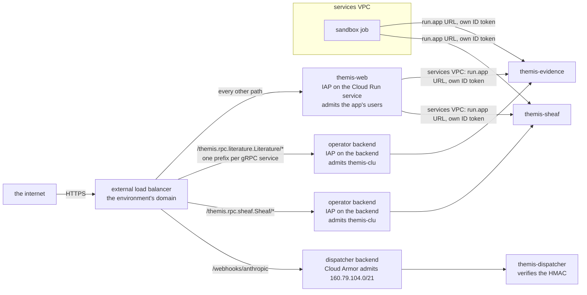
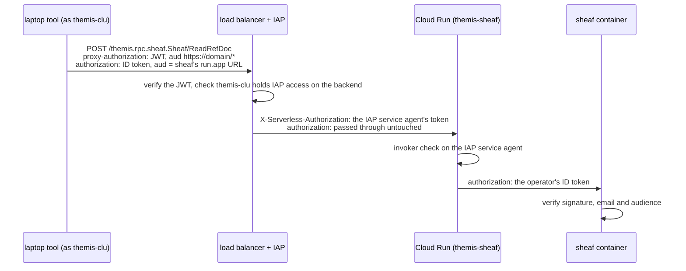

# Design: security architecture

**Related:** [`frontend-framework.md`](frontend-framework.md) (§Auth — the web request-auth chokepoint),
[`rpc-authorization.md`](rpc-authorization.md) (the data-plane RPC authorization interceptor),
[`sandbox-worker.md`](sandbox-worker.md) (the hatch that sandboxed agent calls leave through),
[`sandbox-rpc-exposure.md`](sandbox-rpc-exposure.md) (the condition an RPC meets before the agent may call it),
[`workspace-model.md`](workspace-model.md) (cross-Project default-deny), [`pr-screenshots.md`](pr-screenshots.md) (the
public screenshot bucket), [`spike-infrastructure.md`](spike-infrastructure.md) (§6 — the deployables diagram),
[`../PRODUCT.md`](../PRODUCT.md) (§9 — the security posture this design implements)

## Overview

Themis enforces security across several boundaries: web requests, data-plane RPCs, sandbox egress, outbound calls to
public databases, and public internet ingress. Rather than re-arguing the same security principles inside each area's
design doc, this document establishes three cross-cutting rules that every boundary must satisfy.

First, every critical security check runs at a single default-on chokepoint at the protected resource, with exemptions
explicitly allowlisted in one place. If each call site had to opt in to a check, omitting the check on a new route or
tool would look identical to a deliberate exemption. Second, an outbound request carrying untrusted text counts as an
exfiltration channel only when the untrusted input can steer where the bytes go or when the attacker can read those
bytes back later. The analysis agent routinely queries public biology databases using identifiers read from untrusted
literature; treating every outbound hop with untrusted text as a leak would condemn the product's core lookups while
failing to distinguish fixed-destination read queries from attacker-steered URLs. Third, every request from the public
internet must pass Google's Identity-Aware Proxy (IAP) before reaching any process Themis runs, unless the destination
is an explicit exception with equivalent controls. Putting IAP in front of the stack prevents anonymous internet
scanners from reaching framework and library code that runs before our own authentication checks complete, and prevents
attackers from replaying leaked internal service tokens from outside the project.

## Background

A security check that each call site must remember to invoke leaves the system unprotected by default. When a developer
adds a route, an RPC method, or an egress path and forgets the check, the omission looks the same in code review as a
deliberate exemption: the reviewer has to notice an absent line. Request authentication, egress restriction,
cross-Project data isolation, and sandbox tool gating all fail the same way if they rely on per-call-site discipline.

A different failure mode appears when a security criterion is too broad to discriminate. In Themis, the analysis agent
is untrusted code reading untrusted text from published papers and third-party records, and the evidence RPCs it calls
query public databases such as NCBI or VariantValidator on its behalf. Passing a caller-supplied gene symbol or variant
identifier to an external database is the core mechanism of an evidence lookup. Under the lethal trifecta model
([`../PRODUCT.md`](../PRODUCT.md) §9), combining private data, untrusted content, and an external communication channel
allows exfiltration. If every outbound request carrying agent-supplied text counted as an external communication
channel, the lethal trifecta would trigger on the first evidence lookup, and reviewers would learn to wave the finding
through. We need a precise rule that separates safe database lookups from hops an attacker can actually use to extract
data.

In the inbound direction, the risk is what an internet request touches before service-level authentication finishes.
Every Themis service authenticates its callers, but the HTTP server, the web framework, and the authentication libraries
all parse an incoming request before that check completes. A vulnerability in any of those layers that triggers on an
unauthenticated request is exposed to every scanner on the internet. Because critical pre-authentication flaws regularly
surface in web frameworks, service-level checks alone are not enough for internet-facing endpoints.

## Design

### One default-on chokepoint

Every critical security check MUST run at a single chokepoint that is enforced by default, with any exemptions
explicitly allowlisted in one place.

- **Default-deny.** In the absence of an explicit exemption, the check denies access. A new code path inherits the check
  automatically, and exempting a path requires a visible edit to a central allowlist that a reviewer can inspect.
- **Single shared implementation.** The check's logic lives in one place, so individual call sites neither re-implement
  nor re-decide it.
- **Enforced at the resource.** The authoritative check sits where the protected resource is accessed. A perimeter gate
  such as an HTTP proxy or API gateway provides defense in depth, while the resource-side check remains the authority.
  If a framework bug (such as Next.js CVE-2025-29927, where a request header skipped middleware) or a routing
  misconfiguration bypasses the perimeter, the resource-side check still refuses the call.
- **Fail loud.** A check that cannot run because of missing configuration or unverifiable input denies the request and
  raises an error ([`../style/general.md`](../style/general.md) "Fail loud").

Where a language or framework offers no runtime seam for a default-on interceptor, the fallback is a narrow shared
wrapper paired with a mechanical lint or CI test that fails the build if any call site bypasses it. Relying on reviewer
attention alone never satisfies this rule.

### What counts as an exfiltration channel

An outbound request that carries untrusted text is an exfiltration channel unless both of the following conditions hold:

- **Destination-fixed.** The scheme, host, port, and route come from constants in code, and no request parameter is
  dereferenced by the upstream service as a network location (such as a `url=` parameter the upstream fetches, a webhook
  callback it invokes, or a redirect target it returns). Untrusted text appears only as a percent-encoded query
  parameter value, a percent-encoded path segment, or a request body, so it selects what record comes back without
  influencing where the request goes. Because a request body cannot alter a URL assembled from constants, GraphQL POST
  queries to gnomAD and batch fetches to ClinVar satisfy this condition directly. Whether an upstream dereferences a
  parameter as a location cannot be seen from our call site alone: a call to a constant URL that passes
  `callback=https://attacker.example` looks like a fixed-destination read locally, even though the upstream forwards the
  payload to a host the attacker chose.
- **Query-only.** The call's sole effect on the upstream service is to select and return a response. Any call that
  deposits text on the upstream (such as a submission, a comment, or an upload that the upstream stores and later serves
  to other readers) acts as a publication channel, because the attacker who planted the prompt injection can read the
  deposited bytes back from the upstream.

The two conditions depend on each other at the URL route. We assert that an endpoint is query-only for a specific route
on a specific host. If untrusted text can alter the route, that assertion breaks. For example, if an adapter builds
`https://api.example.org/v1/genes/{symbol}/summary` by string interpolation without percent-encoding, an attacker who
supplies `../../submissions?text=secret` walks the path onto a sibling submission route on the same host.
Percent-encoding turns `/` into `%2F` and `?` into `%3F`, keeping the untrusted text inside the single path segment
where the route remains fixed.

Query string construction has the same failure mode. If an adapter concatenates raw caller text into a query string
(such as `?term={query}`), an attacker who supplies `BRCA1&callback=https://attacker.example` injects a new parameter
that our code never intended to pass. To prevent parameter injection, adapters never assemble query strings by hand;
every outbound call passes structured parameters to the HTTP client, which percent-encodes `BRCA1&callback=...` into a
single parameter's value. Percent-encoding path segments and query parameters is therefore what holds both conditions
together.

When both conditions hold, an attacker who smuggles instructions into evidence text can force our service to ask a
public database an arbitrary question, and still learns nothing. The attacker's payload lands only in the upstream's own
request logs, which the attacker cannot read.

This guarantee rests on a mechanical assumption about the upstream endpoint rather than on trust in the upstream
operator's care or reputation. Even if every request we make is logged by the upstream, a public archive has no duty to
screen what callers send it; if we sent a secret to an endpoint that publishes submissions, the leak would be our fault.
What keeps the request safe is two concrete facts about the specific upstream host: its endpoint answers queries without
serving the query text back to other users, and it exposes no parameter that forwards the request elsewhere. Because
neither fact can be inferred from our call site alone, we record the determination for each allowed host in
[`destinations.py`](../../themis/services/evidence/upstreams/destinations.py) rather than leaving the judgment to
individual adapter authors. When an RPC calls an admitted host under these rules, its free-text parameters (such as a
gene symbol, an HGVS descriptor, or a literature search query) are confined by where the bytes can go rather than by
what characters they contain.

Several properties that look related do not determine whether a call is an exfiltration channel:

- **HTTP method.** Whether an operation is query-only depends on what the upstream does with the request, not on the
  HTTP verb. Our gnomAD GraphQL adapter and ClinVar batch adapter both issue `POST` requests that only read data,
  whereas a `GET` request to an endpoint that publicly logs or stores incoming queries would still be a deposit. The
  author exposing the RPC must verify how the upstream handles the call.
- **Size caps and rate limits.** A secret fits inside a short string and a single request, so capping payload length or
  request rate does not stop content-based exfiltration. Size and rate limits remain useful for controlling cost and
  abuse ([`sandbox-rpc-exposure.md`](sandbox-rpc-exposure.md) §Security), and a session request budget would bound the
  timing-and-count side channel described below, but they do not make an unfixed or depositing endpoint safe.
- **Closed value sets.** Constraining a parameter to a finite type when its domain is closed is good interface design
  ([`../PRODUCT.md`](../PRODUCT.md) §9), and pattern validation such as requiring digits in an accession number helps
  catch malformed inputs early. However, input validation does not close an exfiltration channel, and most free-text
  identifiers (such as HGVS descriptors or search queries) have no finite domain. Validating a gene symbol against an
  HGNC list can improve error messages at the cost of rejecting newly renamed genes, which is a usability trade-off
  rather than a confidentiality control.

Applying this criterion per RPC leaves three residual risks that explain why we evaluate each upstream explicitly:

1. **Upstream log visibility.** Because the upstream sees the query text, anyone who can read the upstream's internal
   logs or query history can read the payload. We therefore assert the query-only property per named upstream host in
   [`destinations.py`](../../themis/services/evidence/upstreams/destinations.py) instead of assuming it holds for
   arbitrary servers.
1. **Data-derived destinations.** A destination stops being fixed the moment code constructs a URL from fetched data
   (such as following a host read from a database record, chasing an arbitrary HTTP redirect, or fetching a link from a
   search result). The criterion exists specifically to flag and forbid that pattern.
1. **Request timing and count.** Even when request contents are unseen by the attacker, anyone who can observe the
   upstream's traffic or side effects could infer a few bits of information from whether and when Themis queries a
   record. Blocking this covert channel would require a strict per-session request budget, which our exposed RPCs do not
   currently enforce because they bound latency rather than total session call count. Instead, we rely on auditability:
   the shared HTTP client logs every completed upstream request URL, and the environment retains those logs alongside
   its audit logs. Because those logs contain the gene symbols, descriptors, and coordinates looked up for a case, they
   are readable only by principals with project log-viewer access, which is already a subset of the principals who can
   read the case data itself. If an environment ever separates log viewers from case readers, those request logs will
   need their own isolated log bucket. We accept detection over prevention here while the bandwidth of timing signals
   remains low.

Destination-fixedness is a property of code, and by the chokepoint rule above, a property each call site holds by
remembering to hold it is not held. It splits into two parts — which host the client may dial, and where untrusted text
lands inside that host's URL — and neither half fully meets the chokepoint rule today.

*Which host* is reachable is a chokepoint for everything riding the evidence service's shared HTTP client. The client is
initialized with the admitted host set from
[`destinations.py`](../../themis/services/evidence/upstreams/destinations.py) and raises an error before sending any
request to an unlisted host. What keeps calls on that client, though, is the shape of the adapters — each is handed the
shared client via dependency injection rather than building its own — and not a mechanical rule that fires when someone
builds a standalone `httpx` client, which is the weaker form the chokepoint rule above warns about. Two batch components
deliberately construct their own clients outside this set because neither carries caller-supplied text: the gene-disease
refresh job, which fetches constant URLs and follows upstream redirects outside the admitted set, and the `litcache`
ingestion pipeline.

*Where the text lands inside that host's URL* is not held by a chokepoint at all. Each adapter percent-encodes its own
path segments and hands its own query parameters to the client, adapter by adapter, and one unencoded interpolation is
all it takes to lose the route. Making URL construction structural is tracked in [Open questions](#open-questions).

Whenever an upstream dataset is published in bulk, we prefer mirroring it into our own storage on a schedule over
querying the upstream live during an analysis. Mirroring eliminates the outbound hop altogether: the evidence service
reads ClinGen validity and dosage tables, GenCC, and PanelApp from our internal mirror bucket, so no caller text ever
leaves our environment for those sources. Only sources that cannot be mirrored in bulk are queried live against the
admitted host set.

### Ingress from the public internet

Every request from the public internet must pass IAP before it reaches any process Themis runs, unless its destination
is one of the explicit exceptions below. IAP is Google's identity-aware proxy; it rejects any request that does not
carry an admitted Google identity before the request reaches our containers.

The obvious alternative is to let each service authenticate its own callers directly. Every Themis service already
performs resource-side authentication: Cloud Run checks the caller's ID token against the service's IAM invoker
bindings, the web tier verifies IAP's signed assertion, the sandbox dispatcher verifies an HMAC signature, and the
data-plane gRPC interceptor verifies the calling account ([`rpc-authorization.md`](rpc-authorization.md)). Resource-side
authentication satisfies the chokepoint rule above, but leaving services directly reachable from the internet exposes
two gaps.

On the web tier, direct internet access exposes all the framework code that executes before the application's own
authentication check completes. For example, CVE-2025-29927 allowed a single request header to bypass Next.js
middleware, and CVE-2025-55182 (disclosed in December 2025) allowed unauthenticated remote code execution in React
Server Components. Themis runs on both frameworks. Placing IAP in front of the web tier blocks anonymous internet
scanners at Google's edge before a request ever touches Next.js or React.

On the data-plane services (`themis-evidence` and `themis-sheaf`), Cloud Run's IAM invoker check runs before container
code, so pre-authentication framework bugs are already blocked. The risk on the data plane is credential replay: if a
data-plane service's `run.app` URL accepted traffic from the public internet, an attacker who extracted a
service-account ID token from the web tier or sandbox could replay that token from their own machine until it expired.
To close that path, data-plane services accept traffic only from inside the GCP project and from our external load
balancer, where the single internet route passes through IAP.

IAP admits a request only if the caller holds the IAP accessor role on the fronted resource, and we configure different
accessors for the web tier and the data plane:

- **Web tier (`themis-web`).** IAP admits any signed-in Google account (`allAuthenticatedUsers`), and the ACL decides
  which Projects each account may see ([`access-control.md`](access-control.md)). On this path, IAP turns an anonymous
  attacker into one who must hold a Google account, but it does not narrow the attacker to our users.
- **Data-plane services (`themis-evidence`, `themis-sheaf`).** No human user calls data-plane services during normal
  operation; the web tier and sandbox workers call them internally over the VPC. The only external callers are
  maintainers driving a service by hand
  ([`../runbooks/hand-driving-a-service.md`](../runbooks/hand-driving-a-service.md)). IAP on the data-plane
  load-balancer backends admits only the automation service account `themis-clu`, which maintainers impersonate via a
  restricted Google Group membership.

Internal callers inside the project reach each data-plane service at its `run.app` URL over the services VPC, presenting
their own service-account ID token for Cloud Run's invoker check. To use this internal path, the web tier attaches to
the services VPC and routes all of its outbound traffic through the VPC. Routing only private IP ranges
(`PRIVATE_RANGES_ONLY`) would fail to satisfy Cloud Run's internal ingress check, because `run.app` URLs resolve to
public Google IP addresses and Cloud Run treats a call as internal only when the packets arrive from an attached VPC
network.

Routing all web-tier egress through the VPC carries two operational costs:

- **Wider network reachability inside the VPC.** At the network layer, the web tier can reach internal-only services
  that it has no reason to call, such as the hello service. Cloud Run's IAM invoker bindings on those services still
  reject the web tier's service account.
- **NAT gateway cost and dependency.** Outbound calls from the web tier to external APIs such as Anthropic traverse the
  VPC's Cloud NAT gateway, which bills per gigabyte processed and sits on the critical path of those calls. Although
  Google's documentation notes that routing all traffic through a VPC can add latency to initial outbound connections on
  cold start, measurements on the development deployment in October 2026 showed at most 2 seconds of added cold-start
  time on `themis-web`, with subsequent database reads completing in about 30 ms.

When a maintainer calls a data-plane service from a laptop, the request enters through the external load balancer.
Because a single Cloud Run service can host multiple gRPC services (as `themis-evidence` does), the load balancer
matches each gRPC service prefix (`/<package>.<Service>/*`) and routes it to that Cloud Run service's operator backend,
where IAP is enabled. The load balancer enforces a 60-minute timeout on operator backend requests, which caps the
duration of any streaming RPC held open from a laptop. Each operator call carries two tokens minted as `themis-clu`:

The sequence above shows why each data-plane container must verify the `authorization` token's audience in application
code ([`themis/clients/auth/`](../../themis/clients/auth/)). When IAP forwards a request to Cloud Run, IAP authenticates
the hop using its own GCP service agent token in `X-Serverless-Authorization`. Cloud Run's IAM invoker check verifies
the IAP service agent and passes the caller's `authorization` header straight through to the container without
inspecting it. If the container did not check the audience claim on `authorization`, an ID token minted by `themis-clu`
for an unrelated audience (such as `https://unrelated-audience.invalid`) would pass IAP and be accepted by the service.
Each data-plane service is therefore given its deterministic Cloud Run URL (constructed from the service name, project
number, and region before the service is created) at startup, refuses to start if that URL is missing, and rejects any
ID token whose `aud` claim does not match it.

A GCP project has a single IAP service agent, and that agent holds `roles/run.invoker` on both `themis-evidence` and
`themis-sheaf`. Consequently, any principal who can pass *any* IAP gate in the project that routes to those services can
invoke them at the Cloud Run layer. Our infrastructure code therefore permits IAP bindings in only two places: on each
data-plane service's operator backend (restricted to `themis-clu`) and on the `themis-web` Cloud Run service. The
automated ingress test below enforces this invariant across the Pulumi program. An IAP grant made by hand at the GCP
project level would pass every operator backend at once, and nothing in the program can see it.

#### The exceptions

Three entry points accept traffic from the public internet without IAP because their callers cannot present a Google
identity or because they use a separate Google-managed authentication plane. Each exception is enumerated in
[`infra/themis_infra/public_ingress.py`](../../infra/themis_infra/public_ingress.py) with compensating controls.

##### The sandbox dispatcher's webhook

Anthropic notifies `themis-dispatcher` via webhook at `/webhooks/anthropic` when an analysis session needs a sandbox.
Because Anthropic's webhook sender cannot authenticate with a Google identity, IAP would block every delivery. Instead,
two controls protect the webhook endpoint ([`sandbox-worker.md`](sandbox-worker.md),
[`spike-infrastructure.md`](spike-infrastructure.md) §6):

- **Cloud Armor IP allowlist at the edge.** A Cloud Armor security policy on the dispatcher's load-balancer backend
  admits only Anthropic's published outbound IPv4 CIDR (`160.79.104.0/21`) and denies all other sources. Anthropic
  commits to giving advance notice before changing this range and publishes no IPv6 range, matching our load balancer's
  IPv4-only address. Because `themis-dispatcher` is configured to accept only internal VPC and load-balancer traffic,
  its `run.app` URL cannot be reached from the internet to bypass Cloud Armor.
- **HMAC signature verification in the service.** Because `160.79.104.0/21` is shared across all Anthropic customers
  (and internal VPC workloads can reach the dispatcher's `run.app` URL directly), source IP filtering only keeps random
  internet scanners away from the dispatcher's HTTP stack. The dispatcher authenticates every webhook payload by
  verifying Anthropic's HMAC signature before acting on the request.

##### The PR screenshots bucket

Pull requests that change rendered UI surfaces embed screenshots that GitHub fetches anonymously through its image proxy
([`pr-screenshots.md`](pr-screenshots.md)). To allow GitHub to load the images without credentials, the screenshot
bucket grants `allUsers` permission to read individual objects (`storage.objects.get`) while denying bucket listing.
Object names are the SHA-256 hash of the image content, making URLs unguessable, and screenshots are captured
exclusively against synthetic fixture data. The bucket is provisioned only in environments that explicitly opt in.

##### Cloud SQL's public IP

The Cloud SQL PostgreSQL instance has a public IP address because several legitimate clients run outside the services
VPC: maintainer laptop tools and CI database migration steps run without a VPC, and Dataflow ingestion workers run in
their own separate network. Removing the public IP would require placing every such client inside the database VPC.

The public IP never accepts raw TCP connections directly:

- **Zero authorized networks.** The instance's IP firewall allowlist is empty, so direct connections to port 5432 are
  refused for all source addresses.
- **Mandatory Cloud SQL Connector and IAM authentication.** The instance requires all connections to arrive through the
  Cloud SQL Auth Proxy / Connector protocol (`require_connectors`). A connector must first authenticate to the Google
  Cloud SQL Admin API, which issues an ephemeral TLS client certificate only if the caller holds
  `roles/cloudsql.client`, and then authenticate the database session using IAM database authentication. Google's IAM
  check on the Admin API therefore plays the same pre-connection gatekeeper role for the database that IAP plays for
  HTTP services.

#### Scope

The public ingress rule governs every route by which an internet request can reach a process that Themis runs. Two
external surfaces fall outside this scope because no Themis process sits on the request path:

- **Cloud Storage signed URLs.** `themis-sheaf` and `themis-web` issue time-limited signed URLs for objects in internal
  buckets. When a client fetches a signed URL, Google Cloud Storage verifies the cryptographic signature directly and
  serves the object bytes without invoking any Themis code.
- **Dataflow worker external IPs.** Dataflow ingestion workers are assigned external IP addresses by GCP to reach public
  data sources, but VPC firewall rules block all inbound connections to those workers from outside their own subnet.

#### The check

We enforce the public ingress rule mechanically in
[`infra/tests/test_public_ingress.py`](../../infra/tests/test_public_ingress.py). Because infrastructure declarations
have no runtime interceptor seam, this test suite provides the mechanical CI enforcement required by the chokepoint
rule.

The test runs the Pulumi infrastructure program under mocks and inspects every resource by resource type, regardless of
which Python module declared it. Any newly added Cloud Run service, load-balancer backend, storage bucket, or Cloud SQL
instance is automatically checked against the rule, and every exception in
[`infra/themis_infra/public_ingress.py`](../../infra/themis_infra/public_ingress.py) links back to its subsection in
this document. Adding a new public entry point requires a reviewed edit to both the allowlist in code and the exceptions
section here. Because the test inspects Pulumi resource declarations rather than live GCP state, resources or IAM
bindings created manually in the GCP console remain outside its reach.

### Where the rules land

Each boundary in the system applies the rules above through a concrete mechanism owned by its area design doc:

- **Web request authentication** ([`frontend-framework.md`](frontend-framework.md) §Auth) combines a default-deny proxy
  perimeter with a shared, request-scoped data-access interceptor that re-verifies the caller's IAP assertion on every
  RPC router method and asks the auth service again whether the caller is admitted
  ([`access-control.md`](access-control.md)). The `/healthz` endpoint (reached directly by Cloud Run's liveness probe
  rather than through the load balancer) is the sole allowlisted exemption.
- **Data-plane RPC authorization** ([`rpc-authorization.md`](rpc-authorization.md)) runs a server-wide gRPC interceptor
  (`AuthInterceptor`) that builds a verified authorization context per call (recording the calling service account, its
  `CallingAs` claim, the scoped Analysis session if present, and the approving user if present) and checks it against
  the `admits_caller` option declared on the protobuf method descriptor. Any RPC method that declares no admitted caller
  is denied at runtime (except to `CALLER_CLU`), leaving the gRPC health check as the only unauthenticated exemption.
  The `evidence` and `sheaf` data-plane servers are constructed through `AuthInterceptor`
  ([`interceptor.py`](../../themis/clients/auth/interceptor.py),
  [`__main__.py`](../../themis/services/evidence/__main__.py)), so admission on those services never depends on a
  handler remembering to check (the `hello` smoke-test service is the sole exception, checking its session in-handler
  via `require_session`).
- **Sandbox egress** ([`sandbox-worker.md`](sandbox-worker.md), [`sandbox-rpc-exposure.md`](sandbox-rpc-exposure.md)
  §Security) runs the untrusted guest process inside an empty network namespace with no network interfaces. Its only
  exit is the local UNIX socket hatch, whose method allowlist is generated directly from protobuf annotations. Because a
  forwarded hatch RPC is the only way agent-supplied text can reach a third party, an RPC must satisfy the exfiltration
  channel criterion above before it may be exposed to the agent.
- **Service egress** relies on application-level host enforcement rather than a VPC egress firewall. Because the
  services VPC allows outbound internet traffic, what an exposed RPC may dial is bounded by the evidence image's shared
  HTTP client, which admits only the upstream hosts recorded in
  [`destinations.py`](../../themis/services/evidence/upstreams/destinations.py).
- **Public ingress** passes through IAP or matches a named exception with compensating controls, enforced across all
  Pulumi resource declarations by [`infra/tests/test_public_ingress.py`](../../infra/tests/test_public_ingress.py).
- **Cross-Project data isolation** ([`workspace-model.md`](workspace-model.md), [`../PRODUCT.md`](../PRODUCT.md) §7)
  enforces default-deny sharing so that case-level content never crosses Project boundaries implicitly.

## Alternatives considered

- **Per-call-site security checks.** Having each route handler or tool invoke its own authentication or authorization
  helper is straightforward to write initially, but leaves the system unprotected by default. A forgotten check on a new
  endpoint looks identical to an intentional exemption during review.
- **Perimeter-only authentication.** Enforcing authentication solely in an edge proxy or middleware layer keeps resource
  handlers simple, but a single framework bypass (such as CVE-2025-29927) or matcher misconfiguration exposes the
  underlying handlers. We use perimeter gates as defense in depth while keeping the authoritative check at the resource.
- **Treating every outbound hop with untrusted text as an exfiltration channel.** A blanket ban avoids reasoning about
  upstream behavior, but flags every evidence lookup the product performs. A rule that triggers on every feature teaches
  reviewers to ignore the warning and obscures the real distinction between fixed-destination read queries and
  data-derived URLs.
- **Bounding free-text identifier length or character sets as a leak control.** Input validation (such as requiring
  digits in an accession number) is useful for rejecting malformed inputs early, and we keep it for that purpose.
  However, it fails as a confidentiality control because sensitive secrets fit inside short, syntactically valid
  strings.
- **A network-level egress allowlist in front of internal services.** A VPC egress proxy or firewall that restricts
  which external hosts internal services may dial would provide defense in depth if an adapter bypassed the shared HTTP
  client. It cannot replace the code-level criterion, because a request to an allowlisted host can still leak data if
  the adapter fails to percent-encode path segments or uses a depositing endpoint. Designing a network egress layer
  remains worthwhile once the set of upstream databases grows beyond a small list.
- **Cloud Run IAM alone on data-plane services with public ingress enabled.** Allowing callers to reach data-plane
  `run.app` URLs directly from the internet removes the load-balancer hop and the second token for maintainers, but
  allows any service-account ID token leaked from the web tier or sandbox to be replayed from anywhere on the internet.
- **Enabling IAP directly on the data-plane Cloud Run services.** Turning on Cloud Run's native IAP toggle (as we do on
  `themis-web`) avoids creating separate load-balancer operator backends. However, Cloud Run's native IAP gates all
  paths to the service, including internal `run.app` calls over the VPC, which would force `themis-web` and the sandbox
  worker to mint and pass IAP tokens on every internal RPC.
- **A bastion host or VPN for maintainer access.** Placing maintainers on a private network would let us remove public
  routes to the data plane altogether, but introduces stateful network infrastructure to patch and operate.
  Load-balancer operator backends behind IAP provide the same per-account identity gate using managed Google
  infrastructure.

## Open questions

- **How to make destination-fixedness structural across all adapters.** While the evidence service's shared HTTP client
  enforces which hosts may be dialed, nothing currently fails the build if a developer constructs a standalone HTTP
  client, and each adapter is still responsible for percent-encoding its own path segments. A lint rule forbidding raw
  HTTP client construction would close the first gap. For the second gap, we could either introduce a single URL builder
  interface that takes a constant base URL, path segment arguments, and query parameters (applying percent-encoding by
  construction so raw string interpolation is impossible to express), or add a static lint rule over URL construction.
  Whether the safety of a typed request builder outweighs the churn of migrating existing adapters remains undecided.
