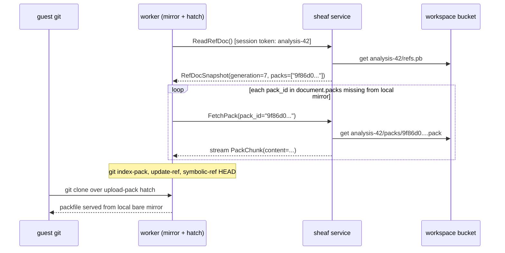
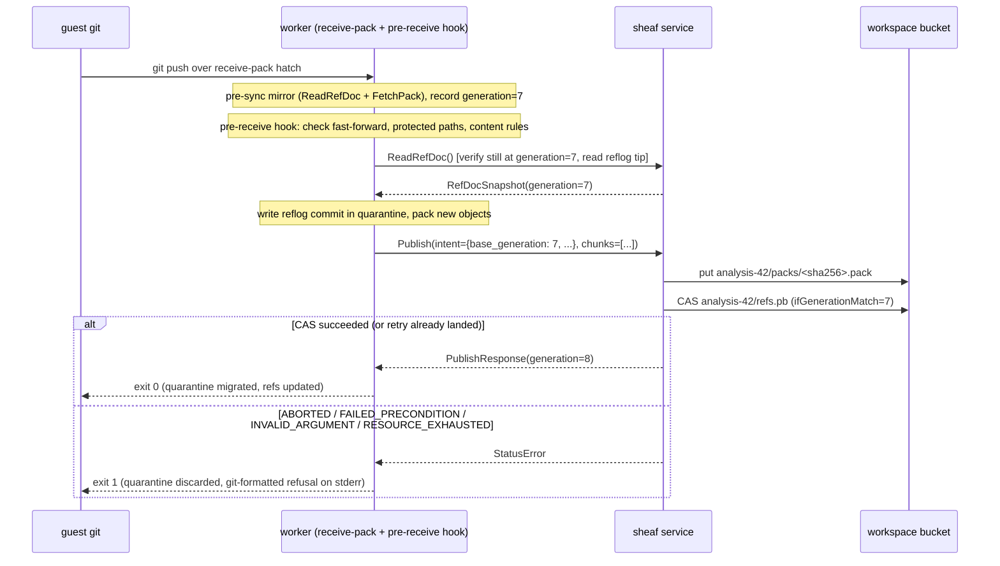

# Design: the sheaf service

**Related:** [`sheaf.md`](sheaf.md) (the object-store git model: packs, the ref document, append-only history, and the
reflog); [`sandbox-worker.md`](sandbox-worker.md) (the worker whose bare mirror and pre-receive hook call this service);
[`workbench-workspace.md`](workbench-workspace.md) (how the curator's browser hydrates and publishes through the BFF);
[`rpc-authorization.md`](rpc-authorization.md) (how the auth interceptor verifies callers and binds session scope);
[`services.md`](services.md) (how a data-plane gRPC service is structured and tested); [`security.md`](security.md)
(public ingress, IAP operator access, and signed URLs); [`deployment.md`](deployment.md) (infrastructure and IAM
capability grants).

## Overview

A sheaf repository stores git history in a Cloud Storage bucket as immutable packfiles and a single mutable ref document
([`sheaf.md`](sheaf.md)). Two callers outside the storage layer need to read and write that repository: the sandbox
worker acting for the analysis agent's `git`, and the curator's browser acting through the web backend-for-frontend
(BFF). Handing either caller a bucket credential would let a compromised worker or web request reach every
[Analysis](../../GLOSSARY.md)'s repository in the bucket and bypass the ref document's append-only invariants. Instead,
the `Sheaf` gRPC service ([`sheaf.proto`](../../schema/proto/themis/rpc/sheaf.proto), implemented in
[`themis/services/sheaf/`](../../themis/services/sheaf/)) holds the sole credential on the workspace bucket and scopes
every call to the single Analysis named in the caller's verified session token. Callers hold the git objects locally and
drive the storage protocol through four RPCs: `ReadRefDoc`, `FetchPack`, `SignPackUrls`, and `Publish`. Keeping objects
in the caller and the ref document behind the service lets the service enforce every invariant that the ref document and
pack stream can decide on their own, while keeping the service stateless across requests.

## Background

Sheaf's bucket layout (`<analysis_id>/packs/<sha256>.pack` and `<analysis_id>/refs.pb`), hydration protocol, and
single-object `ifGenerationMatch` compare-and-swap write protocol are defined in
[`sheaf.md`](sheaf.md#repository-layout-and-the-ref-document).

Two callers drive this protocol for an Analysis's workspace:

1. **The sandbox worker** ([`sandbox-worker.md`](sandbox-worker.md)) maintains a bare git mirror on the host and exposes
   stock `git upload-pack` and `git receive-pack` to the sandboxed guest over the stream hatch. The guest's `git` speaks
   standard git wire protocol to that local mirror and has no network access or knowledge of sheaf. On the host side of
   the hatch, the worker hydrates the mirror and its `pre-receive` hook publishes pushed commits through the remote
   store client in [`themis/clients/sheaf/`](../../themis/clients/sheaf/).
1. **The curator's browser** ([`workbench-workspace.md`](workbench-workspace.md)) keeps its own copy of the repository
   in the workbench. It hydrates from the ref document and packfiles, builds a commit and reflog entry locally when the
   curator edits a file, and publishes through the BFF.

```
  Sandboxed guest                     Host sandbox worker
┌─────────────────┐   stream hatch   ┌───────────────────────────┐
│   stock `git`   │ ───────────────► │ bare mirror + pre-receive │
└─────────────────┘                  └─────────────┬─────────────┘
                                                   │ ReadRefDoc, FetchPack,
                                                   │ Publish (session token)
                                                   ▼
┌─────────────────┐    unary RPCs    ┌───────────────────────────┐     GCS API      ┌──────────────────────┐
│ Curator browser │ ───────────────► │          Web BFF          │                 │   Workspace bucket   │
└────────┬────────┘                  └─────────────┬─────────────┘                 │                      │
         │                                         │ ReadRefDoc, SignPackUrls,     │ <analysis>/refs.pb   │
         │                                         │ Publish (derived session)     │ <analysis>/packs/... │
         │                                         ▼                               │                      │
         │                           ┌───────────────────────────┐                 │                      │
         └───── GET signed URL ────► │    Sheaf gRPC service     │ ──────────────► │                      │
               (direct to GCS)       └───────────────────────────┘                 └──────────────────────┘
```

## Design

### Session-scoped calls instead of repository names on the wire

The obvious way to parameterize a repository service is to pass an `analysis_id` or repository name on each RPC request.
If the request message named the repository, however, any bug or compromise in a caller that holds an invoker token on
the service would let one session read or overwrite another Analysis's workspace.

No request message in [`sheaf.proto`](../../schema/proto/themis/rpc/sheaf.proto) carries a repository name. Every RPC is
gated by the server-wide auth interceptor ([`rpc-authorization.md`](rpc-authorization.md)), which verifies the caller's
Cloud Run ID token and resolves the call's session claim into an `AuthContext`. For example, when the worker calls
`ReadRefDoc` with a session token for `analysis-42`, the request payload is `google.protobuf.Empty`; the servicer
([`themis/services/sheaf/servicer.py`](../../themis/services/sheaf/servicer.py)) reads `analysis-42` from the bound
`AuthContext` and opens [`themis.sheaf.Store`](../../themis/sheaf/store.py) on `analysis-42/`. A caller can therefore
reach the repository of its own session and no other. Which deployment hosts the service is outside the wire contract,
because every call is scoped by the session it carries.

The contract admits two workload principals:

- **The sandbox job's service account**, calling as the worker within an active session on `ReadRefDoc`, `FetchPack`,
  and `Publish`.
- **The web tier's service account**, calling within a session the BFF derives for the Analysis after checking that the
  curator belongs to the Analysis's [Project](../../GLOSSARY.md), on `ReadRefDoc`, `SignPackUrls`, and `Publish`.

As on every data-plane RPC, the automation identity (`themis-clu`) is also admitted for operator debugging. Because an
operator call can pass the interceptor without a session, it must still name a session in its claim so the servicer
knows which repository to open; an admitted call whose claim names no session is refused with `INVALID_ARGUMENT`.

The servicer never sets a gRPC status on the context directly. Instead, it raises each refusal as a `StatusError` that
the auth interceptor converts into the response status ([`rpc-authorization.md`](rpc-authorization.md)). On a
client-streaming `Publish` call, raising as soon as the initial `PublishIntent` fails validation ends the call at once,
so the service never reads the pack chunks queued behind a rejected intent.

### Splitting verification between the service and object-holding callers

A conventional git server validates a push by indexing the incoming packfile and walking the commit graph to confirm
that every updated ref is a fast-forward and every referenced object is present. Doing that inside the sheaf service
would require the service to download and index the repository's existing packfiles on every publish just to check
ancestry and connectivity.

Instead, the service holds only the ref document and never unpacks git objects, splitting validation between the
document-holding service and the object-holding caller:

- **The service checks what the ref document and pack byte stream decide on their own** (implemented in
  [`themis/sheaf/store.py`](../../themis/sheaf/store.py) and
  [`themis/services/sheaf/servicer.py`](../../themis/services/sheaf/servicer.py)):
  - Every ref name is fully qualified under `refs/` and valid in git, and no two names in the resulting ref set collide
    as a file and a directory (such as `refs/heads/topic` and `refs/heads/topic/sub`).
  - Every object ID is a 40-hex-digit SHA-1 other than the all-zero ID, and no update deletes a ref (`new` omitted or
    all-zero).
  - Every publish moves at least one ref outside `refs/sheaf/` and also advances `refs/sheaf/reflog`.
  - Every declared pack has a 64-hex-digit lowercase SHA-256 ID and a positive byte length, arrives contiguously in the
    declared order, and hashes to its declared ID.
  - The declared pack sizes fit within the deployment's per-publish byte ceiling, and the resulting document fits within
    the deployment's ref-count and document-size ceilings.
  - `base_generation` matches the stored document's current generation (or is classified on mismatch as described
    below).
- **The caller checks what requires the git object database**:
  - Every ref update is a fast-forward. The worker's `pre-receive` hook checks ancestry with
    `git merge-base --is-ancestor`, while the browser and in-process writers build their commit directly on the tip they
    read, which is a fast-forward by construction.
  - The new `refs/sheaf/reflog` commit lists the previous reflog entry and every new tip set by the publish as its
    parents, keeping every commit that was ever a ref tip reachable ([`sheaf.md`](sheaf.md)).
  - The uploaded packfiles are self-contained (built without `--thin`) and make every new tip reachable.

This split costs a trust assumption: the service trusts its admitted callers (`themis-sandbox` and `themis-web`) to
enforce fast-forward ancestry and object reachability before calling `Publish`. That assumption holds because neither
the host worker nor the curator's browser is the untrusted writer; the sandboxed agent is the untrusted writer, and the
worker's `pre-receive` hook validates the agent's objects and ancestry on the host before any bytes reach the service.

### Reading and publishing the repository

The protocol's wire messages live in [`sheaf.proto`](../../schema/proto/themis/rpc/sheaf.proto) (generated stubs in
`themis.rpc.sheaf_pb2` and `themis.rpc.sheaf_pb2_grpc`).

#### `ReadRefDoc` and `FetchPack`

`ReadRefDoc` (`google.protobuf.Empty` → `RefDocSnapshot`) returns the stored `RefDoc` protobuf message and its bucket
`generation`:

- `document` carries the stored `RefDoc` (refs, pack manifest, and `HEAD`) as a structured protobuf message so that any
  field added by a newer build survives a read-modify-write round trip through an older build. When the repository does
  not exist yet, `document` is unset.
- `generation` is the bucket's opaque version token for `refs.pb` (`0` if and only if `document` is unset). Because a
  Cloud Storage generation is a microsecond timestamp that is neither dense nor monotonically ordered in any way a
  caller may rely on, callers compare generations for equality only ([`sheaf.md`](sheaf.md)). A nonexistent repository
  is a normal initial state rather than an error, and publishing against `base_generation = 0` asserts that the
  repository still does not exist.
- If the bytes stored at `refs.pb` cannot be parsed as a valid `RefDoc`, the service returns `DATA_LOSS`. Callers treat
  `DATA_LOSS` as terminal repository corruption rather than a transient fault to retry.

`FetchPack` (`FetchPackRequest{pack_id}` → `stream PackChunk`) streams the bytes of a single packfile in 1 MiB chunks
(under gRPC's 4 MiB default message limit). Because `pack_id` is interpolated into the bucket object key
`<analysis_id>/packs/<pack_id>.pack`, the servicer validates that `pack_id` is 64 lowercase hexadecimal digits before
consulting storage, refusing anything else with `INVALID_ARGUMENT`. If the pack is absent from the bucket, the service
returns `NOT_FOUND`. Because packfiles are never deleted from a sheaf repository, every pack named in a current `RefDoc`
exists in storage; `NOT_FOUND` means the requested ID did not come from a document returned by this service.

#### `Publish`

`Publish` (`stream PublishRequest` → `PublishResponse`) uploads a publish's packfiles and replaces `refs.pb` in one
compare-and-swap. The client sends a single `PublishIntent` message first, followed by contiguous `PublishChunk`
messages for each pack declared in `PublishIntent.packs` in order (or closes the stream immediately after the intent if
the publish declares no packs):

- **Up-front pack declarations (`PublishIntent.packs`):** Each `PackDescriptor` declares the pack's byte `size` and its
  64-hex-digit SHA-256 `pack_id` before any chunk is sent. If a client half-closes the stream after a short read of
  git's quarantine directory, the service catches the byte-count or hash mismatch and refuses the call with
  `INVALID_ARGUMENT` before writing the pack. Storing a truncated pack and adding its ID to `refs.pb` would be
  unrecoverable damage, because packfiles are never deleted and `Publish` only appends to the manifest.
- **One pack at a time, objects before refs:** All chunks for pack `0` arrive before any chunk for pack `1`. The
  servicer hashes, verifies, and uploads each completed pack to `<analysis_id>/packs/<pack_id>.pack` before reading the
  next pack, and only compare-and-swaps `refs.pb` at `base_generation` once every declared pack is stored. If validation
  or the compare-and-swap fails at any point, any pack already uploaded stays in the bucket as unreferenced litter, and
  `refs.pb` never names a commit whose pack is missing.
- **Reflog presence and non-bookkeeping requirement (`PublishIntent.ref_updates`):** Moving any ref outside
  `refs/sheaf/` requires also advancing `refs/sheaf/reflog` ([`sheaf.md`](sheaf.md)). Conversely, an intent that moves
  only refs under `refs/sheaf/` is refused with `INVALID_ARGUMENT`: nothing legitimate publishes only sheaf's
  bookkeeping, and race classification (below) inspects only moved refs outside `refs/sheaf/`. If an intent moved none,
  the receipt check ("every moved ref already holds `new`") would hold vacuously and a lost race would be reported as
  having landed.
- **`HEAD` derivation (`PublishIntent.head`):** When `head` is omitted, the service carries the existing document's
  `HEAD` forward, unless the existing `HEAD` is an unborn symbolic ref (pointing to a branch that does not exist yet)
  and the publish creates at least one branch. On a repository's first publish, or when replacing an unborn `HEAD`, the
  service derives `HEAD` once and records it in `refs.pb` so every hydrating mirror lands on the same branch:
  `refs/heads/main` if present after the publish, otherwise the first `refs/heads/*` branch in lexicographic order,
  otherwise an unborn `refs/heads/main`.
- **Response (`PublishResponse{generation}`):** Returns only the generation at which `refs.pb` holds this publish's
  outcome. The stored pack IDs are omitted because they are identical to the `pack_id` values the caller declared in the
  intent.

#### Classifying a moved generation (`LANDED`, `ABORTED`, `FAILED_PRECONDITION`)

When `Publish` loses a compare-and-swap race, the obvious implementation is to return `ABORTED` directly from
[`Store.publish`](../../themis/sheaf/store.py)'s `RaceLost` exception. In
[`Store.publish`](../../themis/sheaf/store.py), however, `plan` compares each update's expected `old` commit against the
caller's own `base` snapshot rather than the live document. Because a well-behaved caller derives its `old` values from
that same `base` snapshot, `plan` never fails on `old` when a concurrent publish lands first; without a second read,
every concurrent advance of `refs.pb` would surface as `ABORTED`, leaving the caller unable to distinguish a retryable
race on an unrelated ref from a non-fast-forward conflict on the ref it is pushing.

When the live document's generation differs from `base_generation` (either on the initial read before pack upload or
after a failed compare-and-swap), the servicer re-reads the current document and classifies the publish in a fixed order
over the refs the intent moves outside `refs/sheaf/` (ignoring `refs/sheaf/reflog`, which advances on every publish and
therefore never remains at `old`):

1. **Already landed (idempotent success):** Every moved ref outside `refs/sheaf/` already holds the intent's `new`
   commit. For example, if a previous `Publish` call wrote `refs/heads/main = b2c3d4e` at generation `8` and the network
   dropped the response, a retry with `base_generation = 7` sees `refs/heads/main == b2c3d4e` and succeeds, returning
   `generation = 8`.
1. **Unrelated publish won (`ABORTED`):** Every moved ref outside `refs/sheaf/` still holds the intent's `old` commit
   (for example, the intent moves `refs/heads/work` from `a1b2c3d` to `b2c3d4e`, while generation `8` only moved
   `refs/heads/main`). The caller re-reads the document, rebuilds its intent (updating `base_generation` and the
   `refs/sheaf/reflog` parent), and publishes again. The worker's hook reports this to git as a concurrent workspace
   move (`run git pull --rebase and push again`).
1. **Target ref moved (`FAILED_PRECONDITION`):** Otherwise, at least one moved ref outside `refs/sheaf/` no longer holds
   `old` in the live document (and not all of them already hold `new`; for example, `refs/heads/main` moved from
   `a1b2c3d` to `f4e5d6c` while the caller built a commit on `a1b2c3d`). Another writer advanced a target ref; the
   service returns `FAILED_PRECONDITION` naming every moved ref that is no longer at `old`. Replaying the intent cannot
   succeed, and the worker's hook translates this into git's non-fast-forward refusal (`fetch first, then push again`).

If the live document is still at `base_generation` and a ref in `ref_updates` does not hold its expected `old` value
there, the intent disagrees with the snapshot it claims to have been built from. That is a caller bug rather than a
race, so the service refuses it with `INVALID_ARGUMENT`.

| Status code           | Cause                                                                                                                                                     | Caller action                                                            |
| --------------------- | --------------------------------------------------------------------------------------------------------------------------------------------------------- | ------------------------------------------------------------------------ |
| `ABORTED`             | `refs.pb` moved past `base_generation`, and every ref the intent moves outside `refs/sheaf/` still holds `old` (an unrelated publish landed first).       | Read the document again, rebuild the intent against it, and replay.      |
| `FAILED_PRECONDITION` | `refs.pb` moved past `base_generation`, and any ref the intent moves outside `refs/sheaf/` no longer holds `old`.                                         | Non-fast-forward: fetch and merge or rebase before pushing again.        |
| `INVALID_ARGUMENT`    | Malformed intent or stream (invalid ref/OID/pack ID, ref deletion, missing reflog update, bookkeeping-only update, pack size/hash mismatch, short chunk). | Fix the caller's intent; retrying the same request will never land.      |
| `INVALID_ARGUMENT`    | `refs.pb` is at `base_generation`, but a ref does not hold `old` there (the intent contradicts the snapshot it claims to have read).                      | Rebuild the intent from the snapshot as read.                            |
| `INVALID_ARGUMENT`    | An admitted operator call whose claim names no session.                                                                                                   | Supply the session whose repository is meant.                            |
| `RESOURCE_EXHAUSTED`  | Declared pack bytes exceed the per-publish byte ceiling, or the resulting document exceeds the deployment's ref-count or document-size ceiling.           | Checked against `Limits` before any pack is stored; nothing to clean up. |
| `DATA_LOSS`           | Stored `refs.pb` cannot be parsed (truncated or foreign encoding).                                                                                        | Stop; treat as repository damage rather than a retryable fault.          |
| `UNAUTHENTICATED`     | Missing or unverifiable Cloud Run ID token at the auth interceptor, before any storage read.                                                              | —                                                                        |
| `PERMISSION_DENIED`   | Caller identity is not admitted by the RPC contract, or the session token does not resolve.                                                               | —                                                                        |

Because nothing is ever deleted (`errors.RefDeletionRefused`), the ref set in a repository only grows. `_decode_intent`
and `_plan` check the deployment's `Limits` (`max_publish_bytes`, `max_refs`, and `max_document_bytes`, configured via
`THEMIS_SHEAF_MAX_*` with no defaults in [`__main__.py`](../../themis/services/sheaf/__main__.py)) before `_store_packs`
writes any pack so a push that would tip the document over either ceiling is refused cleanly without leaving an orphan
pack behind; while a caller can shrink an oversized pack (`max_publish_bytes`), reaching the ref-count or document-size
ceiling is terminal for that repository.

The auth interceptor returns `INTERNAL` (whose details name the claim error) when it cannot honour the caller's claim —
a missing claim from an account that never calls as itself, a session claim with no token, or an undecodable claim.
Uncaught storage or wire faults are ordinary gRPC faults (`UNAVAILABLE` or `INTERNAL`) rather than domain refusals:
callers retry or surface them under standard gRPC fault rules rather than the domain table above, and the worker's hook
reports them as deployment faults rather than blaming the pusher's content.

### Worker hydration and push flows

At session start, the sandbox worker syncs its bare mirror from the sheaf service before the guest clones over the
`upload-pack` stream hatch:



When the guest runs `git push`, the worker's request handler runs the same sync (`ReadRefDoc` and `FetchPack` for any
missing packs) before spawning `git receive-pack`, writing the observed `generation` to `sheaf-sync.json`. Syncing
before `receive-pack` ensures the mirror's refs are current so stock `git` rejects non-fast-forward pushes in the common
case before the hook runs.

When `receive-pack` spawns the `pre-receive` hook ([`themis/sheaf/wire/hook.py`](../../themis/sheaf/wire/hook.py)), it
passes a scrubbed environment. Because the hook parses bytes composed by the untrusted guest and `/proc/<pid>/environ`
is readable by any process sharing the same user ID, the hook reads the service address, sync state, and session token
from host-only file paths rather than environment variables. Inside the hook, `_publish` calls `ReadRefDoc` once more to
confirm that `generation` has not moved since the pre-sync and to read the current `refs/sheaf/reflog` tip (so a push
performs two `ReadRefDoc` calls unless the sync state carries the tip), writes the new reflog commit into git's
quarantine directory, packs the new objects, and streams `Publish`:



The hook does not update the bare mirror's refs itself when `Publish` succeeds. Its zero exit status tells
`receive-pack` to migrate the quarantined objects and update the mirror's refs, and the next git request's pre-sync
re-reads the canonical state from `refs.pb`.

### Browser hydration and publishing via the BFF (`SignPackUrls`)

When a curator edits or inspects the workspace in the workbench ([`workbench-workspace.md`](workbench-workspace.md)),
the browser maintains a local copy of the repository, hydrates it from `refs.pb` and the packfiles, builds a commit and
reflog entry locally on the tip it read, and publishes.

The browser never calls the sheaf service directly; the web BFF relays its calls. Before forwarding a request, the BFF
verifies that the curator belongs to the Analysis's Project ([`workspace-model.md`](workspace-model.md)), derives a
session token scoped to that Analysis ([`rpc-authorization.md`](rpc-authorization.md)), and calls the sheaf service as
the web tier.

#### Why the browser hydrates through `SignPackUrls` instead of `FetchPack`

On a first hydration, the browser must download every packfile in the repository. Streaming those bytes through
`FetchPack` would pass the entire repository through the sheaf service container and then through the BFF container, two
processes that do nothing with the pack contents. Conversely, signing GCS URLs inside the BFF would require giving the
web tier a second identity with read access across every repository in the workspace bucket and duplicating the bucket's
key layout outside the sheaf service.

Instead, the BFF calls `SignPackUrls` (`SignPackUrlsRequest{pack_ids}` → `SignPackUrlsResponse`), which is admitted to
the web tier alone:

- For up to 256 `pack_ids` per call, the sheaf service returns each pack's byte `size`, a short-lived V4 signed GCS URL
  (`url`), and its `expire_time`. The browser then downloads each pack directly from GCS over HTTPS.
- The service reads the current `RefDoc` first and refuses the call with `NOT_FOUND` if any requested `pack_id` is not
  listed in the current manifest, even if the object exists in the bucket. A signed URL is therefore only ever issued
  for a pack that a reader of the current repository can already name, and `NOT_FOUND` tells the caller to re-read
  `ReadRefDoc` because its manifest is stale.
- Returning the pack's byte `size` alongside its signed URL lets the browser reject a repository that exceeds its
  in-memory budget before downloading any pack bytes.
- Because a signed URL is a bearer capability for anyone holding it until `expire_time`, the browser holds it in memory
  and fetches each URL once.
- The service returns `INVALID_ARGUMENT` if the request lists no packs, more than 256 packs, a duplicate ID, or an ID
  that is not 64 hex digits; `DATA_LOSS` if a pack listed in the current `RefDoc` is missing from storage or `refs.pb`
  is corrupt; and `UNIMPLEMENTED` if the storage backend cannot sign URLs (as with the local-directory backend).

#### Unary browser publish through the BFF

Because a browser cannot stream a gRPC request body through the BFF, the browser sends its publish intent and pack bytes
to the BFF in a single unary call under a size cap, and the BFF streams them into `Publish`. The sheaf service runs the
exact same validation and classification as for the sandbox worker. Like the worker, the browser is a trusted writer
([`workbench-workspace.md`](workbench-workspace.md) §Background): it builds its commit directly on the tip it read,
satisfying the fast-forward and reflog-parent requirements by construction.

### Deployment, storage seams, and resource bounds

`Sheaf` is a logical gRPC interface; which Cloud Run service hosts it is defined in the deployment program
([`deployment.md`](deployment.md), [`infra/themis_infra/sheaf.py`](../../infra/themis_infra/sheaf.py)) so the hosting
arrangement can change without altering the service contract. Unlike the evidence services in
[`services.md`](services.md) that define a per-interface domain port with a seeded fixture adapter, the sheaf servicer
uses the library's own storage seam, [`themis.sheaf.Backend`](../../themis/sheaf/backend.py). The protocol already lives
behind `Backend`, and its offline mode is `LocalBackend` (a local directory mirroring a versioned bucket) rather than a
seeded fixture, because a git store starts empty until callers push to it.

Wherever `Sheaf` is deployed, it requires four properties from its host environment:

- **Sole bucket credential (`roles/storage.objectUser`):** The sheaf service's runtime service account is the only
  identity granted a role on the workspace bucket; the sandbox worker and BFF hold `roles/run.invoker` on the sheaf
  service and no role on the bucket. Replacing `refs.pb` under `ifGenerationMatch` is an object overwrite, and Cloud
  Storage requires `storage.objects.delete` permission for an overwrite, so a role limited to object creation and reads
  cannot implement the compare-and-swap. Append-only history ("nothing deletes") is therefore enforced by the sheaf
  protocol rather than by a narrower IAM role; enforcing it at the bucket layer as well would take object versioning or
  a retention policy on the pack prefix.
- **Self-signing capability and bucket CORS:** To sign V4 pack URLs via IAM `signBlob`, the service's runtime service
  account holds `roles/iam.serviceAccountTokenCreator` on itself, and the workspace bucket carries a `GET` CORS rule
  admitting the workbench's web origin.
- **Internal and IAP-gated ingress:** Cloud Run ingress is restricted to internal VPC traffic and the external load
  balancer (`INGRESS_TRAFFIC_INTERNAL_LOAD_BALANCER`). The BFF and sandbox worker call the service's `run.app` URL over
  the services VPC, while an operator driving the protocol by hand reaches it through the load balancer's IAP-gated
  operator backend as `themis-clu` ([`security.md`](security.md#ingress-from-the-public-internet)). On both paths, the
  service verifies the caller's ID token audience against its own `run.app` URL.
- **Per-deployment resource ceilings:** Stream chunks stay under gRPC's 4 MiB default message limit. Each deployment
  configures explicit ceilings on declared pack bytes per publish, total refs per repository, and serialized `RefDoc`
  byte size ([`Limits` in `themis/services/sheaf/servicer.py`](../../themis/services/sheaf/servicer.py)), refusing any
  publish over those bounds with `RESOURCE_EXHAUSTED` before storing a pack. Those ceilings are mandatory because pushed
  bytes come from the untrusted guest and nothing in a sheaf repository is ever reclaimed.
