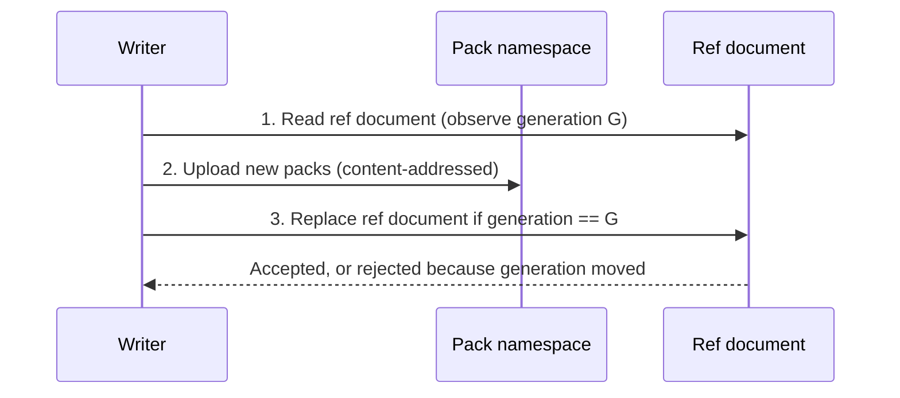

# Design: sheaf — git over object storage

**Related:** [`sheaf-service.md`](sheaf-service.md) (the gRPC surface that serves this protocol, its callers, and where
the bucket credential lives); [`workspace-model.md`](workspace-model.md) (the collaboration model whose workspace this
carries, and the branch-and-append semantics of an Analysis); [`workbench-workspace.md`](workbench-workspace.md) (how
the browser hydrates and publishes commits from the workbench); [`document-widgets.md`](document-widgets.md)
(interactive widgets and their human-judgement guards); [`sandbox-worker.md`](sandbox-worker.md) (how the sandbox worker
exposes git to the guest); [`proto.md`](proto.md) (protobuf evolution rules); [`services.md`](services.md) (how internal
services are structured); [`agent-runtime.md`](agent-runtime.md) (the session the sandbox runs inside).

## Overview

A Themis workspace has two concurrent writers. The agent writes inside an ephemeral sandbox that lives and dies with one
session. A curator writes from the workbench, where the browser keeps its own copy of the repository and commits to it
when the curator updates a widget's state. While only the sandbox wrote to the workspace, storing the workspace as an
opaque tar archive and replacing it whole on every save was enough. With a second writer, whole-archive replacement
causes each writer to overwrite the other's work without warning, and records nothing about what changed.

Git solves concurrent editing, and its object model maps cleanly onto object storage. A git repository consists of an
append-only, content-addressed object store plus a small set of mutable ref pointers. Google Cloud Storage (GCS)
provides matching primitives: immutable objects under content-derived keys, and single-object compare-and-swap via
`ifGenerationMatch`.

Sheaf ([`themis/sheaf/`](../../themis/sheaf)) puts a git repository on object storage by packing all mutable state for a
repository — every ref, the manifest of packfiles that form the object database, and `HEAD` — into a single binary
protobuf document. Every write uploads its new packfiles under content-addressed keys and replaces the ref document in
one compare-and-swap against the generation the writer last read. That single conditional write provides all the
concurrency control the repository needs, without lease objects, advisory locks in Postgres, or single-instance git
servers.

When a compare-and-swap is rejected because the ref document moved, sheaf distinguishes a lost race on the document from
a conflict on a ref. A writer whose ref document moved while the refs it touches kept their expected values can rebuild
its update against the new snapshot and replay automatically. A writer whose target ref moved faces a git
non-fast-forward and must merge or rebase. If a workspace ever shares an append-only log that both writers accumulate
over time, appending lines to a log file makes concurrent edits commute under `.gitattributes` `merge=union` rules so
that retries and merges succeed without human intervention.

History in a sheaf repository is append-only, and nothing is ever deleted from the store. A ref may be created or
fast-forwarded, never rewritten or removed, and uploaded packfiles stay in the bucket permanently. Every push also
advances a reflog ref (`refs/sheaf/reflog`) in the same compare-and-swap, recording which commit was each ref's tip and
when. On the agent's side, stock `git` owns the wire protocol: the agent clones and pushes against real
`git upload-pack` and `git receive-pack` processes reached from the sandbox over postern's stream hatch. Sheaf syncs a
bare mirror before each connection and runs a `pre-receive` hook that refuses pushes that rewrite history, modify
protected paths, author commits or tags under another user's identity, carry object headers that git and the browser's
git library parse differently, or add file paths the browser cannot read. To prevent a large repository from exhausting
container memory on Cloud Run when hydrating a mirror, hydration will check the resident set against a size ceiling
before fetching pack bytes (decided here, not yet built in `bare.py`). The [`themis/sheaf/`](../../themis/sheaf) package
contains no Themis domain types and can be extracted into a standalone package if a second consumer appears.

## Background

The agent runs untrusted model code inside a sandbox whose filesystem is discarded when the session ends, so its work
must be checkpointed to durable storage. Inside the sandbox worker ([`sandbox-worker.md`](sandbox-worker.md)), the agent
reaches the workspace repository through a bare git mirror that the worker maintains on the trusted host side of the
sandbox boundary. Meanwhile, when a curator clicks "mark this criterion as reviewed" in the workbench, the browser
commits that change to its own copy of the repository and hydrates and publishes through the same RPCs the worker's
mirror uses, with the web backend (BFF) relaying them ([`workbench-workspace.md`](workbench-workspace.md)). Both writers
reach the bucket exclusively through the `Sheaf` gRPC service ([`sheaf-service.md`](sheaf-service.md)), which holds the
single credential on the bucket.

```
  Sandbox guest                         Browser (workbench)
    │ git push / fetch                    │ isomorphic-git commit
    ▼ (postern Unix socket)               ▼
  Sandbox worker (bare mirror + hook)   Web BFF
    │                                     │
    └──────────────┐       ┌──────────────┘
                   ▼       ▼  ReadRefDoc / FetchPack / SignPackUrls / Publish
                 Sheaf service
                       │
                       ▼  GCS bucket
         ┌────────────────────────────────────────┐
         │ <repo>/refs.pb             (CAS)       │
         │ <repo>/packs/<sha256>.pack (immutable) │
         └────────────────────────────────────────┘
```

A git repository is a content-addressed store of immutable blobs, trees, and commits, paired with refs that map names
such as `refs/heads/main` to commit object IDs. Everything git requires from a POSIX filesystem — lock files, atomic
renames, and directory semantics — concerns updating refs. Running `git init --bare` directly on an object-store bucket
fails because GCS has no lock files, no atomic rename, and no multi-object transactions: two writers advancing the same
ref through separate object writes would overwrite one another with no error. What GCS does provide is a conditional
write on a single object's generation (`ifGenerationMatch`), along with safe concurrent writes to content-addressed keys
where racing writers upload identical bytes.

## Non-goals

- **General-purpose git hosting.** Sheaf serves one repository per workspace over a socket to a known client, with no
  authentication of its own. Callers must pass through an authenticating proxy or service in front of it. The set of
  repositories a server will serve is an explicit input rather than inferred from the request path; without
  authentication, that allowlist is the boundary preventing a connected client from reaching other workspaces in the
  store.
- **Authorization.** The store authenticates nobody, and protected paths stop a specific forgery by the sandboxed agent
  rather than a holder of the service credential. What the hook refuses for every caller is rewriting or deleting
  history: a force-push is rejected with git's standard wording so the client's ordinary recovery — pull, then push —
  applies.
- **SHA-256 git repositories.** The bare mirror uses git's default SHA-1 object format, which bounds the hash format a
  client can push. Git's own default has not moved, and adopting SHA-256 would be a migration in its own right.
- **One git ref per working-document version.** The working document's versions are the historical commit tips of the
  workspace's collaborative branch as recorded by the reflog and read from the browser's copy of the repository
  ([`workbench-workspace.md`](workbench-workspace.md)), while promoting a version to a report stays in the workspace
  model ([`workspace-model.md`](workspace-model.md)).
- **Reimplementing git's object format.** Sheaf stores packfiles whole without inspecting their internal object streams;
  every pack comes from a standard git pack writer (`git pack-objects` behind the worker's mirror and `isomorphic-git`
  in the browser). Reimplementing pack serialization risks subtle incompatibilities with the git clients sheaf serves.
- **Cross-repository object sharing.** Each workspace repository is self-contained under its own key prefix, with no
  shared object store, alternates, or cross-repository deduplication. Keeping each repository under a self-contained
  prefix ensures that access to one workspace's storage grants no authority over another's.

## Design

### Repository layout and the ref document

Each repository occupies one key prefix ([`themis/sheaf/store.py`](../../themis/sheaf/store.py)) containing two kinds of
objects:

```
<repo>/
├── refs.pb                      # RefDoc protobuf, replaced via compare-and-swap
└── packs/
    ├── 3a7f...91c2.pack         # Immutable packfile, named by SHA-256 of its bytes
    └── 8b10...44e0.pack
```

- **Packfiles**, under content-addressed keys (`<repo>/packs/<sha256>.pack`). Each packfile is written once, never
  mutated, and never renamed. Because a pack's key is the digest of its bytes, a replayed attempt that produces
  identical objects uploads to the same key instead of littering the namespace.
- **One ref document**, at a fixed key (`<repo>/refs.pb`;
  [`schema/proto/themis/sheaf/models/refdoc.proto`](../../schema/proto/themis/sheaf/models/refdoc.proto),
  [`themis/sheaf/refdoc.py`](../../themis/sheaf/refdoc.py)). It holds every ref in the repository, the manifest of
  packfiles that make up its object database, and which ref or object a clone should check out (`HEAD`). It is replaced
  exclusively by compare-and-swap against the generation the writer last read.

Reconstructing a repository requires only this document and the packs it names. Any additional metadata a future feature
might need belongs in a separate object that existing builds do not have to read, keeping the ref document small and its
meaning fixed.

The refs and the pack manifest share one object because compare-and-swap on GCS is per object. Splitting refs across
separate keys would turn a multi-ref push into a multi-key update with no atomicity across refs. The pack manifest must
live in the same object for a complementary reason: listing the pack prefix cannot distinguish a live pack from an
orphan left behind by a lost race or a compaction, so a reader needs the manifest to know which packs to fetch.

The manifest is a mathematical set. Packs are named by the hash of their bytes and are self-contained — built without
`--thin`, so no pack contains delta objects against a base object in another pack. Each pack is therefore a partial map
from git object ID to content, and any collection of packs composes into a larger map without shadowing or ordering
dependencies. The sole invariant the manifest must satisfy is *coverage*: naming every pack needed to reach all refs and
`HEAD`. Because self-contained, content-addressed packs cannot conflict with one another, coverage is the only invariant
a manifest update can violate, and violating it corrupts the repository.

The ref document is encoded as a binary protobuf so that unknown fields survive round-trip updates
([`proto.md`](proto.md)). Because every ref update rewrites the whole document, publishing is a read-modify-write that
mutates the parsed protobuf message in place rather than projecting it into an intermediate structure that would drop
unrecognized fields. An older build reading and updating a document written by a newer build preserves any new fields
untouched. For the same reason, the document carries no schema-version field: additive changes remain readable by older
and newer builds alike, and `buf breaking` enforces wire compatibility at build time.

Every stored ref document must set `HEAD`. An empty byte string or a truncated protobuf payload is otherwise a valid
protobuf encoding with no refs and no packs, which looks identical to an empty repository. `HEAD` is assigned the
highest field number in the message, and all field numbers above it are reserved. Because protobuf serializes fields in
field-number order, a truncated write loses `HEAD` before it loses the pack manifest, and because `HEAD` is a message
field with explicit presence, a reader immediately detects its absence and rejects the damaged document.

Ref names and object IDs are validated on write before the compare-and-swap
([`themis/sheaf/refdoc.py`](../../themis/sheaf/refdoc.py)). When a mirror syncs from the store, it feeds refs to git as
whitespace-delimited, newline-terminated input; if a ref name containing a space or a pair of file/directory-colliding
ref names (such as `refs/heads/a` and `refs/heads/a/b`) were written into the ref document, every subsequent sync of
that repository would fail until the bad entry was manually compare-and-swapped out.

The storage seam ([`themis/sheaf/backend.py`](../../themis/sheaf/backend.py)) is narrow: read, conditionally write, and
list retained generations of one mutable key, plus put, get, list, and sign URLs for immutable content-addressed
objects. There is no delete operation. That interface is small enough to implement over a local filesystem directory
([`themis/sheaf/backends/`](../../themis/sheaf/backends)), allowing the concurrency protocol to be tested without
network calls or cloud credentials.

### Storing HEAD as a distinct field

An ordinary ref maps a name under `refs/` to an object ID. `HEAD` maps to a *ref name* (a symbolic ref) or, when
detached, to an object ID. It has a different type, sits outside the `refs/` namespace, and is advertised differently on
the git wire protocol. Storing `HEAD` as an entry in the `refs` map would also fail silently when updating a mirror:
git's normal ref update dereferences a symbolic ref, so writing `HEAD` through the ref map would overwrite whichever
branch `HEAD` points at.

A symbolic `HEAD` names a valid ref path, which need not resolve to an existing commit yet. Pointing `HEAD` at a branch
with no commits is git's initial state after `git init` and `git switch --orphan`, and git protocol v2 advertises the
symbolic target so that cloning an empty repository still checks out the intended branch name. Requiring `HEAD` to
resolve would forbid the state every repository starts in, which is also the state where a mirror has no branches from
which to infer a default.

Recording `HEAD` in the ref document eliminates a guess that every mirror hydration would otherwise have to make.
`git init --bare` initializes `HEAD` from the host machine's `init.defaultBranch` setting; a mirror created on a host
defaulting to `master` for a repository using `main` advertises a `HEAD` pointing at nothing, causing a client clone to
check out an empty working tree without reporting an error. On a repository's first write, nothing in a git push states
which ref the client considers primary, so the store picks the initial `HEAD` from the refs created by that first write
(preferring `refs/heads/main`, then the first branch in `refs/heads/`, and otherwise an unborn `refs/heads/main`) and
records it in the ref document so all subsequent builds agree.

### Every write is one compare-and-swap

Every write from any caller follows the same three-step sequence:



The conditional replacement of the ref document is the sole point where concurrent writers are ordered against one
another, and it takes a single object-store call. Any lock held by a server while refreshing a local mirror protects
only that local cache, while the compare-and-swap protects the repository state. Generation numbers are treated as
opaque tokens compared only for equality: a GCS generation is a microsecond timestamp that is neither dense nor ordered
in a way callers may rely on, and counting how many transitions occurred is answered by counting retained entries rather
than subtracting generations.

Packfiles are always uploaded before the ref document names them. A ref pointing at an object that no pack in the store
contains is repository corruption, whereas an uploaded pack that no ref document names is inert litter that no reader
requests. Because object storage cannot roll back an uploaded pack when a subsequent compare-and-swap fails, leaving
unreferenced packs behind is an accepted consequence of the protocol.

### Distinguishing a lost race from a ref conflict

When a compare-and-swap fails because the ref document's generation moved, two distinct situations are possible
([`themis/sheaf/store.py`](../../themis/sheaf/store.py)):

```
Snapshot at G1:  refs/heads/main = aaa111,  refs/stranded/w1 = (absent)

Case 1 — Lost race (disjoint refs):
  Winner updates refs/stranded/w1 -> bbb222 (generation becomes G2)
  Loser wanted to update refs/heads/main: aaa111 -> ccc333
  -> At G2, refs/heads/main is still aaa111. Loser rebuilds against G2 and replays.

Case 2 — Ref conflict (same ref moved):
  Winner updates refs/heads/main: aaa111 -> ddd444 (generation becomes G2)
  Loser wanted to update refs/heads/main: aaa111 -> ccc333
  -> At G2, refs/heads/main is ddd444 != aaa111. Loser surfaces non-fast-forward conflict.
```

Conflating these two cases either loses concurrent writes or forces a user to resolve a conflict that the store could
have replayed automatically:

- **The ref document moved, but the refs this writer touches still hold their expected values.** Another writer
  committed to a disjoint ref or compacted packs. The losing writer re-reads the ref document, rebuilds its intent
  against the new snapshot, and repeats the compare-and-swap without surfacing an error.
- **A target ref no longer holds the value the writer expected.** Another writer advanced the same ref, producing a git
  non-fast-forward. Retrying would overwrite the winner's commit, so the failure surfaces to the caller, which must
  merge or rebase.

This separation is what makes a single repository-wide ref document practical under concurrency. Two writers updating
disjoint refs contend on the ref document's generation, but the loser's automatic replay succeeds on the next round
trip. A retry budget bounds how many times a writer replays before reporting starvation from sustained contention. A
caller that derives its entire update from the snapshot passed to its transaction builder never encounters the second
case, because re-invoking the builder against the winning snapshot computes a fresh fast-forward transition on each
attempt.

### A shared append log would commute under `merge=union`

A curator's review judgement on agent-authored content, such as ticking a checklist item, lives as a guard inside the
widget asset it judges ([`document-widgets.md`](document-widgets.md)). Whether any workspace file needs a shared append
log that both writers accumulate is an [open question](#open-questions) below — no live workspace uses one today, and
`merge=union` currently exists only in test fixtures — but this section fixes the shape such a file must take if one is
introduced, because the test suite already pins the mechanism
(`themis/sheaf/tests/test_wire.py::test_two_divergent_appends_merge_without_a_conflict`). Where two writers genuinely
append independent lines to a shared record (such as an event log), modelling that record as a mutable field in a
document would cause concurrent writes to conflict or overwrite each other. Modelling it as lines appended to an
append-only log makes concurrent writes commute: a writer that loses a compare-and-swap race re-reads the winner's log
and appends its line to the new end, producing the same set of lines without surfacing a conflict or requiring an agent
session to be running.

Commutativity must hold for git merges in the agent's clone as well as for compare-and-swaps in the store. When the
agent's clone and the curator's browser copy have both appended lines to the same log file, git's default three-way text
merge reports a conflict in the middle of the agent's turn. Configuring the log file to use git's built-in `union` merge
driver in `.gitattributes` (for example, `*.jsonl merge=union`) instructs git to keep both appended lines automatically
across all clones. On the browser side, the workbench's file-by-file rebase
([`workbench-workspace.md`](workbench-workspace.md) §"A curator's edit is rebased onto the tip, file by file") would
need the same rule, appending to a shared log rather than refusing an edit to a file the agent touched.

A curator's commit carries that curator's author and committer identity. The hook's identity rule
([below](#protecting-paths-identities-and-object-headers-in-the-hook)) prevents the agent from placing a curator's
identity on its own commits.

### Serving the wire protocol with stock git

Implementing `git-upload-pack` and `git-receive-pack` from scratch risks subtle wire-protocol bugs that surface only
with specific git client versions or flags. Instead, the agent talks with a stock `git` binary to stock
`git upload-pack` and `git receive-pack` processes running against a per-session bare mirror
([`themis/sheaf/wire/bare.py`](../../themis/sheaf/wire/bare.py)). Sheaf's code in that path performs two steps:

1. **Sync the bare mirror from the store before handing the request to git.** Before running `upload-pack` or
   `receive-pack`, the mirror reads the ref document, fetches any missing packs concurrently (one worker task per pack,
   since hydration is latency-bound across object-store requests), force-updates local refs to match the store, deletes
   any local refs the store no longer holds, and points `HEAD` at the document's target. Once local refs match the
   store, a client pushing from a stale clone fails git's own fast-forward check and receives git's standard rejection
   message, which models are already trained to recover from. Fetching syncs the mirror first as well: a rejected
   pusher's next step is `git pull`, and a mirror refreshed only on push would hand back the stale state the push just
   failed against.
1. **Turn the push into one compare-and-swap inside a `pre-receive` hook.** By the time `pre-receive` runs
   ([`themis/sheaf/wire/hook.py`](../../themis/sheaf/wire/hook.py)), git has placed the incoming objects into a
   quarantine directory and validated them, and no local ref has moved. The hook receives the entire push at once on
   stdin, so a multi-ref push maps onto a single compare-and-swap. It refuses any ref update that is neither a ref
   creation nor a fast-forward, checks path and identity rules, writes a reflog commit for the transition, packs all new
   objects reachable from the reflog commit and from the pushed tips, uploads the pack, and conditionally replaces the
   ref document against the generation recorded when the mirror was synced. The pushed tips are passed to the packer
   alongside the reflog commit because an annotated tag object is not reachable from the reflog commit, which parents on
   the commit the tag peels to ([below](#the-reflog-ref-says-what-was-current)). Exiting non-zero causes git to discard
   the quarantine directory and leave all local refs untouched, so a rejected push never leaves the mirror out of step
   with the store.

In the sandbox worker ([`sandbox-worker.md`](sandbox-worker.md)), the transport is postern's stream hatch: one Unix
socket per git service bound into the sandbox guest and spliced host-side to `git upload-pack` or `git receive-pack`
against the mirror, speaking git's native protocol over an `ext::` remote with no HTTP in the path. The socket acts as
the capability: the guest's connector sends no repository name or service argument, a socket bound to `upload-pack`
cannot invoke `receive-pack`, and a read-only mount simply leaves the `receive-pack` socket unbound. For unsandboxed
writers, `git http-backend` over loopback ([`themis/sheaf/wire/server.py`](../../themis/sheaf/wire/server.py)) runs the
exact same mirror sync and `pre-receive` hook.

While git's client-side fast-forward check catches stale pushes in the ordinary case, `git push --force` bypasses the
client check. The hook must therefore verify fast-forward ancestry itself rather than relying on git's server-side
`receive.denyNonFastForwards` and `receive.denyDeletes` settings: `receive-pack` evaluates those settings *after* the
`pre-receive` hook finishes and applies them only to branches, which would let a force-push land in the store before git
refused it and would allow tags to be moved or deleted.

Git replace refs (`refs/replace/<id>`) instruct git to substitute another object whenever `<id>` is read, which would
otherwise allow an agent push to make the hook inspect one commit while storing another. An agent could first push
`refs/replace/<forged>` pointing at a benign commit and then push `<forged>` modifying a protected path: git commands
run by the hook would read the benign replacement and pass the push, while `git pack-objects` ignores replace refs and
packs the forged commit. Sheaf closes both steps of that attack: the hook restricts pushes to branches (`refs/heads/*`),
tags (`refs/tags/*`), and `refs/stranded/*` (where the sandbox worker parks work that could not land on its branch),
refusing `refs/replace/*`; and the mirror configures `core.useReplaceRefs=false` so that even if another writer
published a replace ref through the storage protocol without passing through the hook, git commands opening the mirror
ignore it.

Incoming objects are validated by git itself by enabling `receive.fsckObjects=true` on the mirror (off by default in
git). Because the hook is host-side code holding the store credential and walking a pack composed inside the untrusted
sandbox, enabling `fsckObjects` ensures `receive-pack` rejects malformed objects before invoking the hook.

### The reflog ref says what was current

Fast-forward-only history keeps every pushed commit reachable, but the commit graph alone cannot tell which commits were
ever a ref's tip: pushing three commits at once advances the branch tip once, leaving the intermediate commits
indistinguishable from tips that were individually published.

To record tip history inside the repository, every publish that updates a ref writes one commit to `refs/sheaf/reflog`
([`themis/sheaf/wire/reflog.py`](../../themis/sheaf/wire/reflog.py)), parented on the previous reflog commit and on the
commit each updated ref tip peels to, with the `<ref> <old-oid> <new-oid>` transitions in its commit message:

```
refs/sheaf/reflog
  │
  ▼
[entry 2] "sheaf: refs/heads/main, refs/tags/v1"
  │ ├─► commit c3 (new tip of refs/heads/main)
  │ └─► commit c3 (peeled target of annotated tag v1)
  ▼
[entry 1] "sheaf: refs/heads/main"
  │ └─► commit c1 (initial tip of refs/heads/main)
  ▼
[root]    "sheaf: init" (parentless sentinel written by sheaf)
```

Because git requires every parent of a commit to be a commit object, when an updated tip is an annotated tag, the reflog
entry parents on the commit the tag points to while recording the tag's own object ID in the message line; the tag
object itself remains reachable through its own ref under `refs/tags/`, which is never deleted. The reflog update rides
in the same compare-and-swap as the ref updates it describes, so the log and the refs cannot disagree. Because
`refs/sheaf/reflog` is an ordinary ref over ordinary commits, `git repack -a -d` retains every commit it reaches, and a
client can fetch it explicitly by name. A default `git clone` fetches only `refs/heads/*` and `refs/tags/*`, so the
agent never sees `refs/sheaf/reflog` unless it asks for `refs/sheaf/*`, and `git push --mirror` (which would attempt to
overwrite or delete `refs/sheaf/reflog`) is refused in full.

Recording tip transitions in `refs/sheaf/reflog` means any query for what a ref pointed at and when can be answered from
the repository alone without relying on bucket object versioning, and because no pack is ever deleted, every commit
named in the reflog remains hydratable.

The reflog chain is owned by sheaf from tip to root. On a repository's first publish, the writer creates a parentless
root sentinel commit (`sheaf: init`) and parents the first real entry on it, so walking `--first-parent` from
`refs/sheaf/reflog` always stops at a commit sheaf wrote and never runs into pushed history that an untrusted client
could shape to look like a reflog entry. The hook refuses any push under `refs/sheaf/*`, and the store refuses any
publish that updates a ref outside `refs/sheaf/*` without also advancing `refs/sheaf/reflog`. Checking that
`refs/sheaf/reflog` moved requires no pack inspection; ensuring that the reflog commit's parents match the new tips
remains the writer's responsibility, alongside fast-forward checking.

### Tracking installed packs in the mirror with hard links

Because the mirror refreshes before every git request, it needs a fast, drift-free way to know which packs from the
store's manifest are already indexed in its local object database. Re-downloading every pack on every request is too
slow, and checking filenames in `objects/pack/` does not work because git names indexed packfiles after the internal
SHA-1 checksum of the pack stream rather than the store's SHA-256 key.

Recording fetched pack IDs in a separate text or JSON file would create a second account of the object database that can
silently drift: when `git repack -a -d` consolidates packs into a new packfile and unlinks the old files from
`objects/pack/`, a separate note would still claim the old packs are indexed.

Instead, the mirror tracks each installed pack with a hard link
([`themis/sheaf/wire/bare.py`](../../themis/sheaf/wire/bare.py)). When `git index-pack --stdin` writes a pack into
`objects/pack/pack-<sha1>.pack`, the mirror creates a hard link to that file at `sheaf-installed/<sha256>`:

```
mirror.git/
├── objects/pack/
│   └── pack-4f9a...11e2.pack   (inode 9012, st_nlink == 2)
└── sheaf-installed/
    └── 3a7f...91c2             (inode 9012, st_nlink == 2)
```

Because both directory entries reference the same inode, the inode's link count (`st_nlink`) directly reflects whether
git still holds the pack in `objects/pack/`:

- A link count of `2` means both the marker link and git's `objects/pack/` entry exist, so the pack is live in the
  mirror's object database.
- A link count of `1` means a repack consolidated and unlinked git's copy in `objects/pack/`, leaving only the marker
  link.

Deriving state from the filesystem link count also makes losing a compaction race cheap. If a compaction repacks the
mirror and then loses its compare-and-swap on the ref document, the store's manifest still names the pre-repack packs.
Because the marker links in `sheaf-installed/` kept those pack bytes on local disk with link count `1`, the next mirror
sync re-indexes them from local disk rather than downloading them from the store again. The old marker links are
unlinked only after a compaction's compare-and-swap succeeds.

### Protecting paths, identities, and object headers in the hook

Some files in a workspace must not be modified by the agent, such as user-supplied context documents or records of human
judgement. Because the agent controls its own sandbox environment — including git configuration, environment variables,
and commit headers — forging a commit under a curator's name inside the sandbox is trivial, and any check inside the
sandbox can be bypassed. Enforcement therefore lives in the host-side `pre-receive` hook
([`themis/sheaf/wire/protect.py`](../../themis/sheaf/wire/protect.py)), which inspects every new commit and annotated
tag in a push (every object reachable from the pushed tips that the mirror did not already hold before the push):

- **Ref targets.** Every pushed ref must point at a commit or an annotated tag that peels to a commit.
- **Protected paths.** The server passes case-folded path globs to the hook through the process environment (never from
  a tracked file in the repository that the push itself could alter). The hook refuses any new commit that introduces a
  change at a protected path relative to *all* of its parents (`git diff-tree -r -c --root`). Comparing against all
  parents via git's combined diff allows a merge commit that takes the other branch's version of a protected file
  verbatim to pass, which the agent needs in order to merge curator commits; a merge commit that modifies the protected
  file while resolving a conflict differs from every parent and is refused. (The widget content check below is stricter
  on merges, comparing a modified widget asset against *every* parent individually because widget assets mix agent
  content with user judgement; see [`document-widgets.md`](document-widgets.md) §"Each writer's change is checked where
  it passes".) Path matching is case-insensitive because a curator's local clone on a case-insensitive filesystem opens
  `.MailMap` as `.mailmap`. The sandbox worker protects `.mailmap` so the agent cannot remap commit authors in
  `git log`.
- **Commit and tag identity.** When a pusher identity (`Name <email>`) is configured, every new commit's `author` and
  `committer` headers, and every new annotated tag's `tagger` header, must match the agent's configured name and email.
  For example, if the agent commits as `Jane Curator <jane@example.org>`, the hook refuses the push. A merge commit that
  brings in an existing commit authored by a curator passes because the curator's commit is already in the store; a
  cherry-pick of that commit creates a new commit object and is refused if it retains the curator's author header.
- **Canonical object header grammar.** The identity check works only if every git command and the browser's git library
  (`isomorphic-git`) parse the same header line as the author. Stock `git fsck` accepts header shapes that git commands
  and `isomorphic-git` interpret differently: a commit carrying a second `author` line after `committer` displays one
  author in `git log` and another in `git for-each-ref`; a non-UTF-8 `encoding` header causes git to re-decode headers
  while `isomorphic-git` always reads UTF-8; `git fsck` does not validate `tagger` headers beyond the fourth field; and
  unexpected continuation lines can hide headers from naive parsers. The hook therefore reads the raw bytes of each new
  commit and tag and admits only the canonical grammar that both implementations parse identically: headers in git's
  exact order (`tree`, zero or more `parent` lines, `author`, `committer` for commits; `object`, `type`, `tag`, `tagger`
  for tags), 40-digit lowercase hex object IDs, each identity line appearing once in standard
  `Name <email> <epoch> <tz>` format, and after `committer` only the `encoding` (restricted to UTF-8), `gpgsig`,
  `gpgsig-sha256`, and `mergetag` headers that git itself writes, with continuation lines permitted only under signature
  and `mergetag` fields.
- **Browser-readable filenames.** The hook refuses any newly added path that the browser's git library cannot read. A
  filename containing a backslash (`\`) is accepted by stock git on Linux, but `isomorphic-git` rejects the entire tree
  object containing it, making every file in that directory unreadable in the workbench
  ([`workbench-workspace.md`](workbench-workspace.md)). Refusing the push forces the agent to rename the file before the
  commit lands.
- **Deployment content check.** A server can pass the hook a callable name (`module:attribute`) via the environment,
  which the hook invokes for each new commit with the mirror path, the commit ID, and its parent IDs. The hook treats
  any returned violation strings as push refusals without knowing the domain rules inside the check. Themis uses this
  check to enforce the widget guard rule, ensuring a curator's judgement inside a widget stands only while the content
  it judges is unchanged ([`document-widgets.md`](document-widgets.md) §"A user's judgement stands only while what it
  judges is unchanged").

The append-only history rule, canonical header grammar, and backslash filename rule apply on every server. Protected
paths, pusher identity, and the content check are configured per server with no implicit default: a caller starting a
server must pass an explicit `Protection` configuration (or `Protection.unprotected()` for a local development or test
server where all pushers are trusted). In the sandbox worker, all rules are active. Because the only other write path
into a workspace is a curator publishing through the BFF — where the browser authors commits under the identity the BFF
authenticated ([`workbench-workspace.md`](workbench-workspace.md) §Background) — a curator's name on a commit reliably
indicates that the curator authored it.

Protected-path checks depend on append-only history: if a branch could be force-pushed, an agent could erase a protected
file without ever touching its path in a new diff by rebasing away the commit that created it. Enforcing fast-forward
updates across all refs closes that bypass. These rules defend against fabrication by an untrusted sandboxed agent; they
do not defend against a caller holding the web tier's service credentials.

### Compaction and append-only storage

Because the store only appends packs, an active workspace accumulates many small packfiles over time, along with storage
costs for superseded packs.

Leaving many small packs uncompacted adds overhead in three places: one network fetch per pack on a cold hydrate, one
`git index-pack` invocation per pack, and a growing pack manifest inside the ref document that must be rewritten on
every publish. Compaction ([`themis/sheaf/compact.py`](../../themis/sheaf/compact.py)) consolidates a repository's live
packs into a single pack via `git repack -a -d` and compare-and-swaps the ref document's manifest against the generation
the mirror was synced at. Compaction is triggered by the ratio of loose pack bytes (all packs except the largest) to the
largest base pack, supplemented by a maximum pack-count cap. Because repacking costs $O(\\text{repository size})$,
triggering on a byte ratio rather than a small fixed pack count bounds write amplification regardless of repository
size, while the count cap prevents a long run of tiny commits from inflating the ref document while staying below the
byte ratio.

Compaction never deletes the packs it supersedes, and lost compare-and-swap races never delete the packs they uploaded.
Both remain in the bucket as unreferenced orphans that no manifest names and no reader fetches. An orphan meter
([`themis/sheaf/orphans.py`](../../themis/sheaf/orphans.py)) measures live and orphaned packs by count and byte size so
storage overhead stays visible.

Sheaf omits an online garbage-collection sweep because making online deletion safe without multi-object transactions is
disproportionately complex. Because a writer must upload its packfile before the compare-and-swap that adds the pack to
the manifest, an unreferenced pack in the bucket at any instant is either an abandoned orphan or an in-flight write
about to be named by the ref document. Distinguishing the two without a cross-object transaction requires a time-based
grace window, which is a prediction about maximum write latency rather than an invariant, and forces every reader to
tolerate packs disappearing mid-hydration. Three adversarial reviews of a grace-window sweep each found an interleaving
that deleted a live pack.

Keeping unreferenced packs costs storage linear in the number of compactions, measured in multiples of repository size.
Across a hundred active workspaces over a year, that overhead is tens of dollars per month at GCS Standard pricing, and
drops to a tenth of that once GCS Autoclass transitions unaccessed orphan packs to Archive storage (small append packs
below Autoclass's minimum size threshold remain in Standard storage, where their byte footprint is small). If reclaiming
orphan bytes ever becomes necessary, the safe approach is an offline sweep restricted to *archived* analyses that have
no active writers, coordinated under a lock rather than a grace window.

Retaining all packfiles has two operational consequences for the GCS bucket:

- **Every historical ref state remains hydratable.** If object versioning is enabled on the bucket, every accepted
  transition is preserved as a noncurrent generation of the ref document, and because no pack is ever deleted, every
  pack named by any past generation remains in the bucket. Because `refs/sheaf/reflog` already records historical tips
  inside the repository, bucket object versioning is an optional operator convenience rather than a requirement.
- **Age-based delete lifecycle rules must never be enabled on the bucket.** Because packfiles are written once and never
  mutated, an age-based deletion rule would eventually delete a long-lived repository's base pack while the ref document
  still names it, corrupting the repository. GCS Autoclass with Archive as the terminal storage class is the appropriate
  lifecycle configuration, allowing unreferenced orphan packs to sink to cold storage while keeping them readable.

### Bounding resident memory before hydration

While the bucket stores the repository durably, serving a request requires hydrating the repository's packs into a
client. Two clients hydrate a repository: the curator's browser and the sandbox worker. The browser learns each pack's
byte size before downloading any pack and refuses a repository that exceeds its memory budget
([`workbench-workspace.md`](workbench-workspace.md)). During mirror synchronization, `bare.py` bounds how many packs are
fetched concurrently (`DEFAULT_SYNC_CONCURRENCY = 16`), which caps peak bytes in flight during download, but it does not
yet cap the total bytes written to disk. Every pack listed in the manifest lands in `objects/pack/` and remains there
for the duration of the command.

On a developer machine or VM, `objects/pack/` sits on a disk volume, and an unusually large repository only slows down
hydration. In a Cloud Run Gen2 job (`themis/services/sandbox_worker/`), however, container writes land on an in-memory
`tmpfs` backed by the job's 2 GiB memory limit (`infra/themis_infra/sandbox.py`), shared with the Python worker, `git`,
and the command's own processes. Compaction bounds how many packfiles a repository's history is spread across, but it
does not bound the total byte size of that history. Without a pre-hydration size ceiling on the worker, a workspace with
a large history can exhaust the Cloud Run job's memory limit and trigger an out-of-memory kill in the middle of the
agent's session. Unlike a lost compare-and-swap race — which is retryable because replaying against the winning manifest
succeeds — a job killed for exhausting memory fails the same way on replay, because repeating the same hydration fetches
the same bytes and crashes again.

The fix decided here (not yet built in `bare.py`) is to check the total byte size of the manifest's packs against a
ceiling before fetching any pack bytes, turning an out-of-memory crash into a clean refusal that the session can report
to the caller. Because the manifest names every pack and the storage backend can report their sizes before downloading
them, a repository that exceeds the worker's budget can be refused upfront. That pre-hydration check is needed
regardless of which deployment sizing option is paired with it — a size-limited mounted volume (with the bucket
remaining the source of truth), a larger Cloud Run job, or a monitored ceiling on default instance memory
([Open questions](#open-questions)). A client's part is the usual one for any job death that may repeat: a bounded retry
that eventually reports, rather than the unconditional replay that is safe for a lost race.

### Testing with stock git as the oracle

All git objects asserted on by sheaf's test suite are built by a real `git` binary rather than constructed by sheaf's
own code. Because sheaf exists to interoperate with stock git, its test fixtures must come from an independent oracle: a
test suite whose inputs were generated by sheaf would only prove that sheaf round-trips its own output, hiding any bug
shared between its writing and reading paths. Accordingly, the `git` binary is a hard requirement of the test suite; if
`git` is missing from `PATH`, the test suite fails immediately rather than skipping tests and reporting a vacuous pass.

## Alternatives considered

- **Tar archive with last-write-wins.** Storing a workspace as a single tar archive replaced on each write is the
  simplest storage layout and needs no git machinery. We rejected it because concurrent writes from the agent and the
  curator silently overwrite one another with no error or log, and the archive preserves no history of what changed or
  who changed it.
- **Conventional git server behind a lease or persistent disk.** Running `git http-backend` over HTTPS against a
  persistent disk and serializing writers with a Cloud SQL advisory lock, a lease object, or `--max-instances=1` uses
  off-the-shelf git hosting components. We rejected it because it adds a stateful disk, lock-expiry failure modes, and a
  scaling bottleneck, all to reconstruct an atomicity guarantee that a single `ifGenerationMatch` conditional write on
  the ref document provides directly at write time. A time-bounded lease can also expire while its holder is still
  writing, whereas a generation precondition is checked atomically by GCS when the write lands.
- **One object per git ref.** Mapping each git ref to its own object in the bucket makes single-ref updates atomic
  without a combined ref document. We rejected it because a push that moves two refs becomes two independent writes with
  no atomicity across them and no way to roll back if the second write fails, and it leaves no atomic home for the pack
  manifest.
- **Typed RPCs for workspace file operations instead of git.** Defining a `CommitFile`-style gRPC API matches the rest
  of Themis's service surface. We rejected it because models already know how to use standard `git` commands (`clone`,
  `commit`, `push`, `pull --rebase`) and how to interpret git's rejection messages without bespoke prompting. A custom
  RPC surface would require teaching the model custom conflict-recovery workflows and reimplementing history, blame,
  diffs, and merges.
- **Online garbage-collection sweep with a grace window.** Deleting unreferenced packfiles once they have remained
  unreferenced longer than any write could take (using conditional delete on generation to protect re-uploads) reclaims
  orphan bytes automatically. We built and rejected this mechanism: the grace window is a latency prediction rather than
  a safety invariant, every reader had to tolerate packs vanishing mid-fetch and re-read the ref document to distinguish
  concurrent compaction from repository corruption, the backend seam required a conditional delete that the GCS emulator
  does not enforce, and three adversarial reviews each found an interleaving that deleted a live pack.
- **Per-repository advisory lock in Postgres.** Serializing writers and garbage collection with a session-level advisory
  lock in Cloud SQL (which the BFF already uses) removes the timing assumptions of a grace window. We rejected it
  because once online deletion is dropped, every writer is already serialized by the ref document's compare-and-swap,
  and a Postgres lock (or ZooKeeper, etcd, or Consul) would add a Cloud SQL dependency to the sandbox worker for no
  additional safety property.
- **Refusing history rewrites with `receive.denyNonFastForwards` and `receive.denyDeletes`.** Using git's built-in
  server config options avoids custom ancestry checks in the hook. We rejected relying on them because `receive-pack`
  applies those checks *after* the `pre-receive` hook runs and only to branches, which would cause the hook to publish a
  force-push to the store before git refused it locally, and would still allow tags to be moved or deleted.
- **Uploading packfiles directly from git's push quarantine.** Reading the incoming pack directly out of git's
  quarantine directory avoids running `git pack-objects` in the hook. We rejected it because git unpacks small pushes
  below `receive.unpackLimit` into loose objects, leaving no packfile in the quarantine directory to upload. Running
  `git pack-objects` from the pushed tips and reflog commit while excluding objects already reachable from the mirror's
  existing refs produces a self-contained pack regardless of push size.

## Open questions

- **Whether any other record of human judgement lives in the workspace as a file.** A curator's review tick lives as a
  guard inside the widget asset it judges ([`document-widgets.md`](document-widgets.md)). Whether any other human input,
  such as general comments, is stored as a file in the workspace or outside the repository in a database belongs to the
  collaboration model ([`workspace-model.md`](workspace-model.md)). Sheaf already supports, in test fixtures only,
  commuting appends (`merge=union`) for a shared log that both writers update, and provides protected paths for
  user-supplied context documents that the agent may only read.
- **What bounds the resident set, and where the worker's mirror lives.** Checking a size ceiling before hydration is
  decided but not yet built ([above](#bounding-resident-memory-before-hydration)), and the exact byte threshold and the
  worker's storage medium — a size-limited volume, a larger Cloud Run job, or default `tmpfs` with the ceiling alone —
  remain open. Dev measurements put a typical workspace at a few megabytes with an outlier above 100 MB
  ([`workbench-workspace.md`](workbench-workspace.md) §"Appendix: measurements"), and the archive's size cap is the
  closest prior art.
- **Who runs compaction, and when.** Compaction is currently a library function
  ([`themis/sheaf/compact.py`](../../themis/sheaf/compact.py)) with no scheduler invoking it. Triggering it on the write
  path, from a periodic job, or through a maintenance RPC are all plausible; the repository has no scheduled-job pattern
  yet, and Cloud Run services running with request-scoped CPU rule out a background thread.
- **Whether storage growth ever warrants an offline sweep of archived analyses.** Orphan storage costs are small and
  metered ([`themis/sheaf/orphans.py`](../../themis/sheaf/orphans.py)); if they ever grow large enough to matter, the
  safe sweep is an offline job over archived repositories that have no active writers, coordinated under a lock in a
  separate design.
- **Whether an Analysis's branch tree maps onto git refs.** [`workspace-model.md`](workspace-model.md) models an
  Analysis as a tree of immutable turns with branching, while [`workbench-workspace.md`](workbench-workspace.md) defines
  the working document's versions as the historical tips of a single branch in `refs/sheaf/reflog`. How multiple
  Analysis branches map onto git refs, and which git branch the working document follows when an Analysis has several,
  remains open.
