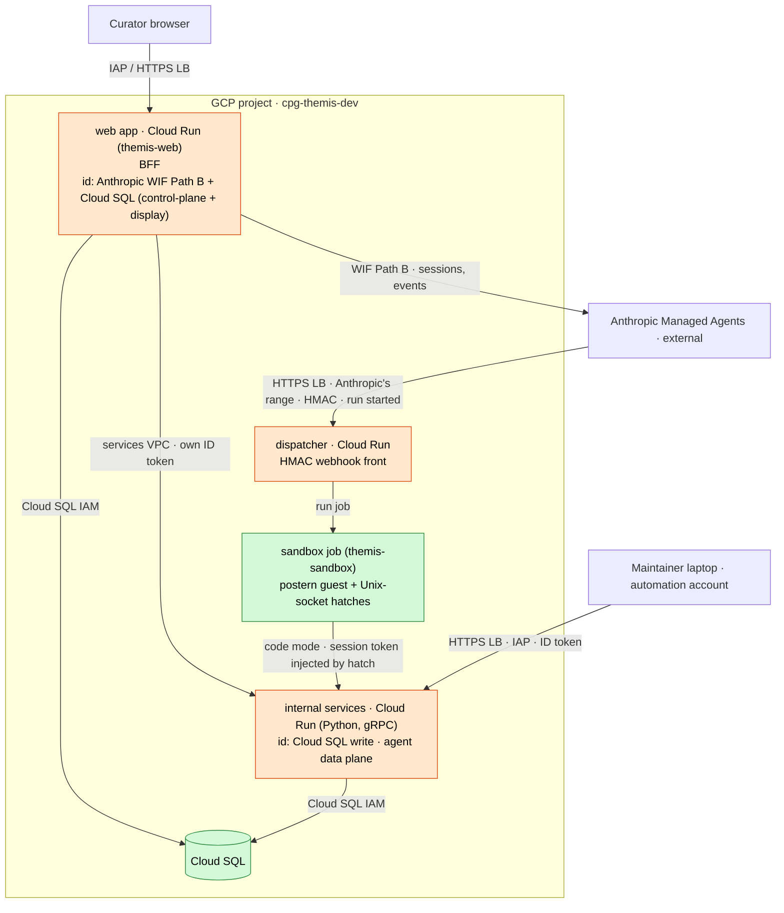

# Design: Spike infrastructure and deployment

**Related:** [`deployment.md`](deployment.md) (IaC tool, deploy authentication, state, and secrets management),
[`agent-runtime.md`](agent-runtime.md) (Managed Agents loop, sub-agents, and event stream), [`security.md`](security.md)
(public ingress rules, IAP boundary, and webhook authentication), [`sandbox-worker.md`](sandbox-worker.md) (self-hosted
sandbox worker, Unix-socket hatches, and per-session tokens),
[`../runbooks/fresh-environment.md`](../runbooks/fresh-environment.md) (bringing up a new environment),
[`../runbooks/iap-access.md`](../runbooks/iap-access.md) (IAP group membership and programmatic access).

## Overview

The Spike runs as a Cloud Run web application backed by Cloud SQL and Google Cloud Storage (GCS) behind Identity-Aware
Proxy (IAP), serving Centre for Population Genomics (CPG) curators from day one. Even though the Spike evaluates only
synthetic cases against public evidence sources, dog-fooding with real curators requires cloud infrastructure that is
reproducible from scratch, cost-observable, and isolated from CPG's production data estate.

Each environment (`dev` now, `prod` later) lives in its own dedicated GCP project inside the CPG GCP organization,
managed by one Pulumi stack per environment in [`infra/`](../../infra/). Curators authenticate through IAP against a
per-environment Google Group whose roster lives outside this repository, while workloads authenticate to GCP, Cloud SQL,
and Anthropic through Workload Identity Federation (WIF) and IAM so that only credentials without a WIF path live in
Secret Manager. Continuous integration validates pull requests without cloud access and posts a read-only
`pulumi preview`, while deployments build and push container images to a per-project Artifact Registry from deployable
refs. Anthropic Managed Agents runs the agent loop while tool calls execute in a self-hosted sandbox inside our project,
where internal gRPC services hold the GCP and Cloud SQL identities and mediate every write of agent-authored content.

## Background

The Spike architecture starts from four platform commitments:

- Cloud Run hosts the stateless services and scales to zero when idle.
- Cloud SQL for PostgreSQL stores structured application and control-plane data.
- GCS stores durable blobs and literature artifacts.
- IAP sits in front of the web application so the application is never open to unauthenticated internet traffic.

Every environment must be reproducible so an operator can bring up a fresh project without tribal knowledge, using the
bootstrap and stack configuration described in [`deployment.md`](deployment.md) and
[`../runbooks/fresh-environment.md`](../runbooks/fresh-environment.md). Plaintext secrets must never appear in the
repository or in logs; committed configuration may hold only Cloud KMS-encrypted ciphertext through the Pulumi secrets
provider. Finally, per-project budgets must bound infrastructure spend so runaway resources surface immediately.

## Non-goals

- Application code for the web tier and agent definitions, which are covered in
  [`frontend-framework.md`](frontend-framework.md) and [`agent-runtime.md`](agent-runtime.md).
- Integration with internal CPG systems (Talos, Metamist, and seqr), because the Spike queries public endpoints only.
- Multi-tenant isolation or external-customer billing and onboarding.
- Per-report authorization, curator roles, and Project membership, which are enforced inside the application rather than
  at the infrastructure perimeter.

## Design

### Per-environment GCP projects

The obvious way to stand up a prototype inside CPG is to reuse an existing development or data project. Sharing a
project with the data estate would couple the Spike's IAM bindings, service accounts, and audit logs to existing
datasets, making it harder to reason about what the prototype can reach.

Instead, each environment runs in a dedicated GCP project inside the CPG organization: `cpg-themis-dev` (project number
`698160839187`) now, and `cpg-themis-prod` later. One Pulumi stack per environment in [`infra/`](../../infra/) targets
its own project, so dev and prod share no GCP resources: each environment has its own project, access group, Pulumi
state bucket, Cloud KMS key, Secret Manager secrets, Cloud Run services, Artifact Registry repository, and budget.
Because both projects sit inside the CPG GCP organization, they still inherit organization-level IAM policies, central
billing, aggregated audit sinks, and Google Workspace single sign-on. The cost is a one-time project-creation and
bootstrap step per environment.

### IAP access gate and Google Group membership

Curators need browser access to the web application (`themis-web` in
[`infra/themis_infra/web.py`](../../infra/themis_infra/web.py)), and medium-term testers include external collaborators
whose Google accounts sit outside the `populationgenomics.org.au` domain. Gating IAP on the CPG Workspace domain would
block external curators, while listing individual user emails in this repository's Pulumi configuration would leak
personal identifiers onto the public mirror.

IAP therefore grants `roles/iap.httpsResourceAccessor` to a single per-environment Google Group
(`themis-dev-access@populationgenomics.org.au` in dev). This binding acts as a coarse gate that decides who may reach
the web application at the network edge; fine-grained roles, Project membership, and per-report authorization stay in
the application. The group and its membership are managed by pull request through CPG's Cloud Identity Pulumi setup in
[`cpg-infrastructure`](https://github.com/populationgenomics/cpg-infrastructure) (`gcp.cloudidentity.Group`), with the
member rosters held privately outside this repository. This repository records only the group email address in
`Pulumi.<stack>.yaml`, which is a non-PII principal safe for the public mirror. Because the group can hold external
Google accounts, access is governed by group membership rather than organization domain.

Curators without any Google identity would require Google Cloud Identity Platform (GCIP). We defer GCIP because all
initial Spike testers have Google accounts.

### Audit logs, backups, and data retention

Waiting until production to configure audit logging and backup locations leaves the team blind during dog-fooding and
risks discovering regional or cost surprises late. In particular, leaving Cloud SQL's backup location unset defaults to
the enclosing `asia` multi-region, which places database backups offshore.

Dev and prod therefore use the same audit and backup configuration from the start:

- Data Access audit logs are enabled in both environments for Secret Manager, Cloud KMS, Cloud SQL, and GCS alongside
  IAP and Cloud Run request logs. Logs route to a dedicated regional Cloud Logging bucket in `australia-southeast1` with
  Log Analytics enabled and a 90-day retention window, allowing operators to run SQL queries in place over secret and
  object access. Because Cloud Logging cost is dominated by ingestion (roughly $0.50/GiB) rather than storage retention
  past 30 days (roughly $0.01/GiB-month), we control cost by scoping or excluding high-volume `DATA_READ` entries rather
  than shortening the 90-day retention window.
- Reports are append-only for the life of the Spike. GCS buckets enable object versioning with a 30-day soft-delete
  window and no automatic deletion policy.
- Cloud SQL ([`infra/themis_infra/sql.py`](../../infra/themis_infra/sql.py)) runs daily automated backups retained for
  30 days and point-in-time recovery (PITR) retained for 7 days. Both backups and WAL logs are pinned to
  `australia-southeast2`, keeping data onshore in a separate regional failure domain from the primary instance in
  `australia-southeast1`.

Because the Spike holds only synthetic cases, we defer finite data-erasure and retention-expiry policies until
production carries real data.

### Keyless authentication and secret inventory

Storing long-lived passwords and API keys in Secret Manager creates rotation toil and widens the blast radius of a
leaked secret. Wherever a target service supports OIDC or IAM authentication, workloads authenticate without stored
secrets ([`deployment.md`](deployment.md)):

- Workloads call the Anthropic control plane via Workload Identity Federation
  ([`../runbooks/claude-api-wif.md`](../runbooks/claude-api-wif.md)).
- Services connect to Cloud SQL using IAM database authentication (`CLOUD_IAM_SERVICE_ACCOUNT`), eliminating database
  passwords.
- Workloads access GCP resources using their dedicated Cloud Run service accounts.
- The web application verifies the per-request IAP JWT assertion directly and keeps no session-signing key of its own,
  while IAP's browser flow uses a Google-managed OAuth client.
- Developers and scripts reaching the application without a browser impersonate the `themis-clu` service account and
  mint a short-lived JWT ([`../runbooks/iap-access.md`](../runbooks/iap-access.md)), gated by Google Group membership
  rather than a shared key.

Secret Manager ([`infra/themis_infra/secrets.py`](../../infra/themis_infra/secrets.py) and
[`infra/themis_infra/sandbox.py`](../../infra/themis_infra/sandbox.py)) holds only the four credentials that have no WIF
path:

| Secret                                    | Consumer                                  | Why stored                                                                                                                  |
| ----------------------------------------- | ----------------------------------------- | --------------------------------------------------------------------------------------------------------------------------- |
| OpenAlex API key                          | Literature ingestion and evidence service | OpenAlex meters keyless callers, so every work lookup sends a key.                                                          |
| Semantic Scholar API key (optional)       | Literature ID resolver                    | Raises the rate limit on bulk fallback lookups.                                                                             |
| `ANTHROPIC_ENVIRONMENT_KEY`               | Self-hosted sandbox dispatcher / worker   | Authenticates work-queue polling and result posting for one self-hosted environment (the interim cloud sandbox needs none). |
| Anthropic webhook signing key (`whsec_…`) | Self-hosted sandbox dispatcher            | Verifies the HMAC signature on incoming wake webhooks so the worker can scale to zero.                                      |

Because self-hosted sandboxes do not support Anthropic environment-variable vault credentials, internal services read
any third-party API keys host-side from Secret Manager rather than injecting them into the sandbox. All stored secrets
are scoped to a single environment and rotated on compromise or exposure according to provider policy.

### Cost budgets and token usage tracking

Infrastructure cost and LLM token spend are driven by different mechanisms and tracked separately.

For GCP infrastructure, each project reuses CPG's existing per-project budget alerts in `cpg-infra` (`cpg-themis-dev`
carries a ~$500/month budget), kept separate between dev and prod rather than re-created in this repository's Pulumi
program. Cloud Run services scale to zero when idle, leaving the Cloud SQL instance (provisioned on the smallest
shared-core tier in dev, since Cloud SQL cannot scale to zero) as the standing-cost floor.

For LLM token usage, per-report input, output, and cache token counts per agent are captured in the trace from the
Managed Agents session event stream (`span.model_request_end` in [`agent-runtime.md`](agent-runtime.md)) and rolled up
across reports into an internal engineering dashboard by agent and day. Token spend is an engineering and operational
signal, so it is omitted from the curator-facing report UI.

### CI/CD pipeline and service topology

As established in [`deployment.md`](deployment.md), GitHub Actions authenticates to GCP via GitHub OIDC and Workload
Identity Federation, and write deployments run only from a deployable ref (`main` or the admin-only `deployed/<env>`
branch) rather than automatically on pull-request merge.

Each stage of the pipeline ([`.github/workflows/`](../../.github/workflows/)) has a distinct responsibility:

1. **Pull requests (`preview.yml` and cloud-free checks):** CI runs linting, type-checking, and hermetic unit tests
   without cloud credentials, alongside a read-only `pulumi preview` job using a dedicated preview identity that posts
   the infrastructure diff as a pull-request comment. No pull-request job can mutate cloud state.
1. **Merge to `main` (`images.yml`):** CI re-runs the cloud-free checks and builds every service container image without
   pushing, catching broken Dockerfiles at merge time rather than during the next deployment.
1. **Deploy to dev (`deploy.yml`):** Pushing `deployed/dev` or dispatching the workflow on `main` builds the service
   images, pushes them to the per-project Artifact Registry (`cpg-themis-dev`), and runs `pulumi up` to roll the Cloud
   Run services to the new image digests. The version-controlled agent declaration
   (`agents/svcv4-classifier.agent.yaml`) and its skills are applied to the Anthropic control plane via
   `python -m tools.agents apply` (authenticating with WIF in `deploy.yml`, or with the `ant` CLI's `ant auth login`
   profile when run from `tools.agents` on a laptop).
1. **Promotion to prod (later):** A gated GitHub Environment with required approval copies the validated image digests
   from dev into prod's Artifact Registry without rebuilding and runs `pulumi up` against `cpg-themis-prod`, preserving
   full project isolation so prod never pulls from dev's registry at runtime.

The deployed system splits into separate Cloud Run services and jobs, each sized, scaled, and granted its own service
account identity in [`infra/__main__.py`](../../infra/__main__.py):

- **Web application (`themis-web`):** The IAP-fronted UI and backend-for-frontend (BFF), holding the Anthropic WIF
  client identity and its own Cloud SQL IAM login.
- **Internal gRPC services:** The agent's data plane, holding the GCP and Cloud SQL identities that mediate data access.
- **Dispatcher (`themis-dispatcher`) and sandbox job (`themis-sandbox`):** In the self-hosted phase, the dispatcher
  receives Anthropic's wake webhook and starts the single-container Cloud Run Gen2 sandbox worker job
  (`themis-sandbox`), which runs untrusted agent commands inside a network-isolated `postern` (`bubblewrap`) guest
  bridged to internal services over Unix-socket hatches ([`sandbox-worker.md`](sandbox-worker.md)).

Every public route to a Cloud Run service sits behind one external HTTPS load balancer, and every such route except the
dispatcher webhook passes through IAP. Curators reach `themis-web` through IAP in a browser. The internal data-plane
services accept traffic from `themis-web` and the sandbox over the internal services VPC, and expose an operator route
on the external load balancer where IAP admits only the `themis-clu` automation account for maintainers on a laptop.
Because Anthropic cannot present a GCP or IAP credential on webhook deliveries, the dispatcher authenticates each
webhook by its HMAC signature behind a Cloud Armor policy that admits only Anthropic's
[published outbound IP range](https://platform.claude.com/docs/en/api/ip-addresses)
([`security.md`](security.md#the-sandbox-dispatchers-webhook)). The public-ingress rule and its exceptions—which also
include the public PR-screenshots bucket and the Cloud SQL instance's public IP (gated by the Cloud SQL Auth Proxy and
IAM authentication)—are specified in [`security.md`](security.md#ingress-from-the-public-internet).

In the diagram above, orange nodes (`web`, `disp`, `svc`) are Cloud Run services with a route on the external load
balancer, while green nodes (`sandbox`, `sql`) have no load-balancer route (`sql` is reached over its Cloud SQL Auth
Proxy-gated public address).

### Cloud-backed local development and hermetic tests

Cloning the entire stack onto a developer laptop would require emulating Anthropic's Managed Agents loop and seeding
local copies of the literature and variant datasets. Because the agents and tools depend on real cloud data to produce
meaningful traces, local emulation adds maintenance overhead without adding signal. Conversely, pull-request CI has no
cloud access, so schema and business-logic tests must run hermetically without hitting GCP.

Local development therefore uses two fast paths against the shared `dev` environment alongside a cloud-free test
harness:

- **Tool and agent iteration:** Developers edit locally, push to `dev` through a dev-only fast path (applying the agent
  declaration via `python -m tools.agents`, which uses the `ant` CLI's `ant auth login` credentials on a laptop, and
  redeploying the internal services or sandbox worker to `dev`), run a session in the cloud, and inspect the resulting
  trace.
- **UI iteration:** Developers run the web application locally against `dev` Cloud SQL (over the Cloud SQL Auth Proxy
  using IAM authentication and TLS) and `dev` GCS so the UI renders real development data without database passwords,
  public database exposure, or local containers. Local UI runs skip IAP (which is a cloud-edge proxy) and inject a
  configured development user identity when a flow needs one.
- **Hermetic tests:** Pull-request CI and local tests run with no cloud access. Every service has an in-memory or
  local-filesystem adapter (`FixtureBackend`, `LocalBackend`) that runs as an ordinary host process without requiring
  Docker, so the local development and unit-test loop works inside the Docker-free Claude Code sandbox. The sandbox
  constraint is **Docker-free** (to avoid nested container issues in dev sandboxes), not emulator-free: a service
  emulator is fine where a test needs one. For adapter and migration tests that exercise real PostgreSQL and GCS wire
  semantics ([`conftest.py`](../../conftest.py),
  [`themis/testing/litcache_db.py`](../../themis/testing/litcache_db.py)), the test suite runs standard PostgreSQL
  (`postgres:16` via `testcontainers`, since Cloud SQL is managed PostgreSQL with no separate emulator) and
  `fake-gcs-server`, gated on a reachable Docker daemon (`docker_daemon`) so they run in CI and skip cleanly inside a
  Docker-free sandbox.

Sharing a single `dev` environment across the team means concurrent edits to database schemas, deployed services, or
agent definitions require team coordination. Full per-developer isolation would eliminate coordination but is
unnecessary overhead for the small Spike team; if shared `dev` becomes a bottleneck, the escape hatch is spinning up
per-developer GCP projects as additional Pulumi stacks rather than building partial in-project isolation. To prevent
schema drift on the shared database, schema migrations ([`migrations.md`](migrations.md)) are strictly forward-only and
applied to `dev` only through the CI deploy pipeline; unmerged schema changes are tested against the local PostgreSQL
test harness.

### Managed Agents runtime and execution sandbox

As decided in [`agent-runtime.md`](agent-runtime.md) and [`managed-agents.md`](managed-agents.md), Anthropic Managed
Agents runs the agent loop and emits the per-session event stream while `themis-web` acts as the thin session client.
The internal data-plane services do not depend on the agent runtime. Moving to a custom loop later would replace
`themis-web`'s session client and the dispatcher's webhook handling while leaving the data plane and the sandbox's gRPC
surface untouched. The remaining runtime dependency is Anthropic's Managed Agents API, which is in beta.

Where the agent's tools execute determines who enforces network egress and data access boundaries. We stage the sandbox
across two phases:

1. **Interim Anthropic-hosted cloud sandbox:** The initial bring-up runs inside Anthropic's hosted sandbox so the first
   end-to-end version comes online quickly, gated so that the self-hosted sandbox lands before any non-synthetic data
   enters the system. Because the web application, agent YAML, CI workflows, and internal data plane are
   sandbox-agnostic, moving from the cloud sandbox to self-hosted is additive rather than a rewrite.
1. **Self-hosted sandbox (`config: type=self_hosted`):** Tool execution moves into a Cloud Run Gen2 job container
   (`themis-sandbox`) inside our GCP project ([`managed-agents.md`](managed-agents.md),
   [`sandbox-worker.md`](sandbox-worker.md)), moving deny-by-default egress enforcement from Anthropic's boundary to our
   network-isolated `postern` guest and Unix-socket hatches.

Inside the self-hosted boundary, container hardening, credential isolation, and the host-side Unix-socket hatches
([`sandbox-worker.md`](sandbox-worker.md)) are specified alongside RPC exposure in
[`sandbox-rpc-exposure.md`](sandbox-rpc-exposure.md), while deploy-time agent configuration and encrypted model-ID
handling are specified in [`managed-agents.md`](managed-agents.md) and [`deployment.md`](deployment.md). At the
infrastructure IAM boundary, write permissions are split by which actor authored the data rather than read versus write:
the internal gRPC services are the sole writer of agent-authored content (binding every write to its Analysis via the
hatch-injected session token), while `themis-web` writes only the control-plane and session rows it owns (Analyses,
Project membership, per-session grants, and session-end trace projections) and curator-initiated GCS uploads. Admitting
an uploaded paper, web search result, or corpus record into an agent's context is a separate retrieval-trust question,
orthogonal to which service identity wrote the blob.

## Open questions

- **External group members and organization policy:** Confirm with CPG central infrastructure that external Google
  accounts can be added to `themis-<env>-access@populationgenomics.org.au` in Google Workspace, and verify that any
  `iam.allowedPolicyMemberDomains` organization policy permits external members inside an in-domain Google Group granted
  `roles/iap.httpsResourceAccessor`.
