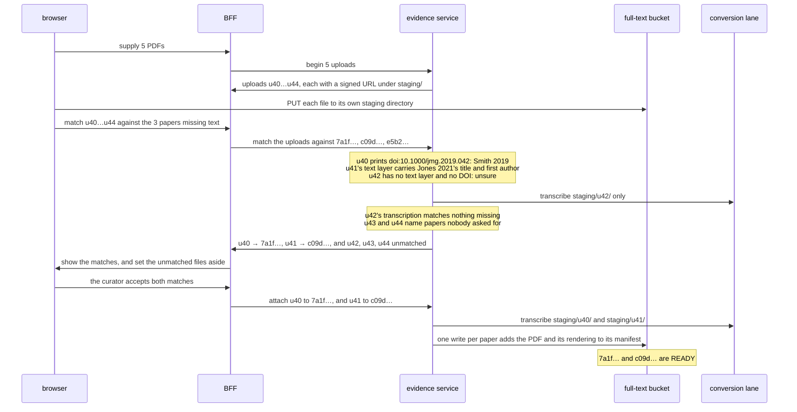

# Design: papers a curator supplies

**Related:** [`literature-evidence-layer.md`](literature-evidence-layer.md) (the interface that serves papers, and the
`doc_id` every reader keys on), [`evidence-fulltext.md`](evidence-fulltext.md) (how a paper's text is produced, and how
readiness is read off the store), [`litcache-manifest.md`](litcache-manifest.md) (what a paper's directory holds, and
the crosswalk the manifests rebuild), [`document-pane.md`](document-pane.md) (the pane the tab opens in, and how PDF
bytes move between the browser and the bucket), [`workbench-workspace.md`](workbench-workspace.md) (the Analysis
repository the literature list is kept in), [`sandbox-rpc-exposure.md`](sandbox-rpc-exposure.md) (how the agent's
literature calls reach the evidence service), [`rpc-authorization.md`](rpc-authorization.md) (how session and approval
tokens bind a call to an Analysis and a person).

## Overview

An agent reading the literature regularly needs papers that the store cannot fetch on its own. When the open-access
route finds no text, the paper settles as having none. A typical Analysis leaves a dozen or so papers in this state, and
the curator can usually get their PDFs through an institutional subscription. This doc decides how the curator sees
which papers an Analysis is missing, and how the PDFs the curator supplies reach the store.

Each Analysis keeps a list of the literature it used in a file inside its repository, written in the sandbox as the
agent works. The workbench renders that list as an **accessed literature** tab in the document pane. Each row shows one
paper and its state, so a paper with no text sits beside the readable ones. For the missing rows, the tab offers a link
to the publisher, a button that opens every missing paper's publisher page at once, and a drop target that takes a batch
of PDFs together.

Accepting the bytes is straightforward; the hard problem is deciding which paper each PDF belongs to. A publisher PDF
often carries identifiers embedded in its file metadata or printed on its first page, and those identifiers are wrong
often enough to corrupt the store if trusted. Writing a wrong identifier to the crosswalk is permanent: it claims that
identifier for the wrong paper, and it can merge two distinct works into one `doc_id`. Identifiers read from a PDF
therefore serve only as evidence when matching an upload to a candidate paper. Every identifier the store claims comes
from an external index record in PubMed or Crossref.

For the same reason, an uploaded file belongs to no paper when it arrives. When the curator drops a batch of PDFs onto
the tab, the evidence service matches them against the papers the Analysis is missing. It checks the free evidence
inside each PDF first, and it transcribes a PDF in a staging area outside the corpus only when that free evidence cannot
decide. Keeping uploads in staging preserves an invariant that several corpus readers rely on: every paper directory
under the corpus holds a claimed work. Once the curator accepts a match, the evidence service attaches the staged PDF
and its rendering to the paper in a single manifest write, and the paper becomes readable.

## Background

### How a paper is named and claimed

Every paper in the store is named by a **`doc_id`**, a random identifier that the store mints
([`literature-evidence-layer.md`](literature-evidence-layer.md#entering-the-full-text-store-through-maybeingestpapers)).
External identifiers (`doi:`, `pmid:`, `pmcid:`) map onto that `doc_id` through the Postgres **crosswalk**. Adding a row
to the crosswalk is a **claim**: it declares that the external identifier names that paper for every subsequent reader.
The store never retracts a claim, because retracting one would orphan every citation already made against the `doc_id`
it named.

Each paper's directory in the full-text bucket holds its **bibliographic record** (`metadata.pb`) and its **manifest**
(`manifest.pb`) ([`litcache-manifest.md`](litcache-manifest.md)). The manifest is the commit point: it lists the paper's
claimed identifiers, its source-file lineages and their licence terms, and its markdown renderings, and a paper exists
for readers as soon as its manifest is written. When a paper holds more than one rendering, the manifest names the
highest-fidelity one for readers to use. Because a rendering converted from XML outranks a PDF transcription, a better
rendering arriving later supersedes a worse one for new reads without deleting the older file, so citations made against
the older rendering keep resolving.

### How a paper ends up with no text

When an agent requests an external identifier via `MaybeIngestPapers`
([`schema/proto/themis/rpc/literature.proto`](../../schema/proto/themis/rpc/literature.proto)), the store resolves and
claims the paper if needed and schedules background conversion ([`evidence-fulltext.md`](evidence-fulltext.md)). If
neither open-access XML nor an open PDF is available, the worker writes a terminal **`NO_FULL_TEXT`** marker beside the
manifest (or **`FAILED`** on permanent conversion failure;
[`evidence-fulltext.md`](evidence-fulltext.md#readiness-is-read-off-the-store)). When a paper settles with no text, a
curator who holds institutional access to the PDF has no way to supply it unless an upload door exists.

### What a rendering costs

A **rendering** is the markdown file that a reader quotes from
([`evidence-fulltext.md`](evidence-fulltext.md#three-ways-to-get-a-papers-text)). Turning open-access XML into markdown
takes seconds at negligible cost. Transcribing a PDF with a vision model takes a minute or two and spends model tokens
on every attempt. Once a paper's manifest lists a rendering, its readiness reads **`READY`** regardless of any terminal
marker beside the manifest.

### How the agent's calls reach the store

The agent runs code inside an untrusted sandbox called the **guest**. The guest reaches the literature service through
its generated stub over the host **sandbox worker**'s gRPC **hatch**, which checks the method allowlist and attaches the
Analysis's session token ([`sandbox-worker.md`](sandbox-worker.md#the-hatch-is-the-capability-boundary),
[`sandbox-rpc-exposure.md`](sandbox-rpc-exposure.md)). A guest-side client interceptor observes calls on the default
stub, though untrusted guest code can bypass it by opening a raw channel to the hatch. On the browser side, requests
pass through the workbench **BFF**
([`schema/proto/themis/workbench/rpc/workbench.proto`](../../schema/proto/themis/workbench/rpc/workbench.proto)), which
authenticates as the web caller and attaches the open Analysis's session.

### The Analysis repository

Each Analysis has a sheaf git repository that holds `working_document.md` and the companion files beside it
([`sheaf.md`](sheaf.md), [`workbench-workspace.md`](workbench-workspace.md)). The agent clones this repository inside
the sandbox and pushes its commits back to the host, where a `pre-receive` hook validates each push before it lands. The
workbench reads and updates the repository to render the Analysis.

## Non-goals

- **Collections of hundreds of PDFs.** Depositing a maintained collection is an operator task with its own batch route
  ([`literature-evidence-layer.md`](literature-evidence-layer.md), "Supplied papers are ordinary papers"). This doc
  covers the dozen or so papers a single Analysis needs.
- **Supplementary files.** A curator dropping a paper's supplementary table is a real need, but attaching a companion
  file to a known paper raises none of the work-identity questions this doc solves. It can follow once supplementary
  files carry their own content hashes in the manifest.

## Design

The following trace follows one batch of five PDFs from the curator's drop to two readable papers. The agent has used
fourteen papers in an Analysis. Three have settled with no text, and the agent cites two of them in its working
document: Smith 2019 (`doc_id` `7a1f…`, `doi:10.1000/jmg.2019.042`) and Jones 2021 (`c09d…`). The curator opens the
accessed literature tab, clicks "open all missing", downloads the PDFs from the publishers, and drops five files from
their downloads folder onto the tab.



### The Analysis keeps a list of the literature it used, written in the sandbox

The curator needs to see which papers the run used and which of them had no text. The obvious source is the prose the
agent already writes in its working document, where it often lists the papers it wanted and could not read alongside its
reasons for wanting them.

A prose list in the working document is incomplete and goes stale. The agent mentions only the papers it remembers to
note, and a paper whose PDF arrives later stays listed as missing until the agent rewrites that paragraph. Keeping the
missing-paper list in prose also carries it into the published Report, where a workflow checklist does not belong.

The Analysis instead keeps a typed file in its repository with one entry per paper, holding the paper's `doc_id` and an
optional reason the agent gave for wanting it. A client interceptor on the guest's channel to the evidence service
writes to this file whenever `MaybeIngestPapers` returns a `doc_id` or a read call names one, so the list stays complete
without relying on the agent's memory. The agent can also edit the file directly to add a reason for a paper or remove a
paper it no longer relies on, which makes the list more useful to the curator.

Because the file orders what the curator sees rather than auditing what the agent read, letting the agent edit it costs
nothing. The session's event log already records every RPC call the agent made, and the working document's citations
record what the run's conclusions rest on independently of this file. A confused or hostile agent can at worst list
papers the run did not need, which it can already ask for in prose.

Because the file comes from the untrusted sandbox, the host treats it as untrusted output. The Analysis repository's
pre-receive check rejects any push containing a malformed literature list, just as it rejects a malformed widget asset
([`workbench-workspace.md`](workbench-workspace.md)). When rendering the list, the workbench ignores any `doc_id` the
store does not know. Every bibliographic field and publisher link in a row comes from the store's own record of the
paper, and the workbench renders the agent's reason as inert text.

The cost of writing the file inside the sandbox is that updates reach the workbench only when the agent commits and
pushes, since the sandbox worker never commits on the agent's behalf. An agent that bypasses the client interceptor or
never commits the file leaves the list incomplete, though the working document's citations still cover every paper the
argument cites.

### The accessed literature tab shows each paper's state, and the missing ones take PDFs

The workbench renders the literature list as a tab in the document pane ([`document-pane.md`](document-pane.md)). At
read time, it joins three sources: the repository file for which papers the run touched and why; the working document's
`:paper` and `:quote` directives for which papers the agent cited
([`literature-evidence-layer.md`](literature-evidence-layer.md), "Citing a paper"); and the store for each paper's
readiness and bibliographic record. Neither readiness nor citation status lives in the repository file, because both
change without the agent touching the file.

```
┌ Accessed literature ┐┌ Smith 2019 ┐
│ Missing text (3)                    [ Open all missing ↗ ]           │
│ ▸ Smith 2019 · J Med Genet · cited  "the only MOCS2B case series"  ↗ │
│ ▸ Jones 2021 · Hum Mutat  · cited                                   ↗ │
│ ▸ Kim 2018 · Clin Genet   · listed  "for the founder variant"       ↗ │
│ ┌──────────────────────────────────────────────────────┐             │
│ │   Drop PDFs here: they are matched to the papers above │             │
│ └──────────────────────────────────────────────────────┘             │
│ Readable (11)                                                        │
│ ▸ Lee 2020 · open access · cited                                     │
│ ▸ …                                                                  │
└──────────────────────────────────────────────────────────────────────┘
```

The tab orders missing papers by how heavily the run depends on them: cited papers come first, followed by papers listed
with a reason, and then papers listed without a reason. Both the "Open all missing" button and the drop zone default to
the first two groups. An agent triaging a search result can ingest thirty papers and rely on four, and the tab should
not ask the curator to fetch the other twenty-six.

Expanding a row reveals the paper's abstract so the curator can judge whether the paper is worth fetching. Each row's
external link points to the DOI resolver address from the paper's bibliographic record. A deployment can configure its
institutional library proxy prefix so that following the link lands the curator on the publisher's page already signed
in. A paper with a PMID and no DOI links to PubMed instead. Clicking "Open all missing" opens each paper's link in its
own browser tab; because browsers block a single click from opening multiple windows unless pop-ups are allowed for the
site, the button explains this the first time the browser blocks it.

Clicking a row also opens that paper's own tab in the document pane, which shows the same publisher link and accepts a
PDF drop scoped to that single paper. Dropping a file on a single paper's tab runs the same batch flow with a candidate
set of one. When the agent cites a paper with no text in the conversation, the citation renders as a chip that opens the
same paper tab.

Rendering this tab requires two additions to the literature RPCs that the web tier calls
([`schema/proto/themis/rpc/literature.proto`](../../schema/proto/themis/rpc/literature.proto)). First, `PollFullTexts`,
which reports readiness for a batch of papers and currently admits only the agent caller, must admit the web caller as
well. Second, `DescribePaper`, which the web tier uses to read a single paper, currently returns only the title and
available representations; it must also return the bibliographic summary (authors, journal, year, DOI, and abstract).

The tab is scoped to a single Analysis. A cross-Analysis view showing every missing paper across all Analyses a curator
belongs to is the same list filtered more broadly, and it waits on the deferred question of who may read an uploaded
paper (§"Who may read an uploaded paper is deferred until the user cohort is known"), because a cross-Analysis list is
the first surface that would place one Project's papers beside another's.

### An upload belongs to no paper until the curator accepts one

The obvious design ties each dropped file to a specific paper the moment the curator drops it. When a curator drops a
file onto a single paper's tab, the file is meant for that paper, and the backend check only needs to confirm the match.

Tying an upload to a paper up front breaks for a batch drop, which is the common case. Five files dropped onto the
accessed literature tab are meant for some subset of the missing papers on the list, and the curator has not said which
file is which. Even a single file dropped onto one paper's tab may turn out to be a different paper from the list that
the curator still wants to attach.

Every upload therefore gets its own `upload_id` from start to finish and holds no `doc_id`. The drop surface supplies a
set of **candidates**: every missing paper in the list when dropped on the accessed literature tab, or one specific
paper when dropped on that paper's tab. Matching assigns each upload to at most one candidate, and the evidence service
attaches the upload only to the paper the curator accepts.

### Only identifiers from an index record are claimed

A PDF can carry a DOI in its embedded XMP metadata, in its document-information dictionary, or printed on its first
page. The obvious approach is to read that DOI from the PDF and claim it in the crosswalk. That is cheap and usually
right, and the seed pipeline that built the initial corpus from a local PDF collection
([`../plans/literature-cache.md`](../plans/literature-cache.md)) does this when a PDF arrives without external metadata.

In a live store, identifiers inside a PDF are wrong often enough to matter, and every wrong claim is permanent.
Publishers frequently stamp embedded metadata from templates, leaving a PDF with the DOI of the journal itself, of a
supplement issue, or of a neighbouring article in the same issue. Suppose `smith2019.pdf` is the article
`doi:10.1000/jmg.2019.042`, but its embedded `prism:doi` field reads `doi:10.1000/jmg.2019.041`, the preceding article
in that issue. Claiming the embedded DOI in the crosswalk would bind article `041` to Smith's text for every subsequent
reader. Worse, if article `041` is already claimed by another `doc_id`, claiming it again would merge the two works into
one. The store has already encountered this failure mode when a seed file whose conversion metadata named another
paper's DOI was routed to the wrong paper's `doc_id` ([`litcache-manifest.md`](litcache-manifest.md), "Path layout").

The store therefore claims only identifiers that come from an external index record. When an upload attaches to a paper
from the Analysis's list, the paper keeps the identifiers it already claimed at ingest, and the attach claims nothing
new. Identifiers extracted from the PDF are used only as evidence to match the upload against candidate papers. A match
that comes out wrong costs the curator one glance to reject; a crosswalk claim that comes out wrong is permanent.

The cost of this rule falls on a PDF whose only identifier is printed or embedded inside the file itself. Such a PDF
cannot become a paper in the store until a PubMed or Crossref record confirms its identity and the curator accepts that
record.

### An upload is staged outside the corpus until its identity is settled

Matching sometimes requires transcribing a PDF, and waiting for the curator's acceptance requires a place in the bucket
to hold an upload that does not yet belong to any paper. The obvious place is a directory under `papers/` with a
provisional `doc_id` and no crosswalk row, which the existing conversion lane could process unchanged. Putting unclaimed
uploads under `papers/` breaks an invariant the rest of the corpus relies on: every manifest under `papers/` belongs to
a claimed paper.

- Rebuilding the crosswalk scans every manifest under `papers/`. A rebuild would claim the provisional directory's
  identifiers in Postgres, making the exact unverified claim the previous section forbids.
- Every read RPC that takes a `doc_id` would serve the provisional paper's text, allowing the agent to read and quote a
  paper whose identity nobody has accepted.
- Every batch scan of the corpus, from coverage reports to manifest migrations, would need a special case to skip
  unclaimed directories.

Each upload therefore lives under a separate prefix in the same bucket, `staging/{upload_id}/`, using the same file
layout: the uploaded PDF, any rendering produced from it, and a small staging manifest, all content-addressed. Nothing
that reads the corpus lists `staging/`. The conversion lane transcribes a staging directory the same way it transcribes
a paper directory, which means the conversion producer takes a bucket prefix to work on rather than a `doc_id`. A bucket
lifecycle rule deletes each `staging/{upload_id}/` directory a few weeks after its last modification, so unmatched or
abandoned uploads need no manual cleanup.

The cost of staging outside `papers/` is a second bucket prefix with its own lifecycle rule, a conversion producer
parameterised by directory path rather than `doc_id`, and an attach step that copies staged objects into
`papers/{doc_id}/` (§"Accepting attaches the staged PDF and rendering in one write").

### A batch is matched cheaply first, and transcribed only where that cannot decide

To match a batch, the evidence service compares each upload with each candidate's bibliographic record (title, first
author, and DOI). Evidence inside the PDF comes in two cost tiers. Reading what the PDF says about itself is free: an
embedded DOI, a DOI printed in the PDF's text layer, and the title and authors carried in the text layer. Most modern
publisher PDFs settle at this free tier. Running a vision-model transcription produces clean text for any PDF, including
scanned pages, but costs model spend. The evidence service therefore transcribes an upload during matching only when its
free evidence is inconclusive and the upload could still match a candidate. An upload whose free evidence clearly names
a work outside the candidate set is not transcribed at all.

This two-tier ordering makes it safe for a curator to drop an entire downloads folder onto the tab. Dropping three
hundred PDFs costs three hundred fast text-layer reads and a handful of transcriptions rather than three hundred vision
transcriptions.

| Upload, against the three missing papers                                      | Outcome                                                                                 |
| ----------------------------------------------------------------------------- | --------------------------------------------------------------------------------------- |
| First page prints `doi:10.1000/jmg.2019.042`; title and first author agree    | **Match** with Smith 2019, accepted with one click                                      |
| Embedded DOI reads `…041`; printed DOI, title and author agree with `…042`    | **Match** with Smith 2019; the embedded DOI is the template error above, and is noted   |
| Text layer carries a candidate's title, but prints a different article's DOI  | **Conflict.** Both records are shown; the curator overrides or sets the file aside      |
| A 1994 scan with no text layer; its transcription carries a candidate's title | **Unsure** until the curator compares the staged first page with the record and decides |
| Text layer names a paper that is not missing, or none at all                  | **Unmatched.** Set aside; nothing is transcribed or claimed                             |
| Two uploads both match Jones 2021                                             | Byte-identical ones collapse into one; otherwise the curator chooses which to attach    |

A DOI printed on the page outranks an embedded DOI, because a human typeset the page while templates populate embedded
fields. A conflict is never settled automatically in either direction — whether between printed and embedded identifiers
or between the PDF and the bibliographic record. PubMed and Crossref occasionally carry erroneous records of their own,
so a curator looking at the PDF's first page beside the index record is better placed to judge than a static rule.

The workbench sets an unmatched upload aside rather than offering to ingest it as a new paper, so a curator who drags in
their whole downloads folder does not ingest unrelated files by accident. When the curator wants to supply a paper that
is not on the missing list, they drop that PDF on its own outside the list (§"A PDF nobody asked for is identified from
an index record").

Two future refinements can make large folder drops cheaper still without changing the matching rules. First, the browser
could read a local folder the curator selects, extract each PDF's DOI and title locally using the PDF library that the
document pane already bundles, and upload only the files that could match a candidate. Second, curators do not need to
rename files before dropping them, because matching inspects the PDF's content rather than its filename.

### A PDF nobody asked for is identified from an index record

A PDF dropped outside the missing-literature list arrives with no candidate papers. To identify it, the evidence service
looks up the PDF's printed or embedded DOI in Crossref and searches its title and first author in PubMed and Crossref.
Each result is an external index record. The workbench displays those index records beside the PDF's first page, and the
curator chooses the matching record or rejects them all.

Once the curator chooses an index record, the evidence service ingests it as if the agent had requested it: the store
resolves the record, claims its identifiers in the crosswalk, and mints a `doc_id` (or locates the `doc_id` that already
claims it). That paper becomes the upload's sole candidate, and matching proceeds as usual.

The browser does not call `MaybeIngestPapers` directly to do this. `MaybeIngestPapers` admits only the agent caller, and
each call can make a permanent crosswalk claim and trigger a paid conversion. Opening `MaybeIngestPapers` to the web
caller would give the browser an unrestricted endpoint for claiming arbitrary identifiers. Instead, the literature
service exposes two dedicated upload RPCs for searching and claiming, and both operate on an existing `upload_id` rather
than on arbitrary strings from the browser. The search RPC queries PubMed and Crossref using only the evidence extracted
from that staged upload, so the browser does not gain a general search endpoint. The claim RPC accepts only an index
record that the search RPC returned for that `upload_id`, checked under the same person and Analysis binding as every
other upload call (§"An upload is bound to the person and the Analysis that began it"). Behind that guard, the evidence
service runs the same ingest path as `MaybeIngestPapers`, so a paper brought in through an upload is claimed and
converted identically to one the agent requested.

A newly claimed paper starts in `PENDING` while the conversion lane checks for open-access text. The staged upload waits
for that conversion attempt to settle, because the outcome decides whether the uploaded PDF is needed. If the paper
turns out to have open-access XML, the conversion lane renders that XML and the evidence service sets the upload aside,
because an attach writes only to a paper that has no text (§"An upload is bound to the person and the Analysis that
began it"). If the paper settles at `NO_FULL_TEXT`, the evidence service transcribes the staged upload and attaches it
just like an upload for a paper on the missing list. While waiting for the open-access check, matching reads only the
PDF's free evidence (its embedded or printed DOI and the title and authors in its text layer), so the store never pays
to transcribe an upload for a paper that turns out to be open access.

For example, suppose a curator drops `brown2022.pdf` outside the list. Its text layer prints
`doi:10.1000/ajhg.2022.311`, Crossref returns that article's record, and the curator selects it. The ingest path assigns
the paper a `doc_id`, and the conversion lane finds open-access XML and renders it, bringing the paper to `READY`. The
evidence service sets the staged upload aside, and the tab informs the curator that the paper is already readable from
the publisher's open-access text without transcribing or attaching the PDF.

### Accepting attaches the staged PDF and rendering in one write

A paper that reached the missing list with `NO_FULL_TEXT` or `FAILED` has already exhausted the open-access route. When
the curator accepts an upload for it, the conversion lane transcribes the staged PDF if the matching step has not
transcribed it already. The evidence service then copies the staged PDF and its rendering into `papers/{doc_id}/` and
adds both to `manifest.pb` in a single generation-matched read-modify-write, using the same compare-and-swap every
manifest update uses ([`evidence-fulltext.md`](evidence-fulltext.md), "Write-back is a generation-matched
compare-and-swap"). In `manifest.pb`, the PDF becomes a new `Revision` (with `kind = SOURCE_KIND_UPLOAD`) on a PDF
`Source` lineage whose `access` oneof is set to `institution_captured`
([`schema/proto/themis/litcache/models/litcache.proto`](../../schema/proto/themis/litcache/models/litcache.proto)). The
rendering is recorded as derived from that PDF revision by the same converter that ran in staging, so no upload is
transcribed twice.

Once the manifest lists the new rendering, the paper's readiness reads `READY`, and the `NO_FULL_TEXT` marker beside the
manifest ceases to affect readiness without needing to be deleted. The paper's row in the accessed literature tab moves
to the readable section. When the agent reads the paper, the response reports `TEXT_PROVENANCE_SUPPLIED` rather than
open-access provenance ([`schema/proto/themis/rpc/literature.proto`](../../schema/proto/themis/rpc/literature.proto)),
so the run's record reflects where the text came from.

Because the agent learns that a paper became readable only when it polls again, an agent that has moved on to another
task might never notice the newly attached papers. Once a batch is attached, the tab therefore offers a button that
sends the agent a steering turn ([`conversation-view.md`](conversation-view.md), `Steer` in
[`schema/proto/themis/workbench/rpc/workbench.proto`](../../schema/proto/themis/workbench/rpc/workbench.proto)) naming
the newly readable papers with their `:paper` directives. The curator clicks the button when they want the run to
revisit those papers, and the agent weighs that message like any other steering turn from the curator.

At the storage layer, attaching is an ordinary manifest update that appends one PDF revision and one rendering. Because
every rendering file is named by the content hash of its markdown bytes, the rendering keeps the filename it had under
`staging/{upload_id}/` and requires no rewrite when copied into `papers/{doc_id}/`. Readers receive the transcription
because it is the only rendering the paper has; if open-access XML becomes available for the paper later, the XML
rendering outranks the transcription and readers switch to it automatically
([`litcache-manifest.md`](litcache-manifest.md)).

### The bytes go straight to the bucket

A publisher PDF can run to tens of megabytes, which exceeds the comfortable size of a gRPC message and would grow
further under proto3-JSON base64 encoding. The document pane already avoids proxying PDF bytes on the read path by
redirecting the browser to a short-lived signed GCS URL ([`document-pane.md`](document-pane.md)). Uploads use the same
pattern in reverse.

To start a batch, the evidence service mints one `upload_id` per file along with a signed GCS URL that permits a single
`PUT` of a bounded-size PDF into `staging/{upload_id}/`. Starting an upload names no paper. The browser uploads each
file directly to GCS, and every subsequent RPC refers to the uploaded files by their `upload_id`s:

- **Match** takes a list of `upload_id`s and a list of candidate `doc_id`s.
- **Search** (for an upload dropped outside the list) takes an `upload_id` and returns matching index records.
- **Claim** takes an `upload_id` and one index record returned by that upload's search.
- **Attach** takes an `upload_id` and the `doc_id` the curator accepted.

These new RPCs on the `Literature` service
([`schema/proto/themis/rpc/literature.proto`](../../schema/proto/themis/rpc/literature.proto)) admit only the web
caller, so the agent cannot upload files.

Each signed URL enforces two GCS conditions: an `x-goog-if-generation-match: 0` create-only precondition so a second
`PUT` to the same object is rejected, and a `content-length-range` header so GCS refuses an oversized upload before its
bytes land.

Minting these signed URLs requires no new IAM grant. The evidence service's service account already has write access to
the full-text bucket ([`evidence-fulltext.md`](evidence-fulltext.md), "An id the corpus does not hold is brought into
the store"), and signing a URL for `staging/` exercises that same permission.

### An upload is bound to the person and the Analysis that began it

Restricting the upload RPCs to the web caller controls which service may call them, but it does not restrict whose
upload a call may act on or which paper an attach may modify. Without per-upload and per-paper checks, a caller who
learned the identifier `u42` could transcribe it at another Analysis's expense, read its staged rendering, or attach it
to a paper nobody accepted it for.

When the evidence service begins an upload, it binds the `upload_id` to both the person who dropped the file and the
Analysis in which they dropped it, and every subsequent upload call must present the same pair. The BFF supplies the
Analysis via the session token for the Analysis the browser has open. The BFF supplies the person via an approval token
minted when the curator drops the files, using the mechanism [`rpc-authorization.md`](rpc-authorization.md) defines for
calls made on a person's behalf. Because the evidence service resolves the approval token to the person's identity, no
caller can forge a user assertion. Any match, search, claim, or attach call that presents a different person or Analysis
is rejected.

In addition, an attach call may write only to a paper whose current readiness is `NO_FULL_TEXT` or `FAILED`. A paper
that already has readable text in the store can never receive a curator's PDF through this route, so an upload cannot
displace text that another Analysis relies on. The evidence service checks this rule against the paper's manifest in the
store rather than against the Analysis's literature list, which the agent can edit. Every source revision written by an
attach also records its depositor, so an operator can find every file a given person supplied.

The evidence service evaluates this readiness guard when it writes `manifest.pb` rather than when the attach call
starts. Because an attach can spend a minute or two transcribing the staged PDF before writing, another curator's upload
or newly discovered open-access XML can make the paper readable in the meantime. The attach therefore checks the
manifest inside the generation-matched read-modify-write that commits the update. If the manifest read inside that loop
already lists a rendering, the attach aborts instead of retrying as an ordinary compare-and-swap conflict would: the
evidence service sets the upload aside, and the tab tells the curator that the paper became readable another way. The
vision transcription spent during that window is the cost of a rare race.

Recording the depositor on each revision makes an erroneous attachment findable, though not yet automatically
reversible; how to withdraw a revision that existing citations already point to remains an open question below.

### Who may read an uploaded paper is deferred until the user cohort is known

An uploaded paper lands in the shared full-text corpus that every Project in the deployment reads. At the same time,
[`../PRODUCT.md`](../PRODUCT.md) §7 states that licensed literature is never shared across institutional boundaries.

[`rpc-authorization.md`](rpc-authorization.md) designs the authorization check that ties an RPC call to the human user
behind it, which it calls the **person axis**: the service resolves the person from a browser approval token, just as
the previous section does. That doc holds off enabling the person axis for **acquisitions**—calls that bring a paper
into the corpus using a person's institutional access—because nothing yet prevents a newly acquired paper from being
read by Projects whose institutions hold no licence for it. Preventing cross-institution reads requires **masking**, a
per-Analysis view of the corpus that hides papers outside the Analysis's institutional licences, and masking is not yet
built. A curator's PDF upload is an acquisition: `smith2019.pdf` entered the corpus through the curator's institutional
subscription.

That institutional boundary only binds when a deployment's users hold different access rights, and today every user of a
deployment shares them, so serving an uploaded paper across the deployment crosses no institutional line. Which
constraints apply depends on who the users will be: which institutions they belong to, and on what terms each
institution holds its subscriptions. That is not yet known, and a scoping mechanism designed before it is known would be
designed against guesses. So the question is deferred until the user cohort is known, and uploaded papers are served to
every Project in the deployment until then. Turning on the person axis for uploads binds each upload to its depositor,
which the previous section requires, and not to scope what anyone reads.

The cost is that a deployment taking on users with different access rights has to settle this question before those
users arrive. Recording the depositor on every attached revision is what makes that tractable later: each supplied paper
can be traced to the person and institution whose access brought it into the store.

### The bucket holds the only copy of an uploaded PDF

Papers deposited from a maintained institutional collection have that external collection as their authoritative copy,
so recovering a lost file means re-running its deposit. A PDF that a curator drops from their browser downloads folder
has no external collection behind it. For an uploaded paper, the full-text bucket is the sole authority. Its objects are
content-addressed and never overwritten, and GCS object versioning on the bucket provides the recovery window for
accidental deletions.

The cost is that an uploaded paper cannot be reconstructed from sources outside the bucket, so any full rebuild of the
corpus must preserve uploaded papers rather than wiping and re-seeding their directories.

## Alternatives considered

- **Draw the list as a working-document widget instead of a tab.** A widget embedded in the working document would read
  the same repository file, join each paper's state at render time, and write back to the Analysis repository from the
  browser just like other widgets, requiring no extra work from the agent. It would appear inline where the agent's
  prose discusses the missing papers. The difference is reachability: the tab in the document pane is always present
  whether or not the agent embeds a directive, whereas a widget appears only where the agent places it. The tab is
  chosen for that predictable placement, and because both surfaces read the same repository file, an inline widget can
  be added alongside the tab later.
- **Record access host-side, in the sandbox worker's hatch.** Because every literature RPC from the guest passes through
  the hatch, a host-side recorder would be complete and tamper-proof. It lost because the literature list orders papers
  by relevance for the curator while the session event log already provides the tamper-proof audit trail. Having the
  host write to the Analysis repository would also introduce a second git writer racing the agent's pushes and adding
  host-generated commits to the Analysis history.
- **Claim the identifiers the PDF carries.** Trusting the DOI inside the PDF requires no index lookup and no curator
  confirmation, and for a well-formed publisher PDF it produces the right answer. It lost because its failures are
  silent and permanent: a template-stamped DOI becomes a crosswalk claim that nobody notices until a citation resolves
  to the wrong article.
- **Stage uploads under `papers/` with a provisional `doc_id` and no crosswalk row.** Reusing `papers/` would let the
  conversion lane run without change and reduce attachment to writing a crosswalk claim. It lost because crosswalk
  rebuilds, every read RPC that accepts a `doc_id`, and every corpus scan would each have to learn that some manifests
  under `papers/` are unclaimed.
- **Transcribe every upload before matching.** Transcribing up front would give the matcher clean text for every file,
  including scanned PDFs. It lost because a curator dropping a large downloads folder would pay for a vision-model
  transcription on every unrelated file in the folder.
- **Send the PDF bytes through the BFF.** Sending the files and candidate list in a single RPC through the BFF would
  avoid minting signed GCS URLs. It lost for the same reasons the document pane rejected proxying bytes on the read
  path: Cloud Run buffers the request body, and Connect inflates binary payloads as base64.
- **Let a model judge the match.** Having a model compare the staged first page against the index record would handle
  garbled author lists more gracefully than string comparison, and the matcher may yet use a model for that comparison.
  Even so, a model cannot replace the curator's decision on a conflict, because PubMed or Crossref records can be wrong
  and a model shown two conflicting sources cannot know which one is authoritative.

## Open questions

- **A paper no index holds.** A thesis, conference abstract, or older technical report may have neither a DOI nor a
  PMID, leaving no external index record to claim from. Under the rule that every claim comes from an index record, the
  store cannot ingest such a document. The store could instead claim the work solely by the SHA-256 hash of its PDF
  bytes—as the seed pipeline already does for PDFs without recognisable identifiers—using the curator's entered citation
  details in place of an index record. Whether a curator's attestation is sufficient to mint a paper with no index
  record remains open.
- **Licence and access metadata.** An uploaded PDF's `Source` lineage is recorded with its `access` oneof set to
  `institution_captured`, but a `Source` in `manifest.pb` also records a `licence` string and its `licence_basis`,
  neither of which has an honest default for an ad-hoc upload. Whether the curator states the licence at drop time or
  each deployment configures an institutional policy default is open.
- **Withdrawing a wrong attachment.** A curator who accepts a match for the wrong PDF makes the wrong text readable to
  every Analysis. Because every attached revision records its depositor, an operator can find the bad revision, but
  removing it requires deciding what happens to citations already made against its rendering: whether those citations
  stop resolving or resolve with a warning that the underlying text was withdrawn.
- **How the agent learns to give reasons.** The client interceptor keeps the literature list complete without the
  agent's help, but the tab's ordering relies partly on the optional reasons the agent writes into the file. Whether a
  short instruction in the guiding prompt is sufficient to get the agent to maintain those reasons is open.
