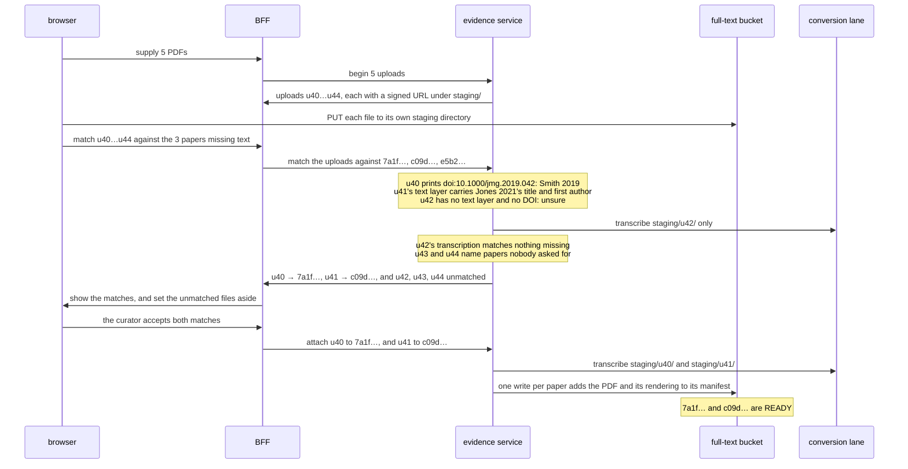

# Design: papers a curator supplies

**Related:** [`literature-evidence-layer.md`](literature-evidence-layer.md) (the interface that serves papers, and the
`doc_id` every reader keys on), [`evidence-fulltext.md`](evidence-fulltext.md) (how a paper's text is produced, and how
readiness is read off the store), [`litcache-manifest.md`](litcache-manifest.md) (what a paper's directory holds, and
the crosswalk the manifests rebuild), [`document-pane.md`](document-pane.md) (the pane the tab opens in, and how PDF
bytes move between the browser and the bucket), [`workbench-workspace.md`](workbench-workspace.md) (the Analysis
repository the literature list is kept in), [`sandbox-rpc-exposure.md`](sandbox-rpc-exposure.md) (how the agent's
literature calls reach the evidence service).

## Overview

An agent reading the literature regularly needs papers the store cannot get. The open-access route finds no text, and
the paper settles as having none. The curator can usually get the PDF through their institution, and a typical Analysis
leaves a dozen or so papers in this state. This doc decides how the curator sees which papers those are, and how their
PDFs reach the store.

The Analysis keeps a list of the literature it used, written in the sandbox as the agent works. The workbench shows that
list as an **accessed literature** tab in the document pane. Each row is a paper with its state, so a paper with no text
is one row among the others. For those rows the tab offers a link to the publisher, a button that opens every missing
paper's page at once, and a place to drop the PDFs, all of them together.

Taking the bytes in is the easy part. The hard part is deciding which paper each PDF is. A PDF carries identifiers of
its own, embedded by the publisher or printed on its first page, and they are wrong often enough to matter. A wrong one
written to the crosswalk is permanent: it claims an identifier for the wrong paper, and it can join two papers into one.
So identifiers read from a PDF are only ever evidence for a match. The identifiers the store claims always come from an
index record, PubMed's or Crossref's.

For the same reason, an upload belongs to no paper when it arrives. A batch dropped on the tab is matched against the
papers the Analysis is missing, using what each PDF says about itself and, where that cannot decide, a transcription
made in a staging area outside the corpus. Nothing under the corpus's paper directories is ever unclaimed, which is a
property several readers of the corpus depend on. Once the curator accepts a match, the staged PDF and its rendering are
attached to the paper in one write, and the paper becomes readable.

## Background

### How a paper is named and claimed

Every paper in the store is named by a **`doc_id`**, a random identifier the store mints. External identifiers such as a
DOI, a PMID or a PMCID map onto it through the **crosswalk**, a table in Postgres. Adding a row to the crosswalk is a
**claim**: it says this DOI is this paper, for every reader from then on. A claim is never retracted, because retracting
one would orphan every citation already made against the `doc_id` it named.

Each paper's files live in a directory in the full-text bucket named by its `doc_id`. The directory's **manifest** is
the commit point: it lists the paper's identifiers, its source files and its renderings, and a paper exists for readers
exactly when its manifest does ([`litcache-manifest.md`](litcache-manifest.md)). Beside the manifest sits the paper's
**bibliographic record**, its title, authors, journal and abstract as PubMed or Crossref published them. The crosswalk
can be rebuilt from the manifests alone, because every identifier a manifest lists is one the crosswalk claimed.

A paper's source files are recorded by kind: its PDFs form one **lineage**, its publisher XML another. Each fetch or
upload of a file adds a **revision** to its lineage, and the lineage records the licence and access terms the file came
with. A paper can hold several renderings at once, for example one transcribed from a PDF and a later one converted from
XML. The manifest names the one readers get, chosen by fidelity: a rendering converted from XML outranks a
transcription. So a better rendering arriving later replaces a worse one for readers without deleting it, and citations
made against the older rendering keep resolving.

### How a paper ends up with no text

The agent asks for a paper by an external identifier through `MaybeIngestPapers`. If the store does not hold the paper,
the call checks the identifier against PubMed or Crossref, claims it, and commits a manifest that holds the identifiers
and nothing else ([`evidence-fulltext.md`](evidence-fulltext.md)). A conversion lane then tries to produce the paper's
text. It fetches open-access XML if any exists, or transcribes a PDF the paper holds. When neither exists, the lane
writes a terminal **NO_FULL_TEXT** marker beside the manifest, and the paper's readiness reads NO_FULL_TEXT from then
on. A conversion that fails for good writes **FAILED** instead.

That is where the agent is left today. It can say in prose that it could not read the paper, and it often lists such
papers in its working document. The curator, who may have institutional access to them, has no way to hand them over.

### What a rendering costs

A **rendering** is the markdown a reader quotes from. Open-access XML is converted to markdown in seconds and for
nothing. A PDF is transcribed by a vision model, which takes a minute or two and costs model spend on every attempt. A
paper's readiness is READY as soon as its manifest lists a rendering, whatever marker sits beside it.

### How the agent's calls reach the store

The agent runs code in a sandbox, the **guest**, which is untrusted: everything in it is driven by the model. The
guest's only way out is a channel to a **hatch**, which the **sandbox worker** runs on the host. The worker is our code,
trusted, and it forwards each allowed call to the service it names, adding the Analysis's session
([`sandbox-rpc-exposure.md`](sandbox-rpc-exposure.md), [`sandbox-worker.md`](sandbox-worker.md)). So the agent's
literature calls go from a generated client stub in the guest, through the hatch, to the evidence service. A client
interceptor in the guest sees every call and its answer before the agent's code does, but it runs inside the untrusted
side and can be bypassed by code that builds its own channel.

The browser reaches the same services through the workbench's **BFF** (backend-for-frontend), the server behind the
browser. The BFF calls as itself, and can add the session of the Analysis the browser has open.

### The Analysis repository

Each Analysis has a git repository that holds its working document and the files the agent writes beside it
([`workbench-workspace.md`](workbench-workspace.md)). The agent works in a clone of it inside the sandbox and pushes its
commits back. The workbench reads the repository to draw the Analysis, and a push is checked on its way in, so a file
the workbench depends on can be refused if it is malformed.

## Non-goals

- **Collections of hundreds of PDFs.** Depositing a maintained collection is an operator's job and has its own route
  ([`literature-evidence-layer.md`](literature-evidence-layer.md), "Supplied papers are ordinary papers"). This doc is
  about the dozen or so papers one Analysis needs.
- **Supplementary files.** A curator dropping a paper's supplementary table is a real need, but attaching a file to a
  paper raises none of the identity questions this doc is about. It can follow once supplementary files carry their own
  content hash in the manifest.

## Design

One batch, traced end to end. The agent has used fourteen papers in an Analysis. Three have no text, and the agent cites
two of them in its working document: Smith 2019 (`doc_id` `7a1f…`, `doi:10.1000/jmg.2019.042`) and Jones 2021 (`c09d…`).
The curator opens the accessed literature tab, clicks "open all missing", downloads the PDFs, and drops five files from
their downloads folder onto the tab.



### The Analysis keeps a list of the literature it used, written in the sandbox

The curator needs to know which papers the run used and which of them it could not read. The obvious source is what the
agent writes about it. The agent already lists, in its working document, the papers it wanted and could not get. That
list is in the place the curator reads, and it carries the agent's reasons.

A list in prose is incomplete, though, and it goes stale. The agent mentions the papers it remembers to mention, and a
paper that arrives later stays listed as missing until the agent rewrites the paragraph. The list also ends up in the
Report, where a record of missing PDFs does not belong.

So the Analysis keeps a typed file in its repository: one entry per paper, each a `doc_id` with an optional reason the
agent gives for wanting it. The file is written in the sandbox. A client interceptor on the guest's channel to the
evidence service records every `doc_id` that `MaybeIngestPapers` returns or a read names, so the list is complete
without the agent remembering. The agent may also edit the file. It can give a reason for a paper, or drop one it no
longer relies on, and either makes the list more useful to the curator.

The list is not an audit trail, so letting the agent edit it costs nothing. The session's event log already records
every call the agent made, and the working document's citations say what the run actually rests on, independently of
this file. A hostile or confused agent can at worst list papers the run did not need, which it can already ask for in
prose.

The file is the agent's output, so it is treated as untrusted. A push that carries a malformed file is refused by the
repository's content check, as a malformed widget asset is. The workbench ignores a `doc_id` the store does not know.
Everything a row shows, the publisher link included, comes from the store's own record of the paper, and a reason is
drawn as inert text.

The cost is that the file reaches the workbench only in the agent's own commits, since the sandbox worker never commits
on the agent's behalf. An agent that calls the generated stubs without the interceptor, or never commits the file,
leaves the list short. The working document's citations still cover what the run relies on.

### The accessed literature tab shows each paper's state, and the missing ones take PDFs

The workbench draws the list as a tab in the document pane. It joins three sources at read time: the file, for which
papers and why; the working document's `:paper` and `:quote` directives, for which papers are cited
([`literature-evidence-layer.md`](literature-evidence-layer.md), "Citing a paper"); and each paper's readiness and
bibliographic record from the store. Neither readiness nor citation is stored in the file, because both change without
the agent touching it.

```
┌ Accessed literature ┐┌ Smith 2019 ┐
│ Missing text (3)                    [ Open all missing ↗ ]           │
│ ▸ Smith 2019 · J Med Genet · cited  "the only MOCS2B case series"  ↗ │
│ ▸ Jones 2021 · Hum Mutat  · cited                                   ↗ │
│ ▸ Kim 2018 · Clin Genet   · listed  "for the founder variant"       ↗ │
│ ┌──────────────────────────────────────────────────────┐             │
│ │   Drop PDFs here: they are matched to the papers above │             │
│ └──────────────────────────────────────────────────────┘             │
│ Readable (11)                                                        │
│ ▸ Lee 2020 · open access · cited                                     │
│ ▸ …                                                                  │
└──────────────────────────────────────────────────────────────────────┘
```

Missing papers are ordered by how much the run depends on them: cited papers first, then papers listed with a reason,
then papers listed with none. "Open all missing" and the drop default to the first two groups. An agent triaging a
search can bring in thirty papers and rely on four, and the curator should not be asked to fetch the other twenty-six.

A row expands to the paper's abstract, so the curator can judge whether it is worth fetching. Its link is the DOI
resolver's address for the paper, taken from the bibliographic record. A deployment can set its library's proxy prefix,
so the link lands the curator on the publisher's page already signed in through their institution. A paper with a PMID
and no DOI links to PubMed. "Open all missing" opens each link in a tab of its own. A browser lets one click open only
one window unless the site is allowed pop-ups, so the button says so the first time it is blocked.

A row also opens the paper's own tab, which carries the same link and accepts a drop for that one paper. A drop there is
a batch with one candidate. Where the agent cites a paper with no text in the conversation, the citation draws as a chip
that opens the same tab.

The tab needs two reads the web tier does not have. `PollFullTexts`, which reports readiness for a batch of papers,
admits only the agent, and has to admit the web caller as well. `DescribePaper`, the web tier's read of one paper,
returns a title and the representations on offer, and has to return the bibliographic summary too: authors, journal,
year, DOI and abstract.

The tab is per Analysis. A view across every Analysis a curator belongs to is the same list filtered more widely, and it
waits with the deferred question of who may read an uploaded paper (§"Who may read an uploaded paper is deferred until
the user cohort is known"), because it is the first surface that would put one Project's papers beside another's.

### An upload belongs to no paper until the curator accepts one

The obvious design ties each file to a paper the moment it is dropped. A file dropped on a paper's tab is meant for that
paper, and the check only confirms it.

That breaks for a batch, which is the common case. Five files dropped on the list are meant for some of the papers on
it, and the curator has not said which. Even a single file dropped on a paper's tab may turn out to be a different
paper, and often it is one the curator still wants.

So an upload is named by its own identifier from start to finish, and holds no `doc_id`. The place it was dropped
supplies a set of **candidates**: every missing paper in the list for a drop on the tab, and one paper for a drop on
that paper's tab. Matching assigns each upload to at most one candidate, and the upload attaches only to the paper the
curator finally accepts.

### Identifiers read from a PDF are evidence, never claims

A PDF can carry a DOI in its embedded metadata, in the document-information fields, or printed on its first page. The
obvious step is to read it and claim it. That is cheap, and usually right. The seed pipeline, the bulk ingestion that
built the corpus from a collection of PDFs ([`../plans/literature-cache.md`](../plans/literature-cache.md)), does it for
a PDF that arrives with few identifiers of its own.

It is wrong often enough to matter, and the error is permanent. Publishers stamp embedded metadata from templates, so a
PDF can carry the DOI of the journal, of its supplement, or of a neighbouring article in the same issue. Take
`smith2019.pdf`: it is the article `doi:10.1000/jmg.2019.042`, but its embedded `prism:doi` reads
`doi:10.1000/jmg.2019.041`, the article before it in the issue. Claiming that DOI would tie article 041 to Smith's text
for every later reader. And because 041 may already be claimed by a different `doc_id`, the claim could join the two
papers into one. The store has met this shape already: a seed whose conversion metadata named another paper's DOI
reached the wrong paper's `doc_id` ([`litcache-manifest.md`](litcache-manifest.md), "Path layout").

So the rule is that only identifiers from an index record are claimed. When an upload attaches to a paper in the list,
the identifiers are the ones that paper already holds, and nothing new is claimed. An identifier read from the PDF is
used only to decide a match. A match that comes out wrong costs the curator one look; a claim that comes out wrong is
permanent.

The cost falls on a PDF whose only identifier is the one it carries. It cannot become a paper until an index record
confirms it and the curator accepts that record.

### An upload is staged outside the corpus until its identity is settled

Matching needs each PDF's text, and acceptance needs a place to hold an upload that is not yet any paper's. The obvious
place is a directory under `papers/` with a provisional `doc_id` and no crosswalk row, which the existing conversion
lane could process unchanged. That breaks a property the corpus relies on: every manifest under `papers/` belongs to a
claimed paper.

- The crosswalk is rebuilt by reading every manifest under `papers/`. A rebuild would claim the provisional directory's
  identifiers, which is the claim the previous section refuses.
- Every reader that holds a `doc_id` would serve the provisional paper's text. The agent could read and quote a paper
  whose identity nobody has accepted.
- Every scan of the corpus, from reports to manifest rewrites, would need to know to skip it.

So an upload lives under its own prefix, `staging/{upload_id}/`, in the same bucket and with the same layout: the PDF,
any rendering made of it, and a small staging manifest, all content-addressed. Nothing that reads the corpus lists that
prefix. The conversion lane transcribes a staged directory as it transcribes a paper, which means the producer takes a
directory to work on rather than a `doc_id`. A lifecycle rule on the prefix deletes an upload a few weeks after it stops
changing, so an unmatched or abandoned upload needs no cleanup.

The cost is a second prefix with its own lifecycle rule, a producer that is no longer tied to `doc_id`, and an attach
step that moves staged objects into a paper (§"Accepting attaches the staged PDF and rendering in one write").

### A batch is matched cheaply first, and transcribed only where that cannot decide

Each upload is compared with each candidate's bibliographic record: title, first author and DOI. The evidence comes in
two tiers of cost. What the PDF says about itself is free: an embedded DOI, a DOI printed in its text layer, and the
title and authors the text layer carries. Most publisher PDFs settle here. A transcription gives clean text for any PDF,
a scan included, but it costs model spend. So an upload is transcribed for matching only when its free evidence is
inconclusive and it could still match a candidate. An upload whose free evidence names a paper outside the candidates is
not transcribed at all.

That ordering is what makes it safe to drop a whole downloads folder. A folder of three hundred PDFs costs three hundred
text-layer reads and a handful of transcriptions, not three hundred transcriptions.

| Upload, against the three missing papers                                      | Outcome                                                                                 |
| ----------------------------------------------------------------------------- | --------------------------------------------------------------------------------------- |
| First page prints `doi:10.1000/jmg.2019.042`; title and first author agree    | **Match** with Smith 2019, accepted with one click                                      |
| Embedded DOI reads `…041`; printed DOI, title and author agree with `…042`    | **Match** with Smith 2019; the embedded DOI is the template error above, and is noted   |
| Text layer carries a candidate's title, but prints a different article's DOI  | **Conflict.** Both records are shown; the curator overrides or sets the file aside      |
| A 1994 scan with no text layer; its transcription carries a candidate's title | **Unsure** until the curator compares the staged first page with the record and decides |
| Text layer names a paper that is not missing, or none at all                  | **Unmatched.** Set aside; nothing is transcribed or claimed                             |
| Two uploads both match Jones 2021                                             | Byte-identical ones collapse into one; otherwise the curator chooses which to attach    |

A printed DOI outranks an embedded one, because a person typeset it on the page. A conflict is never settled
automatically in either direction. The record can be the thing that is wrong, since PubMed and Crossref carry occasional
errors of their own. A curator looking at both is better placed than a rule.

An unmatched upload is set aside, not offered as a new paper. A curator who drags in their whole collection must not
ingest it by accident. One they do want is dropped again on its own, outside the list (§"A PDF nobody asked for is
identified from an index record").

Two later steps would make large drops cheaper still, and neither changes the matching. The browser could read a folder
the curator grants it, extract each PDF's DOI and title locally with the PDF library the pane already ships, and upload
only the files that could match. And the filename normalisation some curators use for this job is unnecessary, because
the match reads the PDF's content.

### A PDF nobody asked for is identified from an index record

A PDF dropped outside the list has no candidates. Its printed or embedded DOI is looked up in Crossref, and its title
and first author are searched in PubMed and Crossref. Each result is an index record. The curator is shown the results
beside the PDF's first page and chooses one, or none.

A chosen record is ingested as if the agent had asked for it: the store resolves it, claims its identifiers and gives it
a `doc_id`, or finds the `doc_id` it already has. That paper becomes the upload's one candidate, and matching runs as
usual.

The browser does not get `MaybeIngestPapers` for this. That rpc admits only the agent, and it spends: each call can make
a permanent claim and start a paid conversion. Admitting the web caller would give the browser a general door for
claiming any identifier. Instead the search and the claim are two more upload rpcs, and both act on an upload rather
than on whatever the browser sends. The search runs from the upload's own evidence, so the browser gains no free-form
search of PubMed or Crossref. The claim accepts only a record that search returned for that upload, under the same
person and Analysis binding as every other upload call (§"An upload is bound to the person and the Analysis that began
it"). Behind it the evidence service runs the same ingest `MaybeIngestPapers` runs, so a paper brought in this way is
claimed and converted exactly as one the agent asked for.

A paper brought in this way starts as PENDING, while the conversion lane looks for open-access text. The upload waits
until that settles, because what happens next depends on the answer. If the paper turns out to be open access, its text
comes from the publisher's XML, and the upload is set aside: an attach writes only to a paper with no text (§"An upload
is bound to the person and the Analysis that began it"). If it settles NO_FULL_TEXT, the upload is transcribed and
attached, as an upload for a paper in the list is. While it waits, matching reads the PDF's own evidence, its embedded
or printed DOI and the title and authors in its text layer, so nothing is transcribed for a paper that will not need it.

Take a curator who drops `brown2022.pdf` outside the list. Its text layer prints `doi:10.1000/ajhg.2022.311`, and
Crossref returns that article's record, which the curator chooses. `MaybeIngestPapers` gives the paper a `doc_id`, and
the open-access route finds its XML and renders it, so the paper reads READY. The upload is set aside, and the tab tells
the curator the paper is readable from the publisher's text. Nothing was transcribed or attached.

### Accepting attaches the staged PDF and rendering in one write

A paper that reached the list with no text has no open-access route, so an upload accepted for it is transcribed if
matching has not transcribed it already. The evidence service then copies the staged PDF and its rendering into the
paper's directory, and adds them to its manifest in one generation-matched read-modify-write, the same compare-and-swap
every manifest write uses ([`evidence-fulltext.md`](evidence-fulltext.md), "Write-back is a generation-matched
compare-and-swap"). The PDF becomes a revision of a PDF lineage recorded as uploaded and as obtained through
institutional access. The rendering is recorded as made from that revision, by the same converter the staging step used.
Nothing is transcribed twice.

The manifest now lists a rendering, so the paper reads READY, and the NO_FULL_TEXT marker beside it stops mattering
without being removed. Its row in the tab moves to the readable group. Its text reports itself as supplied rather than
open access, so a run can record what it relied on.

The agent learns a paper became readable only when it checks again, and an agent that has moved on may never check. So
once a batch is attached, the tab offers to tell it: one button sends the agent a steering turn
([`conversation-view.md`](conversation-view.md), `Steer`) naming the papers that became readable, by their `:paper`
directives. The curator sends it when they want the run to take the new papers into account. It is a turn like any other
the curator writes, so the agent weighs it as it weighs the curator's other steering.

Attaching is an ordinary manifest write: a new revision of a PDF lineage, and one more rendering. The rendering keeps
the name it had in staging, because a rendering is named by the hash of its bytes, so nothing about it is rewritten on
the way in. Readers get it because a transcription is the best rendering a paper with no text has. If open-access XML
for the paper appears later, its rendering outranks the transcription, and readers move to it
([`litcache-manifest.md`](litcache-manifest.md)).

### The bytes go straight to the bucket

A publisher PDF can run to tens of megabytes, which is past the size a gRPC message should carry, and proto3-JSON would
inflate it again as base64. The document pane already avoids this for reading, by redirecting the browser to a
short-lived signed URL ([`document-pane.md`](document-pane.md)). Uploads take the same route in the other direction.

The evidence service begins a batch by minting one upload identifier per file, each with a signed URL that allows one
PUT of a PDF of bounded size into that upload's staging directory. Beginning names no paper. The browser PUTs the bytes,
and every later step names uploads by their identifiers. A match names uploads and candidates. For an upload dropped
outside the list, a search names the upload and returns index records, and a claim names the upload and one of those
records. An attach names an upload and the paper the curator accepted. These are new rpcs on the literature interface,
and they admit the web caller only, so the agent cannot upload.

The signed URL allows exactly one write, of a bounded size. It is signed with a create-only precondition, so a second
PUT to the same object is refused, and with a content-length range, so an oversized body is refused before it lands.

Minting upload URLs adds no grant. The evidence service's identity can already write to the bucket
([`evidence-fulltext.md`](evidence-fulltext.md), "An id the corpus does not hold is ingested, not written off"), and
signing a URL for a prefix it writes to is the same power it already holds.

### An upload is bound to the person and the Analysis that began it

Admitting the web caller says who may call these rpcs. It does not say whose upload a call may act on, or which papers
it may write to. Without both, anyone who learned the identifier `u42` could have it transcribed at another Analysis's
cost, read its staged rendering, or attach it to a paper nobody accepted it for.

So beginning an upload binds it to the person who dropped it and the Analysis they dropped it in, and every later call
must present the same two. The Analysis arrives as the session the BFF adds for the Analysis the browser has open. The
person arrives as an approval token the BFF mints when the curator drops the files, the mechanism
[`rpc-authorization.md`](rpc-authorization.md) designs for a call made on a person's behalf: the evidence service
resolves the token to the person, so no caller can simply assert one. A match or attach that presents any other person
or Analysis is refused.

An attach may write only to a paper whose readiness is NO_FULL_TEXT or FAILED. A paper the store can already read is
never given a curator's PDF through this route, so an upload cannot displace text another Analysis relies on. The rule
is enforced by the evidence service from the store's own state, not from the Analysis's list, which the agent can edit.
Every revision an attach writes records its depositor, so everything one person supplied can be found again.

The guard holds at the moment of the write, not when the attach is asked for. An attach spends a minute or two
transcribing before it writes, and in that time another curator's upload or the paper's open-access XML can make the
paper readable. So the guard is evaluated on the manifest read inside the generation-matched read-modify-write that
commits the attach. If that manifest already lists a rendering, the attach fails rather than retrying as an ordinary
conflict would: the upload is set aside, and the tab tells the curator the paper became readable another way. The
transcription spent on it is the cost of that race, which is rare.

That makes a wrong attachment findable, but not yet undoable. Withdrawing one means removing a revision and a rendering
that citations may already name, which is an open question below.

### Who may read an uploaded paper is deferred until the user cohort is known

An uploaded paper lands in a corpus every Project in the deployment reads. [`../PRODUCT.md`](../PRODUCT.md) §7 holds
that licensed literature is never shared across institutional lines.

[`rpc-authorization.md`](rpc-authorization.md) designs the check that ties a call to the person it is made for. It calls
this the **person axis**: the person is resolved from an approval token they granted in the browser, as the previous
section uses it. That doc holds the person axis off for **acquisitions**, the calls that bring a paper into the corpus
on a person's institutional access. It holds it off because nothing yet stops such a paper reaching Projects whose
institutions hold no licence for it. **Masking**, a per-Analysis view of the corpus that hides what the Analysis's
licences do not reach, would stop that, and it is not built. A curator's upload is an acquisition: `smith2019.pdf`
reached the corpus through the curator's library subscription.

The line only binds when a deployment's users hold different access rights, and today every user of a deployment shares
them, so an upload crosses no institutional line. Which constraints apply depends on who the users will be: which
institutions, and on what terms each holds its subscriptions. That is not yet known, and a scoping mechanism designed
before it is known would be designed against guesses. So the question is deferred until the cohort is known, and uploads
are served to every Project in the deployment until then. The person axis is switched on for uploads to bind each upload
to its depositor, which is what the previous section needs, and not to scope what anyone reads.

The cost is that a deployment taking on users with different access rights has to settle this before those users arrive.
The depositor recorded on every attached revision is what makes that tractable later: each supplied paper can be traced
to the person and institution whose access brought it in.

### The bucket holds the only copy of an uploaded PDF

Papers deposited from the institutional collection have that collection as their authoritative copy, and recovering one
means re-running its deposit. A dropped PDF comes from a curator's download folder, which is no collection at all. So
for an uploaded paper the bucket is the authority. Its objects are content-addressed and never overwritten, and the
bucket's object versioning is the recovery window for an accidental deletion.

The cost is that an uploaded paper cannot be rebuilt from anything outside the bucket. A full rebuild of the corpus
would lose it unless the rebuild preserves uploaded papers.

## Alternatives considered

- **Draw the list as a working-document widget instead of a tab.** The widget would read the same list file, join each
  paper's state when it is drawn, and write back to the Analysis repository from the browser as other widgets do, so it
  needs the agent no more than the tab does. It would sit in the document the curator is already reading, at the place
  the agent's argument needs the papers. The difference is placement. The tab is always reachable from the pane, whether
  or not the agent embedded anything, and the widget appears only where the agent puts it. The tab is chosen for that,
  and because the data is the same file, a widget drawing it can be added beside the tab later.
- **Record access host-side, in the sandbox worker's hatch.** Every literature call passes through the hatch, so the
  record would be complete and the agent could not edit it. It lost because the list serves relevance, not audit, and
  the event log already is the audit. Writing from the host would also add a second writer racing the agent's pushes,
  and commits of its own in the Analysis's history.
- **Claim the identifiers the PDF carries.** This needs no index lookup and no confirmation, and for a well-made
  publisher PDF it gets the right answer. It lost because its failures are permanent and silent: a template-stamped DOI
  becomes a claim nobody notices until a citation resolves to the wrong text.
- **A provisional `doc_id` under `papers/`, with no crosswalk row.** The conversion lane would process it with no
  change, and attaching would only mean writing a claim. It lost because the crosswalk rebuild, every reader holding the
  `doc_id`, and every corpus scan would each have to learn that some manifests are unclaimed.
- **Transcribe every upload before matching.** The match would always read clean text, scans included. It lost because a
  curator dropping a downloads folder would pay a transcription for every file in it.
- **Send the bytes through the BFF.** One request would carry the PDFs and the candidates together, with no signed URLs
  to mint. It lost for the reasons the document pane already gave for reading: Cloud Run buffers the body, and Connect
  inflates it as base64.
- **Let a model judge the match.** A model comparing the staged first page with the record would handle a garbled author
  list better than string comparison. It may yet be how the comparison is done. It does not replace the curator's
  decision on a conflict, because the record itself can be wrong, and a model shown both cannot tell which.

## Open questions

- **A paper no index holds.** A thesis, a conference abstract or an old report may have no DOI or PMID, so there is no
  index record to claim from. Under the identity rule such a paper cannot be ingested. The store could instead claim it
  only by the hash of its bytes, as the seed pipeline already does for a PDF with no recognisable identifier, with the
  curator's description standing in for a bibliographic record. Whether a curator's word is enough to create a paper is
  open.
- **Licence and access.** An uploaded PDF is recorded as obtained through institutional access, but the store also keeps
  a licence and the basis for it, and neither has an honest default. Does the curator state them at the drop, or does
  each deployment record a policy that asserts them?
- **Withdrawing a wrong attachment.** A curator who attaches the wrong PDF has made every Analysis read the wrong text.
  Every attached revision records its depositor, so the attachment can be found. Removing it means deciding what happens
  to citations already made against its rendering: whether they stop resolving, or resolve with a warning that the text
  was withdrawn.
- **How the agent learns to give reasons.** The list is complete without the agent, but its order rests partly on the
  reasons the agent gives. Whether a line in the guiding prompt is enough to get them is open.
