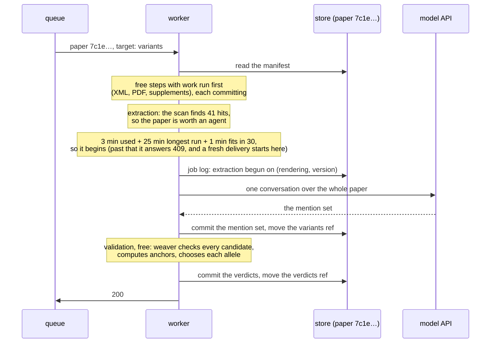
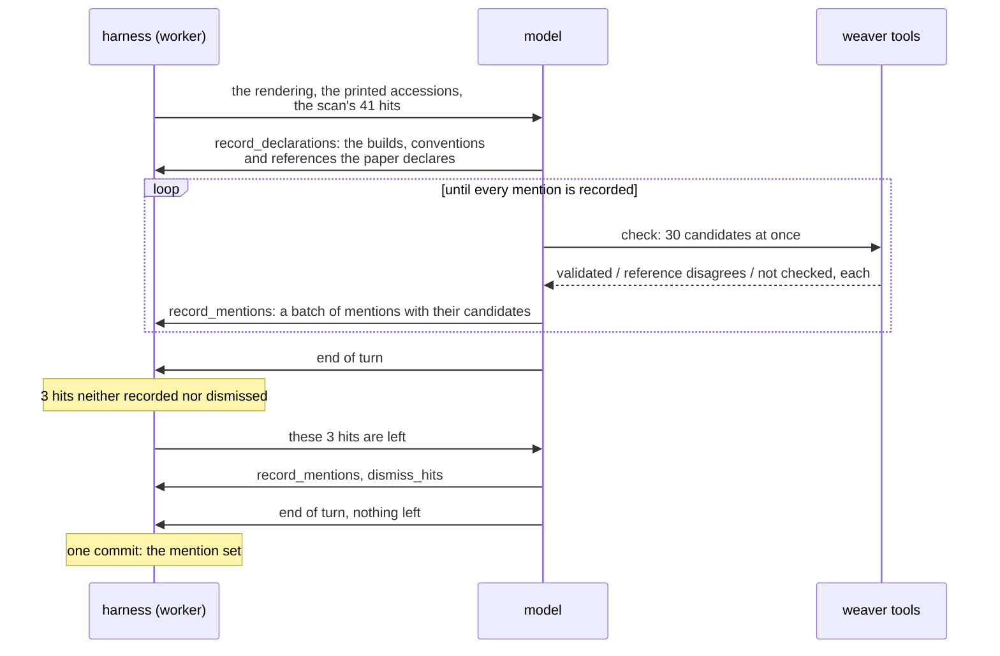
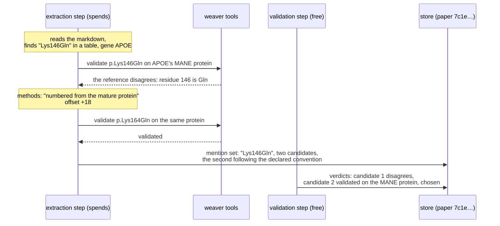

# Design: extracting variants from a paper

**Related:** [`evidence-fulltext.md`](evidence-fulltext.md) (the steps that bring a paper up to date, and the rule that
naming a target is the decision to spend); [`litcache-manifest.md`](litcache-manifest.md) (the records and refs a step
writes, and when a record is current); [`literature-evidence-layer.md`](literature-evidence-layer.md) (the evidence
service, which serves a paper's text and records to agents); [`infrastructure.md`](infrastructure.md) (where the
reference stores are built, and the order in which a new build reaches prod). Terms in
[`../../GLOSSARY.md`](../../GLOSSARY.md).

## Overview

A curator weighing a variant needs the papers that report it, and the literature names variants in whatever notation its
era used: `ΔF508`, `Trp64----nonsense`, `codon 238 (CGG-->TGG; Arg-->Trp)`, `c. 3286 + 5G > A`. Each of those is a real
string from a real paper. Before such a string can be matched against a curator's variant, someone has to turn it into
an HGVS expression on a named reference sequence, and check that the expression agrees with that sequence. This doc
decides how that happens for every paper in the full-text store, what is recorded when it cannot be done, and how the
record improves later without reading the paper again.

The work splits into two parts that improve at different times. Rewriting a paper's notation into HGVS takes judgement:
reading `Lys146Gln` as `p.Lys164Gln` because the paper's methods say its residues are numbered from the mature protein.
That improves whenever the model or the prompt does. Checking an HGVS expression against a reference sequence is
deterministic, and [weaver] already does it: it parses HGVS exactly, projects between coordinate systems, and validates
against the reference stores. Its verdicts change only when one of its bugs is fixed or a store is rebuilt.

So one model-driven step reads the paper and does the judgement, calling weaver as a tool while it works. It records,
for every variant mention it finds, the text exactly as printed and every HGVS candidate it wrote for it, failed ones
included. A separate free step runs weaver over those stored candidates, records the verdicts, and picks the allele a
reader sees. When weaver or a reference store changes, the free step runs again, and a candidate that failed on a weaver
bug can become the chosen allele at no model cost. A mention that never validates is still kept, with the reason it
stopped. Each validated form also records what it took to reach: which sequence it was checked against, because a check
against a sequence the paper never names passes wrongly up to 28% of the time, and what rewrites the agent applied.

Running this over the whole store adds two more decisions. Many papers name no variant at all, so a free pattern scan
reads each paper's text first, and a paper with nothing that looks like a variant never reaches the agent. And one
allele is written many ways across the literature: on different transcripts, on superseded versions of one transcript,
and on two genome builds. So a chosen allele is identified by its GA4GH VRS identifier on GRCh38, which is the same
however the paper wrote it, and an index across papers can join on that.

## Background

### Notation in the literature

The HGVS nomenclature names a change against a reference sequence: `NM_000492.4:c.1521_1523del` deletes three bases of
the CFTR transcript `NM_000492.4`, counted from the A of its start codon. Coordinates come in kinds: `c.` counts along a
coding transcript, `g.` along a chromosome, `p.` along a protein. A tool such as weaver can parse an expression like
that, project it from `c.` to `g.` or `p.`, and confirm that the reference base it states is the base the sequence holds
at that position.

Very little of the literature is written that way. A survey of 1,820 abstracts across seven five-year eras
([Appendix](#notation-by-era)) found that the `c.` prefix is absent before 2000 and still under 30% of abstracts in
2020–25. The one-letter compact form (`R337H`) has been in use since the early 1990s and is still in 11.5% of recent
abstracts. Under 7% of abstracts that name a specific change state the reference sequence it is counted against, even in
2020–25, and none did before 2010. Most notation also lives in the body rather than the abstract: across 110 open-access
full texts, the abstract held 4.5% of the paper's variant mentions.

A model extracting from the full text in October 2026 shows what that looks like at scale. Over 19,175 papers in the
store it found 362,385 human variant mentions. A deterministic pass then validated 72.4% of them on a stated accession
or on the gene's MANE transcript, as written or after a mechanical repair such as removing stray spaces. Of the rest,
some are strings that are almost HGVS but not quite, such as `c.293-13A/C>G` or `c.617(exon7)C>A`. Some are older
notations that need rewriting before any parser can read them, such as `IVS8-1G>C`, or prose like "a C-to-T transition
at nucleotide 1916". And some cannot be checked against sequence at all: an rsID, a pharmacogene star allele, or a
deletion with no stated extent. A second model call per mention rewrote 38,186 of the leftovers into HGVS candidates.
58% of those then validated without needing to try every transcript of the gene, bringing the total to 78.5%.

### What a validation is worth

Validation means the reference base or residue that the paper states matches the sequence at the position the candidate
computes. `R337H` asserts an arginine at residue 337. If the protein has something else there, that reading is wrong.

How much a passing check proves depends on which sequence the candidate was checked against, and the October pass
measured it directly. It replaced each mention's stated base with a wrong one and re-validated it by the same route, so
every pass in that test is a false one:

| Sequence the candidate was checked against | False validations |
| ------------------------------------------ | ----------------: |
| the accession the paper states             |                0% |
| the gene's MANE transcript, nothing stated |              < 1% |
| some other transcript of the gene, `p.`    |               11% |
| some other transcript of the gene, `c.`    |               28% |

A gene has many transcripts, and with enough of them one will hold the stated base at the stated position by chance. A
validation on a stated accession and one found by trying every transcript are therefore different levels of confidence,
and a record that keeps only the word "validated" loses the difference. This doc calls the sequence a candidate was
checked against its *anchor*.

### What the step runs inside

Work on a paper is organised as steps ([`evidence-fulltext.md`](evidence-fulltext.md#a-papers-work-is-a-set-of-steps)).
A step reads what the paper's manifest records, produces one more record, and can tell from the manifest whether it has
work to do. A step that costs model spend runs only for a request that names it as a target, so an agent reading a paper
never pays for its variants by accident. A free step runs on every request, and a scheduled sweep asks for every paper
on which a free step has work. A worker on Cloud Run runs a paper's steps in order, under a 30-minute limit on each
request ([`evidence-fulltext.md`](evidence-fulltext.md#what-the-platform-allows)). The worker begins a spending step
only when the request has time left for the step's longest run, and otherwise hands the paper back to the queue for a
fresh request ([`evidence-fulltext.md`](evidence-fulltext.md#a-spending-step-begins-only-if-it-can-finish)). A spending
step that keeps paying without committing a record settles as failed on its inputs once it reaches the job log's bound
on paid attempts ([`evidence-fulltext.md`](evidence-fulltext.md#the-job-log-records-what-the-worker-has-tried)), and is
not tried again on those inputs.

Each derived artifact is a *record* in the paper's manifest, keyed by the hash of its bytes, listing the hashes of the
inputs it was made from as its *deps*
([`litcache-manifest.md`](litcache-manifest.md#derived-artifacts-are-content-addressed-records)). A *ref* names the
record of each kind that readers use: `markdown` names the paper's main text. A record is current when every record it
was made from is still the one that kind's ref names. A variant set extracted from an older rendering therefore becomes
stale, and its step finds work again, as soon as a better rendering arrives.

### What the checks read

Weaver checks an expression against *reference stores*, built by [hgvs-weaver-data] from the files that NCBI and Ensembl
publish. A store holds each transcript's and protein's sequence as its publisher curates it, and where each transcript
sits on the genome. Three stores cover what papers cite:

- RefSeq on GRCh38, with NCBI's historical set of superseded versions under the current release, so that `NM_000492.3`
  resolves even though `NM_000492.4` replaced it;
- Ensembl on GRCh38, for papers that cite `ENST` accessions;
- RefSeq on GRCh37, for papers that give genomic coordinates on the older build.

Each store comes with its genome's sequence. A job in each environment builds them into a bucket from mirrored copies of
the published files, and names each build by a digest of its inputs and its builder's version. A rebuild from changed
inputs is a new build beside the old one, and the old one stays readable
([`infrastructure.md`](infrastructure.md#data-prod-starts-with)). Weaver reads a store straight from the bucket, a few
small reads per lookup, so the worker needs no copy on disk.

## Non-goals

- **Interpreting a variant.** Pathogenicity, segregation and functional evidence are what a curation run reasons about.
  This design ends at a mention, its candidates and their verdicts.
- **Resolving grammars that name no sequence change.** ISCN karyotypes, α-globin deletion shorthand such as
  `-alpha(3.7)`, and repeat counts resolve through lookup tables rather than sequence. They are recorded as mentions
  with a disposition and never given an HGVS candidate.
- **Resolving rsIDs and star alleles.** Both name an allele through a registry (dbSNP, PharmVar) that the reference
  stores do not carry. They are recorded with a disposition that says so. A registry lookup could later add candidates
  for them without changing this design.
- **Making weaver lenient.** Weaver parses HGVS exactly, so the same expression gets the same verdict every time.
  Teaching it to accept `c. 3286 + 5G > A` would put a guess inside the deterministic check, and would hide the rewrite
  that the record exists to show.

## Design

### The sequence, from request to verdicts

The decisions below are easier to judge with the whole sequence in view: which step runs when, whether the agent works
per mention or per paper, when each record is written, and what runs again when something changes. This section gives
that picture in three parts, and the sections after it argue each decision.

A funded run asks the worker for one paper, naming the extraction step as its target. The worker runs the paper's steps
in order, committing each step's record before it starts the next:

Inside the extraction step, the agent works per paper rather than per mention. It gets the whole rendering in its first
message, with two tables beside it: the accessions the paper prints, found by pattern, and the scan's hits. It then
checks and records in batches, many candidates per call, and the harness holds it to the checklist before it may finish.
Nothing is committed until the conversation ends, and then the mention set is committed once:

The two records then go stale on different changes, at different costs:

| what changes                                                  | mention set | verdicts                   | cost   | when it runs again                          |
| ------------------------------------------------------------- | ----------- | -------------------------- | ------ | ------------------------------------------- |
| a weaver release, a new store build, new validation rules     | current     | stale                      | free   | on the next request that reaches the paper  |
| the extraction version: model, prompt, tool definitions, scan | stale       | follow the new mention set | spends | when a funded run names the extraction step |
| a better rendering of the paper                               | stale       | follow the new mention set | spends | when a funded run names the extraction step |

The rest of the Design section takes these pieces one at a time.

### One mention, end to end

The trace below zooms into one mention of that conversation, and follows it through both steps. A 2000 paper reports
`Lys146Gln` in APOE, and its methods say residues are numbered from the mature protein, which starts 18 residues after
the initiator methionine.

The extraction step stores what the agent read and wrote: the verbatim string, its place in the paper, and both
candidates. The first candidate is kept even though it failed. The second records that it applies an offset the paper
declares. The validation step then stores weaver's verdict on each candidate, the anchor each was checked against, and
the allele it chose. A reader asking which allele the paper meant gets `p.Lys164Gln`, checked against the MANE protein,
reached by a mature-peptide offset that the paper itself declares.

### The agent does the rewriting, with weaver in reach

The obvious design is the one the October pass used: a model lists each mention verbatim, a deterministic pass validates
what it can, and a second model call rewrites each leftover from a window of text around it. Each part is simple, and
the deterministic pass is cheap and reproducible.

It breaks on where the information a rewrite needs sits. The convention a paper numbers under is stated once, in its
methods or a table footnote, and governs every mention in the paper. Only 10 of the 1,820 surveyed abstracts declared a
numbering convention, against a quarter of the full texts. A rewrite call that sees a window around `Lys146Gln` cannot
see the sentence that says to add 18. The rewrite also cannot learn from its own failure, because the candidate it
proposes is validated only after the call has ended.

Giving the rewrite call the whole paper, and a second turn with weaver's verdicts, fixes both faults, and that is
already an agent with two turns. So extraction is an agent, and its number of turns is a cost to measure. It reads the
whole paper and has weaver's functions as tools: parse an expression, validate it against a named sequence, project it
between `c.`, `g.` and `p.`, and list a gene's transcripts with the MANE transcript marked. When a candidate fails it
sees why, and it can try the convention the methods state before writing the mention down. It can also read the
reference bases around a position, and search a gene for a short stretch of sequence. A printed stretch of the bases
around a change then pins down where the change is, even when the paper's numbering cannot be trusted.

That costs more than the two-call pipeline. Every tool call is a model turn, and each turn sends the conversation so far
again. Prompt caching bills the repeated part at a fraction of the input price, which is what keeps a long conversation
affordable. The agent is also less reproducible: run twice, it may find a mention once and miss it the next time. The
experiment in [Open questions](#open-questions) measures both, along with how many turns a mention usually takes. If
nearly every mention settles within one round of feedback, the turn count can be capped there.

### A free scan decides which papers the agent reads

A funded run names the extraction step for a set of papers, and the obvious design runs the agent on each of them. Much
of that money would buy nothing. Some of the papers on a gene are reviews, functional studies or clinical series that
name no specific change, and the agent would read each one to the end to record an empty mention set.

So before the step begins, and before anything is spent, the worker scans the paper's text with patterns for the
notations in [Notation in the literature](#notation-in-the-literature): HGVS expressions, compact forms such as `R337H`
and `2063A>G`, `IVS` forms, `ΔF508` and its relatives, and rsIDs. A paper in which the scan finds nothing settles as
having no work on that text, without a model call. A paper with hits goes to the agent, and the hits go with it as a
checklist. Each hit must end up inside a mention the agent records, or be dismissed with a reason, before the agent may
finish. A long table is where an agent most often stops early, and the checklist names the rows it has not recorded.

The scan is deliberately loose, because its two errors cost different amounts. A false hit costs one agent run on a
paper with nothing to find. A miss settles the paper, and nothing reads it again until its text or the step's version
changes. So the scan errs towards hits, and covers older notations as well as HGVS. What it still cannot see is notation
no pattern describes: prose such as "a C-to-T transition at nucleotide 1916", or a variant shown only in a figure. A
paper that names its variants only that way is skipped. The checklist has the opposite limit: the agent must look for
prose mentions without one.

The October extraction measures both errors. Over its 19,171 full texts, the scan finds nothing in 176. In 88 of those,
the model found human variant mentions: 0.47% of the papers that have any, holding 0.13% of all mentions. About half of
the missed papers print near-HGVS forms that a pattern could catch, such as `c.133-1G > A` with spaces around the
change, or a `>` that the rendering left HTML-escaped. The rest name their variants in prose, as exon-level changes, or
as chromosome coordinates. The screen saves little in this store, because 98% of its papers name a variant: the scan
spares 88 of the 308 that do not. Here its larger value is the checklist.

The scan's patterns are part of the extraction step's version, so a change to them gives every paper the scan settled
another look, as a change to the prompt does
([The candidates and the verdicts are separate records](#the-candidates-and-the-verdicts-are-separate-records)).

### Every mention is kept

A mention leaves the extraction step with one of these dispositions:

- **has candidates**: the agent wrote at least one HGVS candidate for it;
- **cannot be written in HGVS from what is stated**: a deletion with no stated extent, or a change with no stated
  position, with the reason;
- **names an allele through a registry**: an rsID or a star allele;
- **is not a sequence change**: a karyotype, a repeat count, or an eponym such as `factor X San Giovanni Rotondo`.

None of these drops the mention. A curator searching for papers on a variant is better served by a paper whose mention
of it could not be validated than by no paper. The October extraction shows how large that group is. Apart from the
72.4% that validated, 4.1% of full-text mentions were rsIDs or star alleles. Another 4.2% were deletions or duplications
that name no bases, so checking them can only confirm that the position exists. The same rule applies to candidates: a
candidate that weaver rejects is kept, for the reason given in
[The allele is chosen at validation](#the-allele-is-chosen-at-validation).

### The candidates and the verdicts are separate records

The extraction step could store its final answer, an allele that weaver validated, and nothing else. That is one record
per paper and the simplest thing for a reader. It fails when weaver changes, which happens whenever one of its bugs is
fixed. hgvs-weaver#59 is one: weaver did not check the reference base at an intronic position, so an intronic candidate
passed whatever base the paper stated. Once that is fixed, some of those candidates fail and some still pass, and a
record holding only the final answer can learn which only by running the agent again over every paper.

So the step's output is split along the line between judgement and checking:

- **The mention set** is what the agent produced. It holds each mention verbatim, its disposition, and every place the
  paper prints it, cited by its line in the rendering or, where the rendering does not print it, by its page in the PDF
  ([A mention is cited by its line](#a-mention-is-cited-by-its-line)), with what that printing says of the variant:
  observed in the paper's own patients, cited from other work, or engineered for an experiment. It holds every HGVS
  candidate the agent wrote for the mention, in order, each with the rewrites applied to reach it. It also holds the
  reference sequences the paper declares, each with the sentence that declares it. The extraction step writes it, and
  the `variants` ref names it. Its deps are the inputs it read from the paper: the rendering the `markdown` ref named,
  and the PDF revision whenever the agent also read page images.
- **The verdicts** are weaver's result on every candidate in the mention set, the anchor of each, and the allele chosen
  for each mention, together with the version of weaver, the build of each reference store, and the version of the
  validation step's own rules. They also hold the candidates the validation step derives from the agent's
  ([Two candidates the validation step writes itself](#two-candidates-the-validation-step-writes-itself)). The
  validation step writes them, the `verdicts` ref names them, and their one dep is the mention set. They are current
  while that mention set is the one the `variants` ref names.

The verdicts record what was decided, not the working that led to it. Validation is deterministic, and the verdicts name
the weaver version and store builds they were made with, so rerunning it reproduces the rest: how each of a gene's
transcripts fared against the paper's mentions, say, or which transcripts each mention holds on. Storing those would
save only a rerun, and they are the bulkiest part of a verdict. The builds stay in the bucket after the worker moves on,
which is what keeps the rerun possible.

One record holding both, re-validated in place, would save the reader a lookup. It loses because a record is named by
the hash of its bytes, and agents cite a mention by the hash of the record it sits in. Writing new verdicts into the
mention set would give it a new hash on every weaver release and break every citation to it.

The validation step must also find work when weaver or a store changes, which the currency rule cannot detect. Weaver
and the stores are not inputs of the paper, so their versions cannot be deps. The validation step therefore has work
when its current verdicts were made with a version of weaver, a store build or a version of its rules other than the
ones the worker now runs. Deploying a fixed weaver, or moving to a new store build, gives every paper validation work,
and because the step is free, re-validating costs no model call.

The obvious test would ask for an *older* version rather than a different one. During a deploy, two revisions of the
worker serve at once, and under a "different" test each finds the other's verdicts stale and replaces them. An "older"
test cannot be written for the stores, though, because a build is named by a digest of its inputs, and digests have no
order. The test asks for a different version, and accepts the cost: while a deploy that changes weaver or a build is
rolling out, a paper that both revisions reach can be re-validated more than once. Each re-validation is free and takes
well under a second, and it stops when the old revision stops serving.

The extraction step has work, by the same rule, when its mention set was made by another version of the extraction step.
That version covers the model, the prompt, the tool definitions the agent sees, and the scan's patterns. It does not
cover weaver's behaviour behind those tools, so a weaver release leaves every mention set current. The step spends, so
that work waits for a funded run naming it, and a model or prompt change never spends on its own. The version is also
part of what the job log records an extraction attempt against, beside the rendering. A paper whose extraction settled
as failed under one version is therefore tried again under the next. The "different" test costs more here than for
validation: a funded run in flight across a deploy that changes the version can pay twice for a paper the two revisions
both reach. A version change is a deliberate, reviewed commit, so the deploy and the funded run can be kept apart.

### The allele is chosen at validation

Weaver will sometimes reject a correct candidate because of a bug, and the agent will then work around the rejection.
Suppose a weaver release misreads the reference at intronic positions, so that a correct candidate on the accession the
paper states is reported as disagreeing. The agent tries other transcripts of the gene until one validates. Its last
candidate is then checked against a transcript the paper never names, the kind of check that, in the wrong-base test,
passed 28% of the time. If the record kept only that last candidate, fixing weaver would change nothing.

So the mention set keeps every candidate in the order the agent wrote it, and the validation step chooses the allele a
reader sees. Among the candidates that validate, the choice goes first by anchor, in the order of the table in
[What a validation is worth](#what-a-validation-is-worth). After the fix, the stated-accession candidate validates, and
it outranks the alternative-transcript one without a model call.

That recovery is complete only for a bug that wrongly rejects. A bug that wrongly accepts, as hgvs-weaver#59 did,
recovers only in part. If the agent's first intronic candidate passed, it had no reason to write another. After the fix,
validation correctly fails that candidate. If the mention set holds no alternative, the mention loses its allele, and
only reading the paper again gets it back. The two candidates the validation step derives rescue some of these mentions,
but not in general. Nothing re-extracts the rest on its own, because a weaver release does not change the extraction
version ([Open questions](#open-questions)).

The full order, from most trusted to least, adds the anchors that test has not measured:

1. an accession the paper states;
1. a transcript the paper's own mentions single out
   ([Two candidates the validation step writes itself](#two-candidates-the-validation-step-writes-itself));
1. the gene's MANE transcript;
1. a genomic coordinate on a build the paper states;
1. a stated accession, at a version other than the one stated;
1. a stretch of flanking sequence;
1. some other transcript of the gene;
1. a genomic coordinate on a build the paper does not state.

The unmeasured anchors sit where the reasoning puts them until the test covers them and replaces the guess. A transcript
singled out by many of the paper's mentions is close to a stated one, so it ranks just below. A coordinate on an
unstated build ranks last, because GRCh37 and GRCh38 positions differ and nothing says which one the paper used.

A candidate that names no reference base, such as a deletion that gives no bases, passes on any transcript that has the
position, so its pass says little. It is chosen only on a stated accession or the MANE transcript. Anywhere else the
mention is recorded as ambiguous.

Within an anchor, a candidate that follows a numbering convention the paper declares outranks one that does not. In the
APOE example, `p.Lys146Gln` read literally fails, but at 6.1% of positions a literal reading validates by coincidence
([Appendix](#legacy-numbering-offsets)). Where it does, the candidate that applies the declared offset still wins,
because the paper says how to read its own numbers. Where two candidates are left level and imply different alleles, the
mention is recorded as *ambiguous* rather than as either allele.

"Imply different alleles" is checked between every pair of level candidates, not against the first one. Sameness here is
not transitive. A protein change such as `p.Gly12Asp` agrees with both `c.35G>A` and `c.35_36delinsAC`, which both
encode it, yet those two nucleotide changes are different alleles. Comparing each candidate only with the first would
call that mention settled. Among level candidates that do all agree, the choice takes one that can be identified on
GRCh38 ([An allele is identified on GRCh38](#an-allele-is-identified-on-grch38)), because it says the most about the
allele.

### Two candidates the validation step writes itself

The agent writes every candidate in the mention set. Two kinds of candidate need no judgement, though, and the
validation step derives them from the agent's. It stores them in the verdicts rather than the mention set, so the
mention set's hash, which citations carry, never changes. Both are re-derived on every validation, so a store or weaver
change can add or remove them.

The first moves a change from a superseded version of its accession to the current one. A paper written in 2005 cites
`NP_001805.1`; `NP_001805.4` replaced it. Two runs over that paper can choose the same change on different versions, and
a change on `.1` joins nothing that later papers write on `.4`. Moving every candidate to the newest version would be
wrong where the versions differ at the change. `NP_001805.1` and `.4` differ at residue 153 alone, so `p.Ile153Thr`
holds on one and not the other. So a change is moved only where the newest version is the same around it: the same
genomic position where both are placed on the genome, or else the same sequence for a window either side of the change.
The moved change is an extra candidate, marked as an update, and the agent's stays. Which of the two is chosen depends
on what the paper states. If the paper prints `NP_001805.1`, the agent's `.1` candidate is anchored on a stated
accession, while the update to `.4` is anchored on a stated accession at another version, which ranks lower, so the `.1`
candidate is chosen. If the paper prints the accession without a version, the two sit on the same anchor and tie, and
the update to `.4` is chosen, so that the allele joins what later papers write.

The second answers a question the agent often cannot: which transcript a paper numbered against, when it names only a
gene. Each transcript of the gene is a hypothesis that the paper's mentions test, because each mention states a base or
residue that holds on a transcript or not. One mention fitting a transcript proves little: in the wrong-base test, an
exonic change passed on some unnamed transcript 28% of the time. But the chance that a wrong transcript fits falls with
every further mention it holds. So the validation step checks every mention of the gene against every version of every
transcript the stores hold. A transcript is *singled out* when it holds every mention that holds anywhere, there are at
least three such mentions, and some other transcript fails one of them. A mention the agent wrote only on other
transcripts then gains its change moved onto the singled-out one, and that candidate is anchored on the fit.

| transcript of a gene | mention 1 | mention 2 | mention 3 | mention 4 | singled out |
| -------------------- | --------- | --------- | --------- | --------- | ----------- |
| MANE, `.3`           | holds     | holds     | fails     | holds     | no          |
| older isoform, `.1`  | holds     | holds     | holds     | holds     | yes         |
| another isoform      | holds     | fails     | silent    | fails     | no          |

"Silent" means the check could not run on that transcript. Here the paper numbered against the older isoform, and
mention 3, written by the agent on the MANE transcript, where it fails, gains a candidate on `.1` that validates. Only
the agent's candidates in the paper's own numbering take part in the fit. A candidate the agent renumbered by a declared
offset has already answered the question the fit asks.

### The validation step computes the anchor

The agent could report each candidate's anchor alongside the expression, as it reports its rewrites. But the anchor
decides the ranking, so a self-reported anchor would let a misreading by the agent promote a weak candidate.

The validation step can work it out instead, from the text and the stores. A candidate is anchored on a stated accession
when the paper prints its accession, which the step finds by pattern over the whole text, or when its accession is in a
declaring sentence the mention set holds. The second route covers what a pattern misses, such as an accession broken
across two lines. For it, the step checks that the sentence occurs in the rendering the mention set was read from, so
the agent cannot state an accession the paper does not. A transcript the paper states also states the protein it
encodes, so a `p.` candidate on that protein counts as stated. The same checks cover a stated accession at another
version, and a build the paper declares for a genomic coordinate. A candidate is anchored on the MANE transcript when
the store marks its accession so, and on an unnamed transcript otherwise.

A flanking-sequence anchor carries the stretch of bases it was located by. The step accepts it only when the stretch
occurs in the mention's sentence and matches the gene exactly once. A stretch read from a figure, such as a sequencing
trace, cannot be checked against the text, so it ranks with an unnamed transcript. The rewrites stay the agent's account
of what it did, because they are judgements that no deterministic check can reconstruct.

### A tool result says whether the reference disagreed

Weaver fails a check for two different kinds of reason. In the first, it ran the check and the sequence holds something
other than what the candidate states. That is evidence the reading is wrong, and a reason to try another. In the second,
it could not run the check: the operation is unsupported, a store lacks the record, or an alignment is one it cannot
read. That kind of failure says something about weaver, and nothing about the candidate.

An agent shown both as "validation failed" can be expected to rewrite a correct candidate until something passes, which
is the failure the previous section guards against, caused this time by the tool rather than by a bug. So each tool
result tells the agent which kind of failure it got, and the agent's instructions say to keep a candidate that weaver
could not check. The verdicts record the same distinction, so a reader can tell a disagreeing reference from a check
that did not run.

### A candidate states only what the paper states

The agent can read the reference sequence, and that creates a way to make validation circular. Given `codon 238`, which
names no residue, the agent could look up the residue at 238 and write `p.Arg238Trp`. Weaver would validate it, but the
residue came from the very sequence it was checked against, so the pass would show only that the lookup worked.

So a candidate may contain only the bases and residues the paper states. Where the paper states none, the candidate
takes the HGVS form that omits them where HGVS allows one, and validation records that there was nothing to check. Where
HGVS requires a residue the paper does not give, there is no candidate, and the mention's disposition says why. The
reference-reading tools exist to locate a position, for example by matching a printed stretch of flanking sequence, and
never to supply the base that validation then checks. Whether the agent keeps to this can be measured by comparing each
candidate's stated reference base with the verbatim mention and the sentence around it.

One breach of the rule is caught at validation. A paper prints `R337H`, and the agent, finding that residue 337 of the
protein it tried is a histidine, writes `p.His337Arg`. That candidate validates wherever the sequence holds the residue
the paper printed as the new one, on another version of the protein for example, but it is the printed change reversed.
The validation step marks a candidate that exactly reverses its mention's printed substitution at the printed position
as reversing the paper, and never chooses it. Other differences from the printed form are left alone, because the text
alone cannot rule out a reading of them. `C677T` is a base change printed in the shape of a residue change, so a looser
comparison would read it as cysteine to threonine and refuse the right candidate, `c.677C>T`.

### The effort is recorded with the result

Two candidates can both validate and deserve different trust. One validated on the accession the paper states, as
written. The other validated on a transcript the paper never names, after a numbering offset and a notation repair, on
the agent's third attempt. A curator, or an agent citing the paper, should weigh them differently.

The anchor carries most of that difference, and the validation step computes it. The mention set adds the rest. Each
candidate lists the rewrites the agent applied, each marked as following a convention the paper declares or as the
agent's own assumption, and a reader sees what was assumed in reaching the allele. A candidate's position among the
mention's candidates records how many attempts came before it.

How many tool calls each paper took is a cost rather than a property of the allele, so it goes to the worker's telemetry
rather than into a cited record. A call that lists a gene's transcripts serves every mention in that gene, so counting
calls per mention would need an attribution rule, and the telemetry needs none.

### An allele is identified on GRCh38

A curator's question runs from a variant to the papers that report it, so chosen alleles from different papers have to
join. The obvious key is the chosen expression itself. It fails because one allele has many expressions. CFTR's
`F508del` is `NM_000492.3:c.1521_1523del` in one paper, the same change on `NM_000492.4` in another, a `g.` expression
on chromosome 7 in a third, and on GRCh37 coordinates in a fourth. No two of those strings are equal.

The GA4GH Variation Representation Specification (VRS) solves this. It normalises a change to its position on a
reference sequence, and names it by a digest of the sequence's own digest, the position and the new bases. Weaver
computes a VRS identifier for a nucleotide change by projecting it to the genome. Changes written on different
transcripts or versions that make the same change to the genome get the same identifier.

That is true only on one genome. The same change on GRCh37 and GRCh38 sits on two different reference sequences, so its
two identifiers differ. Joining them needs liftover from one build to the other, and liftover is its own hard problem:
some regions moved, some were corrected, and some have no counterpart. So the verdicts record a change's nucleotide
identifier only where it projects to a GRCh38 primary-assembly chromosome. A change that projects only to GRCh37, or
only to a patch or alternate locus, gets no nucleotide identifier, and the index across papers can find it only through
its protein change until liftover is added.

The validation step still compares candidates by whichever genome they project to. Two candidates on GRCh37 that name
different bases are different alleles even though neither has a GRCh38 identifier, and treating them as the same because
they share a protein change would make a choice the evidence does not support. So comparison uses the identifier on any
genome, and the GRCh38 restriction applies only to what the verdicts record. A protein change is identified by its VRS
identifier on its protein's sequence, so proteins with the same sequence share it. A frameshift, which VRS does not
represent, is keyed by the protein's sequence digest and the change written one way.

### The worker pins the builds it validates against

A verdict is reproducible only if the stores it was checked against are fixed. The worker could be told which builds to
open by its deploy, through configuration, so that moving to a new build needs no code change. But a new build changes
verdicts, and the build in use is part of every verdict's record. So the builds are constants in the worker's code, and
moving to a new one is a reviewed commit, like a weaver upgrade. The deploy supplies only the bucket's name, because the
infrastructure code creates the bucket and owns its name.

The worker refuses to start when a pinned build is missing from the bucket. A worker that started anyway would fail on
the first paper it validated, and keep failing on every one after it. Because a build is named by a digest of its
inputs, a pinned build names exactly the files it was built from, and the same name is valid in dev and prod once each
has built it. [`infrastructure.md`](infrastructure.md#data-prod-starts-with) sets out the order in which a new build
reaches prod.

### A mention is cited by its line

Each place a paper prints a mention needs a citation that a reader can follow back. There are two candidates: the line
of the rendering it is printed on, and the PDF page it is on, with a box around it where it sits in a figure.

The line is the stronger of the two. A reader opens it in the document pane, and it is checked as it is recorded: the
recording tool refuses a line that does not print the mention's verbatim string, and the agent has to locate it again. A
page is the model's reading of a page image, and nothing checks it. In the extraction experiment, an agent that saw the
page images named a page whose text layer prints the mention 98% of the time. An agent that read only the markdown,
which carries no page numbers, got the page wrong for 14% to 61% of its mentions, depending on the run.

So an occurrence carries exactly one citation: its line wherever the rendering prints it, and its page only where it
does not. A page is for what the transcription left out, such as a variant shown in a sequencing trace, and only an
agent that was given the page images may give one. Those citations are best effort. If the worker comes to read page
images, the recording tool can check a page as it checks a line, by finding the verbatim in that page's text layer,
which would catch most of the remaining 2%.

### Where the record lives

A normalised allele is a fact about the literature, and facts are shared across Projects
([`../PRODUCT.md`](../PRODUCT.md) §7). The text of a licensed paper is not shared: opening it follows the reader's
institutional licence. The mention set holds both kinds of thing, since each mention carries its verbatim string and the
sentence around it.

So the mention set and the verdicts live in the paper's directory, under the same licence boundary as the rendering they
were read from, and the evidence service ([`literature-evidence-layer.md`](literature-evidence-layer.md)) serves them
the way it serves the rendering. What crosses Projects is the chosen allele, with a citation that points at the paper,
the mention set's hash, the mention's position in it, and the hash of the verdicts that chose the allele. The verdicts'
hash is part of the citation because re-validation can change the chosen allele, and the citation has to say which
choice it repeats.

### What the agent can reach

The agent reads untrusted text, a paper that may carry an injected instruction, and it calls tools. Its tools only read:
they parse, validate, project and look up the reference stores, all within the worker. None of them reaches the network
beyond the stores, writes anything, or touches patient data. An injected instruction can therefore make the agent
extract badly from the paper that carries it, and do nothing else. The mention set it produces is data, read by later
agents through the same delimited channel as a rendering
([`evidence-fulltext.md`](evidence-fulltext.md#a-rendering-is-untrusted-data)).

## Alternatives considered

- **Model the reference stores and weaver as sources of every paper**, so that the existing currency rule covers their
  versions with no test of its own. A source is a file captured for one paper, with that paper's licence terms. A weaver
  release would become a new revision in every paper's manifest, and the manifest would describe a library as if it were
  part of the paper.
- **Extract in the transcription's conversation**, after the model has transcribed the paper, so that the agent reuses
  the cached prompt instead of reading the markdown again. It would save the input tokens of one read of the paper. It
  loses on cost in practice. The two steps rarely run together: transcription runs when an agent first asks for a paper,
  and extraction runs later in a funded run, long after a cache entry has expired. A cache entry also belongs to one
  model, system prompt and tool list, and the two steps differ in all three. Transcription would have to write the cache
  on every paper, at a premium over the input price, including the many papers never extracted. And the shared prefix
  would hold the page images, about 2.6 times the markdown's tokens, so every extraction turn would re-read images it
  does not need. Papers that arrive as XML have no transcription to share.
- **Extract from the abstract.** Abstracts are available for every paper, with no licence gate. They hold 4.5% of
  mentions, and 70% of papers whose body names a variant have an abstract that names none.
- **Take PubTator3's variant annotations.** They are free, and maintained by NCBI. On abstracts that name a change, its
  recall was 83% for 1990–94 and 98% for 2020–25. It is weakest on the old literature, which is where its gaps cost a
  curator most. Its normalisation targets rsIDs, which name an observed variant rather than a position on a sequence. It
  remains useful as a cross-check on recall.
- **Rely on ClinVar's citations.** ClinVar normalises alleles and links them to papers. It carries the allele but not
  the paper's evidence, and not the papers it never cites, so it cannot replace reading the paper.

## Open questions

- **What the agent reads.** The page images carry things the markdown loses: a table drawn as an image, a symbol font
  whose `>` the text layer reads as `4`, and figures. Older papers often show the sequencing trace of a mutation in a
  figure, and the trace prints 20 or so bases either side of the change. That is more sequence context than the text
  usually gives, and it can locate a variant whose numbering the paper does not explain. Images also cost about 2.6
  times the markdown's tokens for the same page. An experiment will decide it, with the agent reading (a) the markdown,
  (b) the markdown with page images, or (c) page images alone, with a tool to view part of a page at higher resolution.
  Each arm runs on the same papers, oversampling older papers with figures. The arms are compared on the similarity of
  their mention sets, on cost, and on the differences that are not run-to-run noise, which are checked by hand. The
  October pipeline's 58% rescue of leftovers is the baseline arm (a) has to beat. Arm (c) also matters for the papers
  whose transcription the provider's output filter blocks: about 11% of the PDF-only papers have no markdown at all. If
  arm (b) wins, the page images are in the agent's prompt anyway, and running extraction in the transcription's own
  conversation ([Alternatives considered](#alternatives-considered)) is worth costing again.
- **Supplementary files.** Many case series put their variants in a supplementary spreadsheet, which reaches the agent
  as a rendering of the file. Once a paper has supplement renderings, the extraction step's inputs include them, so its
  test finds work on a paper whose mention set was read without them. Whether that re-extraction is worth funding across
  the store is a cost question.
- **Papers too long for one conversation.** A paper with hundreds of variants in its tables needs many tool calls. The
  conversation has a timeout inside the request's 30 minutes, and a conversation that reaches it commits nothing, so
  enough of them settle the paper as failed. The first runs in dev will show how often that happens. If it is common,
  the step has to commit partial progress and resume, or such papers need a runner without the 30-minute limit
  ([`evidence-fulltext.md`](evidence-fulltext.md#open-questions)).
- **Re-validating the whole store after an upgrade.** A new weaver or store build gives every paper validation work, but
  the scheduled sweep does not look for it: the sweep counts verdicts as current however they were made, because it does
  not run weaver and does not know which builds the worker pins. So a paper is re-validated when some request next
  reaches it. Re-validating the store promptly needs either a sweep that knows the worker's versions, or an operator
  enqueueing every paper that has verdicts.
- **Mentions a weaver fix leaves without an allele.** When a fix makes a wrongly accepted candidate fail, its mention
  can lose its allele, and no step has work that would restore it. A cheap route back is a report after each
  re-validation, listing the papers whose new verdicts chose no allele for a mention where the verdicts they replaced
  chose one. That list would be the target set of a funded re-extraction, run when an operator decides it is worth it.
- **Where shared alleles are indexed.** The index over every paper's chosen alleles keys on their GRCh38 VRS
  identifiers. Until the sweep re-validates after an upgrade, a paper nobody requests keeps verdicts made by an older
  weaver or store build, so the index would join verdicts made different ways. It has to record each verdict's
  validation stamp, or read only verdicts made with the versions the worker pins. Whether it is a table in Postgres,
  rebuilt from the verdicts, or a store of its own is not yet decided. Alleles that papers give only on GRCh37 join it
  only by their protein change until liftover is added, and how much of the literature that leaves out is not yet
  measured.
- **Legacy numbering that no paper declares.** Some genes are conventionally reported in mature-peptide numbering, and
  some papers declare the convention only by citing a 1980s paper. A table of known offsets per gene, for example from
  UniProt's signal-peptide boundaries, would give the agent a candidate the paper does not. Whether to build one depends
  on how often the experiment finds an undeclared offset.

## Appendix

### Notation by era

Share of abstracts containing each notation family, 260 abstracts per era, selected by MeSH (`Mutation`,
`Amino Acid Substitution`, `Point Mutation` or `Sequence Deletion`, with `Humans` and `Genetic Diseases, Inborn`;
reviews excluded). MeSH is assigned by human indexers and says nothing about how a paper spells its variants, so the
frame does not favour any notation.

| family                         | 90–94 | 95–99 | 00–04 | 05–09 | 10–14 | 15–19 | 20–25 |
| ------------------------------ | ----: | ----: | ----: | ----: | ----: | ----: | ----: |
| `c.` prefix                    |   0.0 |   0.4 |   1.5 |  12.3 |  23.1 |  24.6 |  28.5 |
| `p.` prefix                    |   0.0 |   0.0 |   0.4 |   7.7 |  20.4 |  20.8 |  23.5 |
| accession-prefixed             |   0.0 |   0.0 |   0.0 |   0.0 |   0.4 |   1.9 |   3.1 |
| one-letter compact (`R337H`)   |   6.2 |  15.8 |  24.2 |  21.9 |  21.5 |  16.9 |  11.5 |
| three-letter compact           |   0.8 |   3.5 |   6.2 |   5.4 |  10.8 |  11.9 |  17.3 |
| legacy cDNA indel (`2674delA`) |   0.8 |   5.4 |   4.6 |   5.4 |   4.2 |   5.8 |   6.2 |
| `IVS` intronic                 |   0.4 |   3.1 |   5.8 |   2.3 |   2.3 |   1.2 |   0.0 |
| delta (`ΔF508`)                |   5.0 |   2.3 |   1.2 |   0.8 |   0.4 |   1.5 |   0.4 |
| arrow (`-->`, `→`)             |  12.7 |  10.0 |   6.9 |   5.8 |   1.5 |   1.2 |   0.8 |
| codon prose                    |   9.6 |   8.5 |   2.3 |   3.1 |   2.3 |   1.2 |   1.9 |
| nucleotide prose               |   8.1 |   7.7 |   3.8 |   3.1 |   2.3 |   1.2 |   1.2 |
| **names any specific change**  |  20.8 |  29.2 |  38.1 |  40.8 |  43.1 |  45.4 |  44.6 |

Across 110 open-access full texts from 2000–2025, the abstract held 72 mentions and the body 1,523. Of those papers, 18%
named a change in the abstract and 60% in the body. A quarter of the full texts declared the numbering convention their
variants use, against 10 of the 1,820 abstracts.

### Legacy numbering offsets

Verified against the GRCh38 reference store. "Literal" is the residue at the printed position read against the precursor
protein; "meant" is the residue the paper intends.

| gene | as printed                | offset | literal | meant   |
| ---- | ------------------------- | -----: | ------- | ------- |
| APOE | `Lys146Gln` (2000)        |    +18 | 146 = Q | 164 = K |
| TTR  | `Val30Met`                |    +20 | 30 = C  | 50 = V  |
| HBB  | `Glu6Val`                 |     +1 | 6 = P   | 7 = E   |
| FGA  | `Aalpha Arg104Cys` (2006) |    +19 | 104 = S | 123 = R |

Over ten proteins and 3,296 positions, the residue at a position equals the one an offset away 6.1% of the time. That is
the rate at which a mature-numbered name, read literally, validates on the wrong allele with nothing to flag it.

### Validation of the October extraction

The October extraction ran a model over 19,175 papers in the store and found 362,385 human mentions. A deterministic
pass validated them against RefSeq (release 2025-08, with NCBI's historical set), Ensembl 116, and a GRCh37 RefSeq
store. The outcomes below are shares of all mentions, and the rows do not overlap:

| Outcome                                                        | Share |
| -------------------------------------------------------------- | ----: |
| validated on a stated accession or the MANE transcript         | 72.4% |
| rsID or star allele, needing a registry                        |  4.1% |
| deletion or duplication with no stated bases, nothing to check |  4.2% |

A model rewrite of the leftovers raised the first row to 78.5%. A hand check of 50 mentions rescued by renumbering found
46 correct, 3 plausible and 1 wrong.

[hgvs-weaver-data]: https://github.com/populationgenomics/weaver-data-provider
[weaver]: https://github.com/populationgenomics/hgvs-weaver
