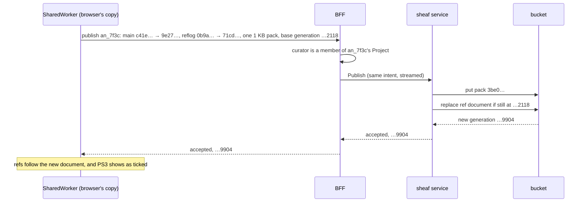

# Design: the workspace in the workbench

**Related:** [`sheaf.md`](sheaf.md) (the repository format, and the hook the agent's pushes pass);
[`sheaf-service.md`](sheaf-service.md) (the RPCs that read and publish a repository);
[`sandbox-worker.md`](sandbox-worker.md) (the agent's side, whose mirror this design copies);
[`document-widgets.md`](document-widgets.md) (the typed assets a widget draws); [`document-pane.md`](document-pane.md)
(the pane that renders a revision, and its windows); [`workspace-model.md`](workspace-model.md) (the working document
and the Project boundary); [`rpc-authorization.md`](rpc-authorization.md) (how a call names the Analysis it acts on).

## Overview

An Analysis's workspace is a git repository kept in object storage. Two parties change it. The agent commits and pushes
with a real `git` inside its sandbox. A curator changes it from the workbench, for now only by changing the state a
widget shows, such as ticking an item of a checklist. This doc decides how the workbench reads the repository and how a
curator's change becomes a commit in it.

No server holds a readable copy of the repository. The service in front of the bucket moves whole packfiles and one
small ref document, and the only server-side git database is the bare mirror the sandbox worker builds for its session.
The workbench therefore needs a copy of its own, and this design puts that copy in the browser
([`apps/web/src/workspace-copy/`](../../apps/web/src/workspace-copy/)). The browser builds its copy from the same
packfiles the worker downloads and reads every revision from it. Keeping a copy on the server instead would have cost
memory per open workspace and a `git` binary in a service that holds no git objects and ships none, and every read would
have waited on it.

With the repository in the browser, a curator's edit follows the same protocol as the agent's. The browser builds a
commit on the revision the curator was looking at and publishes it with the storage protocol's compare-and-swap. The web
backend-for-frontend (BFF) relays the publish after checking that the curator belongs to the Analysis's Project. If the
agent pushed in the meantime, the browser rebases the curator's commit onto the agent's tip, with a whole file as the
unit of conflict: the new commit takes the agent's tree with the curator's edited files in place of the old ones. If the
agent's push changed one of those files, the browser refuses the rebase, and the curator redoes the change on what the
agent left.

The browser is trusted in the same way the sandbox worker is: no server checks the git objects it publishes. The agent
is the one writer whose pushes are checked, because a pre-receive hook outside its sandbox inspects every push and
enforces that the agent's commits carry only the agent's name. The cost of this design is that every curator's browser
holds the whole workspace, including its history and the agent's working files. The repository is the only durable store
of the workspace and of the versions of the working document, so the agent's edits become durable only when the agent
commits them and a push lands.

## Background

The workspace repository is stored in sheaf ([`sheaf.md`](sheaf.md)). Sheaf keeps git objects in content-addressed
packfiles and stores every ref, together with the pack manifest, in one small protobuf **ref document** (`refs.pb`; see
[`sheaf.md`](sheaf.md#repository-layout-and-the-ref-document)). Here is a workspace after two pushes from the agent:

```
the Analysis's repository in sheaf's bucket
  ref document      generation 1727163041502118
    refs/heads/main    → c41e…    the working document's branch
    refs/sheaf/reflog  → 0b9a…    one entry per publish: which tip each ref had, and when
    packs              5d2f…, a817…
  pack 5d2f…   1.9 MB   objects of the agent's first push
  pack a817…   14 KB    objects of its second push
```

A write uploads its new pack and then replaces `refs.pb` with an `ifGenerationMatch` compare-and-swap against the
generation the writer read. When a conditional write loses a race, sheaf distinguishes the two outcomes
([`sheaf.md`](sheaf.md#distinguishing-a-lost-race-from-a-ref-conflict)). `ABORTED` means another writer published first
without moving any branch this publish moves, so only the reflog ref changed and the caller can retry against the new
ref document. `FAILED_PRECONDITION` means a target branch moved (a non-fast-forward conflict), so the caller must rebase
its change onto the new tip.

The sheaf service ([`sheaf-service.md`](sheaf-service.md), implemented in
[`themis/services/sheaf/`](../../themis/services/sheaf/)) holds the sole credential with access to the bucket. It
enforces the ref-level invariants on `refs.pb`, while writers are responsible for git object validity and fast-forward
ancestry. On the agent side, the sandbox worker maintains a trusted host-side bare mirror that hydrates from and
publishes to the sheaf service on behalf of the untrusted guest clone
([`sandbox-worker.md`](sandbox-worker.md#the-workspace-is-a-repository-and-the-agents-git-is-the-only-git-in-it)).

The curator's side has no such split because it rests on a different trust model. Curators are members of their Project
who act in good faith. The browser is a trusted writer like the host worker: it meets the writer's contract by its own
construction and tests, and no server checks the objects it publishes. §"A curator's edit is a local commit, published
with the store's compare-and-swap" argues why server-side object checks are unnecessary. The write path adds no defence
of its own against injected script, because any script running in the page could do whatever the curator can do
regardless of the write path. Keeping script off the page is the renderer's job across the workbench, which renders
agent-written text that may quote a hostile external source ([`agent-output-rendering.md`](agent-output-rendering.md)).

Three constraints from the rest of the system shape this design:

- The BFF is the single place that checks Project membership, answering a non-member as if the Analysis did not exist
  ([`workspace-model.md`](workspace-model.md) §Authorization).
- A browser can receive a streamed response but cannot stream a gRPC request body, so a client-streaming RPC such as
  `Publish` must reach the BFF as one unary message.
- A widget whose asset is missing or malformed draws a placeholder while the rest of the document renders normally
  ([`document-widgets.md`](document-widgets.md) §"Drawability is checked where the file is, and tolerated where it is
  shown").

## Non-goals

- **Comments on the document.** Widget interactions come first because each is a typed change to a typed asset. Where
  prose comments live remains an open question.
- **Byte-level or element-level merging in the browser.** A curator's edit lands on the revision it was built on, or on
  the new tip with the curator's edited files swapped in while the agent has left those files unchanged. Nothing in the
  browser reconciles two concurrent versions of a file's bytes.
- **An interface for the agent.** The agent reaches the repository with stock `git` inside its sandbox; nothing in this
  design is exposed inside the sandbox.

## Design

### One widget edit, end to end

Suppose a curator is reading the working document at commit `c41e…`. Its checklist of criteria is drawn from
`assets/review.binpb`, a serialized protobuf message of a few hundred bytes
([`document-widgets.md`](document-widgets.md) §"One widget, end to end"). The curator ticks PS3.

```
 Curator checks                                                 c41e…
   [✓] PS3  Functional studies support a damaging effect   saving…
   [ ] PM2  Absent from population controls
```

The widget reads the asset at `c41e…`, decodes it, sets PS3's `checked` field, and encodes it again. It hands the new
file bytes and the base commit `c41e…` to the `SharedWorker` that owns the browser's copy
([`apps/web/src/workspace-copy/service.ts`](../../apps/web/src/workspace-copy/service.ts)). The `SharedWorker` writes
the new file blob, the two directory trees above it (`assets` and the root tree), a commit `9e27…` whose parent is
`c41e…` authored as the curator, and a reflog commit
([`apps/web/src/workspace-copy/copy.ts`](../../apps/web/src/workspace-copy/copy.ts)). It packs those five objects into a
packfile of about 1 KB and sends them to the BFF alongside the generation of the ref document it built against
([`apps/web/src/workspace-copy/publish.ts`](../../apps/web/src/workspace-copy/publish.ts)).



The checkbox displays the new state immediately on click, marked as saving, so the curator waits only for confirmation.
A curator does not need to wait for one tick to save before clicking the next: each click appears at once, and the
`SharedWorker` publishes them in order. Each edit builds on the commit produced by the previous publish. The widget
compares the item at that commit with the item the curator ticked by its protected content (its label and citation)
rather than by its tick state. When the protected content matches, the widget builds the new file from the asset at that
previous commit, so a second tick preserves the first, and unticking an item ticked a moment earlier works the same way.
When the protected content differs because the item changed in between, the widget builds the edit on the commit from
which it was originally drawn. When the `SharedWorker` publishes that edit, it sees that the checklist file at the tip
differs from the edit's base commit and refuses the rebase (§"A curator's edit is rebased onto the tip, file by file").
The curator then redoes only that tick, and no earlier tick is lost. Batching edits into a periodic save would pay off
only if the commit count became a storage cost, which manual clicks are unlikely to reach.

If the agent had pushed commit `d8f0…` (rewriting a paragraph of `working_document.md` without touching the checklist)
between the page load and the curator's click, the sheaf service would answer `FAILED_PRECONDITION`. The `SharedWorker`
would then download the agent's new pack, confirm that `assets/review.binpb` is unchanged between `c41e…` and `d8f0…`,
build a new commit on `d8f0…` with the curator's updated checklist file, and publish again. The sections below examine
each part of this flow.

### Versions are the branch's history

The working document is `working_document.md` at the tip of the collaborative branch, and the workbench renders that tip
([`apps/web/src/components/workbench/working-document.ts`](../../apps/web/src/components/workbench/working-document.ts)).
The obvious alternative is an explicit publishing step in which the agent marks certain commits as versions and the pane
shows the latest marked commit. That keeps unfinished intermediate states out of a curator's view, but it breaks as soon
as a curator edits a widget: the curator's commit lands on the branch tip, so a pane pinned to the last agent-marked
version would hide the curator's own change until the agent next marked a version.

Instead, every agent push and every curator publish is a version, and a curator watching mid-session sees states the
agent has not finished. For example, `working_document.md` may embed `assets/pedigree.binpb` a minute before the agent
writes that file. The renderer draws a placeholder naming the missing file and renders the rest of the document. Inside
the sandbox, the document linter applies the same rules while the agent still holds the file and can fix it.

The workbench `Poll` response carries the branch's `workspace_tip`
([`workbench.proto`](../../schema/proto/themis/workbench/models/workbench.proto)), which the BFF reads from the ref
document on every poll tick. The tip is in one of four states: a commit ID, no commit yet, unavailable when the ref
document could not be read on that tick, or damaged when the stored ref document fails to parse. A window whose rendered
commit differs from the tip hydrates its local copy and renders the new tip. When the tip is unavailable, the pane
reports that the workspace is unavailable while keeping the revision already on screen, and conversation events continue
to arrive. Repository damage gets a separate state from a transient outage because a later poll tick will not repair a
corrupt ref document, so the pane reports that the workspace is damaged rather than asking the curator to wait. A failed
ref-document read gets its own state because both alternatives fail badly: reporting the tip as absent would be a silent
wrong answer, and failing the entire `Poll` call would let a sheaf outage halt the conversation view as well.

The version picker lists each tip recorded for the branch in `refs/sheaf/reflog`, newest first, timestamped by its
reflog entry. A push of three commits advances the branch tip once, so it appears in the picker as a single version
representing the state a reader could have observed. Its timestamp comes from the reflog entry, which only trusted
writers write, rather than from the commit header, which any writer can set. Listing versions, opening an older version,
and comparing two versions are local reads against the browser's copy and make no network requests.

### The browser keeps its own copy of the repository

The obvious architecture reads through a server: the sheaf service would maintain a copy of each repository, return the
working document at a commit along with every file it references, and commit the curator's edited file on the server.
That would keep the agent's scripts and intermediate files on the backend while the browser held only what it rendered.
However, a server-held copy breaks on resource cost, service coupling, and transfer size:

- The sheaf service holds no git objects. Maintaining a server-side copy per repository would require memory per open
  workspace, a `git` binary in the service image, and a choice between keeping copies warm in memory or rebuilding them
  on the critical path of every uncached read and edit.
- Returning "every file the document references" requires parsing `working_document.md` on the server. That puts
  working-document markdown rules into a generic git storage service and introduces a second markdown walker beside the
  browser renderer that could disagree about what files the document references.
- Reading at the granularity of "files at a commit" means that after a one-field checklist edit, the pane would
  re-download the markdown document and every embedded asset (193 KB for a document with one figure and three assets)
  because every file now sits under a new commit ID.

Instead, the browser keeps the copy. A single `SharedWorker` per origin
([`apps/web/src/workspace-copy/worker.ts`](../../apps/web/src/workspace-copy/worker.ts)) owns every repository copy the
browser holds: one bare repository per Analysis, stored by `isomorphic-git` in IndexedDB through its companion
filesystem, `LightningFS` (both MIT-licensed). The main workbench window and any pop-out mirror windows
([`document-pane.md`](document-pane.md) §Windows) query the `SharedWorker` over a `MessagePort` for the files they
render ([`apps/web/src/workspace-copy/client.ts`](../../apps/web/src/workspace-copy/client.ts)).

Bringing a browser copy up to date, called hydrating it
([`apps/web/src/workspace-copy/hydrate.ts`](../../apps/web/src/workspace-copy/hydrate.ts)), follows the same sequence as
the sandbox worker's mirror:

1. Read the ref document through the BFF.
1. Request signed URLs for the packs listed in the ref document that the local copy does not yet have. The sheaf service
   returns each pack's byte size alongside its signed URL.
1. Download each missing pack from the bucket and verify its SHA-256 digest against the pack ID it was listed under, so
   a truncated or altered download fails before indexing. Index the pack with `isomorphic-git`, then verify that the
   resulting `.idx` file records as many objects as the pack's 12-byte header declares, because `isomorphic-git` skips
   objects it cannot resolve without raising an error.
1. Flush the copy's storage to IndexedDB, then set its refs to match the ref document (§"Keeping the copy consistent").

```
IndexedDB, one database per Analysis
  an_7f3c   2.1 MB   last read 25 Sep, 10:14
    objects/pack/  5d2f….pack  a817….pack  3be0….pack  (and an index for each)
    refs/heads/main          9e27…    as the ref document says
    refs/sheaf/reflog        71cd…    as the ref document says
    pending                  none     a curator's commit waiting on its publish
  an_02b1   0.4 MB   last read 19 Sep, 16:02
```

Every revision is read locally from this copy. The renderer reads `working_document.md` at a commit, and then reads each
referenced asset from the copy as it draws the directive that names it. Because the copy holds the entire repository,
history features require no new backend endpoints: comparing two revisions or inspecting who changed a file is a local
git read. The cost of this approach is the initial download of the workspace's full history on first open, plus the
local storage and memory footprint covered in the next section and §"Where things are stored".

### The copy is a cache

The browser copy's refs reflect only what the store's ref document reported, so losing the copy to eviction or clearing
browser data costs only a re-download. A curator's commit waiting on an in-flight publish is the sole exception: it sits
on a local-only `pending` ref, and the pane never renders `pending` as a document version.

Compaction rolls a repository's loose packs into a single new pack. Compaction is sheaf's background maintenance
([`sheaf.md`](sheaf.md) §"Living with append-only"), analogous to a database vacuum; the browser never triggers or runs
compaction.

Treating the browser copy strictly as a cache establishes four rules
([`apps/web/src/workspace-copy/residency.ts`](../../apps/web/src/workspace-copy/residency.ts)):

- **Refuse a repository that exceeds the browser's ceiling before downloading it.** Because pack byte sizes arrive with
  the signed URLs, the `SharedWorker` rejects a repository whose total pack size exceeds the per-Analysis ceiling before
  fetching any pack bytes, matching the pre-hydration ceiling in [`sheaf.md`](sheaf.md).
- **Keep only the packs listed in the current ref document.** After each hydration, the `SharedWorker` deletes any local
  pack files no longer listed in the manifest and records the copy's size as the sum of the listed packs. When a
  repository is compacted on the backend, the browser's copy shrinks to the compacted size after its next hydration.
- **Let the curator clear the cache explicitly.** A curator can clear an Analysis's local copy from the error banner of
  a failed read or from the pane's menu. The control states that it clears the browser's cache and reloads without
  losing any saved work. The `SharedWorker` waits for the Analysis's exclusive lock, deletes the copy's IndexedDB
  database, and hydrates fresh from the store. Because deleting the copy discards any unpublished local edit, the pane
  prompts for confirmation if an edit is still pending.
- **Stay consistent across browser crashes and rolling deploys.** Writes to the copy are ordered so that a browser
  killed at any instant leaves refs pointing only to objects already flushed to IndexedDB, and an interrupted hydration
  resumes from the packs already indexed. A per-Analysis Web Lock lets the `SharedWorker` instances of two concurrent
  frontend builds share the IndexedDB databases safely during a deploy (§"Keeping the copy consistent").

When a repository is compacted, the browser pays one full download on its next hydration because the compacted pack has
a new SHA-256 ID. Because a typical workspace is a few megabytes (§"Appendix: measurements"), re-downloading the
compacted pack is simpler than inspecting which objects the local copy already has. Compaction also keeps browser reads
fast: `isomorphic-git` checks each pack's `.idx` file linearly on object lookup, and reading history across 21 packs ran
three times slower per commit than across a single pack.

The local copy costs memory as well as disk space. `isomorphic-git` retains every pack it has read in memory while its
cache object lives, so an open workspace consumes roughly its compressed pack size in heap memory
([`apps/web/src/workspace-copy/service.ts`](../../apps/web/src/workspace-copy/service.ts) releases idle in-memory state
after a timeout). Indexing a new pack allocates memory proportional to the uncompressed history it holds rather than to
its compressed pack size: at typical workspace sizes that peak is tens of megabytes, whereas a 116 MB compressed pack
peaked above 680 MB while indexing (§"Appendix: measurements").

### The BFF relays three calls as the web tier

The browser needs three sheaf operations: reading the ref document, obtaining signed URLs for packs, and publishing a
commit. The browser cannot call the sheaf service directly because it holds no Cloud Run invoker credential and the
sheaf service has no knowledge of Projects. Instead, the BFF exposes three unary methods on the `Workbench` Connect
service ([`workbench.proto`](../../schema/proto/themis/workbench/rpc/workbench.proto), implemented in
[`apps/web/src/server/rpc/service.ts`](../../apps/web/src/server/rpc/service.ts) and
[`apps/web/src/server/authorized-backend.ts`](../../apps/web/src/server/authorized-backend.ts)): `ReadWorkspaceRefDoc`,
`SignWorkspacePackUrls`, and `PublishWorkspace`. On each call, the BFF verifies that the signed-in curator is a member
of the Analysis's Project, mints a derived session token scoped to that Analysis
([`rpc-authorization.md`](rpc-authorization.md)), and calls the sheaf service (`ReadRefDoc`, `SignPackUrls`, or
`Publish`) as the web tier. The sheaf contract admits both the sandbox worker and the web tier on `ReadRefDoc` and
`Publish`, and admits the web tier alone on `SignPackUrls`.

The BFF masks unexpected upstream failures as `INTERNAL` errors, passing through only the status codes the browser acts
on:

- `Publish` rejections: `ABORTED`, `FAILED_PRECONDITION`, `RESOURCE_EXHAUSTED`, and `INVALID_ARGUMENT` (relayed because
  the browser itself constructed the publish intent and pack bytes).
- Unlisted pack on `SignPackUrls`: when the sheaf service returns `NOT_FOUND` because a requested pack is no longer in
  the current manifest, the BFF remaps it to `FAILED_PRECONDITION` because `NOT_FOUND` on the Workbench surface means an
  Analysis outside the curator's Project membership.
- `DATA_LOSS` on any of the three calls, which indicates terminal repository corruption that the browser must not retry.

The sheaf service runs the same document and pack-stream checks on a web-tier publish as on a worker publish and adds no
extra object checks (§"A curator's edit is a local commit, published with the store's compare-and-swap").

### Packs come straight from the bucket, by URLs the sheaf service signs

The obvious way to deliver pack bytes to the browser is for the BFF to relay `FetchPack`, the server-streaming RPC the
sandbox worker uses. That requires no new RPC on the sheaf service, but it breaks on a cold open of a workspace: every
byte of the repository's history would stream through the sheaf service container and then through the BFF container,
even though neither process inspects the bytes.

The paper pane already serves bucket objects to the browser via V4 signed URLs minted by the web tier
([`document-pane.md`](document-pane.md) §"Backend seam"). Reusing that mechanism for workspace packs breaks on IAM
scope: a signed URL carries the signer's own read permission, so the web tier would need a read grant across every
repository in sheaf's bucket and would have to duplicate sheaf's object-key layout.

Instead, the sheaf service signs the pack URLs through `SignPackUrls` in
[`sheaf.proto`](../../schema/proto/themis/rpc/sheaf.proto)
([`themis/services/sheaf/servicer.py`](../../themis/services/sheaf/servicer.py)), and the BFF forwards those URLs to the
browser. The sheaf service remains the sole identity with access to the workspace bucket and signs URLs only for packs
listed in the repository's current ref document:

- One call caps how many packs it names because each pack costs the service an IAM signing request; a cold hydration of
  a repository with many uncompacted packs requests URLs in batches.
- Anyone holding a signed URL can read that pack until the URL expires, so the `SharedWorker` keeps signed URLs in
  memory only, fetches each URL once, and never navigates a browser frame to one.
- Each signed URL is returned with its expiration timestamp. When a pack download fails, the `SharedWorker` requests a
  fresh signed URL rather than retrying the old one, because an expired GCS URL can surface to `fetch()` as an opaque
  CORS or network failure.
- If a requested pack is no longer listed in the current ref document (for example, because compaction replaced it), the
  sheaf service returns `NOT_FOUND`, the BFF remaps that to `FAILED_PRECONDITION`, and the `SharedWorker` re-reads the
  ref document.

The workspace bucket configures a `GET` CORS rule admitting the workbench's web origin, and the workbench's Content
Security Policy ([`apps/web/src/lib/csp.ts`](../../apps/web/src/lib/csp.ts)) admits `connect-src` requests to the sheaf
bucket path, matching how it scopes the literature corpus bucket. In offline fixture mode, a route on the BFF serves the
seeded repository's packs over HTTP so the browser runs the same download and verification path in both modes.

### A curator's edit is a local commit, published with the store's compare-and-swap

The obvious write interface for a curator edit is a high-level RPC that accepts a file's new bytes and the base commit
ID, and builds the commit on the server. That gives typed refusals while keeping commit construction on the backend, but
it breaks because building a git commit requires the parent directory trees along the edited file's path at the tip,
which only a copy of the repository has. The browser already holds a copy of the repository, whereas the sheaf service
does not.

Running `git push` from the browser through the BFF is the other obvious option. That breaks because `git receive-pack`
requires a full server-side repository mirror, and the pre-receive hook would have to verify the curator's identity,
restrict which paths a curator may touch, and enforce single-commit pushes, while returning refusals only as
unstructured stderr text.

Instead, the browser builds the commit locally and publishes it through `PublishWorkspace`
([`apps/web/src/workspace-copy/publish.ts`](../../apps/web/src/workspace-copy/publish.ts)), which streams into the same
`Publish` RPC the worker's hook calls. The BFF supplies the verified IAP email of the signed-in curator, and the
`SharedWorker` records that email as the commit's author and committer. Under the trust model in §Background, the BFF
does not re-parse the pack to verify the commit header. The BFF receives the ref updates, the single packfile, and the
base generation in one size-capped unary request, verifies Project membership, and streams the publish to the sheaf
service.

The browser satisfies the writer's contract by construction:

- Before building a commit, the write path runs `checkUserEdit`
  ([`apps/web/src/widgets/user-edit.ts`](../../apps/web/src/widgets/user-edit.ts)) to verify that the new asset bytes
  differ from the base commit's version only in guard fields that hold a curator's judgement
  ([`document-widgets.md`](document-widgets.md) §"Each writer's change is checked where it passes").
- The commit's parent is the tip commit the edit was built on.
- The new `refs/sheaf/reflog` commit names the previous reflog commit and the new branch tip as parents in sheaf's
  reflog format.
- The uploaded packfile contains the exact new objects reachable from the commit and reflog entry. `isomorphic-git`'s
  pack writer (`packObjects`) writes every object whole without deltas against objects outside the pack, satisfying
  sheaf's self-contained pack requirement.

The browser writes git tree objects using its own serializer rather than `isomorphic-git`'s tree writer
([`apps/web/src/workspace-copy/copy.ts`](../../apps/web/src/workspace-copy/copy.ts)). Git sorts a tree's entries by the
raw UTF-8 bytes of their filenames, whereas `isomorphic-git` sorts entries as JavaScript strings, which compare UTF-16
code units. Those two sort orders diverge whenever a directory contains a filename with a character outside the Basic
Multilingual Plane (encoded as a surrogate pair in UTF-16, `0xD800`–`0xDFFF`) alongside a character in
`U+E000`–`U+FFFF`, such as `😀.md` beside `ｆ.md`. A tree object whose entries are out of UTF-8 byte order fails
`git fsck` on any mirror that syncs it and is rejected by any `git clone` with object checks enabled; because sheaf
never deletes objects, a malformed tree would remain in the repository history permanently. Writing tree objects
directly and testing that their bytes match `git mktree` on the same entries closes that gap.

Each outcome of `PublishWorkspace` has a single deterministic handler in the `SharedWorker`:

- **Accepted:** the local copy updates its refs to match the new ref document and deletes the local `pending` ref.
- **`ABORTED`:** an unrelated publish landed first, leaving the target branch tip unchanged. Because the pending
  commit's parent is still the branch tip, the commit object remains valid. The `SharedWorker` hydrates the updated ref
  document, rebuilds the reflog commit on the new `refs/sheaf/reflog` tip, re-packs the commit and new reflog entry
  (since the previous attempt's pack was orphaned), and publishes again. If hydrating reveals that the target branch has
  also moved, the `SharedWorker` handles it as `FAILED_PRECONDITION`.
- **`FAILED_PRECONDITION`:** the target branch moved. The `SharedWorker` hydrates its copy and checks whether the
  pending commit is already an ancestor of the new branch tip. If it is, an earlier publish attempt succeeded whose
  response was lost before the agent pushed on top of it, so the edit is complete. Otherwise, the `SharedWorker` rebases
  the commit onto the new tip by swapping the curator's edited files into the new tip's tree and publishes again, unless
  the agent also modified one of those files (§"A curator's edit is rebased onto the tip, file by file").
- **`RESOURCE_EXHAUSTED` or `INVALID_ARGUMENT`:** the publish exceeded a service ceiling or was malformed and cannot
  succeed on retry. The `SharedWorker` clears `pending`, restores the widget to the tip state, and tells the curator the
  edit was not saved.
- **`DATA_LOSS`:** the repository is damaged. The `SharedWorker` stops without retrying and tells the curator that the
  workspace is damaged and the edit was not saved.
- **No answer (network failure, timeout, or a fault masked as `INTERNAL`):** because the outcome is unknown, the
  `SharedWorker` retries the exact same publish request. Retrying is idempotent: if the earlier attempt already landed
  at the tip, the sheaf service returns success, and if the agent has already pushed on top of it, the service returns
  `FAILED_PRECONDITION` and the ancestry check above recognises that the commit landed.
- **Any other error or an exhausted retry budget:** the `SharedWorker` clears `pending` and reports to the curator that
  the edit was not saved.

One failure mode is left to the curator to resolve. Because the in-flight publish intent lives in memory inside the
`SharedWorker`, if every open workbench tab closes or reloads mid-publish and the `SharedWorker` terminates before
receiving the response, the new worker drops `pending` on startup (`copy.clearPending()`) and only the branch tip can
say whether the publish landed. The widget redraws from what the tip holds and warns the curator that their last change
may not have been saved so they can redo it if missing; if the publish did land, it shows up on the next `Poll` and the
widget redraws with it.

This design costs a second implementation of sheaf's writer contract in TypeScript alongside the Python implementation
in the worker's hook. Two server-side checks against bugs in the TypeScript writer would be obvious: the sheaf service
could unpack and validate every object in a publish, or it could inspect only the commit chain in the uploaded pack to
refuse a non-fast-forward rewind. Neither check is worth adding to the service. Both admitted callers (the host worker
and the BFF relaying the browser) are trusted writers (§Background), and the agent's pushes already pass the host hook,
which refuses a rewind. Moreover, the consequences of a bug in the browser writer are bounded: the one object-encoding
divergence found against stock `git` (§"Appendix: measurements") is the UTF-16 tree sort fixed above, a bug that
corrupts IndexedDB state affects only that browser and is repaired by clearing the cache, and even a bug that moved
`refs/heads/main` backward from `d8f0…` to a commit parented on `c41e…` would not destroy `d8f0…` because `d8f0…`
remains reachable from `refs/sheaf/reflog`, and the next forward move would bring it back.

### A curator's edit is rebased onto the tip, file by file

If `PublishWorkspace` fails with `FAILED_PRECONDITION` because the agent advanced `refs/heads/main` from `c41e…` to
`d8f0…`, simply re-sending the commit parented on `c41e…` with the updated base generation would rewind the branch over
`d8f0…` and discard the agent's work. Instead, the `SharedWorker` rebases the curator's commit onto `d8f0…`
([`apps/web/src/workspace-copy/publish.ts`](../../apps/web/src/workspace-copy/publish.ts)). The new commit has `d8f0…`
as its parent, and its root tree is `d8f0…`'s tree with the curator's edited files substituted in place of the files at
those paths. If `d8f0…` rewrote a paragraph of `working_document.md` and left `assets/review.binpb` untouched, the
rebased commit preserves both the agent's new paragraph and the curator's checklist tick.

Whereas `git rebase` stops with a conflict when two commits modify overlapping lines of a file, the browser treats an
entire file as the unit of conflict. It refuses the rebase whenever any file the curator edited changed between the
edit's base commit `c41e…` and the new tip `d8f0…`: a different blob OID or file mode at that path, a file created or
deleted there, or a file replacing a directory along the path. When the file changed, the `SharedWorker` drops the
pending edit and reports which file changed and at which tip commit; the widget redraws from `d8f0…` and asks the
curator to redo their tick on the updated content.

Overwriting the file at `d8f0…` with the curator's version would silently revert the agent's changes to that file, while
merging the two versions would attach the curator's tick to content the curator never saw. Suppose `d8f0…` rewrote PS3's
citation while the curator was ticking PS3. Merging the two edits would keep the agent's new citation alongside the
curator's tick, making the tick vouch for a citation the curator never inspected. The widget guard rule in
[`document-widgets.md`](document-widgets.md) (§"A user's judgement stands only while what it judges is unchanged")
requires the agent to clear a tick whenever it changes the content that tick judges; merging in the browser would
violate the same invariant from the curator's side.

Storing widget payloads as text would not make line-based merging safe either. Written in protobuf text format, the
curator's tick and an agent's edit to PS3's label touch adjacent but non-overlapping lines:

```
c41e… (drawn)              curator's commit           d8f0… (agent)
items {                    items {                    items {
                             checked: true
  id: "PS3"                  id: "PS3"                  id: "PS3"
  label: "Functional …"      label: "Functional …"      label: "No functional …"
  citation { … }             citation { … }             citation { … }
}                          }                          }
```

A line-based merge would succeed without conflict and place the curator's tick on a claim whose meaning was inverted.

Whole-file refusal is coarser than the element-level guard rule: any change the agent makes to `assets/review.binpb`
blocks the rebase, so if the agent edits PM2 while the curator ticks PS3, the curator must re-click PS3 on the new
revision. That errs on the cheap side, because re-clicking costs one interaction, whereas leaving a tick on altered
content records a false attestation.

An element-level merge in the browser could avoid that extra click: the widget could record the curator's action as a
typed operation ("set `PS3.checked = true`") and re-apply it to the asset at `d8f0…` whenever PS3's protected content is
unchanged, matching elements by `(element_key)` just as the guard rule does. On the agent's side, conflicts are resolved
element by element: when the agent rebases onto a curator's commit, its `update` helper rebuilds the widget asset on top
of the curator's version and carries each unchanged judgement across ([`document-widgets.md`](document-widgets.md)
§"Each writer's change is checked where it passes"). Element-level resolution is worthwhile on the agent's side because
the agent routinely rewrites widget assets as its analysis progresses. In the browser, concurrent edits to the same
widget asset are rare because each open window polls and renders the new branch tip within seconds of a push, so a
curator's click races the agent only when a push lands in the seconds right before the click. That rarity is why the
browser keeps whole-file refusal rather than duplicating schema-aware merge rules in TypeScript: refusing a same-file
collision keeps the browser's rebase mechanism independent of widget schemas at the cost of a rare extra click.

When a widget modifies an asset, it decodes the protobuf message, mutates the guard field, and re-encodes the message.
During a rolling deploy, the asset in the repository may have been written by a newer agent SDK that includes a protobuf
field the browser's build does not yet know. Say the agent's build wrote field `9`. `protobuf-es` preserves unknown
fields during decode and writes them back out during encode by default (§"Appendix: measurements"), and nothing on the
browser's write path may disable unknown-field preservation, because doing so would silently strip field `9` whenever a
curator clicked a widget.

### The agent's commits carry only the agent's name

Inside the sandbox guest, the agent controls the working tree and every git header, so it could set `git config` or
environment variables to author a commit as `curator@example.org`. If such a commit landed in the repository, it would
be indistinguishable from a curator's own judgement. To prevent identity forgery, the worker's pre-receive hook
([`themis/sheaf/wire/protect.py`](../../themis/sheaf/wire/protect.py)) rejects any new commit whose author or committer
does not match the agent identity configured by the sandbox worker, as well as any new annotated tag whose tagger does
not match ([`sheaf.md`](sheaf.md) §"Protecting what the agent must not write"). A merge commit by the agent that brings
in an existing curator commit passes because the curator's commit object is already in the store and is not new; a
cherry-pick of a curator's commit creates a new commit object and is rejected if it preserves the curator's author line.

Because only two paths can publish to a workspace repository—the sandbox worker's pre-receive hook (which holds the
agent to the agent's identity) and the BFF's `PublishWorkspace` RPC (where the browser authors the commit using the
curator email verified by the BFF)—a curator's email on a commit reliably means that curator authored it.

The pre-receive hook also enforces invariants that keep every pushed commit readable by `isomorphic-git` in the browser.
For example, stock `git` permits a filename containing a backslash (such as `back\slash.md`), whereas `isomorphic-git`
rejects any tree object containing a backslash in an entry name and fails to read the rest of that directory. The hook
rejects pushes that introduce such paths so the agent renames the file before the push can land, alongside the commit
header grammar rules detailed in [`sheaf.md`](sheaf.md) §"Protecting what the agent must not write".

### Where things are stored

Workspace state is stored in three places:

- **The workspace bucket:** the immutable packfiles and the mutable ref document (`refs.pb`), as for every sheaf
  repository.
- **The curator's browser:** a full bare copy of the repository for each Analysis the curator has opened, kept in
  IndexedDB until evicted.
- **The BFF and the sheaf service:** no repository state beyond the lifetime of an in-flight request.

The workspace repository is the single durable home of the working document. An obvious temptation is to add a second
database table of working-document versions written by the sandbox worker after every tool call so that edits the agent
has not yet committed are still saved. Maintaining a second store creates a second version history, and because the
document pane can render only one source of truth, the two stores would inevitably diverge. No service keeps a copy of
the working document outside the sheaf repository.

Sheaf's bucket holds workspace repositories and nothing else. Because Cloud Storage IAM grants apply at the bucket level
unless scoped by conditions, sharing a bucket across services would let any service with a write grant overwrite objects
belonging to another service; for example, if a cost exporter wrote snapshots into sheaf's bucket, its write grant would
reach every Analysis's packfiles. Dedicating one bucket per service keeps each service's IAM grant scoped to the data it
owns.

Relying solely on the git repository puts the durability burden on the agent's commits. Because the sandbox worker never
creates commits on the agent's behalf (apart from seeding `.gitignore` in an empty repository), an edit to the working
document becomes durable only when the agent commits it and a push lands, either during a turn or during the worker's
teardown push at session end ([`sandbox-worker.md`](sandbox-worker.md)). If the sandbox container terminates abruptly,
such as from an out-of-memory kill, the teardown push does not run and any uncommitted changes since the agent's last
commit are lost.

Because the browser hydrates the entire repository, its IndexedDB copy contains every historical revision as well as the
agent's scripts and intermediate files alongside `working_document.md` and its widget assets. That IndexedDB copy
persists across sign-out. If a curator is removed from a Project, the BFF blocks all subsequent RPC calls for that
Analysis, but the curator's browser retains whatever packs it had already downloaded until the copy is evicted or the
browser storage is cleared. That trade-off is accepted under the curator trust model (§Background) and the assumption
that curators use personal workstations. Supporting shared workstations would require keying IndexedDB databases by the
signed-in user's identity and deleting the previous user's databases when a different identity signs in.

Because neither `isomorphic-git` nor `LightningFS` evicts data automatically, the `SharedWorker` manages storage
residency itself ([`apps/web/src/workspace-copy/residency.ts`](../../apps/web/src/workspace-copy/residency.ts),
[`apps/web/src/workspace-copy/browser-storage.ts`](../../apps/web/src/workspace-copy/browser-storage.ts)). Each Analysis
copy lives in its own IndexedDB database alongside a shared residency ledger that records each copy's byte size and last
read timestamp. Whenever hydrating a copy would push total stored bytes across Analyses over the browser's storage
budget, the `SharedWorker` deletes the least recently read copies whole until the new copy fits, skipping any copy whose
Web Lock is currently held. The browser itself may also evict origin storage under disk pressure or after an extended
period without visits, and the workbench does not request `navigator.storage.persist()` because re-hydrating an evicted
copy costs only a download.

### Keeping the copy consistent

The browser copy's storage adapter
([`apps/web/src/workspace-copy/browser-storage.ts`](../../apps/web/src/workspace-copy/browser-storage.ts)) and locking
layer ([`apps/web/src/workspace-copy/locks.ts`](../../apps/web/src/workspace-copy/locks.ts)) follow three rules so that
refs in IndexedDB never point to missing objects, even if the browser crashes mid-write or two frontend builds run
concurrently during a deploy:

1. **Flush `LightningFS` before every ref update, including local commits.** `LightningFS` buffers its directory tree
   (the superblock) in memory and flushes it to IndexedDB on a half-second debounce timer after the last file write,
   whereas our ref store writes ref updates to IndexedDB immediately. If the browser crashed after a ref update landed
   in IndexedDB but before `LightningFS` flushed the newly written pack or loose objects, `refs/heads/main` would name a
   commit whose objects are missing from the database. Explicitly flushing `LightningFS` before writing any ref enforces
   the same objects-before-refs ordering in IndexedDB that sheaf enforces in the bucket.
1. **Resume interrupted hydrations from already-indexed packs.** The `SharedWorker` terminates whenever every open
   workbench tab closes or reloads. Because packs and their `.idx` files are flushed to IndexedDB before any ref is
   updated, an interrupted hydration leaves the already-indexed packs intact while the refs still reflect the previous
   snapshot; the next hydration sees those packs on disk and requests signed URLs only for the packs still missing.
1. **Coordinate access with a Web Lock per Analysis.** During a rolling deploy, a browser tab running the old frontend
   build and a tab running the new build spawn two separate `SharedWorker` instances that share the origin's IndexedDB
   databases. Every mutation to an Analysis's copy acquires an exclusive Web Lock named for that Analysis, and every
   read acquires the lock in shared mode, serializing writes across both `SharedWorker` instances just as across tabs.
   LRU eviction requests the exclusive lock with `ifAvailable: true` so it skips any copy currently in use by either
   worker rather than deleting a database under an active reader. An explicit cache clear triggered by the curator waits
   for the exclusive lock instead, because the curator asked to reset that specific Analysis.

## Alternatives considered

- **A commit request that carries its own cryptographic proof.** The browser could send the edited file bytes alongside
  the tip commit object and the directory tree objects along the file's path; the service would verify that those
  objects hash to the tip commit ID it knows, build the new tree and commit objects on the server using git plumbing,
  and publish them. That would provide typed server-side refusals and a server-constructed commit without storing a copy
  of the repository on the server, even if the browser lied about repository state. We rejected it for the same reason
  the sheaf service does not parse objects on `Publish` (§"A curator's edit is a local commit, published with the
  store's compare-and-swap"), and because it would add git object parsing and tree construction to a storage service
  that holds no git objects.
- **A stored rendering archive per revision, written on push and served via signed URL.** The browser would download a
  single archive per version and never index git packfiles. We rejected it because the archive duplicates immutable
  trees that git already stores in packfiles, revisions not pre-rendered could not be viewed, and history or diff views
  in the workbench would still need the git repository.
- **A separate curator branch that the agent merges.** Commits from curators would land on a dedicated branch and never
  race the agent's pushes on `main`. We rejected it because a curator's widget edit would remain invisible on the
  working document until an agent session next ran to merge it, and resolving binary widget conflicts would fall to the
  agent during its turn.
- **Representing curator edits as conflict-free replicated data types (CRDTs).** Concurrent edits would merge
  automatically without compare-and-swap retries. We rejected it because single-object compare-and-swap coordination is
  already available and cheap, and the concurrent writer alongside the curator is the agent, which commits whole files
  with `git` rather than emitting CRDT operations.

## Open questions

- **Which branch is the collaborative line.** `main` is the default choice. Whether an Analysis's conversation branches
  ever map onto multiple git refs is an open question in [`sheaf.md`](sheaf.md) (§"Open questions"); if an Analysis uses
  multiple branches, we will need a rule for which branch the document pane renders and edits.
- **Tuning the numeric bounds.** The exact production values for signed URL lifetime, the byte ceiling on a browser
  publish, and the browser's total storage budget and per-Analysis size ceiling remain to be tuned against production
  workspaces.
- **Storing a pre-built `.idx` file beside each packfile in the bucket.** Because git can build a self-contained pack's
  `.idx` index from the `.pack` file alone, the sheaf service could generate the index when a publish lands and sign its
  URL alongside the pack URL. That would let the browser skip local pack indexing (reducing a 116 MB pack's index step
  from 1.8 s and a 680 MB memory peak to 6 ms and the pack's own size). A stored index is a sidecar object that no
  reader is required to use, matching [`sheaf.md`](sheaf.md)'s rule for optional additions, though the browser would
  trust the service for object offsets that `isomorphic-git` does not verify. At current workspace sizes, client-side
  indexing is fast enough that stored indexes are unnecessary.
- **Where prose comments on the working document live.** A comment anchored to a span of markdown prose could live
  inline as a marker in `working_document.md` that moves with surrounding text as the agent edits it (either carrying
  the comment body inline or referencing a thread file in the repository), in a sidecar file anchored by a quote, or in
  Cloud SQL where [`frontend-framework.md`](frontend-framework.md) (§Comments) places it today. An inline markdown
  marker is the only anchor that survives the agent rewriting surrounding paragraphs, but it is also the one the agent
  can accidentally delete during an edit.

## Appendix: measurements

These measurements were taken in September 2026 against `isomorphic-git` 1.42.2, `@bufbuild/protobuf` (`protobuf-es`)
2.13.0, and `git` 2.54.

**Workspace sizes on dev.** Most dev workspaces at the time of measurement were uncompressed tar archives written by the
storage service that preceded sheaf. They stand in for workspace content size, as the sheaf repositories on dev had
little history yet:

| Workspaces           | Median  | 90th percentile | Largest                       |
| -------------------- | ------- | --------------- | ----------------------------- |
| 27 tar archives      | 2.0 MiB | 5.1 MiB         | 114 MiB (the next is 6.3 MiB) |
| 6 sheaf repositories | 1.2 KB  | 108 KB          | 108 KB                        |

None of the sheaf repositories on dev had been compacted, so each held one pack per publish and each publish appended
one entry to the ref document's pack manifest.

**The browser as a writer.** A Node harness exercised the browser write path against a sheaf store: it indexed a
repository's packs with `isomorphic-git`, committed a modified file as a curator, wrote the `refs/sheaf/reflog` commit,
packed the new objects, and published them. A fresh `git` mirror then synced the repository and passed
`git fsck --full`, a stock `git clone` checked out the curator's commit, sheaf's Python reflog reader parsed the
browser's reflog entries (including the parentless root entry on a repository's first publish), and a subsequent agent
push on top of the curator's commit passed the pre-receive hook. Commit objects and reflog commits produced by the
browser were byte-identical to those written by `git commit-tree` for the same inputs. Tree objects matched `git mktree`
except for the UTF-16 vs. UTF-8 entry-sorting divergence described in §"A curator's edit is a local commit, published
with the store's compare-and-swap", which the browser's custom tree writer fixes. Both race recovery paths replayed
cleanly: after `ABORTED` by rebuilding the reflog commit and pack against the new reflog tip, and after
`FAILED_PRECONDITION` by rebasing the commit onto the new branch tip.

**Hydration in a browser.** A `SharedWorker` running `isomorphic-git` over `LightningFS` hydrated generated workspaces
(a markdown working document edited on every commit alongside binary widget assets and raster images) from single
self-contained packs served locally. Durations are in milliseconds inside the worker; the indexing peak is the
`ArrayBuffer` heap memory held during indexing in Chrome, measured over the DevTools protocol:

| Engine      | Pack   | Commits | Index | First read | Warm read | History read | Commit and pack | Indexing peak |
| ----------- | ------ | ------- | ----- | ---------- | --------- | ------------ | --------------- | ------------- |
| Chrome 153  | 1.2 MB | 40      | 24    | 4          | 1         | 2            | 7               |               |
| Chrome 153  | 10 MB  | 300     | 144   | 10         | 2         | 8            | 5               | about 100 MB  |
| Chrome 153  | 116 MB | 2,500   | 1,783 | 104        | 5         | 44           | 6               | about 680 MB  |
| WebKit 26.5 | 10 MB  | 300     | 203   | 10         | 1         | 7            | 8               |               |
| WebKit 26.5 | 116 MB | 2,500   | 1,959 | 119        | 3         | 49           | 7               |               |

Firefox could not be launched in the test environment and was not measured. Every pack produced by the browser verified
cleanly with stock `git`: no delta entries, indexable in an empty repository, and passing `git fsck --strict`. Two open
pages sharing the `SharedWorker` read consistently while the worker hydrated, and both a page reload and a full browser
restart found the IndexedDB copy intact without re-downloading packs. When a pre-built `.idx` file generated by `git`
was placed alongside the 116 MB pack, indexing took 6 ms and peak memory dropped to the pack's own byte size.

**Unknown fields.** A widget payload carrying two protobuf fields unknown to the browser's compiled schema was passed
through the widget round trip (unpacking the outer `Any`, mutating a known guard field, and re-packing the `Any`). Both
unknown fields survived byte-for-byte in the re-encoded output. When unknown-field retention was disabled in the decoder
options, the same round trip dropped both fields.
