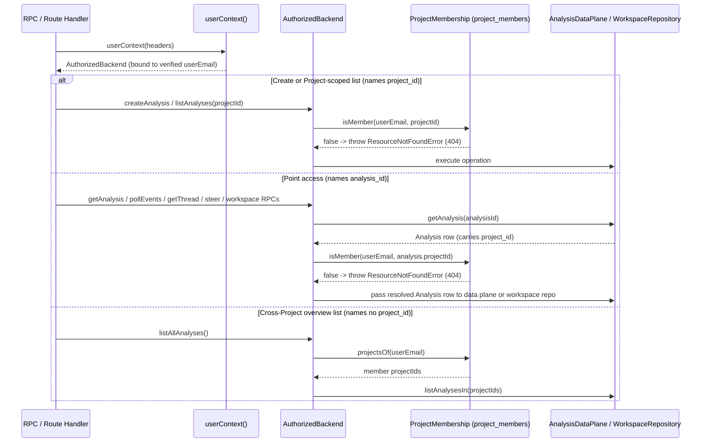

# Design: workspace model

**Related:** [`../PRODUCT.md`](../PRODUCT.md) (product-level workspace and data-governance invariants);
[`../../GLOSSARY.md`](../../GLOSSARY.md) (shared workspace vocabulary); [`analysis-scenarios.md`](analysis-scenarios.md)
(scenario-specific Analysis inputs and kickoff); [`workbench-workspace.md`](workbench-workspace.md) (how the working
document's git history is stored and published); [`document-widgets.md`](document-widgets.md) (structured widgets
embedded inside a working document); [`workbench-navigation.md`](workbench-navigation.md) (how Projects and Analyses are
listed and opened in the UI); [`conversation-view.md`](conversation-view.md) (how an Analysis's turn stream is projected
and steered); [`security.md`](security.md) (defense-in-depth and request authentication);
[`rpc-authorization.md`](rpc-authorization.md) (service-to-service session and person authorization).

## Overview

Clinical and rare-disease variant curation requires teams to collaborate with agents over sensitive patient cohorts
without leaking identifiable data across study boundaries. At the same time, curators need a way to separate exploratory
dialogue with an agent from the verified conclusions that other team members rely on, and a way to reuse scientific
knowledge across studies without pooling institutionally licensed publisher PDFs.

The workspace model organizes work around four entities:

- A **Project** is the access and data boundary that binds an explicit set of users to an explicit set of datasets.
- An **Analysis** is a collaborative session within a single Project, structured as an append-only tree of immutable
  conversation turns.
- A **working document** is the single evolving, versioned artifact produced inside an Analysis, backed by the commit
  history of the Analysis's workspace git repository.
- A **Report** is a human-approved snapshot of a working document promoted to the Project level and linked to a specific
  biological or clinical entity, such as a variant, gene, case, or individual.

Data access across Projects is denied by default. Only thresholded aggregate variant statistics, consent-triggering
existence notices, and human-completed patient matchmaking cross Project boundaries. Platform-wide facts extracted from
the literature are shared across all Projects with pointer-only citations, while resolving a citation to its full source
text is gated at access time by the reader's institutional licensing agreement. In the web tier, every user data access
passes through a single authorization wrapper that verifies Project membership and returns a uniform not-found response
to non-members, matching the Project scoping enforced on agent sessions.

## Background

Genomic medicine studies operate under ethics and governance agreements that restrict which researchers and clinicians
may inspect which patient samples. A cohort dataset such as CaRDinal may serve several distinct research initiatives at
once, while a single study may combine samples from multiple datasets. For example, an autism spectrum disorder (ASD)
research group may work within an ASD Project restricted to an ASD-specific subset of cases and the clinicians assigned
to that study. Because datasets and studies overlap without nesting cleanly, the relationship between datasets and
**Projects** is many-to-many.

Within a Project, curators work alongside an agent coordinator and its delegated sub-agents to investigate variants,
cases, and cohorts. Vocabulary mirrors Claude.ai's deliberately (familiar to users and to Anthropic; see
[`../../GLOSSARY.md`](../../GLOSSARY.md)). A **Project** provides the shared access boundary and overview surface. An
**Analysis** corresponds to a Claude.ai Chat session (with sub-agents) scoped to one Project. The Analysis's **working
document** corresponds to a Claude.ai artifact that evolves alongside the conversation, and an explicit human review
step promotes a revision of that working document into a Project-level **Report**.

## Design

### Entity hierarchy and lifecycle

```
  Datasets (e.g. CaRDinal)                Users (curators, clinicians)
             \                                       /
              \ M:N                             M:N /
               v                                   v
        ┌─────────────────────────────────────────────────┐
        │ Project (access & data boundary)                │
        │                                                 │
        │  ┌───────────────────────────────────────────┐  │
        │  │ Analysis (branching tree of turns)        │  │
        │  │   │                                       │  │
        │  │   └── 1:1 Working document                │  │
        │  │       (evolving workspace git history:    │  │
        │  │        commits c1 -> c2 -> c3)            │  │
        │  └──────────────────────────┬────────────────┘  │
        │                             │                   │
        │                             │ human accept-to-  │
        │                             │ publish (pins c3) │
        │                             v                   │
        │  ┌───────────────────────────────────────────┐  │
        │  │ Report (Project-private, 1 per entity)    │  │
        │  │   Linked to: variant / gene / case / ind. │  │
        │  │   Linearly versioned: v1 -> v2 -> v3      │  │
        │  └───────────────────────────────────────────┘  │
        └─────────────────────────────────────────────────┘
```

#### Analyses and branching turn trees

An **Analysis** is a collaborative working session bound to one Project and visible to all members of that Project. What
an Analysis focuses on depends on the curation scenario ([`analysis-scenarios.md`](analysis-scenarios.md)):

- **Variant-led**: investigating a specific genetic variant against a disease and inheritance mode.
- **Case-led (proband-led)**: investigating a clinical case comprising one or more focus samples and their relatives. An
  Analysis is often triggered by an unsolved case, though a focus sample is not required.
- **Discovery (cohort query)**: querying across the Project's associated datasets for candidate variants or cases.

During an Analysis, a curator often wants to test an alternative hypothesis or revise an earlier instruction without
destroying the existing line of investigation. An Analysis models its conversation as a **tree of immutable turns**.
Curators and agents append turns as work proceeds and branch from any earlier turn to explore an alternative direction.
Submitting an edit to an existing turn creates a new branch from that turn's unchanged parent rather than mutating the
turn in place. Curators can navigate between branches, and every branch is retained in history; an abandoned line of
inquiry can be archived to hide it from the default view, but it is never deleted.

Branching stays inside the same Analysis, matching Claude.ai's conversation branching semantics. Seeding an independent
Analysis from an existing one ("forking" or duplicating the Analysis) is a separate workspace action if needed.

#### Working documents and Project-level Reports

An obvious simplification would be to treat the Analysis's output document directly as the Project's record for the
variant or case under investigation. That breaks down because an Analysis is an active scratchpad: the agent pushes
intermediate drafts, explores tentative hypotheses, and rewrites sections as new evidence arrives, whereas other members
of the Project need a stable, human-reviewed conclusion for each biological or clinical entity.

The workspace model therefore separates the **working document** inside an Analysis from the **Report** at the Project
level:

| Property            | Working document                                               | Report                                                                      |
| ------------------- | -------------------------------------------------------------- | --------------------------------------------------------------------------- |
| **Scope**           | Bound 1:1 to a single Analysis                                 | Bound to the Project; one accepted Report per entity                        |
| **Purpose**         | Live, evolving draft ("the opinion formed" during curation)    | Validated, human-approved record surfaced in the Project overview           |
| **Entity linkage**  | Scoped to the Analysis's scenario inputs                       | Explicitly linked to Project entities (variant, gene, case, or individual)  |
| **Version history** | Every tip of the workspace repository's collaborative branch   | Linear version sequence (`v1`, `v2`, …) with no branching                   |
| **How it advances** | Every agent push or curator publish recorded in the git reflog | Explicit human **accept-to-publish** step pinning an exact working revision |

Each Analysis has one working document. Rather than enforcing a rigid database schema over the whole document, the
working document is prose markdown that uses lightweight structural contracts only where deep-linking requires them:
inline citations, evidence and provenance links, embedded widgets ([`document-widgets.md`](document-widgets.md)), and
the claims or verdicts that curator comments and execution traces anchor to.

The versions of a working document are the commit history of the Analysis's workspace git repository
([`workbench-workspace.md`](workbench-workspace.md)). Every tip that the repository's collaborative branch has held —
one per agent push or curator publish, recorded in the repository's reflog — is a complete revision that a reader can
open. Because the markdown and every widget or data file it embeds live in the same git tree, opening a historical
revision resolves every reference inside that commit.

When a curator finishes reviewing a working document revision, an explicit **accept-to-publish** step promotes that
revision to a Project-private **Report**. For example, when an Analysis on `SCN2A c.2558G>A` reaches workspace commit
`a4f91c2`, the curator accepts that revision to publish the Project's Report for `SCN2A c.2558G>A`. Accepting records
the exact commit `a4f91c2`, so the approved Report is reproducible: any future auditor sees the exact prose and the
exact embedded widget assets the reviewer approved. While multiple Analyses or branches may investigate the same entity,
the Project holds only one accepted Report per entity, advancing in a strictly linear version history with all prior
accepted versions retained for auditability.

### Cross-Project sharing is default-deny

A Project is a strict data boundary: by default, users and agent sessions in one Project can see only the datasets,
Analyses, and Reports belonging to that Project.

Complete isolation between Projects, however, would prevent rare-disease teams from discovering that a rare variant or
an undiagnosed patient has already been characterized in another study on the platform. Conversely, opening read access
across Projects would violate patient consent and study governance. The model resolves this tension by denying all
cross-Project access by default and permitting only three narrowly defined channels across Project boundaries:

1. **De-identified variant-level signals**: an Analysis may query whether a variant has been observed elsewhere on the
   platform and read aggregate counts or allele frequencies across other Projects, provided the underlying cohort meets
   a minimum cohort size and satisfies cohort-scale re-identification limits ([`../PRODUCT.md`](../PRODUCT.md) §9).
1. **Individual-level existence signals**: the platform may surface a binary notice that an accepted Report for a given
   individual exists in another Project. This signal reveals no clinical or genomic content; its sole purpose is to let
   a curator initiate a formal consent process that, once approved, grants further visibility.
1. **Consent-gated case-level matchmaking**: cross-patient or cross-case comparisons across Projects require explicit
   human consent. An agent may propose or trigger a candidate match based on de-identified signals, but a human must
   complete the consent and contact workflow before case details are shared.

#### Shared literature facts vs. institutionally licensed source texts

Scientific literature introduces a second boundary that cuts across Projects. Curators in different Projects — and at
different institutions — rely on the same published literature and public reference databases (such as gnomAD and
ClinVar). Pooling publisher PDFs or full-text articles across the whole platform would violate institutional library
subscriptions, because institutional licensing boundaries do not align with Project boundaries.

```
  ┌─────────────────────────────────────────────────────────────────────┐
  │ Platform-wide shared layer (accessible to all Projects)             │
  │  • Public reference databases (gnomAD, ClinVar)                     │
  │  • Extracted literature facts + provenance + pointer-only citations │
  │    (e.g. claim + doc_id pointer, never verbatim source text)        │
  └──────────────────────────────────┬──────────────────────────────────┘
                                     │ resolve citation to full text
                                     v
  ┌─────────────────────────────────────────────────────────────────────┐
  │ Institution-gated source layer (checked at access time)             │
  │  • Publisher PDFs and full-text renderings                          │
  │  • Gated by the user's institutional licensing agreement            │
  │  • Treated as untrusted content reached via controlled tools        │
  └─────────────────────────────────────────────────────────────────────┘
```

The workspace model separates **extracted facts** from **source documents**:

- **Facts cross Projects**: Themis maintains a platform-wide, provenance-tracked substrate of facts extracted from the
  literature, shared across all Projects alongside public reference databases. Every shared fact carries a citation that
  acts strictly as a pointer to its source document without embedding verbatim source text.
- **Full-text literature follows institutional licensing**: resolving a citation pointer to read the source full text or
  verify the exact passage is gated at access time on the user's institutional licensing agreement
  ([`literature-evidence-layer.md`](literature-evidence-layer.md), [`supplied-papers.md`](supplied-papers.md)). Themis
  never pools or redistributes licensed literature across institutions. Sources are *untrusted content*
  ([`../PRODUCT.md`](../PRODUCT.md) §9), reached through a curated, controlled tool surface.

### Authorization

Because a curator can belong to multiple Projects, every operation in the workbench must establish which Project it acts
within and verify that the caller is a member of that Project.

An obvious implementation is to check Project membership inside each RPC handler and return `PERMISSION_DENIED` (HTTP
403\) when a user is not a member. That approach has two flaws. First, any handler that omits the check creates an
authorization bypass. Second, returning a 403 Forbidden response for a valid Project or Analysis ID while returning 404
Not Found for an unknown ID allows a caller to probe whether a Project or Analysis exists outside their membership,
violating the cross-Project existence-hiding rule above.

#### Single default-on chokepoint

The web BFF enforces Project authorization at a single default-on chokepoint
([`apps/web/src/server/authorized-backend.ts`](../../apps/web/src/server/authorized-backend.ts)), sitting immediately
below request authentication ([`security.md`](security.md), [`frontend-framework.md`](frontend-framework.md)):



The chokepoint relies on two collaborating abstractions in
[`apps/web/src/server/ports.ts`](../../apps/web/src/server/ports.ts):

- **`AuthorizedBackend`** wraps the raw `AnalysisDataPlane` and `WorkspaceRepository` for a single verified user. The
  request-context factory [`userContext`](../../apps/web/src/server/context.ts) is its only constructor, and the raw
  ports are kept module-private inside `context.ts`, so a route handler cannot obtain an unscoped backend.
  - **Operations that name a Project** (`createAnalysis`, `seedDocument`, `listAnalyses`) verify membership in the named
    Project before touching the data plane. `listProjects` queries the user's membership directly to populate Project
    selectors.
  - **Point accesses that name an Analysis** (`getAnalysis`, `pollEvents`, `getThread`, `steerAnalysis`,
    `interruptAnalysis`, and the workspace repository methods) load the Analysis row first and check the caller's
    membership against the `project_id` on that row. Even when a stored Analysis row fails protobuf decoding, the error
    carries the row's `project_id` so `AuthorizedBackend` still runs the membership check and returns not-found to
    non-members. Once authorized, `AuthorizedBackend` passes the resolved `Analysis` row directly to the underlying
    `AnalysisDataPlane` and `WorkspaceRepository` methods. Because the workspace repository port accepts only a resolved
    `Analysis` object rather than a raw ID, workspace access cannot bypass the membership check, and methods like
    `pollEvents` avoid reading the `analyses` row a second time on every polling tick.
  - **Cross-Project listing** (`listAllAnalyses`, which feeds the Projects overview page) takes no Project parameter and
    performs no post-hoc check; instead, it queries `projectsOf(userEmail)` and fetches Analyses only within that set.
    Its safety rests on being authorized by construction, which means code review must reject any parameter that would
    narrow or widen its Project scope.
- **`ProjectMembership`** represents the mapping between users and Projects, backed in production by the
  `project_members(project_id, user_email)` table
  ([`themis/migrate/migrations/0005_project_members.sql`](../../themis/migrate/migrations/0005_project_members.sql)) and
  offline by a seeded fixture map. Membership is binary: there is no role column, because no access decision consults
  one. An empty membership set grants access to nothing, so a freshly deployed environment fails closed until
  `project_members` rows are seeded.

Answering every non-member check with `ResourceNotFoundError` (mapped to `not_found` / HTTP 404) rather than a
permission-denied error guarantees that an unauthorized caller receives the exact same response for another Project's ID
as for an ID that does not exist.

#### Symmetry between user and agent authorization

The user-plane check in `AuthorizedBackend` mirrors the session-plane check used for agent tool calls
([`rpc-authorization.md`](rpc-authorization.md)). When `createAnalysis` inserts an `analyses` row, it atomically inserts
a grant row into `session_context(token_hash, project_id, analysis_id)`
([`themis/migrate/migrations/0001_session_context.sql`](../../themis/migrate/migrations/0001_session_context.sql)).
Backend data-plane services resolve the agent's bearer token through the auth service to that `session_context` row to
scope the agent's data access to `project_id`, just as the BFF resolves the human caller through `project_members` to
scope the browser's access to `project_id`.

### Interaction model (the workbench it grows into)

- **Up-front planning with the human** — refining the question and goals before heavy execution.
- **High-level async steering, not turn-by-turn micromanagement** — sub-agents work asynchronously; the human steers at
  the coordinator level and can drill down into sub-agent threads when they want to
  ([`conversation-view.md`](conversation-view.md)).
- **Bidirectional intervention** — the agent proactively asks the human when it hits roadblocks, ambiguities, or
  prioritization choices; the human can steer or interrupt at any point.
- **Highlighting uncertainty** — the agent explicitly flags contentious or uncertain points for human review rather than
  papering over them.
- **Dead ends are signal** — ruled-out hypotheses and negative findings are first-class content in the Analysis /
  working document, not scrubbed.

### Beyond the MVP

Not built in the initial slice, but part of the target shape the workspace model is designed to accommodate:

- **Epistemic status on claims** — richer than a binary "hypothesis vs. fact" split (even "facts" in literature or
  clinical reports can be wrong); likely a progression (`working hypothesis` → `supported` → `established`) paired with
  provenance (`observed` / `inferred` / `assumed`, cf. [`../PRODUCT.md`](../PRODUCT.md) §6).
- **Lightweight inter-curator flags and variant notes** — quick annotations within a Project (analogous to `seqr` flags
  and notes), distinct from full Reports.
- **Cross-case variant memory** — reusing prior work on a variant when it appears in a new case, with explicit tracking
  of the assumptions under which the prior conclusion held so it can be re-evaluated or invalidated when new evidence
  arrives (within a Project directly; across Projects via the de-identified / consent-gated channels above).
- **Lines-of-evidence separation** — cleanly distinguishing case-derived evidence (specific to one proband/family) from
  variant/gene-attached evidence (reusable across cases) and public evidence.

## Open questions

- **Qualifying cross-Project aggregations**: which exact aggregation thresholds and de-identification rules qualify a
  variant-level or cohort-level signal to cross Project boundaries (tied to the sensitivity tiers in
  [`../PRODUCT.md`](../PRODUCT.md) §9).
- **Establishing institutional affiliation for literature access**: how a user's institutional affiliation is verified
  and trusted when gating access to licensed full-text sources (supplied paper uploads currently rely on user-declared
  affiliation; see [`supplied-papers.md`](supplied-papers.md)).
- **Reconciling diverged branches into a linear Report**: how the accept-to-publish workflow reconciles two branches (or
  two concurrent Analyses) that have diverged while curating the same Project entity.
- **Whether an Analysis's inputs can change under it**: the lean is that changed input data means a new Analysis, with a
  manifest of the inputs recorded in the database when the Analysis starts. Until then, a working document revision's
  reflog time says when it was current, so it can be matched against when an input changed.
